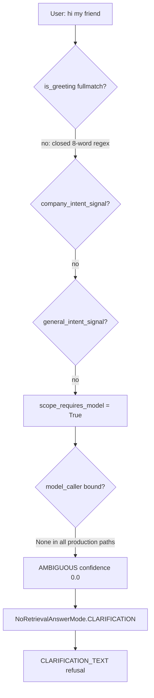

# Agent Brain Repair and God-File Split

> **Superseded on 2026-08-26.** Its complete requirements are incorporated
> into [`scope_graph_nodes_916779e1.plan.md`](./scope_graph_nodes_916779e1.plan.md),
> which is the sole execution plan for this repair and cleanup.

## Root cause

`"hi my friend"` produced a clarification refusal because three defects stack. The refusal text itself is a lie: nothing was mixed.



Verified by running the classifier: `hi my friend`, `hey there`, `good day`, `how are you?`, `thanks a lot`, `What is the capital of Japan?`, and `What is the refund period?` all return `ambiguous` / `clarification`. The agent only works today for queries that trip a hardcoded lexical company signal or an exact mock fixture.

- **Defect 1** — [signals.py](packages/core/src/smart_rag_core/query_routing/signals.py) `_GREETING` is a `fullmatch` over 8 literals, so any social opener with a trailing word fails.
- **Defect 2** — the preparation model that is supposed to classify everything else does not exist end to end: `QueryGraphDeps.model_caller` is never set by [live_runtime.py](apps/agents/src/smart_rag_agents/query/live_runtime.py) or [query_graph_runtime.py](apps/backend/src/smart_rag_api/services/query_graph_runtime.py); `QueryProfileModelRequest`/`Response` in [model.py](packages/core/src/smart_rag_core/gateways/model.py) carry no `knowledge_scope` field even though [query_profile_v1.md](apps/agents/src/smart_rag_agents/prompts/query_profile_v1.md) instructs the model to emit one; `OpenAIModelAdapter.generate_query_profile` raises `query_profile_openai_not_configured` unconditionally; and `MockModelAdapter` returns a bare `ModelInferredProfile()`.
- **Defect 3** — "no signal at all" is encoded as `AMBIGUOUS` with `company_signal=False, general_signal=False`, which is semantically the opposite of ambiguity.

Two plan-conformance mismatches also exist. First, P06-10 step 2.3 and P06-12 require a full greeting to be `DETERMINISTIC` with a zero-cost canned reply, but the code returns `GENERAL_KNOWLEDGE`; per the user's explicit direction this plan resolves the mismatch the other way — amend the packets by ADR so greetings are classified by the preparation model and answered naturally by the general-chat model, not by a canned template. Second, `_extension_for_scope` forces `NO_RETRIEVAL` for `AMBIGUOUS` so a clarification can never be reconsidered.

## Plan governance

P06-09 through P06-15 are all unchecked in [06-phase-agent-intelligence.md](.cursor/plans/hybrid-graph-rag/06-phase-agent-intelligence.md) while evidence is already written for each, and [the evidence file](docs/development/phase-06-agent-intelligence-evidence.md) admits _"Unverified: live preparation-model scope quality on OpenAI."_ This work is a remediation of P06-10 and P06-12 before those packets can be checked. Three items need an ADR plus explicit approval before coding, because they change cost and acceptance criteria:

- Enabling a live counted `usage_kind="profile"` call on the query path. Budgeting is fully in place already: `FAMILY_MODEL_CALL_CEILING` covers it (Hybrid 7 spans "profile/answer/verifier/correction"), and `USAGE_KIND_USD_CAPS` in [ceilings.py](packages/core/src/smart_rag_core/query_admission/ceilings.py) caps `profile` at 0.08 USD per call with 4000-input/1500-output token bounds. No migration or new cap is needed; only real spend changes.
- Softening P06-10 step 2.9. That step mandates `AMBIGUOUS` whenever the prep model is unavailable, invalid, or below 0.80 confidence, which is exactly what makes the product unusable when the gateway is mock or down. The packet's acceptance fixture list repeats the mandate ("Low-confidence, invalid, or unavailable scope output → `AMBIGUOUS`"), so the ADR must amend both the step and the fixture, defining graceful degradation instead of a blanket refusal.
- Abandoning the deterministic zero-cost greeting. P06-10 step 2.3 makes a full-message greeting `DETERMINISTIC`, and P06-12 fixes "Hi" to a canned reply with zero model calls ("pure greeting such as 'Hi' remains a short deterministic response with zero model calls" plus the fixture "'Hi' → deterministic origin, zero model/retrieval/verifier calls"). Per the user's explicit direction, greetings instead flow through the preparation model for classification and the general-chat model for a natural reply, so a pure greeting costs roughly two counted calls. The ADR must amend both packets' steps and fixtures and record the cost change.

## Part A — Repair the brain

### A1. Route greetings through the model; keep the regexes as mock heuristic and guards

Per the user's direction, greetings are no longer settled deterministically. Remove the `is_greeting` early return from `classify_knowledge_scope` and the greeting bail-out from `scope_requires_model` in [knowledge_scope.py](packages/core/src/smart_rag_core/query_routing/knowledge_scope.py), so a pure greeting reaches the one counted preparation call and is classified by the model like any other natural-language message.

`is_greeting` in [signals.py](packages/core/src/smart_rag_core/query_routing/signals.py) is still needed in three places, so keep it a whole-message match but widen it to real conversational openers: optional leading interjection, the existing greeting words plus `salam`/`good day`/`greetings`/`yo`/`howdy`, an optional address such as `my friend`/`there`/`buddy`/`team`, optional trailing punctuation and emoji, and Arabic forms (`مرحبا`, `السلام عليكم`, `اهلا`). Add a sibling `is_small_talk` for `how are you`, `what's up`, `nice to meet you`, `good to see you`. The three retained roles:

- The mock adapter's offline classification heuristic (A4), so mock mode stays deterministic with no network.
- A memory-follow-up guard: a greeting is never a company follow-up, so `has_company_followup_memory` evidence must not hijack `"hi"` sent right after a cited company answer into `COMPANY_DOCUMENTS` retrieval or an `AMBIGUOUS` clarification. Keep greetings inside `general_intent_signal` (or an equivalent guard) so that path still requires the model.
- The existing fallback mapping in `_resolve_no_retrieval_mode` in [generate.py](packages/core/src/smart_rag_core/query_answer/generate.py).

Keep the existing invariant that a greeting _prefix_ on a substantive question is not a match, so `"Hi, what is our refund period?"` still reaches retrieval via its company signal with zero prep-call involvement.

### A2. Carry `knowledge_scope` through the profile gateway contract

In [model.py](packages/core/src/smart_rag_core/gateways/model.py):

- Add to `QueryProfileModelRequest` the fields the other live adapters already have: `prompt_text`, `model_id`, `remaining_deadline_seconds`, and bounded delimited `recent_memory`.
- Replace `QueryProfileModelResponse.inferred: ModelInferredProfile` usage with an additive payload that can carry scope. Mirror `GeneralChatModelResponse`: `payload: dict[str, object]`, `request_id`, `input_tokens`, `output_tokens`, `model_calls: Literal[1]`, `retrieval_performed: Literal[False]`. Keep `inferred` for backward compatibility with the offline profile runner if any caller depends on it, otherwise remove it and update callers.
- Add `query_profile_json_schema()` to [schemas.py](packages/core/src/smart_rag_core/query_answer/schemas.py) (or a new `query_profile/schemas.py` to respect package boundaries) with strict `additionalProperties: false` covering exactly the `PreparationModelPayload` fields: `rewrite`, `query_type`, `subquestions`, `variants`, `hl_keywords`, `ll_keywords`, `retrieval_profile_id`, `metadata_filters`, `confidence`, `relationship_intent`, `knowledge_scope` (enum of the five `KnowledgeScope` values), `knowledge_scope_confidence`. Enforce the existing max-3 bounds in the schema, not only in Pydantic.

The prompt already asks for `knowledge_scope`, so `query_profile_v1.md` and `PROFILE_PROMPT_SHA256` do not change.

### A3. Live OpenAI profile adapter

Add `packages/core/src/smart_rag_core/gateways/openai_profile.py`, mirroring [openai_general_chat.py](packages/core/src/smart_rag_core/gateways/openai_general_chat.py) exactly: pinned prompt version/SHA check, allow-listed model check, `traced_openai_client(max_retries=0, timeout=...)`, `store=False`, strict `json_schema` response format, no tools, and typed failures. Add `query_profile_responses_traceable` alongside `general_chat_responses_traceable` in [langsmith_tracing.py](packages/core/src/smart_rag_core/observability/langsmith_tracing.py) so the span is redacted.

Add `PROFILE_MODEL_ID` and `ALLOWED_PROFILE_MODEL_IDS` to [query_profile/versions.py](packages/core/src/smart_rag_core/query_profile/versions.py) next to the existing `PROFILE_PROMPT_*` pins, reusing the existing `gpt-4o-mini` rather than introducing a new model name (precedent: `openai_general_chat.py` reuses `ALLOWED_ANSWER_MODEL_IDS` from `query_answer/versions.py`; the profile adapter gets its own allow-list because its version pins already live in `query_profile/versions.py`). Then replace the unconditional refusal:

```1055:1067:packages/core/src/smart_rag_core/gateways/model.py
    async def generate_query_profile(
        self, request: QueryProfileModelRequest
    ) -> QueryProfileModelResponse:
        """Refuse live profile calls in this packet.
        ...
        raise ModelGatewayUnavailableError("query_profile_openai_not_configured")
```

### A4. Deterministic mock fixtures that can classify scope

`MockModelAdapter.generate_query_profile` currently returns `ModelInferredProfile()` with no scope, so even a wired mock caller yields `None` and falls back to `AMBIGUOUS`. Make it return a payload whose `knowledge_scope` and `knowledge_scope_confidence` come from a deterministic no-network heuristic: greetings and small talk (the A1 regexes) classify as `general_knowledge` at confidence `0.95`, reuse `company_intent_signal` / `general_intent_signal` / `is_user_text_transform` for the rest, and default an ordinary interrogative with no company signal to `general_knowledge` at confidence `0.85`. No DNS, no provider call.

### A5. Bind `model_caller` in every production path

In `build_query_graph_deps` in [live_runtime.py](apps/agents/src/smart_rag_agents/query/live_runtime.py), construct the adapter and set `model_caller`. `prepare_query` invokes the caller through a synchronous `send` thunk inside `execute_counted_model_call`, so the adapter must be sync and drive the async gateway the same way [pipeline.py](apps/agents/src/smart_rag_agents/query/nodes/pipeline.py) `_gateway_general_chat` already does via `_run_coro`. It must map the gateway JSON payload into `PreparationModelPayload` and let malformed output raise `ValueError` so `prepare_query` records `profile_malformed` rather than fabricating a profile.

Also add `query_profile_prompt_text` to `QueryGraphProcessBindings` and `QueryGraphDeps`, bound next to `answer_prompt_text`; the `query_profile_prompt_text()` registry accessor already exists in [prompts/\_\_init\_\_.py](apps/agents/src/smart_rag_agents/prompts/__init__.py), so only the two binding fields are new. Budget wiring needs no change: `prepare_query` already consumes through `execute_counted_model_call` with `usage_kind="profile"`, and the 0.08 USD per-call cap is verified (see Plan governance).

One gap the current call site hides: `prepare_query_node` in [pipeline.py](apps/agents/src/smart_rag_agents/query/nodes/pipeline.py) never passes `model_id`, so usage records would carry the default `"query-profile-mock-v1"` even when the live adapter runs. Thread the real model id through — either pass `deps`-provided `model_id` at the call site or add a `profile_model_id` field to `QueryGraphDeps` — so the durable usage row names the model that was actually called.

### A6. Honest, graceful behavior when scope is genuinely unresolved

Per the ADR from Plan governance, change `classify_knowledge_scope` so:

- Real conflict (`company_signal and general_signal`) stays `AMBIGUOUS` and keeps the clarification text.
- Model unavailable, malformed, or below `SCOPE_CONFIDENCE_THRESHOLD` no longer collapses into the same bucket. Return a distinct outcome that degrades to the best safe answer path instead of refusing: a general-knowledge answer that explicitly states it did not search company documents. `company_claim_forbidden` stays `True`, citations stay empty, and `filter_invented_ids` still guards the document path, so no grounding invariant weakens.
- Greetings and small talk are classified by the preparation model (mock heuristic in mock mode) and answered by the general-chat model, per ADR deviation 3. Map `KnowledgeScope.DETERMINISTIC` to `NoRetrievalAnswerMode.GENERAL_MODEL` in `no_retrieval_mode_for_scope` so that even if the live model emits `deterministic` (the pinned prompt lists it as a valid enum value, and the prompt SHA must not change), the reply still comes from the general-chat LLM rather than the canned `GREETING_TEXT` template. Retire `GREETING_TEXT`/`DETERMINISTIC_CHAT` from the live path; a pure greeting costs one profile call plus one general-chat call.

Rewrite `CLARIFICATION_TEXT` in [generate.py](packages/core/src/smart_rag_core/query_answer/generate.py) so it is only ever emitted for a genuine mixed-scope query, and add a separate honest message for the degraded path — the existing `GENERAL_DOCUMENT_REFUSAL` constant directly beneath it already carries the right framing ("I can answer general questions from model knowledge, but I cannot claim to have searched company documents") and is the starting point. Reconsider `_extension_for_scope` in [preparation.py](packages/core/src/smart_rag_core/query_routing/preparation.py) so an unresolved scope is not permanently pinned to `NO_RETRIEVAL`.

## Part B — Split the god files

Structural changes only. No behavior change, and each split lands with the existing suites green.

- **[pipeline.py](apps/agents/src/smart_rag_agents/query/nodes/pipeline.py), 1672 lines, 27 top-level functions.** It holds all nine node bodies plus four async gateway bridges, token accounting, state deserialization, and LangSmith flushing; `generate_answer_node` alone is ~255 lines. Split into `nodes/memory.py`, `nodes/prepare.py`, `nodes/plan.py`, `nodes/retrieve.py` (`execute_branches` + `apply_correction`), `nodes/fuse.py` (`fuse_evidence` + `compose_tables`), `nodes/answer.py`, `nodes/verify.py`, plus `nodes/gateway_bridge.py` for `_gateway_answer`/`_gateway_general_chat`/`_gateway_verifier`/`_gateway_timeout_seconds`/`_run_coro`/`_flush_langsmith_traces`, `nodes/state_codec.py` for `_fusion_from_state`/`_tables_from_state`/`_memory_text_from_state`, and `nodes/tokens.py` for the token helpers. Keep `nodes/__init__.py` re-exporting every current public name so [graph.py](apps/agents/src/smart_rag_agents/query/graph.py), `studio.py`, and `studio_live.py` need no edits. Extract the three fat early-return blocks inside `generate_answer_node` (`retrievers_unbound`, `model_call_exhausted`, `deadline_exhausted`) into named guard helpers.
- **[branches.py](packages/core/src/smart_rag_core/query_routing/branches.py), 1186 lines, 24 symbols.** Move `HybridRetrieveLike`/`GraphRetrieveLike`/`TableExecuteLike` into `query_routing/protocols.py`; move the seven result-shredding helpers (`_hybrid_evidence`, `_graph_snapshots`, `_table_evidence`, `_ranked_ids`, `_coverage_bits`, `_limitation_codes`, `_fallback_reason_text`) into `query_routing/branch_results.py`; move `_run_hybrid`/`_run_graph`/`_chunk_loader`/`_load_chunk_contexts`/`_graph_bounds`/`_run_async` into `query_routing/branch_channels.py`; leave `execute_branches`/`_run_spec`/`_inherited_result` plus `_attach_retrieve_budget`, the blindness helpers, `inherit_ids`, and `empty_keyword_guard` in `branches.py`. This also removes the reason the `# isort: off` import-cycle guards exist in `deps.py` and `live_runtime.py`.
- **[matrix.py](packages/core/src/smart_rag_core/query_routing/matrix.py), 674 lines.** `_matrix_case` is a single 12-branch decision tree. Convert it to an ordered tuple of named predicate/handler rules so precedence is data, not nesting depth, and each row is unit-testable. Precedence order must not change. Move `_hybrid_branch`/`_graph_branch`/`_citation_branch` into `query_routing/branch_specs.py`.

Out of scope for this pass, recorded for a follow-up: `query_admission/service.py` (903), `studio_live.py` (829), `live_runtime.py` (677).

## Verification

```powershell
uv run pytest tests/unit/test_knowledge_scope.py tests/unit/test_query_routing_matrix.py tests/unit/test_query_correction.py tests/unit/test_query_profile.py tests/contract/test_query_preparation.py -q
uv run pytest tests/unit/test_general_chat_gateway.py tests/unit/test_general_chat_generate.py tests/unit/test_answer_verifier.py tests/unit/test_query_graph_runtime.py tests/unit/test_query_sse_mapping.py tests/unit/test_prompt_registry.py -q
uv run pytest tests/unit/test_query_sse_executor.py tests/unit/test_model_gateway.py -q
uv run ruff format --check . ; uv run ruff check packages/core/src/smart_rag_core/query_routing packages/core/src/smart_rag_core/query_profile packages/core/src/smart_rag_core/query_answer packages/core/src/smart_rag_core/gateways apps/agents/src/smart_rag_agents/query
uv run pyright packages/core/src/smart_rag_core/query_routing packages/core/src/smart_rag_core/query_profile packages/core/src/smart_rag_core/gateways apps/agents/src/smart_rag_agents/query
```

New and extended tests:

- `tests/unit/test_knowledge_scope.py` (extend the existing suite): every probe phrase from the Root cause section resolves to a usable route, no `clarification`; a real mixed query still returns `AMBIGUOUS`; a full greeting reaches the preparation model, classifies as general, and maps to `GENERAL_MODEL` (never the canned template); `"hi"` sent right after a cited company answer is still a greeting, not a company follow-up; company signals still override a malicious model `general_knowledge`; isolated `policy` is still not a company signal.
- `tests/unit/test_query_profile_gateway.py`: mock mode performs no DNS; live adapter enforces prompt version/SHA, model allow-list, `store=False`, `max_retries=0`, strict schema; malformed payload raises rather than fabricating.
- `tests/contract/test_query_preparation.py`: exactly one counted `profile` call when the model runs (greetings included) and zero when a deterministic company or user-text signal settles scope; a second call still raises `separate_rewrite_call`.
- An architecture test asserting the `nodes/` and `query_routing/` splits introduce no forbidden imports and no module exceeds the agreed line budget.

## Documentation

Update in the same change: a new ADR for the three deviations; [docs/agent/QUERY_ADMISSION.md](docs/agent/QUERY_ADMISSION.md) and the routing/scope docs for the new classification table and degraded path; [prompts/CHANGELOG.md](apps/agents/src/smart_rag_agents/prompts/CHANGELOG.md) if any prompt body changes; [docs/README.md](docs/README.md) index for new files; and a P06-10/P06-12 remediation section in [phase-06-agent-intelligence-evidence.md](docs/development/phase-06-agent-intelligence-evidence.md) with the classification fixtures, model-call counts, exact commands and exit codes, deviations, and rollback.
