# Answer-loss and query-latency repair

The only index for this work. It merges the query-latency plan into the
answer-loss plan so both run on one branch in one order, with no
conflicting edits.

Every run reads one rules file and **exactly one** packet:

- `A*` packets: read
  [`answer-loss-repair/00-rules-and-commands.md`](./answer-loss-repair/00-rules-and-commands.md),
  then the packet.
- `L*` packets: read
  [`query-latency-repair/00-rules-and-commands.md`](./query-latency-repair/00-rules-and-commands.md),
  then the packet.

Nothing else in `.cursor/plans/` is needed. The old latency index
[`query_latency_repair_3f9c2a61.plan.md`](./query_latency_repair_3f9c2a61.plan.md)
is kept as background only; do not follow its order or branch.

Decision record:
[`docs/adr/ADR-retrieved-answer-loss-repair.md`](../../docs/adr/ADR-retrieved-answer-loss-repair.md)
(accepted 2026-09-24). Measured evidence:
[`docs/evaluation/ANSWER_ONLY_50_ROOT_CAUSES_2026-09-24.md`](../../docs/evaluation/ANSWER_ONLY_50_ROOT_CAUSES_2026-09-24.md).

## Packets, in run order

|   # | Packet | File                                                                                                      | Fixes                                                                 | Depends on       |
| --: | ------ | --------------------------------------------------------------------------------------------------------- | --------------------------------------------------------------------- | ---------------- |
|   1 | A0     | [A0-branch-and-unseen-set.md](./answer-loss-repair/A0-branch-and-unseen-set.md)                           | Branch, redaction, draft PR, unseen set written before any fix        | D1, D4           |
|   2 | A1     | [A1-answer-v4-claims-contract.md](./answer-loss-repair/A1-answer-v4-claims-contract.md)                   | Bookkeeping losses (7) and direct-answer losses (6)                   | A0, D2           |
|   3 | A2     | [A2-hybrid-timings-and-rerank-subcodes.md](./answer-loss-repair/A2-hybrid-timings-and-rerank-subcodes.md) | No per-stage timings; rerank failure reason unknown                   | A1, D3           |
|   4 | L0     | [L0-latency-report-and-baseline.md](./query-latency-repair/L0-latency-report-and-baseline.md)             | No repeatable latency report (timer edits skipped)                    | A2               |
|   5 | L1     | [L1-sse-event-loop-unblock.md](./query-latency-repair/L1-sse-event-loop-unblock.md)                       | 50 ms synchronous poll blocks the loop and the event-store lock       | L0               |
|   6 | L2     | [L2-event-store-pool.md](./query-latency-repair/L2-event-store-pool.md)                                   | All runs share one event-store session and lock                       | L1               |
|   7 | L3     | [L3-ordered-event-writer.md](./query-latency-repair/L3-ordered-event-writer.md)                           | Graph waits about 0.25 s for each of about 28 event writes            | L2               |
|   8 | L4     | [L4-pipelined-append.md](./query-latency-repair/L4-pipelined-append.md)                                   | 3 round trips per append (runs only if L3's report meets its trigger) | L3               |
|   9 | A3     | [A3-rerank-v2-compact-labels.md](./answer-loss-repair/A3-rerank-v2-compact-labels.md)                     | Rerank output too long to finish (completed 14/50)                    | A2, L3 or L4     |
|  10 | A4     | [A4-long-document-v3-profile.md](./answer-loss-repair/A4-long-document-v3-profile.md)                     | Fallback order drops dense hits (8 + 2 of 4 pool)                     | A3               |
|  11 | A5     | [A5-rerank-window.md](./answer-loss-repair/A5-rerank-window.md)                                           | Channels consume the slice before rerank starts                       | A4, D5           |
|  12 | A6     | [A6-pdf-hyphen-reflow-v4.md](./answer-loss-repair/A6-pdf-hyphen-reflow-v4.md)                             | U+2010 / U+00AD line-break splits                                     | A5               |
|  13 | A7     | [A7-navigation-page-exclusion.md](./answer-loss-repair/A7-navigation-page-exclusion.md)                   | Contents and index pages crowd the pool                               | A6               |
|  14 | A8     | [A8-reingest-book.md](./answer-loss-repair/A8-reingest-book.md)                                           | Apply A6 and A7 to the stored book                                    | A7, D6           |
|  15 | A9     | [A9-rerun-and-acceptance.md](./answer-loss-repair/A9-rerun-and-acceptance.md)                             | Full proof runs, latency report, evidence doc                         | all above        |
|  16 | A10    | [A10-ship-pr-merge.md](./answer-loss-repair/A10-ship-pr-merge.md)                                         | Green checks, merge, delete branch                                    | A9 + user "ship" |

Not in this plan: latency **L5** (dropped; A3 ships `rerank_v2`), **L6**
(pooled query connections) and **L7** (shorter answers), which were never
written and need their own approval, and **L8/L9** (replaced by A9/A10).
Never start L5, L6, or L7.

### Why this order has no conflicts

- The only files both plans edit are the Hybrid timer files
  (`hybrid_run/types.py`, `retriever.py`, `adapters_hybrid.py`,
  `results.py`, `branch_channels/hybrid.py`, `eval_ask_stage_export.py`,
  and two Hybrid test files). A2 owns them; L0 skips its Edits 1-7, 12e,
  and 12f, and its latency report reads A2's `stage_timings_ms`.
- L1-L4 edit only SSE, event-store, and executor files; no `A*` packet
  touches them.
- A3-A5 quote current code in files L0-L4 never change, so their line
  anchors stay valid after the latency packets.
- The latency probe's `L0` line checks A2's `HYBRID_STAGE_TIMING_KEYS`.

## Decisions (all answered 2026-09-24)

A packet whose "Depends on" names a decision checks its **Answer** line
and stops if it does not match what the packet expects.

### D1 - PR #17 before this branch

**Answer:** resolved. PR #17 was merged on 2026-09-24 at 08:55 UTC
(merge commit `148c44f`). A0 cuts `fix/answer-loss-repair` from `main`.

### D2 - `answer_v4` schema form (A1)

The ADR said the citation ID is a per-request enum. OpenAI charges a
one-time processing cost the first time a strict schema is used ("Typical
schemas take under 10 seconds to process on the first request, but more
complex schemas may take up to a minute",
[Introducing Structured Outputs](https://openai.com/index/introducing-structured-outputs-in-the-api/)),
so a per-request enum would pay it on almost every call.

**Answer:** approved 2026-09-24: **one fixed schema**, no per-request
enum. Application code drops any source ID that was not sent. A1
amends ADR Fix 1 items 1 and 2.

### D3 - Overlap with the query-latency plan

**Answer:** approved 2026-09-24: **this plan owns** the Hybrid timers
(A2) and `rerank_v2` (A3). The latency plan is merged into this index:
L0 runs trimmed (no timer edits), L1-L4 run after A2, L5 is dropped, L6
and L7 are out of scope. The latency files were updated to match.

### D4 - Eval docs that list expected answers

`docs/evaluation/ANSWER_ONLY_50_2026-09-24.md` lists the expected fact
for every question; `docs/evaluation/FRESH_KNOWN_ANSWER_50_2026-09-23.md`
describes each miss in words. Rule 10 forbids gold phrases in tracked
files.

**Answer:** approved 2026-09-24: **redact**. A0 Step 2b drops the
expected-answer and answer-text columns with a private helper and adds a
one-line note; on copies this took the leak check from 45 and 15 hits
(FAIL) to at most 3 per set (WARN).

### D5 - Rerank-window numbers (A5)

**Answer:** approved 2026-09-24 **as a rule**:
`CHANNEL_PHASE_RESERVE_SECONDS` = p90 of A2's `post_channel_ms`
(`assemble_ms + temporal_load_ms + pool_preload_ms`), rounded up to the
next 0.5 s; `CHANNEL_MIN_SECONDS` = 2.0. A5 stops instead if the
resulting channel deadline is below the p90 of `channel_dense_ms`. A5
writes the computed value here.

### D6 - Re-ingest path (A8)

The code cannot add a version to an existing document (every upload
inserts a new document, finalize refuses duplicate bytes, no RPC
restores a deleted document). The only path is to soft-delete the
current book document and upload the same PDF as a new document: new
document and chunk IDs, no restore of the old copy (rollback = revert
A6/A7 and upload again), and the book is unsearchable during the ingest.

**Answer:** approved 2026-09-24. A8 continues without asking and amends
ADR Fix 4 step 4.

### Scoped long-document route (A4)

**Answer:** approved 2026-09-24: questions scoped to one long document
also route to v3 (both routes use v2 today and lose answers the same
way). Only unit tests cover the scoped route. Recorded in the ADR.

## Branch, commits, image

- One branch: `fix/answer-loss-repair`, cut from `main` in A0. A0 commits
  both plans' files. One commit per packet, pushed immediately;
  `gh pr checks --watch --fail-fast` must exit 0 before the next packet.
- The eval calls the laptop Compose API on `http://127.0.0.1:8000`, which
  runs code baked into the `api` image. A live run counts only after a
  rebuild and a probe that prints the packet as `present`. `A*` packets
  use the rules file's one-line probe; `L*` packets use
  `scripts/probe_latency_image.py` (added in L0).
- The unseen set is sealed in A0 and used again only in A9 (rule 14 in
  the answer-loss rules file).
- A8 re-ingests the book, which changes the document and chunk IDs.
  Per-question stage traces from before A8 stop applying after it; that
  is why ingestion is last. A8 also rebuilds the parser image and
  restarts the worker (`scripts/dev.ps1`), not only `api`.

## Why 29 of 50 are lost (measured 2026-09-24, IDs and counts only)

- Every fact is in the stored chunk text (50 of 50). Dense search has a
  chunk holding it in its top 100 on 50 of 50 and in its top 12 on 45
  of 50. Fused top 100: 48. Rerank pool of 20: 44. Final evidence: 35.
  The generated answer stated the fact on 28; 21 were scored right.
- First losing stage per miss: bookkeeping removed a generated right
  answer (7), released claims dropped the asked term (2), rerank did not
  complete and the fallback order dropped a pooled fact chunk (8), fused
  rank outside the 20-passage pool (4), evidence present but a different
  fact stated (4), deadline before generation (2), dense rank below 60
  (2, not targeted).
- Rerank completed on 14 of 50 runs (44 of 50 fell back on the previous
  fresh set). When it completed, it placed 12 of 12 pooled fact chunks
  in final evidence.
- Ingestion is secondary: the root-cause doc counts 2,732 U+2010
  line-break splits and 87 navigation-page chunks in the stored book.
- Latency (from the latency plan, fresh-50 of 2026-09-23): server time
  mean 44.9 s, p90 51.9 s, 4 of 50 deadline runs; about 11-14 s per run
  is SSE and event-store plumbing (each event write about 254 ms, one
  shared session and lock, a 50 ms synchronous poll on the event loop).

## Order

```mermaid
flowchart LR
  a0Node["A0 branch, redact, unseen set"] --> a1Node["A1 answer_v4 claims"]
  a1Node --> a2Node["A2 timers and sub-codes"]
  a2Node --> l0Node["L0 latency report (trimmed)"]
  l0Node --> l1Node["L1 unblock SSE loop"]
  l1Node --> l2Node["L2 event-store pool"]
  l2Node --> l3Node["L3 ordered writer"]
  l3Node --> l4Node["L4 pipelined append (conditional)"]
  l4Node --> a3Node["A3 rerank_v2 labels"]
  l3Node -.->|"L4 skipped"| a3Node
  a3Node --> a4Node["A4 long-document v3"]
  a4Node --> a5Node["A5 rerank window (D5 rule)"]
  a5Node --> a6Node["A6 hyphen reflow"]
  a6Node --> a7Node["A7 navigation pages"]
  a7Node --> a8Node["A8 re-ingest (D6)"]
  a8Node --> a9Node["A9 reruns, latency report, evidence"]
  a9Node --> a10Node["A10 ship"]
```

Run the packets strictly in the table order; each packet assumes the
previous one is committed and green.

## Acceptance (approved 2026-09-24, from the ADR)

| Check                                                                                   | Target                                                                                        |
| --------------------------------------------------------------------------------------- | --------------------------------------------------------------------------------------------- |
| Unseen answer-only set of 50 (written in A0, before any fix)                            | at least 40 of 50 right                                                                       |
| Rerun of the diagnosed set                                                              | at least 40 of 50 right                                                                       |
| Generated right answers removed by bookkeeping                                          | 0                                                                                             |
| Rerank completes, fully or partially                                                    | at least 45 of 50                                                                             |
| Fact chunk reaches final evidence                                                       | at least 43 of 50                                                                             |
| Deadline failures                                                                       | 0                                                                                             |
| p90 run total                                                                           | at most 45 s                                                                                  |
| Invented-expansion regression, verifier and release tests                               | still pass                                                                                    |
| Manual review of every released claim on the unseen set                                 | none unsupported by its cited span                                                            |
| Out-of-scope negative questions                                                         | still refuse                                                                                  |
| Freeze (all pin tests plus a byte diff against `origin/main`; no single test covers it) | v1/v2 profile digests and `answer_v1`-`answer_v3`, `verifier_v2`, `rerank_v1` bytes unchanged |

Latency packets L1-L4 each prove their own before/after improvement on
the latency-12 subset (latency rules file, **Timing run**). The latency
plan's full targets (for example mean 30 s or less) assumed L6 as well;
here they are **reported** in A9 Step 8b, not gated.

## Deviations recorded

Approved in the ADR on 2026-09-24: a new answer prompt and model-output
schema; the rerank response schema without a model-echoed hash; a new
frozen profile; the Phase 6 rule text "falls back to deterministic RRF"
(dense-first is also deterministic); the meaning of
`is_search_representative`; the parser version bump; a re-ingest of the
book; the acceptance targets above.

Approved by the user on 2026-09-24 and applied by the packets: D2 amends
ADR Fix 1 items 1 and 2 (fixed schema, `claim-n` link IDs, one paragraph
per claim; A1 carries the text). D6 amends ADR Fix 4 step 4 and its
rollback (new document instead of new version, no restore; A8 carries
the text). The scoped route to v3 is already in the ADR. L3's own ADR
(ordered event writer) is written by L3.
