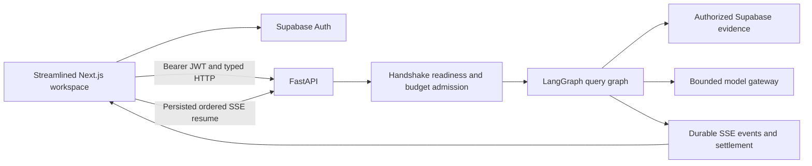

# Functional Frontend Overhaul

## Approved scope and outcome

The user approved these decisions:

- Fix the backend/runtime defects that prevent chat answers.
- Wire frontend controls only to existing Supabase Auth, FastAPI, and SSE contracts.
- Remove unsupported, permanently disabled, placeholder, duplicate, or misleading UI instead of inventing APIs.
- Replace the current navigation with: **Ask, Documents, Tables, Graph, role-gated Admin, and Account**.
- Keep the existing light Precision Workspace token family, but substantially improve composition, interaction hierarchy, recovery behavior, and efficiency.
- Remove MFA, TOTP enrollment/challenge/recovery, and AAL2 authorization requirements from every application environment. This is the one approved exception to the otherwise existing-contract-only scope.
- Do not add APIs for profile editing, budgets, audit export, source preview/download, member directory, owner bootstrap, company settings, or manual Hybrid/Combined route selection.
- Work on `feat/frontend-functional-overhaul`, commit and push packet-by-packet, then merge to `main` only after all required checks pass.

### Explicit security deviation: complete MFA removal

On 2026-08-24, after being warned that MFA/AAL2 currently protects privileged uploads and user offboarding, the user explicitly selected complete removal from the frontend, backend, database policy surface, and all environments.

- This is a deliberate security reduction, not ordinary UI cleanup. Packet P08-07 must record the approval in the ADR and amend the canonical global/phase contracts before implementation.
- Packets P08-11 and P08-12 form one ordered feature-branch transaction. P08-11 removes server/database AAL2 enforcement first; P08-12 immediately removes frontend/provider MFA behavior. Neither packet may be merged independently, and no UI surface packet starts before both pass.
- Existing applied migrations are immutable. Use additive replacement functions/policies or compatibility wrappers; never edit historical migrations or combine destructive signature removal with the expansion.
- Preserve compensating controls that are not MFA: verified Supabase JWTs, disabled/revoked-session checks, live role and authorization-version checks, RLS, server-side owner/admin enforcement, rate limits, explicit destructive-action confirmations, generic errors, audit events, and IDOR-safe 404 behavior.
- Do not silently replace MFA with a new second factor. A recent-password confirmation may be proposed only in a separately approved contract; it is not part of this plan.
- Supabase Auth may retain dormant provider capability or compatibility fields that cannot be removed without breaking the current API major. Such fields must be deprecated, hidden from product UI, excluded from authorization decisions, and documented for a later contract release; they must not keep MFA operational in this application.

## Proven baseline and root cause

- `main` is currently clean and tracks `origin/main` at `0a0140f`.
- Frontend typecheck, production build, and 181 component/unit tests pass. Lint has two non-blocking warnings, so the problem is runtime behavior rather than compilation.
- The live `/api/meta` endpoint returns 200, but `/health/ready` reports `query_ready=false`.
- Recent chat runs fail before any model call, persist only `schema` and `error(run_failed)`, emit no `token_delta`, and leave reservations in `reserved` state.
- [`packages/core/src/smart_rag_core/settings/backend.py`](packages/core/src/smart_rag_core/settings/backend.py) falls back from `LANGGRAPH_CHECKPOINT_URL` to `SUPABASE_DB_URL`. The running value is a Supabase transaction-pooler DSN, while LangGraph checkpointer/store code requires a session/direct connection.
- [`docker-compose.yml`](docker-compose.yml) does not inject `LANGGRAPH_CHECKPOINT_URL` or `LIGHTRAG_DB_URL` into the API.
- [`apps/backend/src/smart_rag_api/services/sse_stream.py`](apps/backend/src/smart_rag_api/services/sse_stream.py) consumes `stream_mode="updates"` but does not translate the answer node’s `answer.answer_text` into `token_delta`; it can emit `completed` with no answer.
- [`apps/frontend/src/components/chat-app.tsx`](apps/frontend/src/components/chat-app.tsx) consequently renders an empty answer, hides most failure detail in a collapsed sheet, ignores `false` from cancel/feedback helpers, and labels caller usage as company usage.
- [`docs/frontend/API_UI_MAPPING.md`](docs/frontend/API_UI_MAPPING.md) proves several UI sections have no backend owner and must be removed. It also proves that document deletion and several curation actions already have backend contracts and should be wired.

### Explicit answer-delivery decision: verified final delivery, not fake token streaming

The current answer path performs one non-streaming OpenAI Responses call with strict structured JSON, then runs answer/citation verification. LangGraph `stream_mode="updates"` reports completed node updates; it does not reduce model time-to-first-token. Emitting chunks from `answer.answer_text` immediately after the answer node would expose an unverified draft before the verifier finishes.

This overhaul therefore chooses the safe, truthful behavior:

- Keep `stream_mode="updates"` for real progress/status events.
- While the answer model runs, the UI shows “Generating.” While the verifier runs, it shows “Verifying.”
- Hold the structured `AnswerPayload` server-side until the real verification node completes.
- After verification, emit the final filtered answer through the existing persisted `token_delta` compatibility event in chunks of at most 4096 characters, then citations/usage and exactly one terminal.
- The client applies those final chunks without a fake typewriter delay, streaming caret, or claim that provider tokens are arriving live.
- Measure and label this as **verified answer availability**, not provider time-to-first-token.
- Refusals and deterministic no-model answers may be emitted when their owning node has already produced a terminal verified result.
- True provider token streaming is explicitly out of scope because it would require a Phase 6 redesign of the model gateway, structured-output parser, verifier gate, budget accounting, cancellation, and “draft versus verified” UX. It must not be approximated with delayed chunk animation.

Packet P08-09 must preserve a contract test for the actual node-keyed update envelope and final typed `AnswerPayload`; it must not hardcode an assumed node name or nested dictionary shape without that test.

### Cross-phase ownership decision

P08-09 repairs behavior owned by Phase 6 admission/budget and SSE compatibility/resume contracts. It is carried as a Phase 8 blocker only because the frontend cannot function without the repair.

- P08-07 records P08-09 as a Phase 6/Phase 8 co-owned defect amendment without unchecking historical completed packets.
- P08-09 updates both Phase 6 and Phase 8 evidence documents.
- All existing Phase 6 budget, deadline, cancellation, one-terminal, ownership, idempotency, and resume tests remain mandatory.
- P08-09 may edit `apps/agents` only to verify/expose the typed final answer state required by the existing contract. It must not redesign routing, prompts, retrieval, model counts, or verifier policy.

## Mandatory weak-model execution protocol

This protocol is part of the acceptance criteria, not optional process advice.

1. Do not implement this overhaul in one model run. One run executes exactly one packet below and then stops.
2. The first run is documentation/governance only. It records this approved amendment as new Phase 8 remediation packets; it does not edit application code.
3. Before every later packet, read only:
   - [`.cursor/plans/hybrid-graph-rag/00-global-contracts.md`](.cursor/plans/hybrid-graph-rag/00-global-contracts.md)
   - [`.cursor/plans/hybrid-graph-rag/08-phase-frontend-integration.md`](.cursor/plans/hybrid-graph-rag/08-phase-frontend-integration.md)
   - [`.cursor/plans/hybrid-graph-rag/08-phase-frontend-integration/00-shared-contracts.md`](.cursor/plans/hybrid-graph-rag/08-phase-frontend-integration/00-shared-contracts.md)
   - exactly one selected new remediation packet
   - only the shared concern contracts explicitly named by that packet
   - [`.cursor/plans/hybrid-graph-rag/shared/frontend/stitch-nextjs-contract.md`](.cursor/plans/hybrid-graph-rag/shared/frontend/stitch-nextjs-contract.md) only for frontend packets
   - [`.cursor/skills/implement-plan-phase/SKILL.md`](.cursor/skills/implement-plan-phase/SKILL.md)
   - only the packet-specific skills listed below.
4. P08-07 copies the exact inherited Phase 6 budget/settlement/resume acceptance clauses needed by P08-09 into the new P08-09 packet and names their source paths. The P08-09 implementation run does not load the Phase 6 wrapper or completed sibling packet bodies as a second source of truth.
5. Packet-specific skills:
   - P08-08: `implement-lightrag-graph`.
   - P08-09: `implement-query-agent` and `implement-api-security`.
   - P08-10 and P08-13 through P08-20: `implement-rag-frontend`; P08-17 also loads `implement-structured-table`.
   - P08-11 and P08-12: `implement-supabase-security` and `implement-api-security`; P08-12 also loads `implement-rag-frontend`.
   - P08-21 and P08-22: `verify-release-gates`; P08-22 may additionally load the skill that owns a failed integration it must diagnose.
6. At the start of a packet, quote its title, list concrete acceptance checks, inspect current files and pinned dependency versions, and state which files are expected to change.
7. Do not read sibling packet bodies or infer later work. Stop when the selected packet is complete.
8. Never invent an endpoint, field, SSE event, environment variable, role, table, test result, or provider capability. Update OpenAPI/types/docs together if an existing endpoint’s behavior changes.
9. Use TanStack Query for server state, the existing typed SSE client for progress/final delivery, `@supabase/ssr` for Auth, React text nodes for untrusted content, and existing primitives/dependencies. Add no new UI framework and no new dependency unless an accepted ADR proves it is necessary.
10. Every authored exported TypeScript function/component/type gets current TSDoc/JSDoc. Every authored Python module/class/function/method gets a Google-style docstring. Update stale documentation in the same packet.
11. Every visible `button` must meet one of these contracts:

- submit a real form with a real handler;
- invoke a real local state transition that visibly changes the UI;
- invoke a typed Auth/API/SSE action;
- otherwise it must be removed or converted to non-interactive text/badge markup.

12. Links must use real routes. Never use `href="#"`, permanent `disabled`, placeholder callbacks, fake success, randomized progress, static “live” diagnostics, raw HTML, or client-only authorization.
13. A disabled action must have a temporary, truthful reason and a tested path to become enabled. Features disabled for the entire deployment, such as Google OAuth, are omitted rather than shown as dead controls.
14. At packet end, run its targeted tests, inspect lint diagnostics, update [`docs/development/phase-08-frontend-integration-evidence.md`](docs/development/phase-08-frontend-integration-evidence.md), inspect `git diff`, commit only packet files, push the feature branch, and stop.
15. Never commit `.env*`, credentials, `.next`, `node_modules`, Playwright reports, screenshots generated only for local review, or other ignored artifacts.
16. Do not search for, select, or improvise UI design during implementation. The exact normative UI/UX specification below is the design decision. Copy the relevant values and component contract into each canonical packet without summarizing away dimensions, states, copy, or responsive behavior.

## Architecture and UX target

Target navigation and route behavior:

- `/` — Ask. Focused chat workspace with new/continue/delete session actions, visible service readiness, real progress, verified final answer delivery, sources, feedback, reconnect, and run details.
- `/documents` — Documents. Library, real upload/finalize, website crawl, status, retry, pagination, and authorized deletion.
- `/documents/[documentId]` — Document detail. Metadata, one unified ingestion timeline, and real links into Graph/Tables. No fake preview or delete-unavailable copy.
- `/tables` — Tables. Deterministic table plan builder, results, sorting, and provenance. No Export button until a real export contract exists.
- `/graph` — Graph. Search, bounded inspect, one list-first visualization, one optional React Flow canvas, and evidence inspector.
- `/admin` — Admin, visible only to owner/admin as convenience. Tabs: Team & access, Tools, Curation, Usage. FastAPI remains authoritative.
- Account menu — current `/me` fields and sign-out. No profile editor or company settings panel.
- Existing `/team`, `/tools`, `/curation`, `/usage`, and `/profile` URLs become server redirects to the appropriate supported destination so bookmarks do not break.
- `/review-fixtures` and `/unavailable/[gap]` are removed from production routing; their useful assertions move to component/real-route tests.

Visual and interaction rules:

- Preserve the canonical tokens in [`docs/frontend/STITCH_BRIEF.md`](docs/frontend/STITCH_BRIEF.md) and [`apps/frontend/src/app/globals.css`](apps/frontend/src/app/globals.css): light canvas, white surfaces, indigo accent, teal evidence accent, visible focus ring, 4px spacing grid, compact 48px enterprise rows, no blur.
- Remove the duplicate `--control-height` declaration while retaining one canonical value.
- Keep the 232px desktop rail with an intentional collapsed state; use a sheet on mobile. Do not add dark mode, glassmorphism, decorative dashboards, or motion-heavy effects.
- Use one dominant action per surface. Secondary actions live in menus/drawers, not rows of equally weighted buttons.
- Use badges/pills for status, links for navigation, and buttons only for actions.
- Loading, empty, partial, refusal, permission, quota, compatibility, deadline, cancellation, reconnect, fallback, degraded, and generic-error states must be explicit and accessible.
- English chrome remains canonical. All user/retrieved text uses `dir="auto"`, safe bidi isolation, and logical citation offsets.

## Normative UI/UX implementation specification

This section is the complete visual and interaction brief. The implementation model must not perform another design search, choose a different theme, install a component library, invent alternate tokens, or reinterpret the layout. Repository inspection is still required to edit safely, but no visual decision is delegated to the implementation model.

If an old screenshot, Stitch frame, component style, or prose document conflicts with this section, this user-approved specification wins for the overhaul. Security, authorization, API, data, and accessibility contracts still have higher precedence.

### Styling architecture

- Use the existing CSS-variable theme in `apps/frontend/src/app/globals.css` and route/component CSS Modules.
- New visual styles go in the owning `*.module.css`; global resets, font faces, theme variables, focus treatment, and reduced-motion rules stay in `globals.css`.
- Do not use inline `style` for fixed visual design values. Inline style is allowed only for runtime geometry such as graph coordinates or measured progress from a real numeric contract.
- Do not add styled-components, Emotion, Material UI, Chakra, shadcn, Bootstrap, another icon package, or a second token system.
- Tailwind remains build-time infrastructure, but new components use CSS Modules and canonical variables rather than long ad-hoc utility strings.
- Use the existing `Icon` abstraction and installed Lucide icons. No emoji, Material Symbols, remote icon font, custom decorative SVG pack, or text pretending to be an icon.
- Use semantic HTML first: `button`, `a`, `nav`, `main`, `aside`, `header`, `section`, `form`, `fieldset`, `table`, `dialog`, `details`, and headings in order.

### Exact color theme

Set or retain these exact CSS variables:

- `--color-bg: #F4F6F8` — application canvas.
- `--color-surface: #FFFFFF` — cards, drawers, topbar, nav, inputs.
- `--color-surface-muted: #F8FAFC` — secondary panels, table headers, code blocks.
- `--color-surface-hover: #F1F4F8` — neutral hover.
- `--color-surface-selected: #EEF0FF` — selected navigation/list item.
- `--color-text: #182230` — primary text.
- `--color-text-secondary: #475467` — secondary body text.
- `--color-text-muted: #637083` — metadata and helper text.
- `--color-text-disabled: #8A94A3` — disabled text only.
- `--color-border: #DDE3EA` — normal borders.
- `--color-border-strong: #C7D0DB` — emphasized separators and input hover.
- `--color-accent: #4E5BD5` — primary action and active navigation.
- `--color-accent-hover: #414CC4` — primary hover.
- `--color-accent-pressed: #343DA8` — primary pressed.
- `--color-accent-fg: #FFFFFF` — text on primary action.
- `--color-accent-muted: #EEF0FF` — active/selected background.
- `--color-accent-border: #C9CDF8` — selected outline.
- `--color-evidence: #0E8584` — citations and evidence accents.
- `--color-evidence-hover: #0A6F6E`.
- `--color-evidence-muted: #ECFDFC`.
- `--color-success: #166534`.
- `--color-success-bg: #F0FDF4`.
- `--color-success-border: #BBF7D0`.
- `--color-warning: #A16207`.
- `--color-warning-bg: #FFFBEB`.
- `--color-warning-border: #FDE68A`.
- `--color-danger: #B91C1C`.
- `--color-danger-hover: #991B1B`.
- `--color-danger-bg: #FEF2F2`.
- `--color-danger-border: #FECACA`.
- `--color-info: #1D4ED8`.
- `--color-info-bg: #EFF6FF`.
- `--color-info-border: #BFDBFE`.
- `--color-focus: #4E5BD5`.
- `--color-overlay: rgb(15 23 42 / 0.42)` — modal/sheet overlay, with no blur.

Rules:

- No gradients.
- No glass, transparency-based cards, or `backdrop-filter`.
- No pure black text.
- White text is used only on accent/danger fills that pass WCAG AA.
- Evidence teal is reserved for citations/provenance, not ordinary buttons.
- Success, warning, and danger are never the only status signal; include text and an icon.

### Exact typography

Font families:

- Primary: locally hosted `Inter`, weights 400, 500, and 600 only.
- Fallback: `"Segoe UI", "IBM Plex Sans Arabic", "Noto Naskh Arabic", sans-serif`.
- Monospace: `ui-monospace, "Cascadia Code", "SFMono-Regular", Consolas, monospace`.
- Do not download fonts at runtime. Do not use a decorative display font.

Type scale:

- Page title: 24px size, 32px line-height, weight 600, letter-spacing `-0.01em`.
- Auth title: 28px size, 36px line-height, weight 600, letter-spacing `-0.015em`.
- Section title: 20px size, 28px line-height, weight 600.
- Card title: 16px size, 24px line-height, weight 600.
- Body: 14px size, 20px line-height, weight 400.
- Body strong: 14px size, 20px line-height, weight 600.
- Label: 13px size, 18px line-height, weight 600.
- Secondary/meta: 13px size, 18px line-height, weight 400.
- Caption/eyebrow: 12px size, 16px line-height, weight 500.
- Code/identifier: 12px size, 18px line-height, weight 500, monospace.
- Arabic/mixed content uses the same nominal size with `line-height: 1.75`.

Rules:

- Do not use uppercase for sentences, buttons, or navigation.
- Eyebrows may use uppercase only for short categories, with `0.04em` letter spacing.
- Limit ordinary paragraph width to 72 characters where possible.
- Use sentence case everywhere: “Import source,” not “IMPORT SOURCE” or “Import Source.”
- Truncate only metadata in constrained rows. Never truncate an answer, error, filename in a detail view, or citation locator without an accessible full-value affordance.

### Exact spacing, sizing, radius, border, and elevation

Spacing uses a 4px base:

- `4px` icon micro-gap.
- `8px` compact inline gap.
- `12px` control group gap.
- `16px` standard component padding/gap.
- `20px` dense card padding.
- `24px` page section gap and normal card padding.
- `32px` large section gap.
- `40px` auth card vertical spacing.
- `48px` page top/bottom breathing room on desktop.
- `64px` only for major empty-state vertical space.

Geometry:

- Standard button/input/select height: 40px.
- Compact button height: 32px.
- Large/auth primary button height: 44px.
- Icon button: 36px square; compact icon button: 32px square.
- Navigation row: 40px high.
- Enterprise table/list row: minimum 48px high.
- Topbar: 56px high.
- Desktop nav: 232px wide; collapsed nav: 72px.
- Form field maximum width: 520px unless it is search or chat composer.
- Auth card width: 420px maximum.
- Dialog width: 480px default, 640px wide; never exceed `calc(100vw - 32px)`.
- Right drawer width: 440px default, 560px for source/detail content; mobile uses full width.

Radius:

- Buttons, inputs, selects, search, compact controls: 8px.
- Cards, panels, banners, menus: 12px.
- Dialogs and drawers: 12px.
- Avatar: 50% circle.
- Status pills and small filter chips: 999px.
- Do not make ordinary buttons pill-shaped.

Borders/elevation:

- Standard border: `1px solid var(--color-border)`.
- Strong/hover border: `1px solid var(--color-border-strong)`.
- Selected border: `1px solid var(--color-accent-border)`.
- `--shadow-1: 0 1px 2px rgb(15 23 42 / 0.08)` for raised cards and menus.
- `--shadow-2: 0 8px 24px rgb(15 23 42 / 0.10)` for dialogs and drawers.
- Never stack multiple shadows or use glow effects.

### Motion and feedback

- Hover/focus color transitions: 120ms ease-out.
- Drawer/dialog open/close: 160ms ease-out, opacity plus at most 8px translation.
- Do not animate layout height while progress events arrive or when the verified answer is inserted.
- Spinner rotation is allowed; pulsing decorative gradients are forbidden.
- Under `prefers-reduced-motion: reduce`, transitions become effectively immediate and spinners may remain a static labeled state.
- Button press feedback uses color change, not scale/bounce.
- Async work always changes visible label/state immediately and disables only the action being submitted.

### Responsive breakpoints and page frame

Use these exact behavior breakpoints:

- `>= 1280px`: full 232px nav, 24px main padding, multi-pane layouts enabled.
- `1024px–1279px`: collapsed 72px nav by default, 20px main padding, graph inspector becomes drawer.
- `768px–1023px`: no persistent nav; mobile/tablet topbar and left navigation sheet, 20px main padding, two-pane layouts collapse.
- `< 768px`: 16px main padding, full-width controls, sheets use full viewport width, tables become horizontally scrollable labeled regions or semantic cards.
- Verification widths are exactly 390px, 768px, 1024px, and 1280px.

Global frame:

- Body background is `--color-bg`; primary content surfaces are white.
- Topbar is sticky at top with white background and bottom border; no shadow unless content scrolls beneath it.
- Main region maximum width is 1440px and centered, except Chat and Graph may use all available width.
- Normal page vertical gap is 24px.
- Every page starts with one `PageHeader`; do not repeat the page title inside the first card.

### Primitive component specification

#### `Button`

An ordinary rounded rectangle, never a decorative shape.

- Default: 40px high, 8px radius, 14px/20px weight 600, 14px horizontal padding, 8px icon gap.
- Primary: accent background, white text, no border. Hover accent-hover; pressed accent-pressed.
- Secondary: white background, primary text, normal border. Hover surface-hover with strong border.
- Ghost: transparent background, primary text. Hover surface-hover. Use only in toolbars/menus.
- Danger: danger background, white text. Hover danger-hover. Use only after a confirmation boundary.
- Quiet danger: transparent, danger text; hover danger-bg. Use for opening a delete confirmation, not final confirmation.
- Loading: keep width stable, show 16px spinner before label, label becomes a present participle such as “Sending…” or “Deleting…”.
- Disabled: disabled surface, disabled text, normal border, `cursor: not-allowed`; a visible adjacent reason or tooltip is mandatory.
- Focus: 2px focus ring with 2px offset.
- Icons are 16px. A trailing chevron is allowed only when opening a menu/disclosure.

#### `IconButton`

- 36px square, 8px radius, ghost style by default.
- Must have `aria-label`; tooltip repeats the action label on hover/focus.
- Icon is 18px.
- Never use an unlabeled icon for a destructive action.

#### `LinkButton`

- Must render a real `Link`/anchor, not a button that navigates.
- It may visually match Primary or Secondary.
- External links show an external-link icon and safe `rel`.

#### `AsyncButton`

- Wrap existing `Button`; accept `pending`, `pendingLabel`, and real disabled reason.
- Prevent duplicate submit.
- Do not swallow errors or show success itself; owning form renders an inline status.

#### `Input`, `Select`, and `SearchInput`

- 40px high, white background, 8px radius, 1px border, 12px horizontal padding.
- Label sits 6px above, 13px/18px weight 600.
- Placeholder uses muted text and is never the only label.
- Hover uses strong border; focus uses accent border plus focus ring.
- Error uses danger border, danger helper text, and `aria-describedby`.
- Disabled uses muted background; readonly uses surface-muted but normal text.
- Search input has a 16px leading search icon and a real clear button only when non-empty.

#### `Textarea`

- Same visual contract as Input.
- Normal minimum height 104px.
- Chat composer minimum 52px and maximum 180px, auto-resizing; after max height it scrolls internally.
- Character counter appears only after 80% of the server limit.

#### `Checkbox`

- Native input retained for accessibility.
- Visual box is 18px square, 4px radius, accent checked state.
- Entire label row has at least 40px hit height.
- Helper/error text aligns with label text, not the box.

#### `Tabs`

- Use for Admin sections and list/canvas switching only.
- Horizontal tab list with 40px tab height.
- Active tab has accent text and a 2px bottom border; inactive tabs have secondary text.
- No pill-style segmented tabs for page-level navigation.
- Arrow keys move focus; Home/End supported.
- URL-addressable page tabs update the query string.

#### `Menu`

- White 12px-radius surface, 1px border, shadow-1, 8px vertical padding.
- Item height 36px, 12px horizontal padding, 8px icon gap.
- Destructive item is danger text and separated by a divider.
- Escape closes; focus returns to trigger; arrows navigate.

#### `Tooltip`

- Use only to supplement icon controls or explain temporary disabled state.
- Dark ink background, white 12px text, 6px radius, 6px by 8px padding.
- Delay 400ms; appears on keyboard focus immediately.
- Never place essential error/help content only in a tooltip.

#### `Card` and `Panel`

- White background, 12px radius, 1px border.
- Standard padding 24px; dense card 16px or 20px.
- Shadow is absent by default. Use shadow-1 only for clearly raised interactive cards.
- Header has title left and at most one primary/overflow action right.
- Do not nest more than one bordered card inside another.

#### `StatusPill`

- 24px high, 999px radius, 12px/16px weight 600, 8px horizontal padding, 6px gap.
- Includes a 6px dot or 14px status icon plus text.
- Ready/complete: success text on success background.
- Processing/running: info text on info background.
- Pending/queued/degraded: warning text on warning background.
- Failed/blocked/quarantined: danger text on danger background.
- Neutral/unknown: secondary text on surface-muted with border.
- Unknown server values render neutral exact safe text; do not invent a status.

#### `StatusBanner`

- Full available width, 12px radius, 1px semantic border, 12px by 16px padding.
- Layout: 18px icon, title/body, optional one action aligned right on desktop and below on mobile.
- Info, success, warning, and error use the exact semantic color triples above.
- Error banners use `role="alert"` only for blocking/new failures; ordinary persisted information uses `role="status"`.
- No dismiss control for a condition that still blocks the action.

#### `Badge` and `FilterChip`

- Badge is non-interactive metadata, 22px high.
- FilterChip is interactive only when it visibly toggles a filter and uses `aria-pressed`.
- Do not style route navigation as chips.

#### `DataTable`

- Semantic table with sticky header when the list scrolls.
- Header: 40px high, muted surface, 12px/16px weight 600, left aligned except numeric columns.
- Row: minimum 48px, white background, bottom border, hover surface-hover only if row is actionable.
- First column contains the primary identity/link.
- Status is a pill; timestamps are secondary text; actions are one overflow IconButton.
- Sortable header is a real button with direction icon and accessible state.
- On mobile, retain a semantic scroll region or render cards with the same field labels; do not hide critical fields without a detail path.

#### `Pagination`

- Use “Load more” for cursor lists, not numbered pages.
- Secondary button centered below list.
- While loading, label “Loading…” and preserve existing rows.
- Hide when fewer than the page size are returned.
- Failure appears inline with Retry using the same cursor.

#### `EmptyState`

- Centered within a minimum 240px region.
- 40px muted icon in a 56px accent-muted square with 12px radius.
- Title 16px/24px weight 600; body 14px, max width 420px.
- At most one primary and one secondary action, both real.
- Do not include illustrations or stock images.

#### `ErrorState`

- Same geometry as EmptyState but uses danger-muted icon treatment.
- Generic title “Something went wrong.”
- Safe route-specific body.
- Retry appears only when retry is valid; never expose exception text.

#### `Skeleton` and `Spinner`

- Skeleton uses solid `#E9EDF2` blocks with 8px radius. Optional subtle opacity animation only when reduced motion is not requested.
- Match final layout dimensions to prevent shift.
- Spinner is 16px or 20px with accessible adjacent text; a spinner alone is never the only status.

#### `Dialog` and `ConfirmDialog`

- Centered white surface, 12px radius, shadow-2, overlay with no blur.
- Header 20px title; body 14px; footer right-aligned buttons with Cancel before primary.
- Destructive confirmation names the object and consequence.
- Initial focus goes to Cancel for destructive actions; final destructive button uses Danger.
- Escape/click outside closes only when no irreversible request is pending.

#### `Sheet` and `Drawer`

- White surface, 12px left-side radius on desktop right drawers; no radius on full-width mobile.
- Header is sticky, 56px high, title left, close IconButton right.
- Body 20px padding; footer sticky only when actions are required.
- Overlay has no blur. Escape and overlay click close when safe.
- Focus is trapped and returned to trigger.

#### `FileDropZone`

- Minimum 160px high, 12px radius, 1px dashed strong border, surface-muted background.
- Centered upload icon, title “Drop files here,” body “or choose files,” and one Secondary “Choose files” button.
- Drag-over uses accent-muted background and accent border.
- Show exact accepted formats and 100 MB server cap beneath.
- Selected files become a real queue with filename, bytes, stage, error, and Remove before upload.
- Never show fabricated percentage for parsing/indexing.

#### `LiveRegion`

- One polite region for progress/reconnect/status summaries and one assertive region for blocking errors.
- Announce stage changes, reconnect, verified answer availability, terminal, and errors; do not announce each compatibility answer chunk.

#### `UserText`, `LogicalHighlight`, and hostile content

- Render as React text nodes only.
- Use `dir="auto"` and bidi isolation.
- Preserve canonical logical offsets.
- Never convert model/retrieved markdown to HTML in this overhaul.

### Application shell component specification

#### `AppShell`

- Desktop grid columns are `232px minmax(0, 1fr)`; collapsed mode is `72px minmax(0, 1fr)`.
- Nav and topbar are white with border separators.
- Main area uses canvas background and owns vertical scrolling.
- Skip link is visually hidden until focused, then appears at top-left as a Primary-style link.
- No footer is needed.

#### Brand block

- Height 56px, 16px horizontal padding.
- 28px square accent mark with existing spark icon and 8px radius.
- “Smart RAG” 14px/20px weight 600; “Company knowledge” 12px muted.
- Collapsed nav shows mark only with tooltip.

#### `AppNav`

- Exact primary order: Ask, Documents, Tables, Graph.
- Admin is separated by a 16px gap and shown only for owner/admin.
- Row is 40px high, 8px horizontal margin, 8px radius, 12px horizontal inner padding.
- Icon 18px, label 14px weight 500, gap 10px.
- Active: accent-muted background, accent text, and a 3px accent bar inset at left.
- Hover: surface-hover. No hover movement.
- Collapsed: centered icons, labels visually hidden, tooltips enabled.
- Mobile sheet uses full labels and no collapsed mode.

#### `ConsoleTopbar`

- Sticky 56px white bar with bottom border.
- Left: mobile menu button when needed, then one page title.
- Right order: readiness control, command control, Account control.
- Do not repeat logo in the topbar when desktop nav is visible.
- At 390px, hide command control first; keep readiness and Account.

#### `ReadinessIndicator`

- It is a button because it opens a real popover.
- Labels: “Checking,” “Ready,” “Degraded,” or “Unavailable.”
- Use corresponding neutral/success/warning/danger pill styling.
- Popover width 320px. Show “Question answering,” “Keyword search,” and “Graph search” only when real readiness fields authorize those labels.
- Primary blocking copy: “Question answering is temporarily unavailable. Try again when the service is ready.”
- Never expose DSNs, provider names not authorized for the caller, stack traces, or probe credentials.

#### `AccountMenu`

- Trigger is a 36px IconButton containing a generated two-letter initial avatar; no remote avatar.
- Menu shows email, role badge, upload capability text, Account details, and Sign out.
- No MFA field, profile editor, locale editor, or company settings.
- Sign out is separated as a quiet-danger menu item.

#### `CommandMenu`

- Dialog width 560px.
- Search input at top; results show supported routes only.
- Each result has icon, label, and optional short description.
- Keyboard: Ctrl/Cmd+K opens, arrows move, Enter navigates, Escape closes.
- Do not include actions that submit mutations.

#### `PageHeader`

- Desktop: title/description left, one primary action right.
- Mobile: stacked, action full width only when it is the page’s main task.
- Title uses Page title style; description uses secondary body, max width 720px.
- Bottom margin 24px.

### Auth component and page specification

#### `AuthLayout`

- Full viewport canvas with centered content.
- Brand above card with 32px bottom gap.
- Auth card: width 420px, white, 12px radius, border, shadow-1, 32px padding desktop and 24px mobile.
- No split-screen marketing panel, stock art, gradient, testimonial, or decorative background.

#### `AuthCard`

- Title, one-sentence helper, form, then text links.
- Form fields separated by 16px.
- Primary submit is full width, 44px high.
- Secondary navigation is plain text link beneath with 16px top margin.
- Inline error banner sits above fields and receives focus after failure.

Exact pages:

- Sign in title: “Sign in to Smart RAG.” Helper: “Use your company account to access private knowledge.”
- Sign up title: “Create your account.” Helper: “Your account still needs a valid company invitation.”
- Forgot title: “Reset your password.” Helper: “We’ll send a reset link to your email.”
- Reset title: “Choose a new password.”
- Invitation title: “Accept invitation.” Helper: “Sign in with the email address that received this invitation.”
- Callback page shows Spinner plus “Completing sign in…” and a safe timeout error with “Return to sign in.”
- No Google button, MFA/TOTP page, recovery page, owner-bootstrap page, or unavailable-gap page.

### Ask workspace component specification

#### Overall layout

- Use available height below topbar: `min-height: calc(100dvh - 56px)`.
- At `>=1280px`: 248px Sessions rail and `minmax(0, 1fr)` main workspace, 16px gap.
- At `<1280px`: Sessions rail becomes a left Sheet opened by a “Sessions” Secondary button.
- Main answer column max width is 880px and centered inside available space.
- There is no permanent right sources/diagnostics column.

#### `SessionRail`

- White bordered panel, 12px radius, vertical layout.
- Header: “Sessions” and compact Primary “New” button.
- Search is omitted because the API does not provide global search and local first-page search is misleading.
- Session row: 48px minimum, title one line, created timestamp, current indicator, overflow menu.
- Clicking row performs real Continue. Active row uses selected background.
- Overflow contains Delete only.
- Footer may contain Load more when cursor data supports it.
- Empty copy: “No sessions yet. Start a question to create one.”
- Continuing copy above transcript: “Continuing this session. Earlier messages are not available in this client.”

#### Chat empty state

- Icon: spark/search, not a robot avatar.
- Title: “Ask your company knowledge.”
- Body: “Answers use authorized documents and show available evidence.”
- Three prompt-fill chips maximum:
  - “Summarize an uploaded policy”
  - “Compare two documented values”
  - “Find a relationship between entities”
- Chips populate composer only; they never submit.

#### User message

- Align right, maximum width 78%.
- Accent-muted background, 12px radius with 4px bottom-right radius, 12px by 14px padding.
- Text 14px/22px, `dir="auto"`.
- No avatar, timestamp, edit, copy, or retry button unless backed by a contract.

#### Assistant answer

- Full-width transparent surface with a 3px evidence-colored left border and 16px left padding.
- Header row: spark icon, “Answer,” route StatusPill when real, and overflow with real actions only.
- Answer text 15px/24px for reading comfort.
- Do not show a streaming caret or typewriter animation. Show the real Generating/Verifying progress state, then insert verified final answer text without artificial delay.
- Partial/cancelled/error retains existing text and adds a StatusBanner below.
- Footer order: citations, feedback, then “Run details” disclosure.

#### `RunProgress`

- Compact horizontal/vertical step list using real status events.
- Known stage labels map to: “Preparing,” “Retrieving,” “Generating,” “Verifying.”
- Unknown stage renders safe neutral exact stage text in details, not as a new primary phase.
- Current stage uses info style; completed stages success; failure danger.
- Do not show percentages.

#### `ChatComposer`

- White bordered panel, 12px radius, shadow-1, 12px padding.
- Textarea borderless inside composer; focus ring surrounds composer container.
- Bottom toolbar: left character count/status; right Attach is absent unless a real chat attachment contract exists; primary Send/Stop at far right.
- Send button: 40px high, label and 16px arrow icon.
- Running state replaces Send with Secondary/quiet-danger “Stop” and square icon.
- `Enter` submits, `Shift+Enter` inserts newline; IME composition never submits.
- Disabled reason appears immediately above composer in a StatusBanner, not only tooltip.
- Draft remains after admission failure; clears only after successful admission.

#### `ReconnectState`

- Warning banner above composer.
- Copy: “Connection interrupted. Reconnecting… attempt X of Y.”
- Actions: “Cancel” and, after automatic ceiling, “Try again.”
- Keep partial answer visible.

#### `CitationChip`

- 28px high evidence-muted pill, evidence text, evidence border, 12px/16px weight 600.
- Label format: `[1] Source` when a safe source label exists; otherwise `[1] Evidence`.
- Opens real Sources drawer.
- No external-link icon unless a safe authorized URL exists in the actual contract.

#### `SourcesDrawer`

- Width 560px desktop, full width mobile.
- Header “Sources.”
- Group citations by safe source identity only when actual provenance supports it.
- Citation card shows index, document/chunk identifiers, page/sheet/range/URL locator fields actually present, and “Source unavailable” status when true.
- No fake excerpt, preview, download, relevance score, or open-source button.

#### `RunDetailsDrawer`

- Width 440px.
- Sections in order: Status, Route, Limitations, Cache/Coverage, Usage, Technical IDs.
- Closed by default.
- “Your usage” labels `/usage/me`; never “Company total.”
- IDs use monospace and Copy buttons with real clipboard feedback.
- No raw traces, prompts, provider secrets, source text, nDCG, or invented latency.

#### `FeedbackPopover`

- Opens from “Give feedback” Secondary button after terminal.
- First choose thumbs up/down, then required server tag Select, optional comment Textarea, Submit.
- Width 360px; actions right aligned.
- Success copy: “Feedback recorded.”
- Failure copy: “Feedback could not be recorded. Try again.”
- Popover remains open on failure.

### Documents page component specification

#### Page layout

- PageHeader title “Documents.”
- Description: “Upload files or add approved websites, then track search and graph readiness.”
- Primary action: “Import source.”
- Toolbar below: loaded-row filter left and count/status summary right.
- Main content is one white bordered DataTable, not multiple dashboard cards.

#### Document table

- Desktop columns: Name, Visibility, Search status, Graph status, Created, Actions.
- Name is the detail Link with document icon; optional ID appears below in monospace only when title is missing.
- Status values come from real document/version status.
- Row overflow menu includes “View details” and owner/admin “Delete.”
- Clicking blank row space does not navigate; only explicit Name link does.
- Mobile card order: Name, two status pills, visibility/created metadata, then overflow.

#### Documents empty state

- Title: “No documents yet.”
- Body: “Import a file or approved website to create searchable company knowledge.”
- Primary “Import source.”

#### `ImportSourceSheet`

- Right drawer width 560px.
- Header “Import source.”
- Two Tabs: “Files” and “Website.” Both map to real APIs.
- File tab: drop zone, selected queue, category Select, attestation Checkbox, Upload button.
- Website tab: URL Input, approved domain Input, optional title, bounded depth/pages controls only if current API exposes them, attestation, “Add website.”
- Keep one stable idempotency key while the same form submission retries.
- On success, close only after showing created document/job IDs or navigate to detail.

#### Upload queue row

- Filename, bytes, stage StatusPill, and Remove before reservation.
- Real stages: “Ready,” “Reserving,” “Uploading,” “Finalizing,” “Queued,” “Failed.”
- Upload byte progress may use a progress bar only if browser/API provides real uploaded bytes.
- Parsing, embedding, BM25, and graph stages use statuses, never fake percent.

#### `IngestionStatus`

- One component used in list/detail.
- Vertical timeline on detail; compact pills on list.
- Ordered labels from real lifecycle: Uploaded, Scanning, Parsing, Search ready, Graph pending/ready/ineligible, Failed, Deletion pending.
- Expandable technical details show scan signature status, OCR, chunks/tables, BM25, queue age, graph handoff, and retry only when fields exist.
- Retry is a real Secondary button visible only when `retry_allowed`.

#### Document detail

- Header: back Link, document title, visibility/status pills, overflow menu.
- Main desktop grid: `minmax(0, 2fr) minmax(280px, 1fr)`.
- Left: processing timeline and real table references.
- Right: metadata definition list and actions to “Inspect in graph” and “Open tables.”
- Delete is in overflow/danger zone, not a large primary button.
- No source preview, download, audit, PII, or raw storage section.

#### Delete confirmation

- Title: “Delete document?”
- Body: `“<safe title>” will be removed from retrieval and scheduled for cleanup. This cannot be undone.`
- Buttons: “Cancel” and Danger “Delete document.”
- Success navigates to Documents and announces “Document deleted.”

### Tables page component specification

#### Layout

- PageHeader title “Tables.”
- Description: “Run bounded calculations on structured data with exact cell provenance.”
- At `>=1024px`: 320px manifest sidebar and main results area; below that manifest picker is a Select.

#### Manifest sidebar

- White bordered panel, 12px radius.
- Header “Available tables.”
- Rows show safe table/sheet identity and document ID metadata.
- Active row uses selected treatment.
- Empty: “No structured tables are available.”

#### Plan builder

- White Card, title “Analysis plan.”
- Field order: Table, Columns, Filters, Aggregation, Group by, Sort, Comparison.
- Optional sections start collapsed and open via real “Add filter,” “Add aggregation,” etc.
- Repeating row has inputs plus labeled Remove IconButton.
- One Primary “Analyze” button at bottom right.
- No raw SQL editor, natural-language fake planner, Export, Save, or Share button.

#### Results

- Header row: “Results,” row count, and Secondary “View provenance” when ranges exist.
- DataTable numeric cells right aligned and use tabular numerals.
- Generated narrative is shown only if returned by an existing typed contract and clearly separated; otherwise omit.
- Empty successful result: “The analysis returned no rows.”

#### Provenance drawer

- Header “Cell provenance.”
- List exact document/version/table/sheet/range fields from response.
- Monospace for cell ranges.
- No fake source link.

### Graph page component specification

#### Layout

- PageHeader title “Graph.”
- Description: “Inspect bounded entities and relationships backed by authorized evidence.”
- At `>=1280px`: 300px search panel, flexible result panel, 320px inspector.
- At 1024–1279px: search plus result; inspector is right Drawer.
- Below 1024px: stacked search, list/canvas result, inspector Drawer.

#### Entity search panel

- SearchInput label “Search entities.”
- Submit/search executes only for trimmed queries meeting current API minimum.
- Results are 48px rows with object type StatusPill, safe ID/name, support metadata.
- Clicking a result selects it and adds a selected entity chip.
- Maximum 12 selected. At limit, show helper “You can inspect up to 12 entities.”
- Selected chips have real Remove controls.
- Depth Select has exact options 1, 2, 3.
- Primary action “Inspect graph.”

#### Result toolbar

- Left: result count and limitation pill.
- Right: Tabs “List” and “Canvas,” then Fit control only in Canvas.
- No Edit, Add relationship, Expand unlimited, Depth 5, Export, or Save buttons.

#### Graph list

- Default accessible representation.
- Each row: object type, object ID, hop, support, and Select.
- Selection opens inspector.
- Empty: “No authorized graph evidence matched this inspection.”

#### React Flow canvas

- White surface with subtle 16px grid dots using border color.
- Nodes: 168px wide, white, 8px radius, 1px border; selected node accent border and accent-muted background.
- Node first line object type caption, second safe object ID, footer hop/support.
- Edges: 1.5px border-strong; selected path evidence color.
- Controls bottom-right: zoom in, zoom out, fit, each labeled IconButton.
- Mini-map is omitted unless it remains legible and accessible at the bounded 200-node limit.
- Node click selects; canvas itself is not an editor.

#### Graph inspector

- Title “Evidence details.”
- Definition list: Type, Object ID, Document ID, Version ID, Chunk ID, Hop, Support.
- Locator cards show page, section path, sheet/range, or safe URL fields that actually exist.
- Limitation banners appear below details.
- No vendor prose or relationship editing.

### Admin component specification

#### Admin frame

- PageHeader title “Admin.”
- Description: “Manage access, tools, retrieval curation, and usage.”
- Horizontal Tabs: Team & access, Tools, Curation, Usage.
- Tab content is one column with maximum width 1120px.
- Member/viewer never see this route in nav; direct page visit renders a safe permission ErrorState after real server confirmation.

#### Team & access

- First Card “Invite user”: email Input, role Select, upload access Checkbox, Primary “Send invitation.”
- Success shows invitation ID and expiry only; never token.
- Second Card “Offboard user”: danger section, user ID Input, consequence copy, quiet-danger “Review offboarding,” then ConfirmDialog.
- No member directory, avatars, owner-bootstrap wizard, MFA/AAL2 copy, or fake invitation list.

#### Tools

- Toolbar: SearchInput and count.
- Tool cards are compact 2-column desktop/1-column mobile.
- Card: name, version, description, enabled StatusPill, permission Select for owner/admin, and real Enable/Disable AsyncButton.
- Full manifest fields open in Drawer through “View details.”
- No tool seeding form in ordinary UI.

#### Curation

- Two Tabs inside content: Glossary and Entity rules.
- Glossary: import form, result/status, then real Approve/Rollback actions.
- Entity rules: DataTable with canonical type, aliases, status, row version, overflow actions Edit/Approve/Revoke.
- “Suggest rule” Secondary action opens Dialog backed by the real suggestions endpoint.
- Edit uses real PATCH and shows conflict banner on stale row version with “Reload rule.”
- No bulk action without an existing endpoint.

#### Usage

- Two metric cards maximum in one row: “Your usage” and owner/admin “Company usage.”
- Each card shows tokens and USD from the real response, using 24px numeric value and 13px label.
- Below: real readiness/rate degradation StatusBanner.
- No charts without time-series data. No budget editor, hard-cap slider, audit panel, forecast, fake trend, or progress bar.

### Remaining reusable component rules

- `ConversationRail` is renamed/implemented as `SessionRail`; do not keep both.
- `IngestionInspector` and `ProcessingTimeline` become one `IngestionStatus`; do not keep duplicated implementations.
- Keep one graph list and one React Flow canvas; delete the custom third SVG neighborhood.
- `CitationDrawer` and `CitationSheet` become one responsive `SourcesDrawer`; do not maintain separate desktop/mobile logic beyond the shared Drawer primitive.
- `ProfileApp`, dedicated Usage/Team/Tools/Curation page bodies, `ReadinessPanel`, gap pages, MFA components, and review fixture route are removed or reduced to redirects as specified.
- A component not named in this target specification is retained only if it is a structural implementation detail required by one named component and has no separate visual behavior. Otherwise remove it after reference checks.

### Target frontend component/file ownership

Use this as the target tree. Reuse and rename existing files where their behavior matches; do not create a second implementation beside an old one.

- `src/components/ui/app-shell.tsx` and `app-shell.module.css`: `AppShell`, responsive frame, skip link, topbar/nav slots.
- `src/components/ui/app-nav.tsx`: `AppNav`, brand block, nav groups, collapse/mobile triggers.
- `src/components/ui/console-topbar.tsx`: `ConsoleTopbar`, title, readiness, command, Account.
- `src/components/ui/readiness-indicator.tsx`: readiness pill/button and popover.
- `src/components/ui/account-menu.tsx`: initials trigger, `/me` summary, Sign out.
- `src/components/ui/command-menu.tsx`: supported-route command navigation.
- `src/components/ui/page-header.tsx`: shared title/description/one-action header.
- `src/components/ui/button.tsx`: Button variants and sizes.
- `src/components/ui/async-button.tsx`: pending/duplicate-submit wrapper.
- `src/components/ui/input.tsx`, `textarea.tsx`, `select.tsx`, `checkbox.tsx`, and `search-input.tsx`: exact form primitive contracts.
- `src/components/ui/tabs.tsx`: accessible tabs and URL-tab helper.
- `src/components/ui/menu.tsx` and `tooltip.tsx`: menus/tooltips.
- `src/components/ui/dialog.tsx`, `confirm-dialog.tsx`, `sheet.tsx`: modal primitives.
- `src/components/ui/status-pill.tsx`, `status-banner.tsx`, and `badge.tsx`: non-interactive state/metadata.
- `src/components/ui/data-table.tsx` and `pagination.tsx`: table and cursor loading.
- `src/components/ui/empty-state.tsx`, `error-state.tsx`, `skeleton.tsx`, and `spinner.tsx`: system states.
- `src/components/ui/file-drop-zone.tsx`: file selection/drop queue entry.
- `src/components/ui/live-region.tsx`, `user-text.tsx`, and `logical-highlight.tsx`: accessibility and hostile text.
- `src/components/chat/chat-app.tsx`: Ask orchestration only; keep network state out of purely visual children.
- `src/components/chat/session-rail.tsx`: list/continue/new/delete session controls.
- `src/components/chat/chat-composer.tsx`: draft, keyboard submit, Send/Stop, disabled reason slot.
- `src/components/chat/answer-surface.tsx`: user message, assistant answer, terminal status, footer actions.
- `src/components/chat/run-progress.tsx`: real stage timeline.
- `src/components/chat/sources-drawer.tsx`: unified citations/evidence.
- `src/components/chat/run-details-drawer.tsx`: diagnostics and usage.
- `src/components/chat/feedback-popover.tsx`: real feedback form.
- `src/components/documents/document-library.tsx`: documents query, pagination, toolbar, table.
- `src/components/documents/document-row.tsx`: responsive row/card rendering.
- `src/components/documents/import-source-sheet.tsx`: Files/Website forms.
- `src/components/documents/upload-queue.tsx`: selected file queue and real stages.
- `src/components/documents/ingestion-status.tsx`: shared compact/timeline status.
- `src/components/documents/document-detail.tsx`: metadata/status/Graph/Tables actions.
- `src/components/tables/tables-app.tsx`: manifest selection, plan state, analyze query.
- `src/components/tables/table-plan-builder.tsx`: bounded typed controls.
- `src/components/tables/table-results.tsx`: deterministic table and empty/error.
- `src/components/tables/provenance-drawer.tsx`: source ranges.
- `src/components/graph/graph-explorer.tsx`: search/selection/inspect orchestration.
- `src/components/graph/entity-search.tsx`: query and selected entity chips.
- `src/components/graph/graph-result-toolbar.tsx`: List/Canvas and Fit controls.
- `src/components/graph/graph-list.tsx`: default accessible results.
- `src/components/graph/graph-canvas.tsx`: bounded React Flow rendering only.
- `src/components/graph/graph-inspector.tsx`: evidence details and limitations.
- `src/components/admin/admin-app.tsx`: URL-tab orchestration and role response.
- `src/components/admin/team-access-panel.tsx`: invite/offboard.
- `src/components/admin/tools-panel.tsx`: search/catalog/permissions/enable state.
- `src/components/admin/curation-panel.tsx`: glossary and entity rules.
- `src/components/admin/usage-panel.tsx`: real personal/company totals only.
- `src/components/auth/auth-layout.tsx` and `auth-card.tsx`: shared Auth composition.
- `src/components/auth/sign-in-form.tsx`, `sign-up-form.tsx`, `forgot-password-form.tsx`, `reset-password-form.tsx`, and `invitation-accept-form.tsx`: one supported form per file.
- Route page files remain thin server/client composition boundaries; they do not duplicate page markup or data logic.

Migration rules:

- If an existing file already owns the target behavior under another path, move/rename it and update imports/tests in the same packet.
- Delete obsolete component and CSS Module files only after the new owner passes tests and a reference search shows no imports.
- Do not leave compatibility re-export files unless an external package imports them. Internal imports must be updated directly.
- Do not put multiple page applications back into a single `auth-screens.tsx` or other monolithic catch-all file.

### Exact product copy rules

- Brand: “Smart RAG.”
- Product descriptor: “Company knowledge.”
- Use “Ask,” not “Chat test bench” or “Auto chat.”
- Use “Search ready,” not internal “Hybrid Ready,” in primary user-facing status; the exact internal status may appear in details.
- Use “Graph ready,” “Graph pending,” and “Graph unavailable” only from real state.
- Generic error title: “Something went wrong.”
- Generic retry body: “The request could not be completed. Try again.”
- Permission title: “You don’t have access.”
- Not found title: “This item is unavailable.”
- Rate limit: “Too many requests. Try again in {seconds}.”
- Budget: “Question answering is paused because the usage limit was reached.”
- Service unavailable: “Question answering is temporarily unavailable.”
- Never show GAP IDs, stack traces, exception strings, database/provider names, “mock,” “fixture,” or implementation-phase language in production UI.

### Mandatory visual acceptance criteria

- The implementation must include screenshots or Playwright visual snapshots at 390px and 1280px for Sign in, Ask empty, Ask generating, Ask verifying, Ask completed with citations, Documents populated, Import source, Document detail, Tables results, Graph list, Graph canvas, and every Admin tab.
- At 390px, no page-level horizontal overflow is allowed. A labeled table/canvas region may scroll internally.
- At 1280px, content must use available width without oversized empty gutters, except readable answer text remains capped at 880px.
- All controls match the exact heights, radii, typography, colors, and states above.
- No page contains more than one visually dominant Primary button in the same immediate region.
- No permanent disabled button, decorative button, fake control, unsupported tab, duplicate panel, or empty dashboard card is visible.
- The weak implementation model must compare completed components against this specification directly; it must not answer a design question by searching GitHub, Stitch, or another design system.

## Open-source UX references

Use these only as pattern references. Do not copy code, assets, branding, or visual identity. Preserve notices if any code is deliberately adapted, although this plan expects original implementation.

- [LibreChat](https://github.com/danny-avila/LibreChat) — MIT: focused send/stop state, active generation indicators, searchable session drawer, and accessible live announcements.
- [DocsGPT](https://github.com/arc53/DocsGPT) — MIT: explicit reconnect state, bounded retry, upload stages, `aria-live`, and semantic progress.
- [AnythingLLM](https://github.com/Mintplex-Labs/anything-llm) — MIT: multi-file upload queue and document-grouped citation drawer; do not copy simulated progress.
- [RAGFlow](https://github.com/infiniflow/ragflow) — Apache-2.0: compact document status/action rows, parse logs/retry, table previews, and source evidence patterns.
- [Neo4j LLM Graph Builder](https://github.com/neo4j-labs/llm-graph-builder) — Apache-2.0: bounded graph canvas, legends, zoom-to-fit, and persistent node/property inspector.
- [Chainlit](https://github.com/Chainlit/chainlit) — Apache-2.0: minimal composer, compact settings, task status, and accessible table/data elements.
- [Hugging Face Chat UI](https://github.com/huggingface/chat-ui) — Apache-2.0: stream reattachment, abort-safe rendering, responsive drawers, and visible open/close controls.

Do not use Open WebUI, Dify, or LobeHub code because their current licenses add non-standard branding/commercial constraints. Do not use AGPL code from Khoj. Do not copy Onyx enterprise-licensed directories.

## Packet P08-07 — Canonical remediation amendment and baseline

Purpose: make this approved plan executable under the repository’s plan-source rules without unchecking or rewriting completed historical packets.

Implementation:

- Create `feat/frontend-functional-overhaul` from clean, current `main`; use `git pull --ff-only` before branching if the remote advanced.
- Add ordered unchecked remediation packet links P08-07 through P08-23 to [`08-phase-frontend-integration.md`](.cursor/plans/hybrid-graph-rag/08-phase-frontend-integration.md). Do not alter checked P08-01 through P08-06.
- Add one packet markdown file for each packet below under [`.cursor/plans/hybrid-graph-rag/08-phase-frontend-integration/packets/`](.cursor/plans/hybrid-graph-rag/08-phase-frontend-integration/packets/). Each file must carry exact scope, files, forbidden work, acceptance checks, verification commands, evidence fields, and stop conditions from this plan.
- Copy the exact global theme/primitive specification into a Phase 8 shared visual contract, then copy each page/component subsection into its owning packet. Do not replace exact values with phrases such as “follow the design system,” “make it modern,” or “research best practices.” Amend the wrapper loading contract so a model reads only the shared primitive contract plus its selected page packet.
- Add maintained frontend design documentation split by concern so no catch-all document grows unchecked: design tokens/primitives, workspace screens, and admin/auth screens. Each document must reproduce the approved values and link to the canonical packet that implements it.
- Create every packet with the exact required metadata, ownership, headings, checklists, and evidence sections. Run the plan-integrity validator without `--update` first and correct all structural errors. Only after structural validation passes may the repository’s verified `verify_plan_integrity.py --update` path rewrite hashes; rerun validation afterward. Never use hash refresh to conceal an invalid packet.
- Add [`docs/adr/ADR-frontend-functional-overhaul.md`](docs/adr/ADR-frontend-functional-overhaul.md) recording the user-approved streamlined IA, removal-over-placeholder policy, backend-defect allowance, explicit complete MFA/AAL2 removal approval and its security consequences, alternatives rejected, compensating controls retained, accessibility/security constraints, and rollback strategy.
- Amend the canonical global/Phase 8 contracts to mark complete MFA removal as an approved planned deviation and P08-09 as a Phase 6/Phase 8 co-owned defect repair. Do not claim MFA removal is implemented until both P08-11 and P08-12 evidence pass.
- Create [`docs/frontend/action-inventory.json`](docs/frontend/action-inventory.json) as a machine-readable baseline. Each visible action records `action_id`, route, label, control kind, contract owner, Auth method or HTTP method/path or local state result, role, success state, failure state, idempotency behavior, and test ID. Unsupported actions are recorded as removed, not shipped.
- Record baseline evidence: frontend checks, live readiness state, blank/failed run symptoms, wrong DSN class, node-keyed LangGraph update shape, zero-token completion risk, stale reservation risk, and current route/control inventory.

Acceptance:

- Plan integrity checks pass.
- The wrapper remains `status: pending`.
- P08-08 is the next and only selected coding packet.
- No application source, migration, dependency, or runtime config changes occur in this packet.
- Commit and push only the approved plan/ADR/inventory/evidence amendment.

## Packet P08-08 — Restore query runtime connectivity and deterministic readiness

Purpose: remove the database/configuration failure that currently prevents all model calls and make deployment configuration reproducible without hidden local files.

Primary files:

- [`packages/core/src/smart_rag_core/settings/backend.py`](packages/core/src/smart_rag_core/settings/backend.py)
- [`apps/agents/src/smart_rag_agents/query/store.py`](apps/agents/src/smart_rag_agents/query/store.py)
- [`apps/agents/src/smart_rag_agents/ingestion/checkpointer.py`](apps/agents/src/smart_rag_agents/ingestion/checkpointer.py)
- [`apps/backend/src/smart_rag_api/services/readiness.py`](apps/backend/src/smart_rag_api/services/readiness.py)
- [`docker-compose.yml`](docker-compose.yml)
- [`apps/frontend/Dockerfile`](apps/frontend/Dockerfile)
- [`.env.example`](.env.example), a new root [`.dockerignore`](.dockerignore), configuration docs, and focused settings/readiness tests.

Implementation:

- Preserve `SUPABASE_DB_URL` for short API transactions. Add explicit Compose injection for the already-defined `LANGGRAPH_CHECKPOINT_URL` and the existing `LIGHTRAG_DB_URL`; do not reuse a transaction-pooler DSN for long-lived LangGraph/LightRAG sessions.
- Fail fast with a sanitized configuration error when a known transaction-pooler DSN is supplied to a session/direct-only integration. Do not “fix” this by disabling prepared statements and continuing on the wrong pool mode.
- Compose and startup fail closed without explicit hosted Auth/DSN values. Session/direct integrations never inherit a transaction-pooler URL. Hosted values remain secret environment inputs; never commit hosts, usernames, passwords, or tokens. Local Supabase ports remain fixture-only.
- Add a bounded startup/readiness probe that opens the actual LangGraph saver/store connection, applies the correct role/schema, and closes cleanly. Readiness must distinguish core query availability from optional graph degradation.
- `query_ready=true` when the core Hybrid query path, durable run store/checkpointer, and model gateway prerequisites are usable. Missing LightRAG may produce a typed degraded dependency and later Hybrid fallback; it must not falsely make all chat unusable if the approved Hybrid fallback is healthy.
- Ensure frontend public configuration is passed explicitly at image build time. Add Docker build arguments for the public API base, Supabase URL, and publishable/anon key; runtime-only environment variables must not be assumed to rewrite already-built Next.js bundles.
- Add `.dockerignore` entries for `.env*`, `.git`, `.next`, `node_modules`, test reports, local plans/state, and other secrets/artifacts, while allowing tracked examples needed by the build.
- Do not read, print, commit, or copy the current local credential-like Vercel token. Record that the operator should rotate it if it was ever exposed outside the ignored local file.
- Keep readiness bounded below the browser timeout or raise the typed frontend timeout to a documented value with abort behavior; do not allow an unbounded health request.

Acceptance tests:

- A transaction-pooler checkpoint DSN fails before a paid run is admitted and without leaking the DSN.
- A direct/session checkpoint DSN opens the pinned saver and store successfully.
- `/health/ready` returns a stable result inside the documented timeout.
- Core healthy plus LightRAG unavailable reports degraded-but-query-capable Hybrid behavior, not fake graph readiness.
- Clean Docker build succeeds without `apps/frontend/.env.local` in the context.
- Image inspection/source tests prove no `.env.local`, privileged key, or Vercel token entered a layer.

## Packet P08-09 — Repair Phase 6 execution durability and verified answer delivery

Purpose: repair the Phase 6-owned production executor contract so admitted runs survive process changes, deliver a non-empty verified final answer, terminate exactly once, and settle budgets.

Ownership: this is a co-owned Phase 6/Phase 8 defect amendment. It must preserve the completed Phase 6 admission-budget and SSE resume contracts, update both phase evidence records, and remain green against their test suites.

Primary files:

- [`apps/backend/src/smart_rag_api/services/sse_stream.py`](apps/backend/src/smart_rag_api/services/sse_stream.py)
- [`apps/backend/src/smart_rag_api/routers/conversations.py`](apps/backend/src/smart_rag_api/routers/conversations.py)
- [`apps/agents/src/smart_rag_agents/query/nodes/pipeline.py`](apps/agents/src/smart_rag_agents/query/nodes/pipeline.py), the compiled query graph, and their contract tests only if needed to expose/verify the existing typed final state; no routing/prompt/retrieval redesign.
- existing query admission/run/message services under `packages/core` and `apps/backend`
- existing `app.messages`, `app.runs`, `app.query_run_events`, and reservation migrations/functions; add a migration only if the existing durable schema cannot meet the contract.
- production-executor unit/contract/integration tests and Phase 6/Phase 8 evidence.

Implementation:

- Persist the admitted user message in existing `app.messages` before returning a successful 202. Process memory may cache execution handles but must not be the only copy of paid input.
- If durable message persistence fails after reservation, mark the run terminal and release/settle the reservation; do not return fake admission.
- On resume/restart, reconstruct the authorized run input from durable run/conversation/message records. Never trust a browser-supplied replacement message for an existing run.
- Consume LangGraph `stream_mode="updates"` as node-keyed envelopes. Add a pinned contract test using the real compiled runtime shape; do not flatten or guess fields.
- For every node update, emit only allow-listed typed SSE fields. Status events use the node name and typed status. Limitations use signed codes only.
- Do not emit the answer node’s draft `answer_text`. Hold the typed candidate until the actual verification node completes, then validate the final state as `AnswerPayload`; derive the node name and envelope path from the pinned real-runtime test instead of assuming `answer.answer_text`.
- Emit the final verified/refused/partial `answer_text` as one or more non-empty persisted `token_delta` compatibility events, each at most the catalog’s 4096-character bound, with no artificial delay. Never emit unverified prose, raw retrieved passages, tracebacks, secrets, or duplicate text.
- Persist each SSE event before flushing. Reconnect replays stored events by sequence and never restarts the graph or charges again.
- Persist the final verified/refused/partial assistant answer to the existing conversation message store when allowed by the canonical memory policy.
- Emit `completed` only after a non-empty answer/refusal payload has been emitted and all required final writes succeed. A successful graph with no answer becomes a safe typed `error`, never “Answer ready.”
- Map typed partial/refusal/deadline states to `partial` or the approved limitation sequence; do not convert them to generic completion.
- Ensure exactly one of `completed`, `partial`, `cancelled`, or `error` is durable per run.
- On every terminal path, call the existing reservation true-up/release service exactly once with recorded usage. Failed/cancelled runs must not remain indefinitely `reserved`.
- Include `run_id` in structured server logs while retaining sanitized client error codes. Never log user message or source content.

Acceptance tests:

- Real production executor with a deterministic bound gateway emits `schema`, status events, at least one non-empty `token_delta`, optional usage/citations, then exactly one terminal.
- A real compiled-graph test proves node-keyed updates are interpreted correctly and that no answer text is emitted before verification; a flat fake update test is insufficient.
- `completed` with zero answer text is impossible.
- Error, cancellation, refusal, deadline, and partial paths each settle the reservation exactly once.
- Disconnect after sequence N and resume yields no duplicated text, no duplicate provider call, monotonic sequence, and one terminal.
- API restart after admission can recover durable input and finish, or fail terminally and settle; no run remains orphaned pending.
- Foreign/unauthorized run replay remains 404 and reveals no existence detail.
- Existing Phase 6 admission, budget consume/true-up, deadline, cancellation, ownership, idempotency, one-terminal, and replay/resume suites pass unchanged or with an explicitly documented compatible assertion update.

## Packet P08-10 — Harden the frontend chat protocol and recovery state

Purpose: make the existing frontend client accurately represent readiness, admission, progress/final-answer delivery, cancel, feedback, refresh/resume, and safe failures before visual restructuring.

Primary files:

- [`apps/frontend/src/lib/api.ts`](apps/frontend/src/lib/api.ts)
- [`apps/frontend/src/lib/types.ts`](apps/frontend/src/lib/types.ts)
- [`apps/frontend/src/lib/chat-view.ts`](apps/frontend/src/lib/chat-view.ts)
- [`apps/frontend/src/lib/sse-consume.ts`](apps/frontend/src/lib/sse-consume.ts)
- [`apps/frontend/src/lib/stream-reconnect.ts`](apps/frontend/src/lib/stream-reconnect.ts)
- current [`apps/frontend/src/components/chat-app.tsx`](apps/frontend/src/components/chat-app.tsx); do not move it in this packet. P08-15 owns the one move to `components/chat/chat-app.tsx`.
- related focused tests and contract docs.

Implementation:

- Add exact types and client support for existing `GET /runs/{run_id}` and `GET /conversations/{conversation_id}` where needed for reload/resume validation. Do not invent transcript fields.
- Change mutation helpers such as cancel and feedback from ambiguous booleans to typed success payloads or classified thrown errors. Callers must not show success when HTTP failed.
- Store only `{conversationId, runId, lastSequence}` for the active run in `sessionStorage`; never store access tokens, retrieved evidence, or full answer/source text there.
- On page reload, fetch the owned run, resume from the durable sequence if running, and clear the pointer when terminal/deleted/foreign. Never submit a second message during recovery.
- Treat `completed` without answer/refusal content as a protocol failure and render a visible safe error.
- Make a terminal SSE `error` visible in the main workspace with safe code and run ID; the collapsed details panel is supplementary.
- Gate paid send on compatible handshake and core `query_ready`. Show the specific safe reason. Do not reserve while the core executor/checkpointer is unavailable.
- Preserve approved Hybrid fallback when only BM25 or graph is degraded; do not block all chat for optional degradation.
- Fix caller usage labeling from “Company total” to “Your usage.” Company usage appears only on the owner/admin Usage tab.
- Keep idempotency keys stable across a failed network retry of the same draft/run and rotate only after a durable terminal.
- Make reconnect state explicit: attempt count, next retry, Cancel, and manual Retry after the bounded automatic ceiling. Retain partial output.

Acceptance tests:

- Cancel success and failure are both visible and correctly classified.
- Feedback shows recorded only after 201; 403/404/422 show failure and preserve the form.
- Refresh during a run resumes without duplicate POST, tokens, or cost.
- Readiness unavailable disables Send with an accessible reason; graph-only degradation still permits approved Hybrid behavior.
- Empty completion is a test failure.
- 402, role/permission 403, 404, 409, 422, 426, 429 with `Retry-After`, and 503 each render approved generic/safe copy.

## Packet P08-11 — Remove backend and database MFA/AAL2 enforcement

Purpose: remove server-side MFA/AAL2 authorization requirements before privileged UI surfaces are rebuilt, while preserving every non-MFA security control.

Primary files:

- one new additive Supabase migration; never edit an applied migration
- identity/auth schemas and services under `apps/backend/src/smart_rag_api`, including profile loading, upload authorization, invitation/offboarding, and security error mapping
- shared identity models under `packages/core/src/smart_rag_core/security`
- [`docs/api/openapi.foundation.json`](docs/api/openapi.foundation.json), generated/current API types, security docs, ADR, Phase 8 evidence, and focused backend/RLS tests.

Implementation:

- Remove every live backend check that requires `aal2`, `mfa_enrolled`, an enrolled factor, or an `MFA required` error for upload reserve/finalize, offboarding, document administration, or any other route.
- Keep owner/admin/member/viewer roles, upload capability, authorization-version reloads, JWT verification, revoked/disabled sessions, RLS, rate limits, audit events, destructive confirmations, and IDOR-safe errors unchanged.
- Replace AAL2-gated database functions/policies with additive versions or compatibility wrappers that preserve existing signatures during the current API major while removing only the AAL2 rejection.
- Do not edit historical migrations, mutate the managed `auth` schema directly, or drop old function signatures in this release.
- Update backend callers to use the non-MFA behavior. Remove assurance arguments only where additive compatibility permits; otherwise retain ignored deprecated parameters and document them.
- Remove MFA from `GET /me` product semantics. If deleting `mfa_enrolled` would break additive API evolution, retain it only as a deprecated compatibility field fixed to `false`; no authorization decision may read it.
- Remove MFA-specific backend HTTP/SSE errors and OpenAPI descriptions. Historical reviews and immutable migration text remain unchanged.
- This packet may leave the old optional MFA frontend visible for one feature-branch commit, but it may not be merged or followed by surface work. P08-12 is the mandatory next packet.

Acceptance tests:

- Owner/admin at ordinary authenticated assurance can upload and offboard when all non-MFA checks pass.
- Member/viewer forged upload/admin/offboard requests still fail with the same 403/404 semantics.
- No live backend path emits `MFA required`, checks `aal2`, or authorizes from `mfa_enrolled`.
- Existing JWT, revoked-session, role, capability, RLS, rate-limit, audit, IDOR, upload, and offboarding tests remain green.
- OpenAPI, generated/current types, schema tests, RLS matrix, migration checks, security docs, and plan integrity pass.
- Evidence explicitly marks P08-12 as required before any UI packet or merge.

## Packet P08-12 — Remove frontend/provider MFA and finish single-factor Auth

Purpose: immediately complete the approved MFA removal transaction by deleting TOTP product behavior and proving the remaining single-factor Auth journeys.

Primary files:

- [`supabase/config.toml`](supabase/config.toml)
- Auth routes/components under `apps/frontend/src/app/(auth)` and `apps/frontend/src/components/auth`
- helpers under `apps/frontend/src/lib/auth`, including current `totp-qr.ts` and `mfa-recovery.ts`
- invitation acceptance routing, Auth tests, action inventory, frontend/security/Auth docs, managed-provider runbook, ADR, and Phase 8 evidence.

Implementation:

- Before editing configuration, verify the pinned Supabase Auth configuration/admin API in current primary documentation. Do not guess a TOML key.
- Remove `/mfa/enroll` and `/mfa/challenge` routes, forms, QR generation, challenge verification, recovery helpers/copy, navigation, callbacks, and unavailable-gap routing.
- Delete MFA-only files/tests only after reference search proves no retained import remains.
- Remove `mfa_enrolled`, assurance level, factor lists, and MFA-required errors from frontend state and rendering.
- Disable TOTP enrollment/challenge in local Supabase configuration only through a documented supported setting.
- For managed Supabase, write a dry-run-first operator procedure using only documented provider settings/admin APIs. Never remove factors with direct SQL. If safe enumeration/unenrollment is unavailable, leave provider residue dormant and state that limitation honestly.
- Keep and polish email/password sign-in, sign-up, forgot/reset, callback, invitation acceptance, and sign-out. Move invitation acceptance into the Auth layout.
- Omit Google OAuth while disabled; do not render a disabled button.
- Preserve callback allow-listing, cookie refresh, revoked-session handling, generic production errors, and the absence of anonymous/test-auth bypasses.
- Update the action inventory and maintained docs; do not rewrite historical reviews or migrations.

Acceptance tests:

- Sign-in, sign-up, reset/callback, invitation acceptance, revoked-session return, and sign-out pass without an MFA route or challenge.
- No production route, import, action, copy, state, test, or provider-local config enables/expects TOTP/MFA.
- No Supabase internal message is rendered verbatim.
- Managed-provider handling is documented with prerequisites, dry run, verification, rollback, and honest residue limits.
- P08-11 backend/RLS checks plus frontend Auth, type, lint, unit, route, docs, and plan-integrity checks pass together.
- The two-packet MFA transaction is complete before P08-13 starts.

## Packet P08-13 — Implement exact design tokens and reusable primitives

Purpose: establish the mandatory visual foundation in a small isolated packet before shell or feature composition changes.

Primary files:

- [`apps/frontend/src/app/globals.css`](apps/frontend/src/app/globals.css)
- existing primitive components/styles under [`apps/frontend/src/components/ui/`](apps/frontend/src/components/ui)
- new primitives only when no existing component can be extended
- design-token/primitive docs and focused geometry/accessibility tests.

Implementation:

- Implement the exact styling architecture, color, typography, spacing, geometry, elevation, focus, motion, and responsive values in the normative UI/UX specification. Do not approximate or substitute framework defaults.
- Keep the specified existing fonts and token family; remove duplicate global declarations and component-specific token forks.
- Extend existing Button, Input, Select, Textarea, Card, StatusPill, Dialog/Sheet, Tooltip, Menu, Tabs, and Table primitives before creating alternatives.
- Add `PageHeader`, `PrimaryAction`, `AsyncButton`, `EmptyState`, `ErrorState`, `ConfirmDialog`, `Drawer`, and `DataTable` only where an equivalent does not exist.
- Every async primitive exposes pending/success/failure contracts, blocks duplicate submission, preserves safe errors, and restores focus.
- Do not edit app navigation, routes, or feature-page composition in this packet.

Acceptance tests:

- Computed-style tests prove required button/input/table heights, radii, fonts, colors, focus rings, borders, and reduced motion.
- Primitive keyboard, focus trap/return, Escape, disabled-versus-pending, and accessible-name tests pass.
- No duplicate token or duplicate primitive implementation remains.
- Representative primitives meet WCAG AA in light theme at 390px and 1280px.

## Packet P08-14 — Build the streamlined role-aware shell and routes

Purpose: compose the final information architecture on top of P08-13 without mixing feature-page rewrites into the shell packet.

Primary files:

- [`apps/frontend/src/components/ui/app-shell.tsx`](apps/frontend/src/components/ui/app-shell.tsx)
- [`apps/frontend/src/components/ui/app-nav.tsx`](apps/frontend/src/components/ui/app-nav.tsx)
- [`apps/frontend/src/components/ui/command-menu.tsx`](apps/frontend/src/components/ui/command-menu.tsx)
- route layouts/pages, role/query providers, redirects, shell tests/docs, and action inventory.

Implementation:

- Build one responsive shell with the specified 232px desktop rail, deliberate 72px collapsed rail, 56px topbar, and mobile navigation sheet.
- Primary nav order is Ask, Documents, Tables, Graph. Show one Admin item only when live `/me.role` is owner/admin; server authorization remains authoritative.
- Put Account in one topbar menu/drawer showing only supported live `/me` fields, upload state, and Sign out. Never render `mfa_enrolled`.
- Use `Link`/router APIs for internal navigation and remove internal `window.location.assign`.
- Limit the command menu to supported routes and real Sign out.
- Centralize readiness in one shell indicator/popover with core availability and authorized operator probes; remove duplicate page-level readiness panels.
- Add stable `data-action-id` values and inventory entries for every shell action.
- Redirect `/team`, `/tools`, `/curation`, and `/usage` to `/admin?tab=...`; redirect `/profile` to the supported Account destination.
- Remove production `/review-fixtures` and `/unavailable/[gap]`. Move useful hostile-text/accessibility assertions to real-route or component tests.
- Delete `ReadinessPanel` only if reference search proves it is unmounted after shell integration.

Acceptance tests:

- Navigation at 390px, 768px, 1024px, and 1280px is keyboard-operable with correct focus return and no page overflow.
- Admin visibility matches role, while forged member/viewer API mutations still receive server denial.
- Old bookmarks redirect deterministically; removed test/gap routes return production 404.
- No internal `window.location.assign`, dead nav item, duplicate readiness UI, or unmapped shell action remains.
- Shell visual and WCAG AA checks pass.

## Packet P08-15 — Rebuild Ask around verified final answers

Purpose: produce a focused RAG workspace using only real conversation/run/SSE contracts and the explicit verified-final-delivery decision.

Primary files:

- move current [`apps/frontend/src/components/chat-app.tsx`](apps/frontend/src/components/chat-app.tsx) once to `apps/frontend/src/components/chat/chat-app.tsx`
- components under [`apps/frontend/src/components/chat/`](apps/frontend/src/components/chat)
- update every import/test in this packet and delete the old source path
- chat styles, safe copy, action inventory, docs, and tests.

Implementation:

- Use a two-region desktop layout: optional compact Sessions rail/drawer plus the main answer workspace. Sources and diagnostics open in drawers; remove the duplicate permanent source column.
- Sessions use `GET /conversations`. New, Continue, and Delete are real actions. Continue validates with `GET /conversations/{id}`, selects it for future messages, clears only the local visible transcript, and states that prior transcript content is not exposed by the current API.
- On mobile, Sessions opens from a labeled sheet button; no gesture-only navigation.
- Prompt chips place text in the composer and never submit paid work.
- The sticky auto-resizing composer respects the server message limit and exposes one Send/Stop control.
- Show only real stages: connecting, queued, retrieving, generating, verifying, reconnecting, partial, complete, cancelled, and failed.
- During Generating/Verifying show progress, not a caret or fake typewriter. Insert the verified final SSE chunks immediately without artificial delay and announce the completed answer once.
- Render answer text as safe text with `dir="auto"`. Preserve already delivered verified text on later transport failure/cancel.
- Show citation chips only for real IDs; open one provenance drawer without fabricated preview/download text.
- Keep route/BM25/cache/coverage/tool diagnostics collapsed. Remove manual Hybrid/Combined/Table/Inspect send controls and unsupported nDCG/TTFB fields.
- Feedback appears only after a terminal answer, uses the exact server tag catalog, and reports real success/failure.
- Remove static “sources unavailable” and duplicate status/answer chrome.
- Use polite live regions for progress/reconnect/final-answer availability and assertive regions for blocking compatibility, budget, and error states.

Acceptance tests:

- A successful run shows Generating then Verifying, emits no answer text before verification, inserts a non-empty final answer before `completed`, and renders real citations.
- Continue, New, Delete, Send/Stop, Retry reconnect, Sources, Run details, prompt chips, and Feedback all have tested effects.
- No decorative/dead control, fake streaming caret, or invented transcript appears.
- Keyboard/screen-reader flows cover composer, sessions, sources, details, feedback, and reconnect.
- Mixed Arabic/English answer, code, URL, citation, and punctuation fixtures preserve readable bidi behavior.

## Packet P08-16 — Rebuild Documents as one complete ingestion workflow

Purpose: make document ingestion, status, pagination, and deletion understandable and fully backed by existing APIs.

Primary files:

- move current `apps/frontend/src/components/document-library.tsx` and `document-detail.tsx` once under `apps/frontend/src/components/documents/`
- update every import/test and delete the old source paths in this packet
- [`apps/frontend/src/lib/api.ts`](apps/frontend/src/lib/api.ts), [`apps/frontend/src/lib/types.ts`](apps/frontend/src/lib/types.ts), query keys, tests, docs, and inventory.

Implementation:

- Present one responsive enterprise list/table with title, visibility, status, timestamp, and contextual actions; use cards only at narrow widths.
- Fix only the frontend `DocumentResponse` TypeScript type to include the existing FastAPI `created_at` response field. Do not change the backend schema/router for this item.
- Implement bounded keyset pagination using the real `created_at,id` cursor. Determine continuation with the documented page-size strategy; never invent `next_cursor`.
- Label local filtering as filtering loaded rows, or send only supported server parameters.
- Consolidate `IngestionInspector` and `ProcessingTimeline` into one status component.
- File upload remains reserve → Supabase Storage JWT upload → finalize with one stable idempotency key. Show truthful stages and bytes, never simulated percentages.
- Website crawl remains owner/admin only and preserves one retry key.
- Show Retry only when `retry_allowed` is true.
- Wire existing `DELETE /documents/{document_id}` behind a name-bearing confirmation; handle 204/403/404/rate limit, invalidate list/detail, and navigate safely.
- Remove `DOCUMENT_DELETE_UNAVAILABLE`, source-preview/download UI, and all unsupported GAP panels.
- Link supported document context to Graph/Tables without exposing storage paths, service-role URLs, unauthorized counts, or source text.

Acceptance tests:

- Upload happy path, quota/capability denial, upload/finalize failures, duplicate-click idempotency, and invalidation.
- Crawl success, 403, validation, stable-key retry, and rate limit.
- Delete 204, member 403, foreign 404, second 404, and safe navigation.
- Cursor pagination appends without duplicate IDs and stops correctly.
- Polling stops at terminal/unmount; document context preconfigures only accessible Graph/Tables state.

## Packet P08-17 — Rebuild deterministic Tables

Purpose: retain bounded structured-table analysis while removing unsupported controls and isolating this surface from Graph work.

Primary files:

- move current `apps/frontend/src/components/tables-app.tsx` once to `apps/frontend/src/components/tables/tables-app.tsx`
- table helpers/components, API types, tests, docs, and inventory; update imports and delete the old path in this packet.

Implementation:

- Read `tableId`/document context from the URL and preselect only a real accessible manifest.
- Keep a guided `TableQueryPlan` with allow-listed columns, predicates, aggregations, grouping, order, and comparison; never accept raw SQL.
- Provide one Analyze primary action and preserve the exact submitted plan beside results.
- Render deterministic rows first, then provenance/source ranges. Label client sorting as display-only.
- Remove Export because there is no standalone export contract.
- Preserve the plan on empty manifest, 422, 403/404, 429, or server failure.

Acceptance tests:

- URL preselection, valid analyze, invalid plan, sorting, provenance drawer, failure preservation, and absence of Export pass.
- Unknown columns/operators/raw SQL are rejected before submission.
- Keyboard operation, mixed-direction cells, and mobile table overflow pass.

## Packet P08-18 — Rebuild bounded Graph inspection

Purpose: retain graph evidence inspection while removing the duplicate custom SVG and unsupported relationship editing.

Primary files:

- move current `apps/frontend/src/components/graph-explorer.tsx` once under `apps/frontend/src/components/graph/`
- existing graph components/helpers, tests, docs, and inventory; update imports and delete the old path in this packet.

Implementation:

- Use search → select entities/document → inspect.
- Default to list-first results and one optional React Flow canvas. Remove the third custom SVG implementation.
- Clamp depth to 1–3, entity keys to 12, and results to 200 with visible truthful bounds.
- Provide one persistent inspector for identity, hop/support, canonical locator, and limitation codes.
- Distinguish Graph Pending, graph outage/fallback, and ACL blindness without unauthorized counts/titles.
- Fit, zoom, list/canvas toggle, and selection must be labeled and functional. Relationship editing is absent, not disabled.

Acceptance tests:

- Entity search, document-seeded inspect, bounds, list/canvas toggle, locator inspection, pending/outage/ACL behavior, and empty state pass.
- Large/mixed-direction labels, keyboard controls, focus return, and mobile overflow pass.
- No duplicate canvas or relationship-edit control ships.

## Packet P08-19 — Consolidate Admin and supported Account operations

Purpose: replace four top-level management routes and dead settings panels with one compact role-aware admin workspace after the final single-factor model is in place.

Primary files:

- current `team-app.tsx`, `tools-app.tsx`, `curation-app.tsx`, `usage-app.tsx`, and `profile-app.tsx`
- new `/admin` route/container and small tab components; move retained code exactly once and delete old implementations
- API clients/types for existing entity-rule and tool-query actions
- redirects, tests, docs, and inventory.

Implementation:

- Create `/admin` tabs `team`, `tools`, `curation`, and `usage`; tabs update URL state and support keyboard navigation.
- Team keeps invitation creation/link and offboarding by known user ID. Remove member-directory and owner-bootstrap panels. Offboarding uses ordinary authenticated owner/admin authorization.
- Tools uses `GET /tools?q=`, real enable/disable, and permission mutations. Remove tool seeding from ordinary product UI.
- Curation wires existing entity-rule PATCH with `row_version` conflict handling and suggestions POST, plus existing import/approve/rollback/upsert/approve/revoke.
- Usage shows only real caller/company totals and real degraded/rate-limit states. Remove budget policy and audit-history UI.
- Account remains the P08-14 shell menu with supported `/me` fields and Sign out. Remove old profile editor, locale editor, company settings, and duplicate account pages.
- Owner/admin visibility is convenience only; direct APIs retain role/capability, 403, and IDOR-safe 404 enforcement.

Acceptance tests:

- Owner/admin can execute every retained mutation without MFA; member/viewer cannot see Admin and forged requests fail.
- Stale entity-rule `row_version` yields recoverable 409; tool search URL-encodes `q`.
- No bootstrap, budget, audit, profile editor, company settings, member directory, placeholder, gap, or permanent-disabled control renders.
- Keyboard, screen-reader, mobile, and mixed-direction email/error copy checks pass.

## Packet P08-20 — Enforce action, accessibility, security, and documentation integrity

Purpose: apply the cross-cutting quality contract after all final surfaces and paths exist.

Primary files:

- [`docs/frontend/action-inventory.json`](docs/frontend/action-inventory.json)
- frontend tests/CI checks, global/component styles, CSP/security configuration, maintained frontend docs, and Phase 8 evidence.

Implementation:

- Add a repository check for unique `data-action-id` values and matching inventory entries. Recognize submits, links, and local-state actions without a fragile all-buttons regex.
- Add computed-style contracts for representative buttons, inputs, cards, pills, dialogs, nav, topbar, and table rows at required viewports.
- Add a rendered-route audit for permanent-disabled buttons, empty/hash links, unnamed controls, and unresolved GAP copy.
- Require every shipped inventory action to name a positive and applicable failure/authorization test.
- Enforce WCAG AA, visible focus, landmarks/headings, mobile targets, focus trap/return, Escape, arrow-key tabs/lists, live-region discipline, and reduced motion.
- Test 390px, 768px, 1024px, and 1280px with no page-level overflow.
- Apply `dir="auto"` and bidi isolation to messages, filenames, entities, citations, URLs, codes, cells, and errors.
- Preserve CSP, bundled fonts/icons, strict escaping, safe URL allow-listing, no `dangerouslySetInnerHTML`, and no trace leakage.
- Remove dead components/styles/helpers/tests only after reference search.
- Update API/UI mapping, Stitch review, design/admin/chat/document docs, docs index, Phase 6 evidence for P08-09, and Phase 8 evidence.

Acceptance tests:

- Action integrity passes with zero unmapped visible actions.
- Accessibility, hostile text, XSS, CSP, bidi, responsive, reduced-motion, and geometry suites pass.
- No dead page, duplicate component, old source path, permanent-disabled control, placeholder copy, or unowned visible field remains.
- Documentation links and Mermaid checks pass.

## Packet P08-21 — Run deterministic release gates

Purpose: isolate repeatable CPU/local checks from credentialed stack verification so failures are attributable and the weak-model run remains bounded.

Required checks:

- `uv run python scripts/check.py --tier format`
- `uv run python scripts/check.py --tier lint`
- `uv run python scripts/check.py --tier types`
- `uv run python scripts/check.py --tier unit`
- `uv run python scripts/check.py --tier contract`
- `uv run python scripts/check.py --tier docs`
- `uv run python scripts/check.py --tier frontend`
- `uv run python scripts/ci/check_openapi.py`
- `uv run python scripts/ci/check_migrations.py`
- `pnpm --filter smart-rag-frontend build`
- deterministic Playwright/component tests using approved synthetic/mock-provider inputs
- `git diff --check`
- repository secret/static-security scan that does not print secret values.

Acceptance:

- The production executor test binds a deterministic gateway and proves verified answer delivery; an SSE fixture that injects token events is insufficient.
- No mandatory skip, empty collection, zero-answer completion, migration drift, lint/type/build/docs failure, or secret finding is accepted.
- Record command, exit code, duration, and test count in evidence.
- Do not run the real provider or claim production-like verification in this packet.

## Packet P08-22 — Run production-like stack, role, visual, and real-answer verification

Purpose: prove the application works against hosted Supabase plus laptop Compose sidecars and one bounded provider call, with explicit prerequisites and no hidden “when available” pass.

Prerequisites and stop conditions:

- Required: Docker, hosted `smart-rag` Auth/Postgres values wired into ignored Compose env (transaction DSN for API SQL, session/direct DSN for worker/checkpoint/LightRAG), laptop ParadeDB/Valkey/crawl-proxy, sufficient disk/ports, approved synthetic fixtures, valid OpenAI credential, and available existing query budget.
- Check prerequisites without printing credentials. If a credential, entitlement, Docker service, hosted project, or budget is unavailable, record a blocked result and stop; P08-23 may not merge.
- This packet is expected to be long-running on Windows/PowerShell. Use repository commands and bounded health waits; do not replace checks with ad hoc shell behavior.
- Never reset or destroy hosted data. Local Supabase reset is a separately labelled destructive fixture only.

Verification:

- Build from a clean Docker context and prove no local `.env`, privileged key, token, `.next`, or host dependency entered an image layer.
- Start laptop Compose through hosted-runtime scripts and health gates. Do not start local Supabase as the runtime target.
- Prove live/meta/readiness, hosted JWKS, API SQL on the transaction pooler, checkpoint/store/LightRAG/worker on session mode, and optional graph degradation semantics.
- Seed only approved synthetic users/documents for owner, admin, member, and viewer; never access the frozen holdout.
- Run role-aware Playwright journeys for every retained route/action and capture intentional visual baselines at 390px and 1280px for the normative states.
- Run one bounded real-provider browser query. It must show real Generating/Verifying progress, then a non-empty verified answer or grounded refusal, at least one durable compatibility `token_delta`, exactly one terminal, correct settlement, and citations when evidence exists.
- Query hosted Supabase by `run_id` to prove conversation, user message, run, sequenced events, terminal, assistant message/refusal, citations when present, settlement, and checkpoints are durable there. Prove the same IDs are absent from local Supabase `:54322`.
- Prove reconnect/resume with monotonic sequences and no duplicate provider call/cost. Test refresh, cancel, API/model/checkpoint error, BM25/graph degradation, 402, 403, 426, 429, and revoked session.
- Tighten any test that treats generic `error` as a successful chat outcome. User-visible chat alerts must not echo raw `run_failed`.

Evidence closure:

- Update Phase 6 and Phase 8 evidence with commands, exit codes, durations, test counts, live/manual classification, retained screenshot paths, authorization/idempotency/fallback proof, rollback, and external assumptions.
- Any skipped mandatory journey, chat error terminal, answer before verification, zero-answer completion, wrong settlement, unresolved secret, or authorization failure blocks delivery.
- Do not mark remediation packets or Phase 8 complete until required evidence is committed and user-accepted under canonical rules.

## Packet P08-23 — Final review, pull request, and normal merge

Purpose: deliver the requested branch-to-main integration without bypassing safety.

Implementation:

- Confirm no unrelated/generated/secret file is staged.
- Review `main...feat/frontend-functional-overhaul`, every packet commit, migration/API compatibility, action inventory, docs, and evidence.
- Ensure every packet has a concise repository-style commit and the feature branch is pushed.
- If `origin/main` advanced, use a non-destructive update and rerun affected gates; never force-push main.
- Create the pull request with summary and test plan, then wait for required GitHub checks.
- Merge only when P08-11 and P08-12 are both present, P08-21 and P08-22 pass, checks are green, and the diff matches scope.
- Use the repository’s normal merge commit method; never bypass branch protection.
- Synchronize local `main` with `git pull --ff-only` and prove it equals `origin/main`.
- Report PR URL, merge commit, verification summary, and any provider residue that is documented but not falsely claimed removed.
- On auth, protection, conflict, entitlement, or CI failure, stop and report; do not rewrite history or weaken gates.

## Final definition of done

The overhaul is complete only when all statements below are proven:

- A signed-in user can submit a real question, see truthful Generating/Verifying progress, and receive a non-empty verified final answer or explicit grounded refusal; blank “completed” answers and pre-verification answer leakage are impossible.
- Core-unready service blocks paid submission before reservation; optional BM25/graph failures degrade only along approved routes.
- Admitted input, SSE events, reconnect sequence, terminal state, and reservation settlement are durable and restart-safe.
- Every visible button/link has a mapped real Auth/API/SSE/local behavior and a test. No permanently disabled, placeholder, hash-link, fake-success, or decorative button remains.
- Unsupported profile, budget, audit, source preview, member-directory, recovery, bootstrap, company-settings, manual-route, relationship-edit, export, MFA, and TOTP UI is absent.
- Ask, Documents, Tables, Graph, Admin, Account, and supported Auth journeys work at desktop/mobile sizes and for applicable roles.
- Document delete, feedback failure, cancel failure, entity-rule patch/suggest, tools search, pagination, ordinary-assurance owner/admin offboard, and active-run resume are correctly wired.
- No application route, database policy, frontend state, or current authorization decision requires MFA/TOTP/AAL2; any compatibility residue is inert, deprecated, and documented.
- Server role/capability authorization, revoked sessions, RLS, ACL silence, idempotency, bounded work, canonical evidence, CSP, strict escaping, mixed-direction text, keyboard operation, and WCAG AA behavior remain intact.
- No new UI framework, fake data, mock production path, raw retrieved HTML, secret, or privileged browser credential is introduced.
- All deterministic gates and the required bounded live chat smoke pass, evidence is committed, the feature branch is pushed, the PR is green, and the normal merge to `main` succeeds.
