# G4a - PDF code and table layout, line-aware splitting (code only)

Read [`00-rules-and-commands.md`](./00-rules-and-commands.md) first.

**Depends on:** G3 committed (or skipped by its gate), pushed, green.
**Live run:** no. **Database change:** none (the re-ingest is G4b).
**Target:** the private parse check on the real book (Step 9) shows
more code and table structure and no fewer gold facts inside one
element than before. **Stop rule:** if the parse check fails, revert
this packet's commit and report; do not start G4b.

## Goal

Three generic layout fixes, measured on the book during planning:

1. **Code.** Monospace lines (PyMuPDF flag bit 3 or a monospace font
   name) keep their line breaks and rebuilt indentation. Today a code
   listing is flattened into one line. The book has 2,469 monospace
   lines in 127 code runs; no monospace line is split at the same row.
2. **Tables.** Table cells are separate PDF lines that share a row top y
   and a column left x. A region of at least two multi-column row bands
   becomes one Markdown pipe table **only** when a `Table <n>` caption
   sits within 60 points above or below it, or when it continues, at the
   top of the next page, a table with the same columns. On the book this
   finds all 20 captioned tables plus 5 page continuations and nothing on
   the two-column index and glossary pages. Wrapped cell lines (smaller
   line gap than the row gap) join into their cell.
3. **Splitting.** A paragraph that contains single newlines (code or a
   table) is kept whole up to 536 tokens instead of being cut at 400 and
   rejoined with spaces. Larger ones are split only at line ends, and a
   pipe table repeats its header row in every fragment. 20 of the 127
   code runs are 401-539 tokens today.

Versions: `parser_v1_pdf_reflow_v5` and `chunking_v3`. Element kinds stay
`PARAGRAPH`, so the builder, chunk sizes for prose, and retrieval do not
change.

```mermaid
flowchart LR
  dictText["page.get_text dict"] --> extract["extract_pdf_text_blocks: monospace, text_x0, char_width"]
  extract --> tables["detect_pdf_tables: row bands, columns, caption or continuation"]
  tables --> classify["table block and monospace lines forced to PARAGRAPH"]
  classify --> indent["indent_pdf_code_lines"]
  indent --> merge["merge_consecutive_pdf_paragraphs: code joined by newline, table isolated"]
  merge --> elements["PARAGRAPH elements"]
  elements --> splitter["_split_prose_text: keep line-structured paragraphs whole up to 536 tokens"]
```



## Read first (confirm each exists)

- `packages/core/src/smart_rag_core/ingestion/parser/helpers.py`:
  imports `hashlib`, `uuid`, `Iterable`, `NamedTuple, cast`;
  `PDF_TEXT_FONT_BOLD = 1 << 4`; `LINE_END_HYPHENS`;
  `class PdfTextBlock(NamedTuple)` (fields `text`, `bbox`, `max_size`,
  `bold`, `block_index`); `def join_pdf_lines(`;
  `def merge_consecutive_pdf_paragraphs(`; `def median_font_size(`;
  `def _span_is_bold(`; `def extract_pdf_text_blocks(` with
  `cleaned = "".join(line_parts).strip()`.
- `packages/core/src/smart_rag_core/ingestion/parser/adapters/pdf_adapter.py`:
  the `for page_index in range(page_count):` loop, `dict_blocks, sizes =`,
  the `classified` loop, and
  `for kind, block in merge_consecutive_pdf_paragraphs(tuple(classified)):`.
- `packages/core/src/smart_rag_core/ingestion/parser/limits.py` line 6.
- `packages/core/src/smart_rag_core/ingestion/chunking/limits.py`
  (`CHUNKING_POLICY_VERSION = "chunking_v2"`, `PASSAGE_HARD_MAX_TOKENS = 600`,
  `PASSAGE_OVERLAP_MAX_TOKENS = 60`).
- `packages/core/src/smart_rag_core/ingestion/chunking/splitter.py`:
  `_split_prose_text`, `_split_by_tokens` (uses `text.split()`, which
  drops newlines).
- `tests/fixtures/parser/__init__.py`: `build_pdf_hyphen_fixture`,
  `_open_pdf`, `_call_vendor`, `sha256_bytes`.
- `tests/unit/test_pdf_line_joins.py` (`test_pdf_parser_version_is_reflow_v4`).

## Step 1 - Verify the PyMuPDF flag (pinned `pymupdf==1.25.5`)

```powershell
uv run python -c "import fitz; print(fitz.VersionBind, fitz.TEXT_FONT_MONOSPACED, fitz.TEXT_FONT_BOLD)"
```

Expected: `1.25.5 8 16`. Anything else: stop and report.

## Step 2 - Baseline parse check on the real PDF (before editing code)

Create `.private-eval/g4_parse_check.py` (private, exact):

```python
"""Count layout signals and dev40 code/table facts in parsed PDF elements.

Private, read-only. Prints counts only, never element text or phrases.
"""

from __future__ import annotations

import hashlib
import sys
from pathlib import Path

from smart_rag_core.evaluation.company_ask_regression import load_private_gold
from smart_rag_core.evaluation.dual_metric import phrase_is_present
from smart_rag_core.ingestion.parser.adapters.pdf_adapter import parse_pdf
from smart_rag_core.ingestion.parser.limits import PDF_PARSER_VERSION

REPO = Path(__file__).resolve().parents[1]
PDF = (
    REPO
    / "dataset"
    / "building-applications-with-ai-agents-designing-and-implementing-multiagent-systems-1 (1).pdf"
)
GOLD = REPO / ".private-eval" / "dev40-2026-10-v1.json"


def facts_in_one_element(texts: list[str], kind: str) -> tuple[int, int]:
    """Count dev40 facts of one kind whose phrase sits inside one element.

    Args:
        texts: Parsed element texts.
        kind: Question kind (``code`` or ``table``).

    Returns:
        ``(found, total)`` fact counts.
    """

    found = 0
    total = 0
    for question in load_private_gold(GOLD):
        if question.kind != kind:
            continue
        for fact in question.facts:
            total += 1
            phrases = [*fact.canonical_phrases, *fact.approved_aliases]
            if any(phrase_is_present(text, phrase) for text in texts for phrase in phrases):
                found += 1
    return found, total


def main() -> int:
    """Parse the book and print one count line.

    Returns:
        0 on success, 2 when the PDF or gold file is missing.
    """

    if not PDF.is_file() or not GOLD.is_file():
        print("blocked=missing_pdf_or_gold")
        return 2
    data = PDF.read_bytes()
    result = parse_pdf(PDF, hashlib.sha256(data).hexdigest(), "pdf")
    texts = [element.text for element in result.elements if element.text]
    indented = sum(1 for text in texts if "\n    " in text)
    tables = sum(1 for text in texts if "\n| --- |" in text)
    code_found, code_total = facts_in_one_element(texts, "code")
    table_found, table_total = facts_in_one_element(texts, "table")
    print(
        f"parser={PDF_PARSER_VERSION} elements={len(texts)}"
        f" indented_code_elements={indented} pipe_table_elements={tables}"
        f" code_facts_in_one_element={code_found}/{code_total}"
        f" table_facts_in_one_element={table_found}/{table_total}"
    )
    return 0


if __name__ == "__main__":
    sys.exit(main())
```

```powershell
New-Item -ItemType Directory -Force .private-eval/runs/g4-reingest | Out-Null
.venv\Scripts\python.exe .private-eval/g4_parse_check.py | Tee-Object .private-eval/runs/g4-reingest/parse-before.txt
```

Record the line (it shows `parser=parser_v1_pdf_reflow_v4` and
`pipe_table_elements=0`).

## Step 3 - `helpers.py`: imports, constants, `PdfTextBlock`

### 3a. Imports and constants

Add `import re` after `import hashlib`. After `PDF_TEXT_FONT_BOLD = 1 << 4`
add:

```python
# PyMuPDF 1.25.5 span ``flags`` bit 3 (``TEXT_FONT_MONOSPACED``).
PDF_TEXT_FONT_MONOSPACED = 1 << 3
PDF_MONOSPACE_FONT_NAME = re.compile(
    r"mono|courier|consol|menlo|inconsolata|code", re.IGNORECASE
)
PDF_CODE_MAX_INDENT = 40
PDF_TABLE_CAPTION = re.compile(
    r"^(?:Table|TABLE)\s+[A-Z]?\d+(?:[.\-\u2010\u2013]\d+)*\b"
)
# Table geometry in PDF points, or in multiples of the table font size:
# lines whose tops differ by at most ROW_TOLERANCE share a row band; cells
# may overlap by CELL_OVERLAP; columns align within COLUMN_TOLERANCE; a
# caption sits within CAPTION_DISTANCE; a gap above MAX_GAP_RATIO ends the
# table; a lone aligned line within WRAP_GAP_RATIO continues it; when the
# gaps are mixed, a gap below ROW_PITCH_RATIO is a wrapped cell line.
PDF_TABLE_ROW_TOLERANCE = 2.0
PDF_TABLE_CELL_OVERLAP = 1.0
PDF_TABLE_COLUMN_TOLERANCE = 3.0
PDF_TABLE_CAPTION_DISTANCE = 60.0
PDF_TABLE_MAX_GAP_RATIO = 2.5
PDF_TABLE_WRAP_GAP_RATIO = 1.6
PDF_TABLE_ROW_PITCH_RATIO = 1.25
```

### 3b. `PdfTextBlock`

Replace the docstring `Attributes:` text and the fields so the class
reads:

```python
class PdfTextBlock(NamedTuple):
    """One PDF text line from PyMuPDF ``get_text('dict')``.

    Vendor blocks often mix a title with following body copy. Emitting one
    line keeps short large or bold titles standalone for heading classification.

    Attributes:
        text: Concatenated span text for one line, without leading or
            trailing whitespace (code indentation is added later from
            ``text_x0``). For a table block, the Markdown pipe table.
        bbox: ``(x0, y0, x1, y1)`` from the vendor line, else the parent block.
        max_size: Largest span size on the line.
        bold: True when any span has ``TEXT_FONT_BOLD``.
        block_index: Position of the parent block in the page ``blocks`` list.
        monospace: True when every span with text uses a monospace font.
            After merging, it describes the last line of the paragraph.
        text_x0: X of the first visible character (monospace lines only).
        char_width: Average character width of the line (monospace only).
        table: True for a synthetic block built by ``detect_pdf_tables``.
    """

    text: str
    bbox: tuple[float, float, float, float]
    max_size: float
    bold: bool
    block_index: int
    monospace: bool = False
    text_x0: float = 0.0
    char_width: float = 0.0
    table: bool = False
```

## Step 4 - `helpers.py`: joins, merge, code indentation, extraction

### 4a. `join_pdf_lines`

Insert directly after the line `right = block.text` and before the
existing `if (` hyphen check:

```python
    if pending.table or block.table:
        return f"{left}{PARAGRAPH_DELIMITER}{right}"
    if pending.monospace and block.monospace:
        return f"{left}\n{right}"
    if pending.monospace != block.monospace:
        return f"{left}{PARAGRAPH_DELIMITER}{right}"
```

Add to its docstring, before `Args:`: "A table block is always its own
paragraph. Two monospace (code) lines join with a single newline and
never lose a line-end hyphen; a switch between code and prose uses
``PARAGRAPH_DELIMITER``."

### 4b. `merge_consecutive_pdf_paragraphs`

In the `pending = PdfTextBlock(` call add after
`block_index=block.block_index,`:

```python
                monospace=block.monospace,
                text_x0=block.text_x0,
                char_width=block.char_width,
```

(`table` stays `False` on a merged block; the table text is already
separated by `PARAGRAPH_DELIMITER`.)

### 4c. `indent_pdf_code_lines` (new, directly above `merge_consecutive_pdf_paragraphs`)

```python
def indent_pdf_code_lines(
    lines: tuple[tuple[ElementKind, PdfTextBlock], ...],
) -> tuple[tuple[ElementKind, PdfTextBlock], ...]:
    """Prefix monospace lines with spaces that rebuild their indentation.

    Each run of consecutive monospace paragraph lines is measured against
    the leftmost line of that run. The column offset is the x distance
    divided by the run's median character width, capped at
    ``PDF_CODE_MAX_INDENT``.

    Args:
        lines: Classified ``(kind, block)`` pairs in reading order.

    Returns:
        The same pairs; monospace paragraph lines carry leading spaces.
    """

    result = list(lines)
    index = 0
    while index < len(result):
        kind, block = result[index]
        if kind is not ElementKind.PARAGRAPH or not block.monospace:
            index += 1
            continue
        end = index
        while (
            end < len(result)
            and result[end][0] is ElementKind.PARAGRAPH
            and result[end][1].monospace
        ):
            end += 1
        run = [item[1] for item in result[index:end]]
        widths = sorted(item.char_width for item in run if item.char_width > 0)
        width = widths[len(widths) // 2] if widths else 0.0
        left = min(item.text_x0 for item in run)
        for offset, item in enumerate(run):
            columns = 0
            if width > 0:
                columns = min(
                    PDF_CODE_MAX_INDENT, max(0, round((item.text_x0 - left) / width))
                )
            result[index + offset] = (
                ElementKind.PARAGRAPH,
                item._replace(text=" " * columns + item.text),
            )
        index = end
    return tuple(result)
```

### 4d. `_span_is_monospace` (new, directly below `_span_is_bold`)

```python
def _span_is_monospace(span_map: dict[object, object]) -> bool:
    """Return whether one span uses a monospace font.

    Args:
        span_map: Vendor span mapping with ``flags`` and ``font``.

    Returns:
        True when flag bit 3 is set or the font name looks monospace.
    """

    try:
        flagged = bool(as_int(span_map.get("flags", 0)) & PDF_TEXT_FONT_MONOSPACED)
    except (TypeError, ValueError):
        flagged = False
    return flagged or bool(
        PDF_MONOSPACE_FONT_NAME.search(str(span_map.get("font") or ""))
    )
```

### 4e. `extract_pdf_text_blocks` (exact edits)

1. Before `for span in spans:` add:

   ```python
               text_spans = 0
               mono_spans = 0
   ```

2. Replace

   ```python
                   text = str(span_map.get("text") or "")
                   if text:
                       line_parts.append(text)
   ```

   with

   ```python
                   text = str(span_map.get("text") or "")
                   if text:
                       line_parts.append(text)
                   if text.strip():
                       text_spans += 1
                       if _span_is_monospace(span_map):
                           mono_spans += 1
   ```

3. Replace everything from `cleaned = "".join(line_parts).strip()`
   through the end of the `collected.append(PdfTextBlock(...))` call with:

   ```python
               raw_line = "".join(line_parts).rstrip()
               cleaned = raw_line.strip()
               if not cleaned:
                   continue
               bbox = _pdf_block_bbox(line_map.get("bbox")) or block_bbox
               monospace = text_spans > 0 and mono_spans == text_spans
               text_x0 = 0.0
               char_width = 0.0
               if monospace:
                   char_width = (bbox[2] - bbox[0]) / len(raw_line)
                   leading = len(raw_line) - len(raw_line.lstrip())
                   text_x0 = bbox[0] + leading * char_width
               collected.append(
                   PdfTextBlock(
                       text=cleaned,
                       bbox=bbox,
                       max_size=max_size,
                       bold=bold,
                       block_index=block_index,
                       monospace=monospace,
                       text_x0=text_x0,
                       char_width=char_width,
                   )
               )
   ```

4. Add to its docstring: "Lines whose text spans all use a monospace
   font are flagged ``monospace`` with ``text_x0`` and ``char_width`` so
   code indentation can be rebuilt."

## Step 5 - `helpers.py`: table detection (new code, exact)

Place this block directly above `def _sentence_like_pdf_text(`:

```python
class PdfTable(NamedTuple):
    """One table rebuilt from PDF line geometry.

    Attributes:
        members: Indexes of the page lines that belong to the table.
        columns: Left x of each column, in points.
        block: Synthetic line whose text is the Markdown pipe table.
    """

    members: frozenset[int]
    columns: tuple[float, ...]
    block: PdfTextBlock


def _pdf_row_bands(lines: tuple[PdfTextBlock, ...]) -> list[list[int]]:
    """Group line indexes into row bands by top y.

    Args:
        lines: Page lines in extraction order.

    Returns:
        Bands from top to bottom; each band lists line indexes by x0.
    """

    order = sorted(
        range(len(lines)), key=lambda index: (lines[index].bbox[1], lines[index].bbox[0])
    )
    bands: list[list[int]] = []
    for index in order:
        if (
            bands
            and lines[index].bbox[1] - lines[bands[-1][0]].bbox[1]
            <= PDF_TABLE_ROW_TOLERANCE
        ):
            bands[-1].append(index)
        else:
            bands.append([index])
    return [sorted(band, key=lambda index: lines[index].bbox[0]) for band in bands]


def _pdf_band_is_multi_column(lines: tuple[PdfTextBlock, ...], band: list[int]) -> bool:
    """Return whether a band holds two or more side-by-side cells.

    Monospace-only bands are code, never table cells.

    Args:
        lines: Page lines.
        band: Line indexes sorted by x0.

    Returns:
        True for at least two non-overlapping lines that are not all code.
    """

    if len(band) < 2 or all(lines[index].monospace for index in band):
        return False
    return all(
        lines[band[position]].bbox[0]
        >= lines[band[position - 1]].bbox[2] - PDF_TABLE_CELL_OVERLAP
        for position in range(1, len(band))
    )


def _pdf_aligned(x0: float, columns: tuple[float, ...]) -> bool:
    """Return whether ``x0`` starts at one of the column positions.

    Args:
        x0: Line left x.
        columns: Column left x values.

    Returns:
        True within ``PDF_TABLE_COLUMN_TOLERANCE``.
    """

    return any(abs(x0 - column) <= PDF_TABLE_COLUMN_TOLERANCE for column in columns)


def _pdf_column_index(columns: tuple[float, ...], x0: float) -> int:
    """Return the column a line belongs to: the last column starting at or left of it.

    Args:
        columns: Column left x values in order.
        x0: Line left x.

    Returns:
        Zero-based column index.
    """

    index = 0
    for position, column in enumerate(columns):
        if column <= x0 + PDF_TABLE_COLUMN_TOLERANCE:
            index = position
    return index


def _pdf_table_regions(
    lines: tuple[PdfTextBlock, ...],
    bands: list[list[int]],
) -> list[tuple[list[list[int]], tuple[float, ...]]]:
    """Find runs of row bands that look like one table.

    A region starts at a multi-column band and continues through further
    multi-column bands and lone lines aligned with a column (wrapped
    cells). It ends at a large gap or at any other line.

    Args:
        lines: Page lines.
        bands: Output of ``_pdf_row_bands``.

    Returns:
        ``(region bands, column x values)`` for regions with at least two
        multi-column bands.
    """

    regions: list[tuple[list[list[int]], tuple[float, ...]]] = []
    start = 0
    while start < len(bands):
        if not _pdf_band_is_multi_column(lines, bands[start]):
            start += 1
            continue
        columns = tuple(lines[index].bbox[0] for index in bands[start])
        size = max(lines[index].max_size for index in bands[start]) or 1.0
        end = start + 1
        while end < len(bands):
            band = bands[end]
            gap = lines[band[0]].bbox[1] - lines[bands[end - 1][0]].bbox[1]
            if gap > PDF_TABLE_MAX_GAP_RATIO * size:
                break
            if _pdf_band_is_multi_column(lines, band):
                if len(band) > len(columns):
                    columns = tuple(lines[index].bbox[0] for index in band)
                end += 1
                continue
            if (
                _pdf_aligned(lines[band[0]].bbox[0], columns)
                and gap <= PDF_TABLE_WRAP_GAP_RATIO * size
            ):
                end += 1
                continue
            break
        region = bands[start:end]
        if sum(1 for band in region if _pdf_band_is_multi_column(lines, band)) >= 2:
            regions.append((region, columns))
            start = end
        else:
            start += 1
    return regions


def _join_pdf_cell_text(left: str, right: str) -> str:
    """Join a wrapped cell line onto the cell text.

    Args:
        left: Cell text so far (may be empty).
        right: Next line of the same cell.

    Returns:
        Joined text; a letter-hyphen break before a lowercase letter is
        rejoined like body text.
    """

    if not left:
        return right
    if (
        len(left) >= 2
        and left.endswith(LINE_END_HYPHENS)
        and left[-2].isalpha()
        and right[:1].islower()
    ):
        return f"{left[:-1]}{right}"
    return f"{left} {right}"


def _pdf_table_rows(
    lines: tuple[PdfTextBlock, ...],
    region: list[list[int]],
    columns: tuple[float, ...],
) -> list[list[str]]:
    """Assemble cell text per row.

    When the gaps between bands are mixed, a gap below
    ``PDF_TABLE_ROW_PITCH_RATIO`` times the median font size is a wrapped
    line of the current row; otherwise every band is its own row.

    Args:
        lines: Page lines.
        region: Bands of one table.
        columns: Column left x values.

    Returns:
        Rows of cell strings, one string per column (empty when absent).
    """

    size = median_font_size(tuple(lines[index].max_size for band in region for index in band))
    tops = [lines[band[0]].bbox[1] for band in region]
    gaps = [lower - upper for upper, lower in zip(tops, tops[1:], strict=False)]
    limit = PDF_TABLE_ROW_PITCH_RATIO * size
    mixed = any(gap >= limit for gap in gaps)
    rows: list[list[str]] = []
    for position, band in enumerate(region):
        if not rows or not (mixed and gaps[position - 1] < limit):
            rows.append([""] * len(columns))
        row = rows[-1]
        for index in band:
            column = _pdf_column_index(columns, lines[index].bbox[0])
            row[column] = _join_pdf_cell_text(row[column], lines[index].text)
    return rows


def _pdf_pipe_row(cells: list[str]) -> str:
    """Render one Markdown pipe-table row.

    Args:
        cells: Cell strings.

    Returns:
        ``| a | b |`` with literal pipes escaped.
    """

    return "| " + " | ".join(cell.replace("|", "\\|") for cell in cells) + " |"


def _pdf_table_markdown(rows: list[list[str]]) -> str:
    """Render rows as a Markdown pipe table; the first row is the header.

    Args:
        rows: At least two rows of equal width.

    Returns:
        Header, ``| --- |`` separator, and body rows joined by newlines.
    """

    width = len(rows[0])
    return "\n".join(
        [
            _pdf_pipe_row(rows[0]),
            _pdf_pipe_row(["---"] * width),
            *(_pdf_pipe_row(row) for row in rows[1:]),
        ]
    )


def detect_pdf_tables(
    lines: tuple[PdfTextBlock, ...],
    *,
    previous_columns: tuple[float, ...] = (),
) -> tuple[PdfTable, ...]:
    """Rebuild captioned tables from one page's line geometry.

    A region becomes a table when a line matching ``PDF_TABLE_CAPTION``
    sits within ``PDF_TABLE_CAPTION_DISTANCE`` above or below it, or when
    it is the first region on the page and its columns match the last
    table of the previous page (a continued table). Regions without either
    signal (two-column text, indexes, glossaries) are left unchanged.

    Args:
        lines: Page lines in extraction order.
        previous_columns: Column x values of the last table on the
            previous page, or empty.

    Returns:
        Tables in top-to-bottom order.
    """

    tables: list[PdfTable] = []
    for region, columns in _pdf_table_regions(lines, _pdf_row_bands(lines)):
        members = frozenset(index for band in region for index in band)
        top = min(lines[index].bbox[1] for index in members)
        bottom = max(lines[index].bbox[3] for index in members)
        captioned = any(
            index not in members
            and PDF_TABLE_CAPTION.match(line.text) is not None
            and (
                0.0 <= top - line.bbox[3] <= PDF_TABLE_CAPTION_DISTANCE
                or 0.0 <= line.bbox[1] - bottom <= PDF_TABLE_CAPTION_DISTANCE
            )
            for index, line in enumerate(lines)
        )
        continued = (
            not tables
            and len(previous_columns) == len(columns)
            and all(
                abs(left - right) <= PDF_TABLE_COLUMN_TOLERANCE
                for left, right in zip(previous_columns, columns, strict=True)
            )
        )
        if not (captioned or continued):
            continue
        rows = _pdf_table_rows(lines, region, columns)
        if len(rows) < 2:
            continue
        tables.append(
            PdfTable(
                members=members,
                columns=columns,
                block=PdfTextBlock(
                    text=_pdf_table_markdown(rows),
                    bbox=(
                        min(lines[index].bbox[0] for index in members),
                        top,
                        max(lines[index].bbox[2] for index in members),
                        bottom,
                    ),
                    max_size=max(lines[index].max_size for index in members),
                    bold=False,
                    block_index=lines[min(members)].block_index,
                    table=True,
                ),
            )
        )
    return tuple(tables)
```

## Step 6 - Adapter and parser version

`pdf_adapter.py`:

1. Add `detect_pdf_tables` and `indent_pdf_code_lines` to the
   `from smart_rag_core.ingestion.parser.helpers import (` list
   (alphabetical).
2. Directly before `for page_index in range(page_count):` add
   `previous_table_columns: tuple[float, ...] = ()`. As the first two
   lines inside that loop add:

   ```python
           carried_columns = previous_table_columns
           previous_table_columns = ()
   ```

3. Replace the block from `if dict_blocks:` through the line
   `for kind, block in merge_consecutive_pdf_paragraphs(tuple(classified)):`
   with:

   ```python
           if dict_blocks:
               tables = detect_pdf_tables(dict_blocks, previous_columns=carried_columns)
               if tables:
                   previous_table_columns = tables[-1].columns
               table_at = {min(table.members): table.block for table in tables}
               in_table = frozenset(
                   index for table in tables for index in table.members
               )
               classified: list[tuple[ElementKind, PdfTextBlock]] = []
               for index, block in enumerate(dict_blocks):
                   if index in table_at:
                       classified.append((ElementKind.PARAGRAPH, table_at[index]))
                       continue
                   if index in in_table:
                       continue
                   cleaned = block.text.strip()
                   if not cleaned:
                       continue
                   kind = (
                       ElementKind.PARAGRAPH
                       if block.monospace
                       else classify_pdf_text_block(
                           text=cleaned,
                           max_size=block.max_size,
                           median_size=median_size,
                           bold=block.bold,
                       )
                   )
                   classified.append((kind, block))
               for kind, block in merge_consecutive_pdf_paragraphs(
                   indent_pdf_code_lines(tuple(classified))
               ):
   ```

   Keep the body of that last `for` loop exactly as it is.
4. Add to the `parse_pdf` docstring `Returns:` text: "Monospace code
   lines keep line breaks and rebuilt indentation; captioned tables
   become Markdown pipe tables."

`limits.py` (parser): `PDF_PARSER_VERSION = "parser_v1_pdf_reflow_v5"  # PDF-only; other formats stay parser_v1`.

## Step 7 - Splitter and chunking version

`packages/core/src/smart_rag_core/ingestion/chunking/limits.py`:

- `CHUNKING_POLICY_VERSION = "chunking_v3"` (keep `CHUNKING_POLICY_VERSION_V1`).
- Directly after `PASSAGE_OVERLAP_MAX_TOKENS = 60` add:

  ```python
  LINE_STRUCTURED_MAX_TOKENS = PASSAGE_HARD_MAX_TOKENS - PASSAGE_OVERLAP_MAX_TOKENS - 4
  """Largest code or table paragraph (text with single newlines) kept whole.

  It leaves room for the overlap prefix so the passage stays under the hard cap.
  """
  ```

`packages/core/src/smart_rag_core/ingestion/chunking/splitter.py`:

1. Add `import re` after `from __future__ import annotations` (blank line
   rules as ruff wants) and `LINE_STRUCTURED_MAX_TOKENS` to the limits
   import (alphabetical). Below the imports add:

   ```python
   _PIPE_RULE = re.compile(r"^\|(?:\s*:?-{3,}:?\s*\|)+\s*$")
   ```

2. In `_split_prose_text`, replace

   ```python
       sentences = _sentence_parts(text)
   ```

   with

   ```python
       single = paragraphs[0] if len(paragraphs) == 1 else text
       if "\n" in single:
           if tokenizer.count_tokens(single) <= LINE_STRUCTURED_MAX_TOKENS:
               return [single]
           return _split_line_structured(single, LINE_STRUCTURED_MAX_TOKENS)
       sentences = _sentence_parts(text)
   ```

   and change its docstring first line to "Prefer paragraph, then line
   (code and tables), then sentence splits before token windows." Add:
   "A paragraph with single newlines is kept whole up to
   ``LINE_STRUCTURED_MAX_TOKENS``, else split at line ends."
3. Add directly below `_split_prose_text`:

   ```python
   def _split_line_structured(text: str, limit: int) -> list[str]:
       """Split code or table text at line ends, never inside a line.

       A Markdown pipe table repeats its header and separator rows in every
       fragment. A single line longer than ``limit`` falls back to token
       windows.

       Args:
           text: Paragraph with single newlines.
           limit: Token ceiling per fragment.

       Returns:
           Ordered fragments.
       """

       lines = text.split("\n")
       header: list[str] = []
       if len(lines) > 2 and lines[0].startswith("|") and _PIPE_RULE.match(lines[1]):
           header, lines = lines[:2], lines[2:]
       fragments: list[str] = []
       current: list[str] = []
       for line in lines:
           candidate = "\n".join([*header, *current, line])
           if current and tokenizer.count_tokens(candidate) > limit:
               fragments.append("\n".join([*header, *current]))
               current = [line]
           else:
               current.append(line)
       if current:
           fragments.append("\n".join([*header, *current]))
       result: list[str] = []
       for fragment in fragments:
           if tokenizer.count_tokens(fragment) > limit:
               result.extend(_split_by_tokens(fragment, limit))
           else:
               result.append(fragment)
       return result
   ```

## Step 8 - Tests

### 8a. Fixture: add to `tests/fixtures/parser/__init__.py` (below `build_pdf_hyphen_fixture`)

```python
def build_pdf_layout_fixture() -> tuple[bytes, str]:
    """Build a one-page PDF with a captioned table, a code listing, and prose.

    Returns:
        PDF bytes and SHA-256 digest.
    """

    document = _open_pdf()
    page = _call_vendor(document, "new_page")
    _call_vendor(page, "insert_text", (72, 50), "Table 2-1. Sample costs", fontsize=10)
    rows = (
        (80, ("Name", "Kind", "Cost")),
        (93, ("alpha", "tool", "low")),
        (106, ("beta", "agent", "high")),
    )
    for y, cells in rows:
        for x, text in zip((75.6, 150.0, 250.0), cells, strict=True):
            _call_vendor(page, "insert_text", (x, y), text, fontsize=9)
    _call_vendor(page, "insert_text", (72, 140), "def f(x):", fontsize=8.5, fontname="cour")
    _call_vendor(page, "insert_text", (92, 151), "return x", fontsize=8.5, fontname="cour")
    _call_vendor(
        page,
        "insert_text",
        (72, 180),
        "Body text after the table and the code.",
        fontsize=10.5,
        fontname="tiro",
    )
    payload = cast(bytes, _call_vendor(document, "tobytes"))
    _call_vendor(document, "close")
    return payload, sha256_bytes(payload)
```

(During planning the same page was built with PyMuPDF 1.25.5: every cell
is its own line, Courier spans carry flag 8, and the caption ends about
20 points above the table.)

### 8b. `tests/unit/test_pdf_code_layout.py` (new, exact)

```python
"""Monospace PDF lines keep line breaks and indentation (reflow v5)."""

from __future__ import annotations

from smart_rag_core.ingestion.parser.helpers import (
    PdfTextBlock,
    extract_pdf_text_blocks,
    indent_pdf_code_lines,
    join_pdf_lines,
    merge_consecutive_pdf_paragraphs,
)
from smart_rag_core.ingestion.parser.types import ElementKind
from smart_rag_core.text_constants import PARAGRAPH_DELIMITER

P = ElementKind.PARAGRAPH


def _span(text: str, *, font: str, flags: int = 0, size: float = 8.5) -> dict[str, object]:
    """Build one vendor span.

    Args:
        text: Span text.
        font: Font name.
        flags: PyMuPDF flags.
        size: Font size.

    Returns:
        Span mapping.
    """

    return {"text": text, "font": font, "flags": flags, "size": size}


def _page(*lines: tuple[tuple[float, float], list[dict[str, object]]]) -> dict[str, object]:
    """Build a one-block ``get_text('dict')`` page.

    Args:
        lines: ``((x0, x1), spans)`` per line.

    Returns:
        Vendor page mapping.
    """

    return {
        "blocks": [
            {
                "type": 0,
                "bbox": [0.0, 0.0, 400.0, 400.0],
                "lines": [
                    {"bbox": [x0, 10.0 * i, x1, 10.0 * i + 9.0], "spans": spans}
                    for i, ((x0, x1), spans) in enumerate(lines)
                ],
            }
        ]
    }


def _code(text: str, x0: float, block: int = 0) -> PdfTextBlock:
    """Build one monospace line with 5-point characters.

    Args:
        text: Visible line text.
        x0: X of the first visible character.
        block: Block index.

    Returns:
        Monospace text block.
    """

    return PdfTextBlock(
        text=text,
        bbox=(x0, 0.0, x0 + 5.0 * len(text), 9.0),
        max_size=8.5,
        bold=False,
        block_index=block,
        monospace=True,
        text_x0=x0,
        char_width=5.0,
    )


def _prose(text: str, block: int = 0) -> PdfTextBlock:
    """Build one body line.

    Args:
        text: Line text.
        block: Block index.

    Returns:
        Proportional-font text block.
    """

    return PdfTextBlock(
        text=text, bbox=(72.0, 0.0, 300.0, 12.0), max_size=10.0, bold=False, block_index=block
    )


def test_monospace_detected_by_flag_or_font_name() -> None:
    """Flag bit 3 or a monospace font name marks the line; mixed lines do not."""

    blocks, _sizes = extract_pdf_text_blocks(
        _page(
            ((89.0, 134.0), [_span("def f(x):", font="AnyFont", flags=8)]),
            ((89.0, 129.0), [_span("x = 1", font="UbuntuMono-Regular")]),
            ((72.0, 300.0), [_span("Call ", font="MinionPro"), _span("f()", font="UbuntuMono")]),
        )
    )
    assert [block.monospace for block in blocks] == [True, True, False]


def test_leading_spaces_move_text_x0() -> None:
    """Leading spaces in span text shift the visible start, not the text."""

    blocks, _sizes = extract_pdf_text_blocks(
        _page(((89.0, 149.0), [_span("    return x", font="Courier")]))
    )
    assert blocks[0].text == "return x"
    assert blocks[0].char_width == 5.0
    assert blocks[0].text_x0 == 109.0


def test_indent_rebuilt_from_x_offset() -> None:
    """A line 20 points right of the run start gets four spaces."""

    lines = ((P, _code("def f(x):", 89.0)), (P, _code("return x", 109.0)))
    indented = indent_pdf_code_lines(lines)
    assert [block.text for _kind, block in indented] == ["def f(x):", "    return x"]


def test_code_lines_join_with_newline_and_keep_hyphens() -> None:
    """Code joins with a newline; the hyphen rule never applies to code."""

    assert join_pdf_lines(_code("a = b -", 89.0), _code("c", 89.0)) == "a = b -\nc"
    assert join_pdf_lines(_code("x = 1", 89.0), _code("y = 2", 89.0, block=1)) == "x = 1\ny = 2"


def test_prose_code_switch_uses_paragraph_delimiter() -> None:
    """Prose followed by code, or code followed by prose, splits paragraphs."""

    assert join_pdf_lines(_prose("Example:"), _code("x = 1", 89.0)) == (
        f"Example:{PARAGRAPH_DELIMITER}x = 1"
    )
    assert join_pdf_lines(_code("x = 1", 89.0), _prose("Next we")) == (
        f"x = 1{PARAGRAPH_DELIMITER}Next we"
    )


def test_merge_keeps_function_layout() -> None:
    """A three-line function survives indentation plus merge."""

    lines = (
        (P, _prose("The helper is:")),
        (P, _code("def f(x):", 89.0)),
        (P, _code("y = x + 1", 109.0)),
        (P, _code("return y", 109.0)),
    )
    merged = merge_consecutive_pdf_paragraphs(indent_pdf_code_lines(lines))
    assert len(merged) == 1
    assert merged[0][1].text == (
        f"The helper is:{PARAGRAPH_DELIMITER}def f(x):\n    y = x + 1\n    return y"
    )


def test_prose_lines_unchanged() -> None:
    """Non-monospace lines keep the existing space join."""

    assert join_pdf_lines(_prose("one"), _prose("two")) == "one two"
```

### 8c. `tests/unit/test_pdf_table_layout.py` (new, exact)

```python
"""Captioned PDF tables become Markdown pipe tables (reflow v5)."""

from __future__ import annotations

from pathlib import Path

from smart_rag_core.ingestion.parser.adapters import parse_file
from smart_rag_core.ingestion.parser.helpers import (
    PdfTextBlock,
    detect_pdf_tables,
    join_pdf_lines,
)
from smart_rag_core.text_constants import PARAGRAPH_DELIMITER

from tests.fixtures.parser import build_pdf_layout_fixture

COLUMNS = (75.6, 150.0, 250.0)
TABLE = (
    "| Name | Kind | Cost |\n| --- | --- | --- |\n"
    "| alpha | tool | low |\n| beta | agent | high |"
)


def _line(text: str, x0: float, y0: float, *, size: float = 9.0, mono: bool = False) -> PdfTextBlock:
    """Build one page line with 5-point characters.

    Args:
        text: Line text.
        x0: Left x.
        y0: Top y.
        size: Font size.
        mono: Monospace flag.

    Returns:
        Text block.
    """

    return PdfTextBlock(
        text=text,
        bbox=(x0, y0, x0 + 5.0 * len(text), y0 + 8.0),
        max_size=size,
        bold=False,
        block_index=0,
        monospace=mono,
    )


def _grid(rows: list[tuple[float, tuple[str, ...]]], *, mono: bool = False) -> list[PdfTextBlock]:
    """Build table cell lines at the shared column positions.

    Args:
        rows: ``(top y, cell texts)`` per row band.
        mono: Monospace flag for every cell.

    Returns:
        Cell lines in reading order.
    """

    return [
        _line(text, x0, y0, mono=mono)
        for y0, cells in rows
        for x0, text in zip(COLUMNS, cells, strict=False)
    ]


CAPTION = _line("Table 2-1. Sample costs", 72.0, 40.0, size=10.0)
GRID = [
    (60.0, ("Name", "Kind", "Cost")),
    (73.0, ("alpha", "tool", "low")),
    (86.0, ("beta", "agent", "high")),
]


def test_captioned_table_becomes_pipe_table() -> None:
    """Caption plus three aligned row bands yields one table."""

    lines = tuple([CAPTION, *_grid(GRID)])
    tables = detect_pdf_tables(lines)
    assert len(tables) == 1
    assert tables[0].block.text == TABLE
    assert tables[0].block.table is True
    assert tables[0].members == frozenset(range(1, 10))


def test_uncaptioned_columns_are_not_tables() -> None:
    """Two-column text or an index without a caption stays prose."""

    assert detect_pdf_tables(tuple(_grid(GRID))) == ()


def test_continued_table_needs_matching_columns() -> None:
    """A captionless region continues the previous page's table."""

    lines = tuple(_grid(GRID))
    assert len(detect_pdf_tables(lines, previous_columns=COLUMNS)) == 1
    assert detect_pdf_tables(lines, previous_columns=(75.6, 200.0, 250.0)) == ()


def test_wrapped_cell_line_joins_its_cell() -> None:
    """A lone aligned line with a small gap continues the cell above."""

    rows = [
        (60.0, ("Name", "Kind", "Cost")),
        (73.0, ("alpha", "tool", "low")),
        (96.0, ("beta", "agent", "high")),
    ]
    lines = tuple([CAPTION, *_grid(rows), _line("fast", 150.0, 83.0)])
    text = detect_pdf_tables(lines)[0].block.text
    assert "| alpha | tool fast | low |" in text
    assert "| beta | agent | high |" in text


def test_uniform_tight_rows_stay_separate() -> None:
    """Equal gaps below the wrap ratio are rows, not wrapped lines."""

    rows = [
        (60.0, ("Name", "Kind", "Cost")),
        (70.8, ("alpha", "tool", "low")),
        (81.6, ("beta", "agent", "high")),
    ]
    assert detect_pdf_tables(tuple([CAPTION, *_grid(rows)]))[0].block.text == TABLE


def test_monospace_columns_are_not_tables() -> None:
    """Aligned code lines never become a table."""

    assert detect_pdf_tables(tuple([CAPTION, *_grid(GRID, mono=True)])) == ()


def test_pipe_in_cell_is_escaped_and_table_is_own_paragraph() -> None:
    """Literal pipes are escaped; a table never joins prose with a space."""

    rows = [(60.0, ("Name", "Kind", "Cost")), (73.0, ("a|b", "tool", "low"))]
    table = detect_pdf_tables(tuple([CAPTION, *_grid(rows)]))[0].block
    assert "| a\\|b | tool | low |" in table.text
    assert join_pdf_lines(CAPTION, table) == f"{CAPTION.text}{PARAGRAPH_DELIMITER}{table.text}"


def test_pdf_fixture_keeps_table_and_code_layout(tmp_path: Path) -> None:
    """The real adapter path emits the pipe table and the indented code."""

    payload, digest = build_pdf_layout_fixture()
    path = tmp_path / "layout.pdf"
    path.write_bytes(payload)
    texts = [element.text for element in parse_file(path, digest, "pdf").elements if element.text]
    joined = "\n\n".join(texts)
    assert f"Table 2-1. Sample costs{PARAGRAPH_DELIMITER}{TABLE}" in joined
    assert "def f(x):\n    return x" in joined
    assert "Body text after the table and the code." in joined
```

### 8d. `tests/unit/test_chunking_line_structured.py` (new, exact)

```python
"""Code and table paragraphs keep their lines when prose is split (chunking_v3)."""

from __future__ import annotations

from smart_rag_core.ingestion.chunking.limits import (
    LINE_STRUCTURED_MAX_TOKENS,
    PASSAGE_HARD_MAX_TOKENS,
    PASSAGE_TARGET_MAX_TOKENS,
)
from smart_rag_core.ingestion.chunking.splitter import ProseSegment, split_prose_segments
from smart_rag_core.ingestion.chunking.tokenizer import count_tokens

HEADER = "| Name | Value |\n| --- | --- |"


def _code_text(min_tokens: int) -> str:
    """Build a function whose token count first exceeds ``min_tokens``.

    Args:
        min_tokens: Threshold to pass.

    Returns:
        Multi-line indented code.
    """

    lines = ["def build(x):"]
    index = 0
    while count_tokens("\n".join(lines)) <= min_tokens:
        lines.append(f"    value_{index} = compute(x, {index})")
        index += 1
    return "\n".join(lines)


def _table_text(min_tokens: int) -> str:
    """Build a pipe table whose token count first exceeds ``min_tokens``.

    Args:
        min_tokens: Threshold to pass.

    Returns:
        Header, separator, and body rows.
    """

    rows = [HEADER]
    index = 0
    while count_tokens("\n".join(rows)) <= min_tokens:
        rows.append(f"| item {index} | value {index} |")
        index += 1
    return "\n".join(rows)


def _split(text: str) -> list[str]:
    """Split one paragraph through the public prose splitter.

    Args:
        text: Paragraph text.

    Returns:
        Passage texts.
    """

    segment = ProseSegment(text=text, element_ids=("e1",), locators=({"page": 1},))
    return [passage.text for passage in split_prose_segments([segment])]


def _body(text: str, index: int) -> str:
    """Drop the overlap prefix that later passages start with.

    Args:
        text: Passage text.
        index: Passage position.

    Returns:
        Passage text without the prefix.
    """

    return text.split("\n\n", 1)[-1] if index > 0 else text


def test_code_over_target_but_under_keep_limit_stays_whole() -> None:
    """A 401-536 token listing is one passage with its newlines."""

    code = _code_text(PASSAGE_TARGET_MAX_TOKENS)
    assert PASSAGE_TARGET_MAX_TOKENS < count_tokens(code) <= LINE_STRUCTURED_MAX_TOKENS
    assert _split(code) == [code]


def test_long_code_splits_only_at_line_ends() -> None:
    """Every passage body is made of whole original lines."""

    code = _code_text(LINE_STRUCTURED_MAX_TOKENS)
    original = set(code.split("\n"))
    passages = _split(code)
    assert len(passages) >= 2
    for index, passage in enumerate(passages):
        assert count_tokens(passage) <= PASSAGE_HARD_MAX_TOKENS
        assert set(_body(passage, index).split("\n")) <= original


def test_long_table_repeats_header_in_every_fragment() -> None:
    """Each passage body starts with the header and separator rows."""

    passages = _split(_table_text(LINE_STRUCTURED_MAX_TOKENS))
    assert len(passages) >= 2
    for index, passage in enumerate(passages):
        assert _body(passage, index).startswith(HEADER + "\n| item ")


def test_single_oversized_line_still_bounded() -> None:
    """A line longer than the keep limit falls back to token windows."""

    text = "short line\n" + " ".join(f"w{index}" for index in range(900))
    for passage in _split(text):
        assert count_tokens(passage) <= PASSAGE_HARD_MAX_TOKENS
```

### 8e. Version test

`tests/unit/test_pdf_line_joins.py`: rename
`test_pdf_parser_version_is_reflow_v4` to
`test_pdf_parser_version_is_reflow_v5`, docstring "The code and table
layout change carries a new PDF parser version identity.", assert
`"parser_v1_pdf_reflow_v5"`. Module docstring:
`"""PDF line joins for line-end hyphens (A6) and the current parser version."""`.
Keep every other test unchanged.

### 8f. Run

```powershell
uv run python -m pytest tests/unit/test_pdf_code_layout.py tests/unit/test_pdf_table_layout.py tests/unit/test_chunking_line_structured.py tests/unit/test_pdf_line_joins.py tests/unit/test_pdf_heading_extraction.py tests/unit/test_chunking_service.py -q
uv run python -m ruff format packages/core/src/smart_rag_core/ingestion/parser/helpers.py packages/core/src/smart_rag_core/ingestion/parser/adapters/pdf_adapter.py packages/core/src/smart_rag_core/ingestion/parser/limits.py packages/core/src/smart_rag_core/ingestion/chunking/limits.py packages/core/src/smart_rag_core/ingestion/chunking/splitter.py tests/fixtures/parser/__init__.py tests/unit/test_pdf_code_layout.py tests/unit/test_pdf_table_layout.py tests/unit/test_chunking_line_structured.py tests/unit/test_pdf_line_joins.py
uv run python -m ruff check --fix tests/unit/test_pdf_code_layout.py tests/unit/test_pdf_table_layout.py tests/unit/test_chunking_line_structured.py
uv run python scripts/check.py --tier lint
uv run python scripts/check.py --tier types
uv run python scripts/check.py --tier unit
uv run python scripts/check_gold_literals.py
```

Expected: 7 + 8 + 4 new tests pass; existing heading, line-join, and
chunking tests pass unchanged. If a test fails, compare with the exact
code in this packet before changing anything; if they match, stop and
report the failing assertion.

## Step 9 - After parse check (the target)

```powershell
.venv\Scripts\python.exe .private-eval/g4_parse_check.py | Tee-Object .private-eval/runs/g4-reingest/parse-after.txt
```

Pass, compared with `parse-before.txt`:

- `parser=parser_v1_pdf_reflow_v5`;
- `indented_code_elements` larger than before;
- `pipe_table_elements` at least 20 (25 were found during planning);
- `code_facts_in_one_element` and `table_facts_in_one_element` each not
  lower than before.

If any line fails, stop and report both lines. Do not tune constants to
make it pass; revert per the stop rule.

## Step 10 - Docs and commit

- `docs/ingestion/CHUNKING_CONTRACT.md`: policy version line becomes
  `chunking_v3` ("Historical rows may still carry `chunking_v1` or
  `chunking_v2`"); in the paragraph describing `chunking_v2` add one
  sentence: "`chunking_v3` keeps a paragraph with single newlines (code,
  tables) whole up to `LINE_STRUCTURED_MAX_TOKENS` (536) and otherwise
  splits it only at line ends, repeating a pipe table's header rows."
  In the PDF section (search `parser_v1_pdf_reflow_v4`) add
  `### Code and tables (parser_v1_pdf_reflow_v5)` with the Goal rules,
  the mermaid flowchart above, and the limits: tables need a caption or a
  same-column continuation; merged cells come out as empty cells;
  monospace lines split at one row by the vendor are not re-merged.
- `docs/ingestion/INGESTION_LIMITS.md`: row `PDF parser version` value
  `parser_v1_pdf_reflow_v5`, reason "General answer-quality repair:
  code line breaks and captioned tables"; add a row
  `Line-structured paragraph keep limit | 536 tokens (LINE_STRUCTURED_MAX_TOKENS) | hard cap 600 minus overlap 60 minus 4`
  next to the passage hard-cap row.
- ADR `## Decision` item 4: add "Implemented in G4a on <TODAY>."
- `docs/README.md` date cells for the edited docs.

```powershell
uv run python scripts/check.py --tier docs
git status --short
git add packages/core/src/smart_rag_core/ingestion/parser/helpers.py packages/core/src/smart_rag_core/ingestion/parser/adapters/pdf_adapter.py packages/core/src/smart_rag_core/ingestion/parser/limits.py
git add packages/core/src/smart_rag_core/ingestion/chunking/limits.py packages/core/src/smart_rag_core/ingestion/chunking/splitter.py
git add tests/fixtures/parser/__init__.py tests/unit/test_pdf_code_layout.py tests/unit/test_pdf_table_layout.py tests/unit/test_chunking_line_structured.py tests/unit/test_pdf_line_joins.py
git add docs/ingestion/CHUNKING_CONTRACT.md docs/ingestion/INGESTION_LIMITS.md docs/adr/ADR-general-answer-quality.md docs/README.md
git commit -m "feat(ingestion): keep PDF code and table layout; line-aware splitting (G4a)"
git push
gh pr checks --watch --fail-fast
```

## Done when

- [ ] Step 1 printed `1.25.5 8 16`.
- [ ] Code, fixture, 19 new tests, version test; lint, types, unit,
      guard, docs exit 0; PR checks green.
- [ ] parse-after passes every Step 9 line against parse-before (both
      lines in the report).

## Commit message

```text
feat(ingestion): keep PDF code and table layout; line-aware splitting (G4a)
```

## Do not

- Do not add book-specific x positions, font names, page numbers, or
  caption texts to tracked code; the constants above are generic.
- Do not change element kinds, the chunk builder, or prose sizing.
- Do not re-ingest or touch the database (that is G4b).
- Do not run the holdout.
