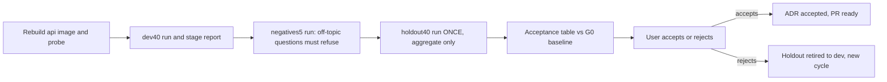

# G5 - Acceptance on the sealed holdout and ship

Read [`00-rules-and-commands.md`](./00-rules-and-commands.md) first.

**Depends on:** G4b done (G4a kept, or reverted and re-ingested by the
G4b stop rule), pushed, green.
Every kept packet has an `## After <packet>` section in
`docs/evaluation/GENERAL_ANSWER_QUALITY_2026-10.md`.
**Live run:** yes - dev40 once, negatives5 once, holdout40 **once**.
**No code changes in this packet.** If a run shows a bug, stop and
report; fixing it is a new cycle (runbook), not part of G5.

## Goal

Decide, with numbers, whether the repair is accepted:



## Acceptance targets (from the ADR; do not change them in this packet)

1. holdout40 strict passes at least 30 of 40, and not below the G0
   holdout baseline.
2. holdout40 generation losses (`5a_draft_missing` +
   `5b_removed_after_draft`) at most half of the G0 holdout count
   (round down).
3. `scripts/check_gold_literals.py` exits 0.
4. negatives5: 5 of 5 answers have status `insufficient_evidence`.
5. Verifier, release, and invented-expansion unit tests pass.
6. p90 wall seconds on holdout40 at most 5.0 s above the G0 holdout p90.

A target that fails is reported as failed. Never re-run the holdout,
never edit gold, never relax a target to make it pass.

## Step 1 - Preflight

```powershell
git switch fix/general-answer-quality
git pull --ff-only
git status --short
uv run python scripts/check_gold_literals.py
uv run python -m pytest tests/unit/test_answer_verifier.py tests/unit/test_answer_verifier_integration.py tests/unit/test_answer_verifier_scope.py tests/unit/test_answer_filter_invented.py tests/unit/test_company_scope_fail_closed.py tests/unit/test_verifier_verbatim_support.py -q
uv run python scripts/check.py --tier unit
gh pr checks
```

Pass: `git status --short` shows no modified tracked files (untracked
private files are fine), the guard exits 0 (target 3), the pytest line
shows `passed` with 0 failed (target 5), the unit tier exits 0, and
every PR check is `pass`. If `test_verifier_verbatim_support.py` does
not exist because G2 was reverted, drop it from the command and say so
in the report. Any other failure: stop.

Confirm the holdout has not been run since G0 (only the baseline folder
may exist):

```powershell
Get-ChildItem .private-eval/runs -Directory -Filter "holdout40-*" | Select-Object -ExpandProperty Name
```

Pass: exactly `holdout40-g0-baseline`. Anything else: stop and report;
the holdout is no longer sealed and the user must decide.

## Step 2 - Rebuild and probe

Run the 00-rules "Docker rebuild before any live run" commands and the
probe. Every kept packet prints `present`, every reverted or skipped
packet prints `MISSING`. Write down which is which. Also run:

```powershell
docker run --rm --network none smart-rag-parser-sandbox:local python -c "from smart_rag_core.ingestion.parser.limits import PDF_PARSER_VERSION; print(PDF_PARSER_VERSION)"
uv run python -c "from smart_rag_core.ingestion.chunking.limits import CHUNKING_POLICY_VERSION; print(CHUNKING_POLICY_VERSION)"
```

Expected: `parser_v1_pdf_reflow_v5` and `chunking_v3` when G4a was kept,
otherwise `parser_v1_pdf_reflow_v4` and `chunking_v2`. The "Current
book" line in 00-rules must show the same parser version.

## Step 3 - dev40 final run

Live command with `$run = "dev40-g5-final"`, then the stage report and
the "Latency p90" command. Record strict passes, the eight stage counts,
the removed-after-draft causes, and p90. This run is informative only;
it does not decide acceptance.

## Step 4 - negatives5 (refusal check)

Create `.private-eval/negatives5-2026-10-v1.json` (private, never
committed). Five questions about topics that are certainly **not** in
the book (for example sports results, cooking recipes, a city's
population, a film plot, a tax rate). Each item:

```json
{
  "id": "n01",
  "kind": "text",
  "page": 0,
  "prompt": "<PREFIX> <off-topic question>? Use only that document.",
  "facts": [{"id": "n01-f1", "canonical": ["no-answer-sentinel-qzx"], "aliases": []}]
}
```

`<PREFIX>` is the same prefix as the dev40 prompts (see G0 Step 8b rule
1). Ids `n01`-`n05`, fact ids `n0X-f1`. Write it UTF-8 without BOM:

```powershell
.venv\Scripts\python.exe -c "import json; d=json.load(open('.private-eval/negatives5-2026-10-v1.json',encoding='utf-8')); print(len(d), sorted(i['id'] for i in d))"
```

Expected: `5 ['n01', 'n02', 'n03', 'n04', 'n05']`.

Run it with the live command, `$run = "negatives5-g5"` and
`--gold .private-eval/negatives5-2026-10-v1.json`. Then:

```powershell
.venv\Scripts\python.exe -c "import json,collections; a=json.load(open('.private-eval/runs/negatives5-g5/answers.json',encoding='utf-8')); print(dict(collections.Counter(v['status'] for v in a.values())))"
```

Target 4 passes with `{'insufficient_evidence': 5}`. Strict passes are
0 by design (the sentinel never appears). If any other status shows,
record the ids and statuses only. Do not "fix" it in G5; note which
packet probably caused it (a non-refusal with released quotes points at
the G3 quote fallback).

## Step 5 - holdout40, exactly once

Do not start this step until Steps 1-4 are done. Do not open
`answers.json`, `summary.json`, or `stages.json` of this run except
through the three commands below.

```powershell
$run = "holdout40-g5-final"
New-Item -ItemType Directory -Force ".private-eval/runs/$run" | Out-Null
uv run python scripts/run_company_ask.py `
  --gold .private-eval/holdout40-2026-10-v1.json `
  --out ".private-eval/runs/$run/summary.json" `
  --credentials .private-eval/eval-credentials.json `
  --progress ".private-eval/runs/$run/progress.json" `
  --answers-out ".private-eval/runs/$run/answers.json" `
  --stage-export ".private-eval/runs/$run/stages.json"
```

Run it in the background and poll `progress.json` (00-rules). If the run
crashes part-way, re-run the same command with the same folder: the
runner resumes from `--answers-out`, so questions already asked are not
asked again. That is still the single holdout run. If the stack itself
was broken (for example `query_ready` false for many questions), stop
and report; do not start a second full run without the user's approval.

After it finishes:

```powershell
uv run python scripts/eval_stage_loss.py --run ".private-eval/runs/$run" --gold .private-eval/holdout40-2026-10-v1.json --json-out ".private-eval/runs/$run/stage-loss.json" --aggregate-only
.venv\Scripts\python.exe -c "import json; o=json.load(open('.private-eval/runs/holdout40-g5-final/summary.json',encoding='utf-8'))['outcomes']; print('holdout strict_pass', sum(bool(x['strict_pass']) for x in o), '/', len(o))"
```

Then the 00-rules "Latency p90" command for `holdout40-g5-final` and for
`holdout40-g0-baseline`.

## Step 6 - Acceptance table

Get the G0 numbers:

```powershell
.venv\Scripts\python.exe -c "import json; [print(r, {k: json.load(open(f'.private-eval/runs/{r}/stage-loss.json',encoding='utf-8'))[k] for k in ('strict_passes','stages','removed_after_draft_causes')}) for r in ('holdout40-g0-baseline','holdout40-g5-final','dev40-g0-baseline','dev40-g5-final')]"
```

Fill `## Acceptance (G5)` in
`docs/evaluation/GENERAL_ANSWER_QUALITY_2026-10.md` (counts only, no
ids for the holdout):

```markdown
| Check | G0 baseline | G5 final | Target | Result |
| --- | --- | --- | --- | --- |
| holdout40 strict passes (runner) | <n>/40 | <n>/40 | >= 30 and >= G0 | pass/fail |
| holdout40 5a + 5b facts | <n> | <n> | <= floor(G0 / 2) | pass/fail |
| gold-literal guard | n/a | exit <code> | exit 0 | pass/fail |
| negatives5 refusals | n/a | <n>/5 | 5/5 | pass/fail |
| verifier/release/invented tests | n/a | <passed> passed | 0 failed | pass/fail |
| holdout40 p90 wall seconds | <s> | <s> | <= G0 + 5.0 | pass/fail |
| dev40 strict passes (info) | <n>/40 | <n>/40 | info | - |
```

Below the table add: the holdout stage table (eight stages, G0 vs G5),
the list of kept and reverted packets from Step 2, and one sentence per
failed target saying what it means. No question ids, phrases, prompts,
or answer text for the holdout.

```powershell
uv run python scripts/check.py --tier docs
git add docs/evaluation/GENERAL_ANSWER_QUALITY_2026-10.md
git commit -m "docs(eval): G5 acceptance results on sealed holdout40"
git push
gh pr checks --watch --fail-fast
```

## Step 7 - Report to the user and wait

Send the user the filled acceptance table and this question:

```text
All targets: <k of 6 passed>. Do you accept the general answer-quality
repair as shown? "accept" marks the ADR accepted and the PR ready for
review. "reject" keeps the PR as a draft; holdout40 is retired to a dev
set and the next cycle starts with a new sealed holdout (runbook).
```

Wait for the answer. Never mark the ADR accepted without it.

## Step 8a - On "accept"

1. `docs/adr/ADR-general-answer-quality.md`: front matter
   `status: accepted`, `last-reviewed: <TODAY>`; `## Status` becomes
   "Accepted by the user on <TODAY> after G5 (see the evaluation
   evidence)"; add the user's words to `## Approvals recorded`.
2. `docs/adr/README.md` row status `accepted`; `docs/README.md` rows for
   the ADR and the evidence doc: status `accepted` / `final`, date
   `<TODAY>`.
3. Evidence doc front matter `status: final`.
4. Commit, push, checks, then mark the PR ready:

```powershell
uv run python scripts/check.py --tier docs
git add docs/adr/ADR-general-answer-quality.md docs/adr/README.md docs/README.md docs/evaluation/GENERAL_ANSWER_QUALITY_2026-10.md
git commit -m "docs(adr): accept general answer-quality repair (G5)"
git push
gh pr checks --watch --fail-fast
gh pr ready
gh pr view --json url,state,isDraft
```

Do not merge; the user merges.

## Step 8b - On "reject"

1. Retire the holdout:
   `Copy-Item .private-eval/holdout40-2026-10-v1.json .private-eval/dev-retired-holdout40-2026-10-v1.json`
   (the original stays; both are now dev data).
2. Evidence doc: add `## Decision` "Rejected by the user on <TODAY>;
   holdout40 retired to dev; next cycle per runbook". ADR stays
   `proposed`.
3. Commit `docs(eval): G5 rejected, holdout40 retired`, push, checks.
   The PR stays draft.
4. Tell the user the next cycle starts at runbook step "Write and seal a
   new holdout set", with the stage that lost the most facts on
   `holdout40-g5-final` as the next target (stage name and count only).

## Step 9 - Ledger

If the work came from a Notion ticket, append the ledger block per the
`workday-report` skill (ticket URL, Request ID, title, PR link). Notion
stays read-only.

## Done when

- [ ] Preflight passed; holdout folder list showed only the G0 baseline.
- [ ] Probe recorded kept and reverted packets.
- [ ] dev40, negatives5, and holdout40 (once) ran; holdout stage report
      used `--aggregate-only`.
- [ ] Acceptance table filled with numbers for all six targets;
      committed; PR checks green.
- [ ] User answer quoted; Step 8a or 8b done; PR state matches.

## Commit messages

```text
docs(eval): G5 acceptance results on sealed holdout40
docs(adr): accept general answer-quality repair (G5)
docs(eval): G5 rejected, holdout40 retired
```

## Do not

- Do not run holdout40 a second time, look at its answers, or tune
  anything on it.
- Do not change code, prompts, or gold in G5.
- Do not merge the PR.
- Do not mark the ADR accepted without the user's explicit "accept".
