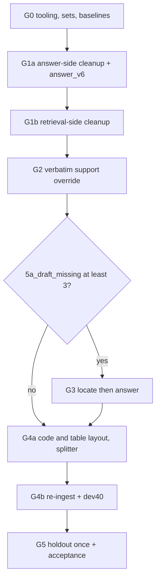

# General answer-quality repair (gpt-4o-mini only)

## How to execute this plan (for the implementing model)

- Read [general-answer-quality/00-rules-and-commands.md](general-answer-quality/00-rules-and-commands.md) first in every run, then **exactly one** packet file. Do not read sibling packets.
- Packets run in this order, one per run. Each packet has exact files, code, tests, commands, a stop rule, "Done when" checks, and commit messages.
  1. [G0 - setup tooling and sets](general-answer-quality/G0-setup-tooling-and-sets.md)
  2. [G1a - remove answer-side special cases](general-answer-quality/G1a-remove-answer-side-special-cases.md)
  3. [G1b - remove retrieval-side special cases](general-answer-quality/G1b-remove-retrieval-side-special-cases.md)
  4. [G2 - verbatim support override](general-answer-quality/G2-verbatim-support-override.md)
  5. [G3 - locate then answer (conditional)](general-answer-quality/G3-locate-then-answer.md)
  6. [G4a - PDF code and table layout (code only)](general-answer-quality/G4a-pdf-code-and-table-layout.md)
  7. [G4b - re-ingest and measure](general-answer-quality/G4b-reingest-and-measure.md)
  8. [G5 - acceptance and ship](general-answer-quality/G5-acceptance-and-ship.md)
- A packet reverted by its stop rule does not block the next one; the next packet compares with the last kept run (00-rules rule 17).
- Two points need the user: G5 accept/reject, and any stop the packet tells you to report. The G4b re-ingest was pre-approved on 2026-10-06.

## Why scores stay around 60% (measured)

- On 130 first-time facts (fresh-30, fresh-50, mix-50), the generated draft held the fact **104** times and the released answer only **80** times.
  - 13 correct drafts were overwritten by question-specific `salvage_*` functions.
  - 13 correct claims were rejected by the gpt-4o-mini verifier (mostly literal code lines and table rows).
  - The salvages repaired only 2 wrong drafts.
- Earliest losing stage over 275 facts in 6 first-time runs: generation 100, rerank/select 28, retrieval 9, fusion pool 5, ingestion 1.
- Re-runs on a tuned set reach up to 100%, but the next fresh set falls back to 43-62%. The fixes match single questions (regexes holding gold words in `generate_grounded.py`, `retrieval/rerank.py`, `retrieval/context.py`, and question-specific bullets in `answer_v5.md`), so they do not transfer.
- General fixes did transfer: the earlier rerank fixes cut rerank losses from 16/50 to 1-2 per run on every new set.
- Only 10 of 102 stored code chunks keep line breaks, and table cells are stored as loose words, so the model often cannot reproduce code or tables. Measured on the PDF: 2,469 monospace code lines in 127 runs (20 runs are 401-539 tokens and would be split by the 400-token prose target), and 20 captioned tables plus 5 page continuations whose cells are one PDF line each.
- `&quot;` in streamed answers is added at the SSE boundary and decoded by the frontend and scorer. It is not a defect and is not in this plan.

## What is proven and what is not

- Proven: retrieval reaches about 90% of facts; post-processing removes about 24 of 130 correct drafts; the removal causes are known by type.
- Not proven: that keeping verbatim claims does not release unsupported text (G2 limits it to fact claims that are literal substrings of a cited passage); that the locate call helps the drafts that never had the fact (G3 is gated and has its own stop rule); that results on this one book carry over to other documents.
- No plan can guarantee a score. This one guarantees that every change is measured on dev, reverted if its target stage does not improve, and accepted only on a holdout nobody tuned on.

## The procedure (permanent, used for every future fix)

```mermaid
flowchart LR
  writeHoldout["Write and seal a new holdout set"] --> devRun["Run the dev set"]
  devRun --> stageReport["Stage-of-loss report"]
  stageReport --> pickStage["Pick the stage that loses the most facts"]
  pickStage --> generalFix["General fix: pattern in 3+ questions across 2+ sets"]
  generalFix --> guard["Gold-literal guard and tests"]
  guard --> devRerun["Dev rerun: that stage's loss must drop, else revert"]
  devRerun --> holdoutOnce["Run the holdout once"]
  holdoutOnce --> retire["Holdout becomes a dev set"]
  retire --> writeHoldout
```

Rules (Cursor rule `.cursor/rules/80-general-fix-policy.mdc` and runbook `docs/runbooks/answer-quality-repair-loop.md`, both written in G0):

1. Dev sets are for debugging. A holdout is written and sealed before any fix, run once for acceptance, then retired to dev.
2. Every run produces the stage-of-loss report, with generation split into 5a (draft never had the fact) and 5b (post-processing removed it).
3. Only general fixes: no question wording, gold phrase, page number, or book term in code or prompts. `scripts/check_gold_literals.py` enforces it before every commit.
4. Stop rule: if the packet's target stage does not drop on dev, or strict passes drop by more than 3, revert the packet.

## Packet summary

- **G0** (no runtime change): branch `fix/general-answer-quality` and draft PR; park fresh-30 work on `wip/fresh30-postfix`; tracked `scripts/eval_stage_loss.py` and `scripts/check_gold_literals.py` with tests; rule, runbook, ADR, evidence doc; write and validate `dev40` and the sealed `holdout40`; run both baselines.
- **G1a**: delete the question-specific answer-side salvages; new `answer_v6.md` with general rules only (old prompt files unchanged). Target: 5b `salvage_overwrite` down.
- **G1b**: delete question-specific retrieval promotions and seed terms; keep the generic `def <name>(` and `Table N-M` promotions and query-only seeds. Target: guard exits 0 with no retrieval regression above 3 facts.
- **G2**: a verifier "unsupported" verdict is ignored for a fact claim whose normalized text (at least 12 characters) is a substring of a cited passage. No prompt, model, schema, or call-count change. Target: 5b refused/trimmed down.
- **G3** (only if 5a is at least 3): one `locate_v1` gpt-4o-mini call returns up to 3 quotes; code keeps only exact substrings; the answer call (`answer_v7`) sees them first; a quote fallback applies only when the answer refuses or is empty. Skipped when it would use the answer/verifier reserve or the deadline is short. Target: 5a down.
- **G4a** (code only, no database change):
  - Monospace PDF lines keep line breaks and indentation rebuilt from x positions.
  - Table regions (row bands of side-by-side cell lines with aligned columns) become Markdown pipe tables when a `Table <n>` caption is within 60 points, or when they continue the previous page's table with the same columns. Wrapped cell lines join their cell. Index and glossary pages are left alone (verified on the book).
  - The prose splitter keeps any paragraph with single newlines whole up to 536 tokens, otherwise splits at line ends and repeats a pipe table's header.
  - Versions `parser_v1_pdf_reflow_v5` and `chunking_v3`. 19 new tests including a real PDF fixture through `parse_file`. Target: private parse check shows more code and table structure and no fewer gold facts per element.
- **G4b**: re-ingest the book (pre-approved, no stop to ask); version report adds pipe-table and indented-line counts; dev40. Target: code + table strict passes up.
- **G5**: rebuild, dev40, negatives5 (off-topic questions must refuse), holdout40 once, acceptance table vs G0, user decision.

## Acceptance targets (recorded in the ADR in G0)

1. holdout40 strict passes at least 30 of 40, and not below the G0 holdout baseline.
2. holdout40 generation losses (5a + 5b) at most half of the G0 holdout count.
3. `scripts/check_gold_literals.py` exits 0.
4. negatives5: 5 of 5 off-topic questions refuse (`insufficient_evidence`).
5. Verifier, release, and invented-expansion unit tests pass.
6. holdout40 p90 wall time at most 5 s above the G0 holdout p90.

## Deviations recorded in the ADR

- Up to two gpt-4o-mini answer-stage calls per question (approved by the user in this conversation).
- The locate call reuses the existing answer operation and `usage_kind = "answer"` with a second allowed prompt pin, so no migration and no new gateway method are needed.
- The verifier verdict is overridden for verbatim claims (G2): a deterministic rule, limited to fact claims with real chunk citations.
- Question-specific salvage, promotion, and seed code is deleted; scores on older tuned sets are expected to drop.
- Parser version bump (`parser_v1_pdf_reflow_v5`), chunking version bump (`chunking_v3`), and book re-ingest (G4b); chunk ids change, so earlier traces no longer apply.
- Tables are rebuilt from line geometry, not PyMuPDF `find_tables` (which gave header-only or over-detected tables on this book). Limits: a table needs a caption or a same-column page continuation; merged cells come out as empty cells.
- Code and table passages may reach 536 tokens (above the 400-token prose target, under the 600 hard cap).
