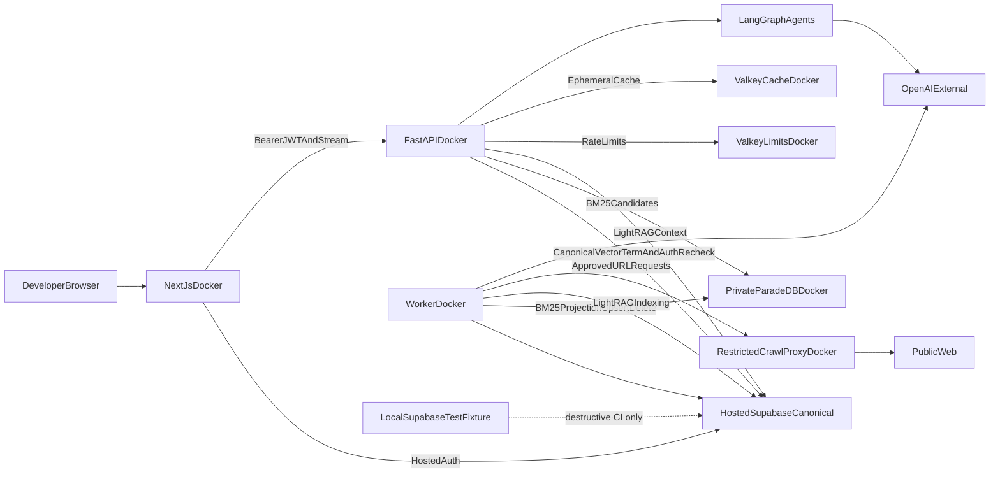
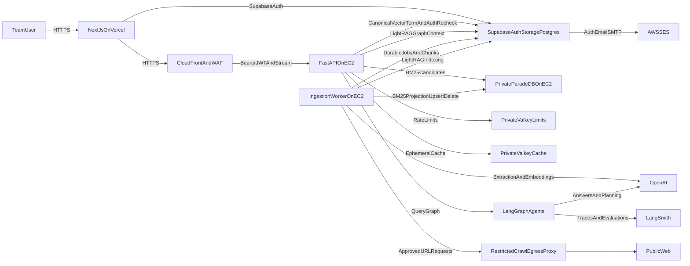

# Global contracts for every phase

## How to use this file

This file is mandatory input for every implementation phase. It contains the confirmed scope, measurable gates, architecture, data ownership, and whole-program sequence that no phase may silently weaken.

When instructions conflict, use this precedence:

1. security, authorization, canonical-evidence, durable-budget, bounded-work, idempotency, and safe-degradation invariants in this file;
2. the active phase's canonical detailed requirements and done gate;
3. current repository contracts and pinned primary dependency documentation;
4. examples and provisional implementation choices.

Repository reality does not silently override the plan. A conflict affecting security, data semantics, cost, or acceptance criteria requires a deliberate ADR and user approval.

## Non-negotiable implementation behavior

- Supabase canonical passages and deterministic table values are the only final-answer evidence for company RAG; graph output is a lead resolved back to authorized canonical sources. The advanced-web-research deviation below is the only exception: Web answers may cite creator-owned, run-scoped `app.web_sources` / `app.web_citations` persisted from bounded Exa or crawl-proxy results. Those rows are never company RAG, BM25, LightRAG, or StructuredTable evidence.
- Core routing is deterministic. Graph-only is inspection, not an answering fallback.
- Every read/write/retrieval path enforces role, ownership, current-version, deletion, and ACL rules at the authoritative boundary.
- Budgets, jobs, checkpoints, idempotency keys, usage, and security state are durable; Valkey and process memory are never authoritative.
- Work is bounded by explicit candidates, rows, bytes, tokens, calls, tools, retries, hops, concurrency, deadlines, and recursion limits.
- Failures degrade only along approved routes, remain observable, and never create fake success or uncited answers.
- Every external integration is pinned/qualified, every unstable contract has a real contract test, and every change updates its documentation.
- Later-phase infrastructure is not implemented speculatively. Earlier phases create only the interfaces and evidence their own exit gate requires.

## Canonical global requirements

## 1. Starting point and confirmed decisions

The repository folder is a greenfield build with review/planning documents, including the six historical reports under [`prev_review/`](../../../prev_review/) and [`PLAN_WEAKNESS_REVIEW.md`](../../../prev_review/PLAN_WEAKNESS_REVIEW.md), but no application implementation yet. Preserve review history, initialize the project, and do not copy code that is only described by those reports.

Use the prior reviews as hard requirements, especially the production blockers in [`prev_review/17_PRE_PROD_REVIEW.md`](../../../prev_review/17_PRE_PROD_REVIEW.md), the security findings in [`prev_review/14_QA_SECURITY_REVIEW.md`](../../../prev_review/14_QA_SECURITY_REVIEW.md), and the architecture/documentation lessons in [`prev_review/15_QA_CODE_QUALITY_REVIEW.md`](../../../prev_review/15_QA_CODE_QUALITY_REVIEW.md) and [`prev_review/16_QA_DOCUMENTATION_REVIEW.md`](../../../prev_review/16_QA_DOCUMENTATION_REVIEW.md).

Confirmed scope:

- One company/team uses the application. Roles and ownership protect administration, mutations, private conversations, and runs. V1 LightRAG has one shared workspace, so only company-visible documents are graph-eligible; ACL-restricted documents remain available to authorized Hybrid searches but are never indexed into LightRAG.
- Files: PDF, DOCX, PPTX, XLSX, CSV, HTML, Markdown, and text, including OCR for scanned PDFs.
- V1 indexes text, OCR output, typed tables, and adjacent captions only. Answers whose material evidence exists only inside a figure, chart, diagram, or non-OCR image are a signed non-goal in [`docs/QUALITY_TARGETS.md`](../../../docs/QUALITY_TARGETS.md); the UI returns an explicit limitation notice instead of inventing an interpretation. [`docs/adr/ADR-vision-captioning.md`](../../../docs/adr/ADR-vision-captioning.md) records the evaluation/promotion trigger if the client later funds governed vision captioning.
- Daily runtime on the developer machine uses Docker sidecars only: private pinned ParadeDB/`pg_search`, FastAPI, worker, split Valkey, crawl proxy, and Next.js. Canonical Auth/Postgres/Storage, LightRAG tables, conversations, runs, citations, budgets, and LangGraph checkpoints persist to hosted Supabase project `smart-rag`. Local Docker Supabase is a labelled destructive-test fixture, not a runtime default. Development must not require AWS resources or AWS credentials.
- Hosted Supabase provides canonical Auth, Postgres, Storage, RLS, pgvector/trigram/search-term indexes, private LightRAG PostgreSQL storage, conversation/application data, LangGraph checkpoints, durable BM25 outbox jobs, and all security state. A separate private ParadeDB service holds only a rebuildable BM25 projection keyed by canonical chunk/version IDs because managed Supabase does not expose the required `pg_search` extension. See [`docs/adr/ADR-hosted-runtime-local-test-fixture.md`](../../../docs/adr/ADR-hosted-runtime-local-test-fixture.md).
- LightRAG is a replaceable graph engine behind an application-owned `GraphRetriever` interface. Use `PGTableGraphStorage`, not Apache AGE, so graph nodes/edges live in ordinary private Supabase PostgreSQL tables.
- LangGraph orchestrates ingestion and query workflows; LangSmith handles tracing, prompt/evaluation workflows, and production feedback.
- OpenAI supplies chat, extraction, accuracy-first bounded reranking with only a narrow trivial-lookup skip, and embedding models through one cost-controlled gateway.
- Deterministic core retrieval routing invokes Hybrid, LightRAG, and StructuredTable directly with no tool-catalog LLM call. Progressive disclosure is reserved for genuinely ambiguous optional capabilities such as export format, administration, and future MCP/external connectors.
- Supabase Auth supports email/password and Google OAuth. Roles are owner, admin, member, and viewer. Local Inbucket captures development auth emails; AWS SES is introduced only during the managed staging/production infrastructure steps.
- Private, ACL-authenticated Valkey limit/cache services run in Docker locally and later on EC2 with independent memory policies; durable security/work state remains in Supabase.
- UX is generated in Google Stitch from a detailed brief, then integrated into a complete Next.js frontend deployed to Vercel.
- XLSX/CSV ingestion preserves typed cells and sheet/range coordinates. Numeric aggregation uses a bounded structured-table tool; the answer model never invents totals from retrieved prose.
- Scale is unknown, so the project starts with explicit provisional quality/performance/cost targets below and requires client sign-off before Phase 4.

### Provisional measurable targets and mandatory sign-off

Record approved values in [`docs/QUALITY_TARGETS.md`](../../../docs/QUALITY_TARGETS.md) during Phase 1. Until the client approves replacements, use these launch gates:

- Capacity envelope: 10,000 Hybrid document versions, 1,000,000 canonical chunks, 25 concurrently active users, and five simultaneous query runs. The initial graph-eligible envelope is 2,000 current document versions/200,000 graph source chunks; raise it only if a full clean-workspace rebuild meets the seven-day maintenance SLO and approved maintenance budget.
- Embedding capacity and multilingual accuracy are a Phase 2 gate, not a Phase 9 discovery. Before any bulk embedding, create a frozen embedding-qualification slice containing at least 20 Arabic/mixed-language cases plus representative English semantic, exact-identifier, and vocabulary-mismatch cases, disjoint from the final launch holdout. [`docs/adr/ADR-embedding-model-dimension.md`](../../../docs/adr/ADR-embedding-model-dimension.md) compares `text-embedding-3-small` at its 1536-dimensional default against `text-embedding-3-large` at 1536 dimensions and at least one lower dimension using OpenAI's supported `dimensions` parameter, under identical chunks/queries. It pins the winning exact model/snapshot or approved stable alias, output dimension, `vector` versus `halfvec`, distance operator, and index version from per-language Recall@10/MRR/nDCG, cost, latency, and storage—not model reputation. Extrapolate heap + HNSW + build memory from a representative seeded index with `pg_relation_size` and include LightRAG's separate vectors. At the full envelope, the approved combined steady-state vector working set must fit within 60% of selected database RAM with documented maintenance headroom; otherwise reduce dimensions/envelope, qualify `halfvec`/quantization without unacceptable per-language recall loss, or resize before ingestion.
- Hybrid p95: first evidence/status within 2 seconds, first answer token within 5 seconds, and completion within 20 seconds.
- BM25 qualification: the pinned ParadeDB/`pg_search` version and image digest must index the full authorized text projection with Unicode tokenization, versioned Arabic normalization, field boosts, phrase/boolean queries, metadata/ACL prefilters, and stable canonical IDs. At the 1,000,000-chunk envelope, measure index size/RAM, p95 top-75 latency, write throughput, outbox lag, and clean rebuild duration. `Hybrid Ready` requires verified BM25 projection; normal ingestion keeps p95 projection lag below five minutes, and deletion/ACL safety remains immediate through the mandatory Supabase recheck even while asynchronous purge catches up.
- Combined p95: first answer token within 10 seconds and completion within 35 seconds, including LightRAG graph retrieval, precomputed evidence-map joins, second-stage fusion, and verification; qualification forbids a duplicate LightRAG keyword-extraction call.
- Structured-table p95: deterministic result within 5 seconds, first answer token within 8 seconds, completion within 20 seconds; graph inspection p95 within 5 seconds for bounded views.
- Composite p95: first answer token within 12 seconds and completion within 40 seconds when table and text/graph branches run in parallel.
- Hard query deadline: 25 seconds for Hybrid, 45 for Combined, 30 for StructuredTable, 50 for Composite, and 10 for graph inspection; at most one routing/retrieval correction, at most three subquestions, and a LangGraph `recursion_limit` of 24 supersteps. Deadline/recursion exhaustion returns verified partial or insufficient evidence.
- Count every gateway model invocation, including query preparation/routing/rewriting, query embeddings (one batched retrieve call over the original query plus at most three variants), any LightRAG callbacks, reranking, answer, summary, and verifier: maximum seven for Hybrid, eight for Combined, six for StructuredTable, nine for Composite, and three for inspection. Hybrid targets at most six normally; the seventh is available only when the single same-route correction requires a second bounded rerank or a due summary cannot be safely deferred. Query preparation combines rewrite/profile into one structured call when both are needed. Allow at most four tool executions (five for Composite), one optional discovery/selection model round, and one side-effecting tool. Exhaustion follows the same verified partial/refusal rule.
- Ingestion throughput on the selected launch hardware: at least 500 text-based pages/hour and 100 OCR pages/hour through Hybrid readiness; LightRAG throughput and cost are reported separately because extraction-model limits dominate it.
- Graph throughput is measured as current document versions/hour through mapping-verified `Graph Ready` under the concurrency-one writer, plus cost/version. The admin UI shows backlog count and rolling ETA. Initial/bulk onboarding is an owner-approved maintenance operation with a reserved budget; if the 2,000-document envelope cannot become Graph Ready within seven days at measured throughput, reduce the advertised graph envelope or fund/approve a different graph-ingestion design before onboarding.
- Graph deletion/ACL enforcement is immediate at the canonical resolver, targeted LightRAG cleanup verifies within 24 hours, and dirty changes are consolidated into a clean-workspace rebuild within seven days. Before graph launch, set the monthly maintenance reserve to at least `max(USD 800, 4 × measured full-rebuild cost)` and reduce the graph envelope if one rebuild cannot finish inside seven days. Cleanup/rebuild bypasses normal ingestion limits; if the maintenance reserve is unavailable, canonical deletion still succeeds but graph service stays quarantined until funded cleanup completes.
- Phase 1 cost sign-off presents normal operation (`USD 200/month` plus `USD 20/ingestion day`) and the separate graph compliance/maintenance reserve as distinct commitments and explicitly records that the reserve may be materially larger. Before first bulk onboarding, document scale-trigger candidates—domain/workspace sharding, dedicated managed LightRAG PostgreSQL behind `GraphRetriever`, and evaluated incremental compaction/rebuild strategies—so a seven-day/rebuild trigger review does not start from zero.
- Chunking gate: versioned structure fixtures preserve heading ancestry, list items, table headers/rows/cells, page/sheet/slide/URL spans, and reading order with zero orphaned or unmarked/unreconstructable mid-row/mid-item splits. At least 90% of ordinary prose passages fall in the 200–400 embedding-token target, no normal passage exceeds 600 tokens, and every exception/duplicate suppression has recorded provenance. On labeled duplicate fixtures, fuzzy suppression starts with at least 99% precision and 85% recall; if precision misses, use exact-only suppression until retuned.
- Evaluation gates: zero ACL leaks; citation correctness at least 98%; citation completeness and answer faithfulness at least 90%; routing accuracy at least 90%; Hybrid Recall@10 at least 85%; exact-identifier/code Recall@5 at least 98%; approved-alias Recall@10 at least 95%; and Combined must improve relationship/multi-hop success by at least 10 percentage points over Hybrid alone without violating latency/cost ceilings. Provisional query-profile gates are language/configuration accuracy at least 95%, temporal-intent macro-F1 at least 90%, exact-code/date extraction F1 at least 98%, entity/approved-alias extraction macro-F1 at least 90%, metadata-filter precision and recall at least 95%, and query-type/relationship/table/decomposition macro-F1 at least 90%; signed values live in `QUALITY_TARGETS.md`. A retrieval run is not blamed on ranking until those fields are scored.
- Initial normal-operation OpenAI ceiling: USD 200 per month and USD 20 per ingestion day until explicitly changed by the owner. The separate compliance/graph-maintenance reserve above is visible in the same usage dashboard but cannot be consumed by ordinary chat/ingestion. The application rejects or pauses normal spend when its durable budget is exhausted.
- Temporal policy uses UTC for storage, `now`, `latest`, `current`, `recent`, and `as_of` comparisons unless the owner signs one alternate company timezone in `QUALITY_TARGETS.md`. Source date parsing is deterministic and versioned; mixed Arabic/English Gregorian formats require fixtures, and Hijri dates are not authoritative `effective_at` values in v1 unless a separately signed parser/fixture contract is approved.
- Availability for the single-host v1: best-effort service, RTO at most four hours and RPO at most 24 hours, with brief health-gated deployment interruption accepted. Open a multi-host availability ADR within ten business days when any trigger occurs: active users/concurrent runs exceed 80% of the supported envelope for 30 days, EC2 or database CPU/memory/IO is above 70% for three 15-minute windows in a week after tuning, two availability incidents occur within 90 days, one incident misses RTO/RPO, or the business requires tighter targets. The review selects independent API/worker capacity, external rate-limit/cache service, and database/read-workload isolation rather than silently extending the single-host ceiling.
- Schema and independently deployed API/frontend contracts evolve additively. Database changes follow expand → deploy compatible code/backfill → contract across separate releases; destructive DDL never shares a release with its expansion. OpenAPI and SSE fields/events remain backward-compatible within a major version, and staging proves old-slot/new-schema plus Vercel/API version-skew behavior before production.

These are falsifiable defaults, not promises that an undersized Supabase/EC2 tier can meet them. Phase 9 load results either prove the envelope, reduce the documented supported limits, or trigger infrastructure resizing before staging.

### What the finished application does in plain language

An authorized company user can:

1. Sign in with email/password or Google.
2. Upload company files or provide a website URL.
3. Watch each source move through `Uploaded`, `Scanning`, `Parsing`, `Hybrid Ready`, `Graph Pending`, `Graph Ready`, `Graph Ineligible`, `Deletion Pending`, or `Failed`.
4. Ask a normal-language question in the chat screen.
5. Let `Auto` route direct facts to Hybrid and relationship/multi-hop questions to Combined. An advanced test panel can compare `Hybrid` and `Combined`; graph-only appears as an inspection diagnostic, not the normal answering path.
6. Receive a streamed answer with citations that open the exact file page, section, sheet, slide, or URL used.
7. Inspect related entities and paths in a graph explorer.
8. Give feedback on the answer so retrieval prompts and evaluations can improve.
9. If authorized, manage users, documents, tool permissions, usage budgets, and failed ingestion jobs.

The application does not fine-tune a model on company files. It stores/indexes files privately and sends bounded evidence to the configured OpenAI API only after the documented retention/training/DPA settings and client-approved data-governance policy are in force.

### Plain-language glossary

- **RAG:** Retrieval-Augmented Generation. The application searches company knowledge first, then asks the LLM to answer using the retrieved evidence.
- **Chunk:** A small, traceable piece of a document, such as a paragraph, page section, spreadsheet range, or slide.
- **Embedding/vector:** A numeric representation of meaning. Similar questions and chunks have nearby vectors, enabling semantic search even when they use different words.
- **BM25 search:** Relevance-ranked keyword search using term rarity, term frequency, and document-length normalization. V1 runs it in a private pinned ParadeDB/`pg_search` service, not managed Supabase, and treats its output as candidate IDs rather than authoritative evidence.
- **Hybrid RAG:** Runs canonical Supabase semantic vector and exact/trigram/search-term retrieval alongside private BM25 retrieval, combines their ranks, batch-rechecks every candidate against Supabase authorization/current-version state, then uses accuracy-first top-20 OpenAI reranking for non-trivial queries before diversifying evidence; only a fully supported trivial exact lookup may skip. This is the default for ordinary factual questions.
- **GraphRAG:** Searches entities and relationships. LightRAG provides local, global, and graph-hybrid context for questions involving connections or several reasoning steps.
- **LightRAG:** The built-in graph extraction/retrieval engine. It stores graph/KV/vector/status data in private Supabase PostgreSQL tables and returns context to LangGraph; it does not authenticate users or generate the final user-facing answer.
- **PGTableGraphStorage:** LightRAG's recommended PostgreSQL graph backend for new deployments. It stores nodes and edges in ordinary indexed tables without Apache AGE.
- **LangGraph:** The workflow engine that makes ingestion and question answering explicit, resumable, testable steps rather than one uncontrolled prompt.
- **LangSmith:** The tracing and evaluation service used to inspect agent steps, latency, token usage, retrieval quality, and prompt versions.
- **Progressive disclosure:** When an optional tool is needed, the model first sees short descriptions and loads full instructions only for the selected tools. Core Hybrid/LightRAG routing bypasses this discovery step.
- **JWT:** The signed access token issued by Supabase after sign-in. FastAPI verifies it before serving protected data.
- **RLS:** Row Level Security in Supabase. Database policies enforce which records each signed-in role can read or change.
- **Worker:** A background process that parses files, runs OCR, creates embeddings, and updates the graph without blocking the web request.
- **Checkpoint:** Saved LangGraph progress. If a process restarts, the workflow resumes instead of repeating completed OpenAI calls.
- **BM25 projection job:** A durable Supabase outbox record that idempotently upserts, updates, or deletes a versioned canonical chunk projection in private ParadeDB. It carries IDs/search fields/filters, not authority; Supabase still rechecks every candidate.
- **Graph indexing job:** A durable Supabase record requiring a canonical document version to be indexed or deleted in LightRAG. It makes hybrid readiness and graph readiness explicit and retryable.
- **Valkey:** Redis-compatible in-memory services split into a protected no-eviction rate-limit instance and an independently bounded evicting cache instance; neither is permanent application state.

## 2. Development and production architecture

### Laptop Compose plus hosted Supabase

Laptop runtime boundaries:

- [`docker-compose.yml`](../../../docker-compose.yml) starts the backend, worker, a digest-pinned ParadeDB/`pg_search` service, separate Valkey rate-limit/cache instances, crawl-egress proxy, and frontend. It fails closed unless hosted `SUPABASE_URL`, transaction/session DSNs, and browser-safe public keys are supplied. It does not start local Supabase.
- Hosted Supabase is the only runtime Auth/Postgres/Storage target. API SQL may use the transaction pooler; worker, LangGraph checkpoint/store, and LightRAG require session/direct DSNs. ParadeDB remains a private derived BM25 index.
- Local Docker Supabase is started only by explicitly test-named fixture/CI scripts for destructive reset, RLS, and schema-determinism work. Those suites refuse `*.supabase.co`.
- ParadeDB and both Valkey instances remain on private Docker networks with distinct least-privilege credentials and hard memory limits; ParadeDB exposes no browser/public port, and LightRAG has no public server endpoint.
- Local files use development-only values in ignored env files. OpenAI and optional LangSmith are the only external services needed for real-model development; tests default to mocks/frozen fixtures.
- The same Docker images and migrations that pass on the laptop are promoted later, avoiding a separate AWS-specific application implementation.
- Windows development uses Docker Desktop's WSL2 backend. Minimum supported resources are 16 GB RAM, four CPU cores, and 40 GB free SSD; 32 GB RAM, eight cores, and 80 GB free are recommended for ParadeDB, OCR, Playwright, and the optional local fixture together. If bind-mount/file-watch performance is poor, keep the repository in the WSL2 ext4 filesystem and run the helper scripts through WSL.

Expected daily Windows/Docker Desktop workflow:

1. Copy [`.env.hosted-ingest.example`](../../../.env.hosted-ingest.example) guidance into ignored `.env` / `.env.compose` and run [`scripts/ops/wire_hosted_ingest_env.py`](../../../scripts/ops/wire_hosted_ingest_env.py) so Compose receives hosted Auth plus separate transaction/session DSNs. Never commit values.
2. Run [`scripts/dev.ps1`](../../../scripts/dev.ps1), which starts laptop Compose sidecars only. It must not start or reset local Supabase.
3. Open the frontend and FastAPI `/docs` / `/health/live` using the URLs printed by the startup script. Inspect chat rows in hosted Studio, not local `:54322`.
4. Use a mock-LLM profile for fast tests with no OpenAI cost, or the real-model profile for manual RAG evaluation.
5. Run [`scripts/stop.ps1`](../../../scripts/stop.ps1) to stop Compose without touching the local test fixture. Destructive local reset remains [`scripts/reset.ps1`](../../../scripts/reset.ps1) `-ConfirmReset` plus the fixture starter.

### Final production target

Runtime boundaries:

- Vercel hosts only the Next.js application and public Supabase configuration.
- CloudFront plus AWS WAF protects the public API, applies managed/bot/size/rate rules, and forwards streaming without response caching. The EC2 origin validates a secret origin header and restricts ingress to CloudFront origin-facing ranges; Caddy also enforces connection/header/body/time limits.
- EC2 Docker Compose hosts Caddy, two health-gated FastAPI slots for same-host blue/green deployment, the ingestion worker, digest-pinned private ParadeDB/`pg_search`, separate Valkey limit/cache instances, and a restricted crawl-egress proxy. LightRAG runs as pinned Python code inside FastAPI/worker and uses managed Supabase PostgreSQL; no ParadeDB/Valkey/proxy service publishes a public host port.
- Production egress is deny-by-default at the host/Docker boundary. API/agent traffic is allow-listed to required Supabase, OpenAI, LangSmith, and AWS endpoints through a controlled provider-egress path. Website retrieval alone uses the dedicated crawl proxy, which repeats DNS/private-IP/redirect/peer-IP policy and logs destination/decision metadata. Parser/OCR sandboxes keep zero network. If the selected single-host platform cannot enforce these boundaries, Phase 10 blocks production until an explicit client-approved egress-risk ADR and compensating monitoring are accepted.
- FastAPI runs the query LangGraph in-process for low-latency streaming. The worker runs the checkpointed ingestion graph. [`apps/agents/langgraph.json`](../../../apps/agents/langgraph.json) keeps both graphs inspectable in LangGraph Studio and allows a later independent agent deployment without redesigning the graph code.
- Supabase is canonical for documents, authorization, BM25 projection jobs/active-index version, conversations, citations, vector/term indexes, typed table artifacts, LangGraph checkpoints, and private LightRAG storage. ParadeDB is derived and rebuildable; it returns canonical chunk IDs/ranks only. Final answers use Supabase-revalidated canonical passages or deterministic spreadsheet values linked to exact source cells; BM25 snippets and graph prose are never standalone evidence. Web answers, when the advanced-web-research deviation is enabled, use only run-scoped `app.web_sources` persisted from bounded Exa/crawl-proxy results and never mix those rows into company RAG.

### Where each kind of data lives

- **Supabase Storage:** original files, quarantined uploads, accepted files, and website snapshots.
- **Supabase application schemas:** users, roles, canonical document metadata/chunks, typed table manifests, hybrid embeddings/trigram/search-term indexes, BM25 projection outbox/index-version state, jobs, chats, citations, tool catalog, durable usage/budget reservations, feedback, and audit events.
- **Private ParadeDB on EC2/local Docker:** a digest-pinned `pg_search` BM25 projection containing canonical chunk/version IDs, normalized searchable text, field/filter metadata, and opaque ACL scope IDs. It has reader/writer roles, no public endpoint, no canonical authority, and can be destroyed/rebuilt from Supabase.
- **Private LightRAG schema in Supabase:** pinned LightRAG `PGTableGraphStorage`, `PGVectorStorage`, `PGKVStorage`, and `PGDocStatusStorage` tables. These are backend/worker-only implementation data and are not exposed through the public Data API.
- **Valkey limits:** expiring FastAPI-owned rate-limit counters only, `maxmemory-policy noeviction`, and no durable authority. Browser-direct email/password, OAuth, password-reset, and MFA operations are throttled by configured Supabase Auth controls; FastAPI Valkey plus the Postgres degraded path in [legacy Section 10 FastAPI/security requirements in Phase 6](./06-phase-agent-intelligence.md#10-fastapi-contract-streaming-and-security) covers only FastAPI-mediated invitation, upload, crawl, chat, and administration operations. Neither boundary may claim to throttle traffic it does not receive.
- **Valkey cache:** short-lived query-profile, query-embedding, and retrieval-result cache only with an independent memory cap and evicting policy. Every key includes the authenticated principal/ACL-scope hash, frozen profile/index versions, and a monotonic document-visibility generation changed by deletion, ACL downgrade, or current-version flip. Retrieval entries store IDs/ranks rather than trusted evidence, use a provisional 30-second TTL (profiles/embeddings 300 seconds), receive best-effort event invalidation, and always revalidate current-version/deletion/ACL in authoritative Postgres before evidence assembly. TTL is never the ACL control. Losing or bypassing cache affects latency only and cannot erase or weaken jobs, reservations, usage, or security state.
- **LangGraph checkpoint tables in Supabase:** the current step and compact state for ingestion and chat runs. Large files and full retrieval payloads are referenced by ID instead of copied into every checkpoint.
- **LangSmith:** redacted traces and evaluation results. Raw private source content is disabled or sampled only under an explicit development setting.

### Why Hybrid, BM25, and LightRAG remain separate components

The custom Hybrid RAG, derived BM25 projection, and LightRAG have different responsibilities. Supabase owns canonical passage/vector/term data and authorization. Private ParadeDB owns BM25 candidate ranking only. LightRAG owns entity/relation extraction and local/global graph context in Supabase. LangGraph coordinates them through `Bm25Retriever` and `GraphRetriever` interfaces, batch-rechecks BM25 and graph candidate IDs against authorized current Supabase chunks, and generates the final answer only from those chunks. If ParadeDB fails, Hybrid visibly degrades to vector plus exact/trigram term search; if LightRAG fails, Hybrid remains usable and the UI shows `Graph Pending` or graph fallback.

## 16. Implementation sequence

1. Foundation: initialize the repo, scaffold the Section 3 uv/pnpm workspace and import boundaries, configuration, WSL2/local Compose including private digest-pinned ParadeDB plus split Valkey/crawl proxy, document same-host TLS/licensing/availability decisions, tiered CI, C4 skeleton, risk register, and obtain sign-off on quality/cost/capacity/RTO/availability-trigger targets.
2. Identity/data: hosted Supabase runtime plus private ParadeDB bootstrap, migrations/outbox, per-deployable Supabase and BM25 roles, connection-budget/workload-isolation proof, asymmetric signing/JWKS rollover, Storage/Auth/upload-MFA/invitations/RLS/graph-eligibility, disjoint Arabic/mixed embedding bake-off plus model/dimension memory ADR, protected migration credentials, retention/audit-chain foundations, and a local Supabase fixture for destructive RLS/reset tests.
3. Core ingestion: leased queue, budget/backpressure, pinned ClamAV engine with fresh signatures, data-category gate, no-secret parser sandbox/accepted-risk ADR, approved crawl/egress boundary, typed element extraction, deterministic boilerplate cleaning, structure-aware 200–400-token passages/parents, exact/fuzzy deduplication, typed tables, embeddings, idempotent BM25 projection, checkpoints, deletion, and status APIs.
4. Hybrid RAG: immutable held-out dataset; seeded SME glossary/codes/aliases; lightweight contextual vectors; versioned Arabic/mixed normalization plus private ParadeDB BM25 with 75 candidates; filtered-HNSW iterative scans with 100 dense candidates; 30 exact/trigram candidates; max-normalized query variants; RRF; bounded temporal multipliers; accuracy-first top-20 OpenAI reranking/counterfactuals; per-field profile and per-query-class tuning; calibrated coverage/refusal; structured tables; benchmarks; and citations.
5. GraphRAG: pin LightRAG, single-writer indexing, precomputed profile keywords, internal-chunk/graph-object-to-canonical passage maps, entity curation, atomic version visibility, global steering, deletion/ACL cleanup, bounded inspection, and graph tests.
6. Agent intelligence: deadline-bounded LangGraph, complete composable route matrix, escalation, deterministic Combined fusion/ablation, inference verification, optional-tool disclosure, memory, resumable streaming, reserve-once durable budgets, Valkey-down rate behavior, bounded CPU offload/event-loop telemetry, conversation deletion, traces, and thin UI.
7. Stitch specification: deliver the Stitch brief and API/UI map, then pause for the generated UX and review.
8. Frontend integration: implement the approved Stitch output, auth, chat test bench, documents, graph explorer, tools, settings, accessibility, and E2E tests.
9. Local release candidate: run the full Docker stack through load/eval/security tests including Supabase/ParadeDB/Valkey/CPU contention, BM25 sync/rebuild/outage behavior, graph-onboarding ETA, observability, Supabase restore including LightRAG, restart/resume, no-go review, and dependency/image audits without using AWS.
10. Managed staging: provision isolated managed Supabase/SES sandbox, private EC2 ParadeDB, CloudFront/WAF, EC2 and Vercel with production topology; prove OIDC/protected migrations, BM25 rebuild/fallback, JWKS and origin-secret rotation, egress isolation, real-CDN slow streaming, alerts, restore, and rollback using synthetic data.
11. Production: promote immutable images/configuration including the pinned BM25 service, provision production data services and email, verify DNS/TLS/CORS/redirects/alarms/budgets, smoke test BM25 synchronization/fallback, test rollback, and hand off.

### Effort and de-scoping joints

For one experienced full-time developer, excluding client/SME waiting time, estimate: Phase 1 1–1.5 weeks; Phase 2 1.5–2.5; Phase 3 3–4; Phase 4 3.5–5; Phase 5 4–6; Phase 6 3.5–5; Phase 7 0.5–1; Phase 8 3–5; Phase 9 1.5–2.5; Phase 10 1–1.5; Phase 11 0.5–1. Total planning range: approximately 23–35 weeks. Re-estimate after Phases 1, 4, and 6.

The release named production v1 requires Hybrid plus LightRAG and all v1 acceptance gates. The deliberate cut line is an optional prerelease `0.x Hybrid Pilot` after Phases 1–4 plus the Phase-6 thin chat/streaming/budget path and a minimal Phase-8 UI. If schedule/budget forces that cut, label it non-production/pilot and reschedule GraphRAG, graph explorer, and generalized optional-tool catalog before redefining a later production scope; it does not satisfy this plan's v1 completion criteria.

During Phase 1 sign-off create a dated Hybrid Pilot decision record with the client approver, decision checkpoints at the end of Phases 1 and 4, and objective continue-versus-pilot criteria such as Hybrid gates, revised Phase 5 estimate, SME availability, and approved budget. Phase 4 exit re-estimates delivery and records the decision before Phase 5 starts; silence is not approval to relabel the pilot as production.

### Review checkpoint and visible result for every phase

The detailed `Deliver`, `Review`, and `Done when` checkpoint is colocated with each phase so a constrained model does not need to load later-phase gates:

1. [Phase 1: Foundation](./01-phase-foundation.md#phase-deliver-review-and-done-gate)
2. [Phase 2: Identity and data](./02-phase-identity-data.md#phase-deliver-review-and-done-gate)
3. [Phase 3: Ingestion](./03-phase-ingestion.md#phase-deliver-review-and-done-gate)
4. [Phase 4: Hybrid RAG](./04-phase-hybrid-rag.md#phase-deliver-review-and-done-gate)
5. [Phase 5: GraphRAG](./05-phase-graphrag.md#phase-deliver-review-and-done-gate)
6. [Phase 6: Agent intelligence](./06-phase-agent-intelligence.md#phase-deliver-review-and-done-gate)
7. [Phase 7: Stitch specification](./07-phase-stitch-specification.md#phase-deliver-review-and-done-gate)
8. [Phase 8: Frontend integration](./08-phase-frontend-integration.md#phase-deliver-review-and-done-gate)
9. [Phase 9: Local release candidate](./09-phase-local-release-candidate.md#phase-deliver-review-and-done-gate)
10. [Phase 10: Managed staging](./10-phase-managed-staging.md#phase-deliver-review-and-done-gate)
11. [Phase 11: Production](./11-phase-production.md#phase-deliver-review-and-done-gate)

## Approved planned deviation: complete application MFA removal

User approval on 2026-08-24: remove MFA, TOTP enrollment/challenge/recovery, and AAL2 authorization requirements from every application environment. This is a deliberate security reduction, not ordinary UI cleanup.

- Recorded in `docs/adr/ADR-frontend-functional-overhaul.md`.
- Implementation is P08-11 then P08-12 on one feature branch; neither packet may merge alone.
- Existing applied migrations remain immutable. Use additive replacement functions/policies.
- Do not silently replace MFA with a new second factor.
- Preserve JWT verification, revoked/disabled-session checks, live role and authorization-version checks, RLS, server-side owner/admin enforcement, rate limits, destructive confirmations, generic errors, audit events, and IDOR-safe 404 behavior.
- Supabase Auth may retain dormant provider capability or compatibility fields that cannot be removed without breaking the current API major. Those fields must be deprecated, hidden from product UI, excluded from authorization decisions, and documented; they must not keep MFA operational in this application.

## Approved planned deviation: general-chat strict split

User approval on 2026-08-25; 2026-08-26 remediation accepted 2026-09-10: the production Ask surface and a separate live LangSmith Studio graph may answer general questions from OpenAI world knowledge, while company/document questions remain citation-required RAG with no world-knowledge fallback. Only a genuine conflict between company and general signals asks for clarification; unavailable, malformed, or low-confidence profile inference records a typed degradation reason and may produce an honest company-claim-forbidden general answer that explicitly states company documents were not searched.

- Recorded in `docs/adr/ADR-general-chat-strict-split.md`.
- Implementation is additive Phase 6 packets P06-09 through P06-15. P06-14 is a Phase 6/Phase 8 co-owned UI amendment. Do not uncheck historical completed Phase 6 packets or Phase 8 packets 1–21, and do not renumber active P08-22/P08-23.
- Keep `query_studio` deterministic and unbound. Live document access uses only `query_studio_live` with a real developer JWT from a gitignored environment variable.
- Never synthesize a live identity or use a service-role key for Studio document access.
- Never fall back from insufficient company evidence to world knowledge. Never emit canonical citations on a general/user-text/clarification answer.
- The production preparation path may consume one live counted `usage_kind="profile"` call under the existing profile and route ceilings. General, greeting, degraded, and user-text model calls consume the existing durable `usage_kind="answer"` reservation and immutable usage rows. No new usage kind or migration is authorized.
- Pure greetings and bounded small talk are profile-model classified and general-model answered; deterministic company signals still settle before the model. A live pure greeting normally costs one profile plus one answer call.
- Keep the five existing `KnowledgeScope` values and route families. The degradation reason is server-derived, never accepted from model output, and cannot authorize evidence.
- Validated `RetrievalPlan` selects explicit company, general, mixed, or fail-closed graph paths after plan compilation. Direct paths skip retrieval/correction/fusion/table/tool/verifier-model work but still run deterministic verification.
- Rollback disables general scope, restores the former post-plan linear edge, and removes the live graph registration without changing document RAG or durable usage history.

## Approved planned deviation: local PDF evaluation workspace

User approval on 2026-09-10: after Phase 6 Packet 9, run a local-only owner/admin PDF evaluation workspace and label-repair overlay before Packet 10 coding. Integrity keeps packet numbers contiguous, so overlay packets are P06-19 through P06-26 and execute immediately after Packet 9. Hosted-label custody is superseded by the deviation below.

- Recorded in `docs/adr/ADR-local-pdf-evaluation-workspace.md` (superseded for custody and official Recall@10).
- FastAPI uses `app_api` plus server-derived owner/admin identity. Operator and service-role DSNs are forbidden on this path.
- Holdout files remain outside the repository. The workspace never lists, fetches, or opens holdout.
- Automatic drafts may propose extractive questions. A named human must approve. The answering model receives only the question.
- Do not freeze `hybrid_long_document_v1`, retune frozen Hybrid weights, or open holdout until grounded labels and open-split gates pass.
- Rollback disables `PDF_EVAL_WORKSPACE_ENABLED` without changing document RAG.

## Approved planned deviation: hosted webapp evaluation workspace

User approval on 2026-09-10: store quiz questions, expected answers, gold metadata, and exam state in the existing hosted Supabase project. Day-to-day evaluation happens in the local/test webapp. The web exam measures production-corpus Hybrid Recall@10 (all required gold chunks in the signed-in examiner's production Hybrid top 10). Ordinary thumbs feedback stays. Holdout and freeze stay out.

- Recorded in `docs/adr/ADR-hosted-webapp-evaluation-workspace.md`.
- Integrity keeps packet numbers contiguous, so hosted packets are P06-27 through P06-36. Execute P06-27, then existing Packet 10, then P06-28 through P06-36, then resume P06-11.
- RLS, `app_api` RPCs, content-free audit, immediate delete, and 365-day retention are mandatory.
- Staging and production keep `PDF_EVAL_WORKSPACE_ENABLED` false.
- Managed Supabase region/DPA/backup rows remain unverified; this deviation is a named residual-risk exception, not matrix verification.
- Rollback disables `PDF_EVAL_WORKSPACE_ENABLED`. Do not down-migrate populated hosted tables.

## Approved planned deviation: advanced web research mode

User approval on 2026-09-10: add Ask dropdown Auto, Company documents, General, Web. Auto is the default and chooses exactly one source. Web research uses Exa REST plus the existing crawl proxy, only when `APP_ENV=local` and `WEB_SEARCH_ENABLED=true`. Staging and production reject the flag. Production Web stays disabled until a paid budget and managed egress are approved.

- Recorded in `docs/adr/ADR-advanced-web-research.md`.
- Integrity keeps packet numbers contiguous after P06-36, so overlay packets are P06-37 through P06-43. Do not reuse P06-27 through P06-36.
- Web is a deterministic `web_scope` subgraph, not an optional catalog tool.
- Never blend company documents and Web in one answer. Company-insufficient evidence never falls back to Web or general knowledge.
- Never send company passages, conversation memory, internal IDs, JWTs, or signed URLs to Exa. API/agent code never `httpx` public result URLs.
- Rollback sets `WEB_SEARCH_ENABLED=false`. Do not down-migrate populated Web tables.

## Approved planned deviation: PDF paragraph citations

User approval on 2026-09-15: company-PDF answers cite each factual paragraph with live authorized `app.documents.title`, the 1-based PDF viewer file page (`page_index + 1` displayed as `PDF page N`), and an ACL-checked exact supporting excerpt of at most 1000 characters. Printed `page_label` may remain in stored locators and must not drive the chat page. General, user-text, deterministic, and Web answers stay unchanged.

- Recorded in `docs/adr/ADR-pdf-paragraph-citations.md`.
- Integrity keeps packet numbers contiguous after P06-43, so overlay packets are P06-44 through P06-48. Do not reuse P06-37 through P06-43.
- Execute after P06-41, then resume P06-42, P06-43, then P06-17.
- Creator-owned citation GET may return the bounded excerpt only after live run-ownership and chunk ACL/current-version/deletion recheck. SSE `citation_preview` remains ID/ordinal metadata.
- Missing, ambiguous, unsupported, or uncontained mappings fail closed. Retrieval is not citation proof. Historical rows with no paragraph index or exact span stay unmapped.
- Rollback stops using `answer_v2` and `list_run_citations_v4` in application code. Do not down-migrate populated citation rows. Do not present `page_label` as the PDF viewer page.

## Approved planned deviation: paced verified-answer reveal and custom progress

User approval on 2026-08-26: keep progress-only before verification, then progressively reveal already-verified answer text so it does not appear as one bulk block.

- Recorded in `docs/adr/ADR-verified-answer-paced-reveal.md`.
- Implementation is additive Phase 6 packet P06-16 and Phase 8 packets P08-24 through P08-87. Do not uncheck historical completed packets or renumber P08-22/P08-23.
- Authoritative verified-text ingestion, persistence, settlement, citations, and the resume cursor remain immediate.
- Presentation pacing is frontend-only, at most 2.5 seconds and 90 publications, with skip and reduced-motion bypass.
- Production LangGraph streaming may use `stream_mode=["updates", "custom"]` and `version="v2"` after the pinned 1.2.11 contract test. Custom payloads carry only safe node/tool keys.
- No pre-verification draft prose. A future pre-verification reversal requires another ADR.
