# Split plan completeness audit

## Verdict

The initial mechanical split mapped all 16 numbered legacy sections and all 11 phase checkpoints, but this audit correctly found phase-ownership and completion-gate defects.

The listed defects are now repaired. The split is safe for packet-scoped implementation when the model follows the canonical index, global contract, one active wrapper, one selected inline or split-source packet, named skills, and the always-applied rule.

The original monolith SHA-256 remains historical split evidence. Current amended files are protected by [`plan-integrity-lock.json`](./plan-integrity-lock.json) and the reproducible [integrity verifier](./scripts/verify_plan_integrity.py).

## Structural coverage that passed

- All 11 phases are present, ordered, and linked by the [canonical index](../hybrid-graph-rag_ab5281ef.plan.md).
- Every phase wrapper contains prerequisites, skills, a scope lock, ordered work packets, stop conditions, an exit record, canonical requirement navigation, and a deliver/review/done gate.
- Phases 6–11 link every checkbox to exactly one canonical packet file and keep only phase-wide invariants in their shared contracts; Phases 1–5 retain their validated inline packet contracts.
- Legacy Sections 1–16 have declared owners in [`99-source-coverage.md`](./99-source-coverage.md).
- Core invariants remain represented: canonical Supabase evidence, deterministic routing, ACL/RLS enforcement, durable budgets, bounded work, idempotency, and safe degradation.
- Hybrid retrieval, LightRAG resolution, Combined fusion, structured tables, FastAPI/SSE, frontend, release, deployment, and documentation requirements remain present.

## Resolved priority findings

### P0 — Phase 9 local and managed gates conflict

**Evidence:** [`09-phase-local-release-candidate.md`](./09-phase-local-release-candidate.md), scope interpretation versus its launch-blocking CloudFront and KMS/S3 checks.

Phase 9 correctly says CloudFront, real-CDN streaming, KMS/S3 Object Lock, protected managed migrations, and other managed-topology controls belong to Phase 10. Its copied Section 13 checklist still requires a CloudFront stream and missing KMS/S3-anchor checks.

**Resolution applied:** Phase 9 now has a local-only checklist for local Caddy streaming and test-adapter audit-chain tamper detection plus an explicit managed-gate handoff. CloudFront, KMS/S3, OIDC/protected migrations, direct-origin, and other managed proof exist only as Phase 10 blockers.

### P0 — Phase 5 requires Phase 6 Combined behavior

**Evidence:** [`05-phase-graphrag.md`](./05-phase-graphrag.md), Phase 5 `Done when`.

Phase 5 requires Combined to meet answer-quality and citation gates. Combined routing, second-stage fusion, verification, and final answer behavior are implemented in Phase 6, so Phase 5 cannot honestly prove that gate.

**Resolution applied:** Phase 5 ends on adapters/storage, mapping, resolver, survival, cleanup/versioning, inspection, ETA, and Hybrid handoff evidence. Phase 6 now owns and proves the global Combined improvement/citation/latency/cost gate; Phase 9 re-confirms it in the local release report.

### P0 — Phase 3 graph ownership contradicts its normative steps

**Evidence:** [`03-phase-ingestion.md`](./03-phase-ingestion.md), Phase 3 ownership note versus steps covering `LightRAGAdapter.ainsert`, `Graph Ready`, workspace mutation, targeted deletion, and rebuild.

The ownership note correctly assigns real graph mutation and `Graph Ready` verification to Phase 5. The body still instructs the Phase 3 implementer to perform those operations.

**Resolution applied:** Phase 3 now ends at verified `Hybrid Ready`, eligibility, exactly one `Graph Pending` job, canonical deletion exclusion, and status handoff. Real insertion, `Graph Ready`, graph pointer switching, cleanup, and rebuild instructions live in Phase 5.

### P1 — Phase 6 is not self-contained

**Evidence:** [`06-phase-agent-intelligence.md`](./06-phase-agent-intelligence.md) references legacy Sections 6.5 and 6.6, which are only present in [`04-phase-hybrid-rag.md`](./04-phase-hybrid-rag.md).

The canonical reading rule tells a constrained model to load global contracts plus one active phase. Phase 6 nevertheless depends on Phase 4 coverage, reranking, and fusion details that are not reproduced or directly linked.

**Resolution applied:** Phase 6 now embeds a normative runtime Hybrid contract covering bounded candidates, variant/RRF behavior, accuracy-first rerank/fallback, MMR/context, coverage, correction budget, provenance, and prerequisite failure behavior.

### P1 — Completion gates are weaker than deliverables

The following phases can be marked complete without proving every promised artifact:

- **Phase 1:** `Done when` omits explicit proof for the documentation index, architecture skeleton, risk register, embedding experiment plan, and governance draft.
- **Phase 2:** `Done when` omits owner bootstrap, local Inbucket flows, and protected migration-credential/OIDC design.
- **Phase 3:** `Done when` omits several queue, backpressure, crawl, pointer-switchover, graph-handoff, and status-API checks.
- **Phase 6:** `Done when` does not explicitly include the global Combined relationship/multi-hop improvement gate.
- **Phase 7:** `Done when` does not require complete `STITCH_BRIEF.md` and `API_UI_MAPPING.md` artifacts before approval/fallback.
- **Phase 8:** `Done when` is narrower than the canonical Section 12 Playwright journey matrix.
- **Phase 10:** `Done when` omits explicit protected OIDC migration and managed JWKS-rollover proof.
- **Phase 11:** `Done when` omits explicit retention publication, quarterly graph qualification, and the tested Hybrid-only disable procedure.

**Resolution applied:** The `Done when` gates for Phases 1, 2, 3, 6, 7, 8, 9, 10, and 11 now explicitly prove their full deliverables; Phase 5 was corrected to remove the later Combined requirement.

### P1 — Cross-cutting ownership is duplicated

The OpenAI governance document is correctly a Phase 3 prerequisite, but the duplicated Section 11 bodies in Phases 4 and 6 still say to create it. Arabic normalization and pgvector compatibility text is also repeated across Phases 2 and 4 with ambiguous migration ownership.

**Resolution applied:** Canonical ownership is now:

- Phase 3 creates and signs `OPENAI_DATA_GOVERNANCE.md`; Phases 4 and 6 explicitly consume and enforce it.
- Phase 2 owns the Arabic-normalization migration and pgvector compatibility gate; Phase 4 explicitly consumes them and proves retrieval behavior.

### P1 — Coverage certification is not reproducible

[`99-source-coverage.md`](./99-source-coverage.md) has `status: verified` and the deleted monolith's SHA-256. Post-split amendments, ownership notes, and cheap-model wrappers are not represented by that source hash, and the original verifier is unavailable.

**Resolution applied:** The manifest is marked `verified-at-split-amended-current-locked`, includes an amendment log, and documents the committed verifier/lock update and check commands.

### P2 — Legacy section numbering is ambiguous

Infrastructure files refer to the “Section 10 90-second contract.” Legacy Section 10 means the Phase 6 FastAPI/SSE requirements, but “Phase 10” means managed staging.

**Resolution applied:** Phase 10 and Phase 11 now link directly to the “legacy Section 10 FastAPI/SSE 90-second contract in Phase 6.”

### P2 — Always-applied rule is weaker than the index

[`00-plan-source-of-truth.mdc`](../../rules/00-plan-source-of-truth.mdc) requires global contracts plus one active phase but does not mirror:

- one work packet per model run;
- loading the phase's named skills;
- quoting the packet and acceptance checks before coding;
- user acceptance of the exit record before advancing.

**Resolution applied:** Both files now require one unchecked work packet per run, named skill loading, packet/acceptance quotation before coding, evidence handoff, and user acceptance before phase advancement.

### P2 — Duplicated requirements have no drift control

Sections 4, 11, 12, 13, and 14 are intentionally duplicated across phase files. There is no canonical-owner marker, generated include, or synchronization check.

**Resolution applied:** Mixed legacy sections now have concern-level canonical owners and short consumer contracts. The verifier checks ownership markers and locks all canonical plan/rule/skill files by SHA-256 for CI adoption.

### P2 — Expanded phases force monolithic model context

**Evidence:** Phases 1–5 expanded packet contracts inline, while the shorter Phase 6–11 wrappers originally required a model to read the complete phase and infer executable packet boundaries from large legacy sections.

**Resolution applied:** Phases 6–11 use `split_source: true`, a thin wrapper, one phase-shared contract, and one canonical file per ordered packet. Repeated frontend and release concerns are single-sourced under `shared/`. The index, always-applied rule, and phase skill prohibit sibling-packet loading. The verifier enforces wrapper-link/file parity, packet order/titles/headings, unique packet requirement IDs, navigation, and complete discovered-file hashing.

## Resolved ownership flow

```mermaid
flowchart LR
    phase03["Phase 3: Ingestion"] -->|"hands off Graph Pending"| phase05["Phase 5: GraphRAG"]
    phase05 -->|"graph evidence and resolver"| phase06["Phase 6: Agent intelligence"]
    phase06 -->|"Combined quality proof"| phase09["Phase 9: Local release"]
    phase09 -->|"managed-only blockers"| phase10["Phase 10: Managed staging"]

```

## Completed repair order

1. [x] Reconcile the Phase 3, Phase 5, and Phase 9 ownership/gate conflicts.
2. [x] Make the Phase 6 Hybrid runtime dependencies locally explicit.
3. [x] Strengthen every `Done when` gate to match its deliverables.
4. [x] Assign canonical owners to governance, migrations, evaluation, and infrastructure text.
5. [x] Disambiguate legacy section references and update cheap-model guardrails.
6. [x] Replace the one-time coverage claim with reproducible current-state evidence.
7. [x] Expand Phases 6–11 through canonical one-packet-per-file contracts without recreating monolithic implementation context.

## Audit boundary

This document audits the plan split only. It does not authorize implementation of any application phase and does not change security, data, cost, or acceptance semantics.
