# Hybrid Graph RAG Platform Plan

This path remains the architecture and acceptance source of truth. The former comprehensive document has been redistributed into smaller canonical files; no implementation phase should use an inferred summary in place of its inline packet contract or linked split-source packet.

## Mandatory reading order for an implementation model

1. Read [global contracts](./hybrid-graph-rag/00-global-contracts.md).
2. Read exactly one active phase wrapper completely.
3. For an inline phase (`split_source` absent), select its next embedded packet contract. For a split phase (`split_source: true`), read its phase shared contract, exactly one linked active packet, and only the additional shared concern contracts named by that packet.
4. Inspect the actual repository files, schemas, tests, and pinned versions named by that packet.
5. Load `.cursor/skills/implement-plan-phase/SKILL.md` plus the active phase's listed workspace skills that apply to the packet.
6. Execute only that packet and preserve the phase `Done when` gate.
7. Stop before the next packet/phase as required by its evidence and acceptance contract.

Do not load all phase files, sibling split-source packets, or unrelated shared contracts into a small model at once. Do not implement from the index, coverage manifest, audit, todo summary, or an inferred summary.

## Plan files

- [Global contracts and program sequence](./hybrid-graph-rag/00-global-contracts.md)
1. [Phase 1: Foundation](./hybrid-graph-rag/01-phase-foundation.md)
2. [Phase 2: Identity and data](./hybrid-graph-rag/02-phase-identity-data.md)
3. [Phase 3: Ingestion](./hybrid-graph-rag/03-phase-ingestion.md)
4. [Phase 4: Hybrid RAG](./hybrid-graph-rag/04-phase-hybrid-rag.md)
5. [Phase 5: GraphRAG](./hybrid-graph-rag/05-phase-graphrag.md)
6. [Phase 6: Agent intelligence](./hybrid-graph-rag/06-phase-agent-intelligence.md)
7. [Phase 7: Stitch specification](./hybrid-graph-rag/07-phase-stitch-specification.md)
8. [Phase 8: Frontend integration](./hybrid-graph-rag/08-phase-frontend-integration.md)
9. [Phase 9: Local release candidate](./hybrid-graph-rag/09-phase-local-release-candidate.md)
10. [Phase 10: Managed staging](./hybrid-graph-rag/10-phase-managed-staging.md)
11. [Phase 11: Production](./hybrid-graph-rag/11-phase-production.md)
- [Split plan completeness audit](./hybrid-graph-rag/98-split-plan-completeness-audit.md)
- [2026-08-12 architecture/security/RAG review and amendment record](../../docs/reviews/2026-08-12-hybrid-graph-rag-plan-review.md)
- [Source coverage and redistribution manifest](./hybrid-graph-rag/99-source-coverage.md)

Phases 1–5 keep validated inline packet contracts. Phases 6–11 are thin wrappers whose ordered checkboxes link the canonical packet files and whose packets name any additional shared frontend/release contract they require.

## Dependency chain

```mermaid
flowchart LR
    phase01["Phase 1: Foundation"]
    phase02["Phase 2: Identity and data"]
    phase03["Phase 3: Ingestion"]
    phase04["Phase 4: Hybrid RAG"]
    phase05["Phase 5: GraphRAG"]
    phase06["Phase 6: Agent intelligence"]
    phase07["Phase 7: Stitch specification"]
    phase08["Phase 8: Frontend integration"]
    phase09["Phase 9: Local release candidate"]
    phase10["Phase 10: Managed staging"]
    phase11["Phase 11: Production"]
    phase01 --> phase02
    phase02 --> phase03
    phase03 --> phase04
    phase04 --> phase05
    phase05 --> phase06
    phase06 --> phase07
    phase07 --> phase08
    phase08 --> phase09
    phase09 --> phase10
    phase10 --> phase11
```

The chain is sequential because every phase consumes evidence and contracts established by its predecessors. A later phase may not compensate for a failed earlier gate.

## Cheap-model execution rules

- One prompt/run handles one unchecked work packet, not an entire phase.
- Split phases load the wrapper, phase shared contract, one packet, and only that packet's explicitly linked shared concern contracts.
- Require the model to quote the packet, acceptance checks, files inspected, and repository-defined verification commands before coding.
- Require current primary documentation and a contract test before any unstable provider/library integration.
- Reject invented modules, tables, endpoints, environment variables, APIs, commands, or test results.
- Reject placeholders, permissive security shortcuts, swallowed failures, unbounded work, fake integrations, and skipped required tests.
- Require an explicit evidence handoff after each packet and a phase exit record before status changes.
- Start a fresh context for the next packet if the model can no longer restate the scope and stop conditions accurately.

## Legacy section map

- Legacy Sections 1–2 and program sequence → [global contracts](./hybrid-graph-rag/00-global-contracts.md)
- Legacy Section 3 → [Phase 1](./hybrid-graph-rag/01-phase-foundation.md)
- Legacy Section 4 → [Phase 2](./hybrid-graph-rag/02-phase-identity-data.md)
- Legacy Section 5 → [Phase 3](./hybrid-graph-rag/03-phase-ingestion.md)
- Legacy Section 6 → [Phase 4](./hybrid-graph-rag/04-phase-hybrid-rag.md)
- Legacy Section 7 → [Phase 5](./hybrid-graph-rag/05-phase-graphrag.md)
- Legacy Sections 8–11 → [Phase 6 wrapper](./hybrid-graph-rag/06-phase-agent-intelligence.md) and its linked canonical packet sources
- Legacy Section 12 → [Phase 7](./hybrid-graph-rag/07-phase-stitch-specification.md), [Phase 8](./hybrid-graph-rag/08-phase-frontend-integration.md), and their shared frontend contract
- Legacy Section 13 → [Phase 9](./hybrid-graph-rag/09-phase-local-release-candidate.md), [Phase 10](./hybrid-graph-rag/10-phase-managed-staging.md), and their shared release contracts
- Legacy Section 14 → [Phase 10](./hybrid-graph-rag/10-phase-managed-staging.md), [Phase 11](./hybrid-graph-rag/11-phase-production.md), and their shared release contracts
- Legacy Section 15 → [Phase 1](./hybrid-graph-rag/01-phase-foundation.md) plus [Phase 11](./hybrid-graph-rag/11-phase-production.md) handoff packets
- Legacy Section 16 checkpoints → each corresponding phase file

## Redistribution integrity

The original monolith SHA-256 `41e3ee603ddb25d985b3636f13969e942cb8f53d0ab9c0753234f71fe46bb8ab` is historical split evidence. Current amended ownership, completion gates, navigation, and file hashes are checked by `python .cursor/plans/hybrid-graph-rag/scripts/verify_plan_integrity.py` against the committed integrity lock. See the [resolved completeness audit](./hybrid-graph-rag/98-split-plan-completeness-audit.md) and [coverage/amendment manifest](./hybrid-graph-rag/99-source-coverage.md).
