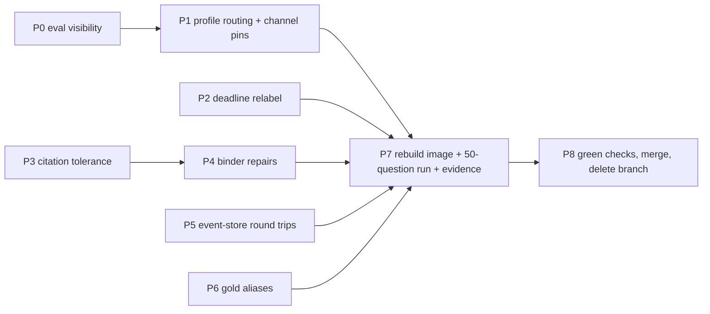

# Known-Answer-50 Accuracy Repair

Canonical index for this repair. The implementing model reads
[`ka50-accuracy-repair/00-rules-and-commands.md`](./ka50-accuracy-repair/00-rules-and-commands.md)
and **exactly one** packet file per run. Nothing else in `.cursor/plans/`
is needed for this work.

| Packet | File                                                                                                    | Fixes                                                            | Depends on       |
| ------ | ------------------------------------------------------------------------------------------------------- | ---------------------------------------------------------------- | ---------------- |
| P0     | [P0-eval-visibility.md](./ka50-accuracy-repair/P0-eval-visibility.md)                                   | Blind eval buckets                                               | -                |
| P1     | [P1-profile-routing-and-channel-pins.md](./ka50-accuracy-repair/P1-profile-routing-and-channel-pins.md) | 19 cap drops, RRF demotion                                       | P0               |
| P2     | [P2-deadline-relabel.md](./ka50-accuracy-repair/P2-deadline-relabel.md)                                 | 2-4 finished answers scored as deadline                          | -                |
| P3     | [P3-citation-tolerance.md](./ka50-accuracy-repair/P3-citation-tolerance.md)                             | citation_persist_failed kills answers                            | -                |
| P4     | [P4-binder-repairs.md](./ka50-accuracy-repair/P4-binder-repairs.md)                                     | paragraph_unmapped / link mismatch refusals                      | P3               |
| P5     | [P5-event-store-roundtrips.md](./ka50-accuracy-repair/P5-event-store-roundtrips.md)                     | ~0.65 s per SSE event                                            | -                |
| P6     | [P6-gold-aliases.md](./ka50-accuracy-repair/P6-gold-aliases.md)                                         | 5 phrasing misses (data, not code)                               | -                |
| P7     | [P7-rerun-and-acceptance.md](./ka50-accuracy-repair/P7-rerun-and-acceptance.md)                         | Rebuild `api` image, run the 50 known-answer questions, evidence | P0-P6            |
| P8     | [P8-ship-pr-merge.md](./ka50-accuracy-repair/P8-ship-pr-merge.md)                                       | Green checks, merge to `main`, delete branch                     | P7 + user "ship" |

## Branch, commits, image

- One branch for the whole plan: `fix/ka50-accuracy-repair`, cut from
  `main`, draft PR opened before P0 (commands in
  `00-rules-and-commands.md`, **Git workflow**).
- One commit per packet, pushed immediately; `gh pr checks --watch
--fail-fast` must exit 0 before the next packet starts. P6 has no
  commit (gold lives in gitignored `.private-eval/`).
- The eval calls the laptop Compose API on `http://127.0.0.1:8000`, which
  runs code baked into the `api` image. Every live subset run and the
  P7 full run happen only after
  `docker compose --env-file .env.compose -f docker-compose.yml -f docker-compose.packet8.yml up -d --build --wait api`
  and a probe inside the container proving the packet's symbols exist
  (`00-rules-and-commands.md`, **Docker rebuild before any live run**).
- P8 merges with a merge commit (repo convention), deletes the branch
  locally and on `origin`, and watches the post-merge `PR fast` and
  `Main` workflows on `main` to `success`.

## Why the last two weeks looped

Every fix so far was aimed at the stage the eval _named_, and the eval
named the wrong stage. `classify_ask_drop` in `scripts/run_company_ask.py`
labels a question `retrieval_miss` when the gold page is absent from the
**final evidence**, so 19 questions whose gold page was in the fused top
100 but cut by the 5-per-document rerank cap were reported as retrieval
misses. Retrieval was never the problem: dense had the gold page on 50/50
questions. P0 makes the eval tell the truth before anything else changes.

## Measured facts this plan is built on (2026-09-22, read-only DB)

Source: `.private-eval/ka50-stages.json` joined to `app.document_chunks`.
Only page numbers and ranks were read; no gold text left the private dir.

- Authorized corpus: **4 documents** with 1015, 632, 164, and 3 search
  representatives. The gold document is the 1015-chunk one. The corpus is
  not single-document, so "exact-one title match" routing can never pick
  `hybrid_long_document_v2` for these questions.
- Gold page fused rank: `<=5`: 31, `6-12`: 11, `13-20`: 2, `21-40`: 5,
  `41-100`: 1. The 19 questions with fused rank >= 6 are exactly the 19
  cap drops. `hybrid_default_v1` has `rerank_pool_size: 20`,
  `rerank_max_per_document: 5`, and **`document_quota: 2`** (at most two
  final chunks per document).
- Gold page dense rank: `<=3` on 41/50, `<=5` on 44/50, worst 23 (`k01`).
  BM25 held the gold page on 29/50.
- RRF (`rrf_k=60`, equal weights) pushes a dense-only rank-1 chunk below
  every chunk that both channels returned. `k11`, `k28`, `k32` are dense
  rank 1 and fused rank 22-26. A chunk at dense 60 + BM25 60 scores
  2/120 = 0.0167 > 1/61 = 0.0164.
- `hybrid_long_document_v2` (already frozen and pinned) has
  `rerank_max_per_document: 20`, `document_quota: 12`, pool 20,
  `excerpt_strategy: query_aware`. It ran on 0/50 questions.
- Verifier LLM timeouts return `detail="deadline_exhausted"` from
  `verify_answer_node` **before** citation persistence, and the SSE mapper
  turns that into `deadline` + `partial(reason=deadline_exhausted)`, which
  the scorer ranks above phrase matching. Correct answers were scored as
  deadline failures.
- `app.insert_run_citation_v2` raises `span_not_contained` /
  `leaf_ambiguous` when a cited span on a parent chunk does not sit inside
  exactly one representative child. One such citation aborts the whole
  batch and the answer terminates `insufficient_evidence`
  (`citation_persist_failed`).
- SSE event persistence costs about 0.65 s per event against remote
  Supabase (SET ROLE, SET LOCAL, RPC, COMMIT = 4 round trips).

## Order and dependency

Run P0 first. P1 is the accuracy lever. P2 and P3 are independent of P1
and can run in any order after P0. P4 needs P3's result type. P5 and P6
are independent. P7 is the proof run; P8 ships only after the user reads
the P7 table.

## Acceptance table (P7 checks these)

| Metric                                                              |     Baseline 2026-09-22 |            Target after P0-P6 |
| ------------------------------------------------------------------- | ----------------------: | ----------------------------: |
| `strict_pass`                                                       |                   17/50 |                      >= 32/50 |
| `grounded_fact_pass`                                                |                   17/50 |                      >= 36/50 |
| gold page in `rerank_pool_ids`                                      |                   31/50 |                      >= 46/50 |
| gold page in `selected_ids`                                         |                   31/50 |                      >= 42/50 |
| `retrieval_profile_id`                                              | `hybrid_default_v1` x50 | `hybrid_long_document_v2` x50 |
| `deadline` bucket where answer text contains every canonical phrase |                     2-4 |                             0 |
| `citation_persist_failed` terminals                                 |                       3 |                             0 |
| unit tier (`uv run python scripts/check.py --tier unit`)            |                    pass |                          pass |
| `api` image probe before the run                                    |                     n/a |               P0-P5 `present` |
| GitHub `PR fast` on the merged head, `Main` on `main`               |                   green |                         green |

Residual misses that this plan does **not** promise to fix: `k09` (gold
fused rank 41, dense rank 19) and any question whose gold page the
reranker itself ranks below the final evidence cut. Report them; do not
tune around them.

## Deviations that need the user's approval (record in ADRs)

1. P1 extends `hybrid_long_document_v2` eligibility from "exact-one named
   source" to "small authorized corpus with a long document". This changes
   which frozen profile answers unscoped questions. It does not change any
   frozen JSON or digest.
2. P1 adds channel-head pinning to the rerank pool. The pool contract
   "at most 5 per document in fused order" becomes "fused order under the
   per-document cap, plus the top 5 dense and top 5 BM25 authorized IDs".
3. P3 changes "any citation persist failure => insufficient_evidence" to
   "leaf-resolution failures skip that citation; other failures still
   fail closed".

Accepting this plan is approval to write those ADRs. Every other change is
a bug fix inside existing contracts.
