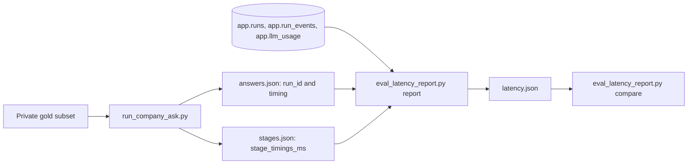

# L0 - Latency report, sub-stage timers, and baseline

Read `00-rules-and-commands.md` first. Apply every edit below exactly as
written, in order. Each edit names one file, gives text to **Find** (it
appears exactly once in that file) and the text to **Replace with**. New
files give the **full contents**. If a Find text is not found exactly
once, stop and report the edit number. Do not change anything that is not
in an edit.

## Combined-plan changes (read this first; it overrides the rest)

This packet runs inside the combined plan
`.cursor/plans/answer_loss_repair_9c24e1a0.plan.md`, after A0, A1, and A2
are committed on branch `fix/answer-loss-repair`. A2 already added the
Hybrid sub-stage timers (`HybridBranchDiagnostics.stage_timings_ms`,
keys `HYBRID_STAGE_TIMING_KEYS` in
`packages/core/src/smart_rag_core/retrieval/profiles.py`, exported per run
by `scripts/eval_ask_stage_export.py` as `stage_timings_ms`). Therefore:

1. **Skip Edits 1, 2, 3, 4, 5, 6, 7, 12e, and 12f completely.** Do not
   create `hybrid_run/timing.py` and do not touch `types.py`,
   `retriever.py`, `adapters_hybrid.py`, `results.py`,
   `branch_channels/hybrid.py`, `scripts/eval_ask_stage_export.py`,
   `tests/unit/test_hybrid_branch_diagnostics.py`, or
   `tests/unit/test_hybrid_run.py`. Goal items 1 and 2 are already done
   by A2.
2. Apply Edits 8, 9, 10, 11, 12a, 12b, 12c, 12d, 13a, 13b, 13c, and 13d
   exactly as written. They already read the A2 field name
   `stage_timings_ms`.
3. The branch check in **Before you start** expects
   `fix/answer-loss-repair`, and `git log --oneline -5` must show the A2
   commit.
4. The Files table rows 1-7, 12e, and 12f do not apply. Every check that
   says "only files from the Files table" means the remaining rows.
5. In **Commands**, keep every line as written. `ruff format` and the
   two Hybrid test files run on A2's code and must still pass.

## Goal

Make latency measurable the same way before and after every packet:

1. Hybrid retrieve records wall milliseconds per sub-stage and persists
   them in `HybridBranchDiagnostics.stage_timings_ms`, so `company_scope`
   (14.6 s median) can be split into scope, connect, cache, embed,
   channels, temporal, preload, rerank, and locator time.
2. The stage export copies them into each run as `stage_timings_ms`.
3. `scripts/run_company_ask.py` records client time per question
   (`post_seconds`, `first_frame_seconds`, `sse_seconds`, `wall_seconds`).
4. `scripts/eval_latency_report.py` turns one timing run into a JSON
   report and compares two reports.
5. `scripts/eval_citation_page_score.py` makes the accuracy bar "fact
   present and a persisted citation on the gold page" (13/50 on
   2026-09-23) one command.
6. `scripts/probe_latency_image.py` proves which packets are inside the
   running `api` image.
7. Two baseline runs of the latency-12 subset give the "before" numbers and
   the noise band.

No product behavior changes. Timers never change control flow.

## Before you start

Run these and check the results. If any check fails, stop and report.

```powershell
git status --short
git branch --show-current
```

- The branch must be `fix/answer-loss-repair` (combined plan), with A2
  committed.
- `git status --short` must not list any file from the table below
  except `docs/README.md` (see Edit 13d for that file).

## Files

| Edit | File | Kind |
| ---- | ---- | ---- |
| 1 | `packages/core/src/smart_rag_core/retrieval/hybrid_run/timing.py` | new |
| 2 | `packages/core/src/smart_rag_core/retrieval/hybrid_run/types.py` | change |
| 3 | `packages/core/src/smart_rag_core/retrieval/hybrid_run/retriever.py` | change |
| 4 | `apps/agents/src/smart_rag_agents/query/runtime/adapters_hybrid.py` | change |
| 5 | `packages/core/src/smart_rag_core/query_routing/models/results.py` | change |
| 6 | `packages/core/src/smart_rag_core/query_routing/branch_channels/hybrid.py` | change |
| 7 | `scripts/eval_ask_stage_export.py` | change |
| 8 | `scripts/run_company_ask.py` | change |
| 9 | `scripts/eval_latency_report.py` | new |
| 10 | `scripts/eval_citation_page_score.py` | new |
| 11 | `scripts/probe_latency_image.py` | new |
| 12a | `tests/unit/test_eval_latency_report.py` | new |
| 12b | `tests/unit/test_eval_citation_page_score.py` | new |
| 12c | `tests/unit/test_probe_latency_image.py` | new |
| 12d | `tests/unit/test_company_ask_timing.py` | new |
| 12e | `tests/unit/test_hybrid_branch_diagnostics.py` | change |
| 12f | `tests/unit/test_hybrid_run.py` | change |
| 13a | `docs/evaluation/QUERY_LATENCY_REPORT.md` | new |
| 13b | `docs/evaluation/QUERY_LATENCY_REPAIR_EVIDENCE.md` | new |
| 13c | `docs/evaluation/DUAL_METRIC_SCORING.md` | change |
| 13d | `docs/README.md` | change (only if clean, see 13d) |

## Edit 1 - new file `timing.py`

File: `packages/core/src/smart_rag_core/retrieval/hybrid_run/timing.py`

Full contents:

```python
"""Per-stage wall-clock timings for one Hybrid retrieve.

Timings are diagnostics only. They never change ranking, caching, or
fallback decisions, and they hold numbers only (no query or passage text).
"""

from __future__ import annotations

import time
from dataclasses import dataclass


@dataclass(frozen=True, slots=True)
class HybridStageTimings:
    """Wall-clock milliseconds spent in each Hybrid retrieve stage.

    Every value is rounded to 0.1 ms. A stage that did not run stays 0.0,
    for example on a cache hit or an early fail-closed return.
    ``HybridRetriever.retrieve`` fills ``cache_ms`` through ``locator_ms``
    and ``total_ms``. ``ProcessHybridRetriever.retrieve`` then sets
    ``scope_ms`` and ``context_connect_ms`` and replaces ``total_ms`` with
    its own, larger total.

    Attributes:
        scope_ms: Source-scope resolution in the process adapter.
        context_connect_ms: Opening the shared context connection.
        cache_ms: ID/rank cache lookup and ACL recheck.
        embed_ms: The one embedding batch.
        channels_ms: Dense, BM25, and term channels. They run in parallel,
            so this is the slowest channel, not the sum.
        temporal_ms: ``effective_at`` lookup for fused candidates.
        preload_ms: Context preload for the rerank pool.
        rerank_ms: ``select_hybrid_context``: the rerank call, MMR, and
            parent expansion.
        locator_ms: Locator reload and heading inventory.
        total_ms: Whole retrieve, as measured by the outermost caller that
            set it.
    """

    scope_ms: float = 0.0
    context_connect_ms: float = 0.0
    cache_ms: float = 0.0
    embed_ms: float = 0.0
    channels_ms: float = 0.0
    temporal_ms: float = 0.0
    preload_ms: float = 0.0
    rerank_ms: float = 0.0
    locator_ms: float = 0.0
    total_ms: float = 0.0


def elapsed_ms(started: float) -> float:
    """Return wall-clock milliseconds since ``started``, rounded to 0.1 ms.

    Args:
        started: A ``time.perf_counter()`` reading taken earlier.

    Returns:
        Elapsed milliseconds, never negative.
    """

    return round(max(0.0, time.perf_counter() - started) * 1000.0, 1)
```

## Edit 2 - `types.py`

File: `packages/core/src/smart_rag_core/retrieval/hybrid_run/types.py`

### Edit 2a

Find (exactly once):

```python
from dataclasses import dataclass
```

Replace with:

```python
from dataclasses import dataclass, field
```

### Edit 2b

Find (exactly once):

```python
from smart_rag_core.retrieval.coverage import HybridCoverage
from smart_rag_core.retrieval.profiles import RetrievalFallbackReason
```

Replace with:

```python
from smart_rag_core.retrieval.coverage import HybridCoverage
from smart_rag_core.retrieval.hybrid_run.timing import HybridStageTimings
from smart_rag_core.retrieval.profiles import RetrievalFallbackReason
```

### Edit 2c

Find (exactly once):

```python
        source_resolution: Server-derived scope token. Empty when the
            retrieve path did not attach one.
    """
```

Replace with:

```python
        source_resolution: Server-derived scope token. Empty when the
            retrieve path did not attach one.
        stage_timings: Wall milliseconds per retrieve stage. Zeros when the
            retrieve closed early or a stage did not run.
    """
```

### Edit 2d

Find (exactly once):

```python
    term_ids: tuple[UUID, ...] = ()
    source_resolution: str = ""
```

Replace with:

```python
    term_ids: tuple[UUID, ...] = ()
    source_resolution: str = ""
    stage_timings: HybridStageTimings = field(default_factory=HybridStageTimings)
```

## Edit 3 - `retriever.py`

File: `packages/core/src/smart_rag_core/retrieval/hybrid_run/retriever.py`

### Edit 3a

Find (exactly once):

```python
from smart_rag_core.retrieval.hybrid_run.terms import (
    matched_terms_from_units,
    supported_subquestion_count,
)
from smart_rag_core.retrieval.hybrid_run.types import (
```

Replace with:

```python
from smart_rag_core.retrieval.hybrid_run.terms import (
    matched_terms_from_units,
    supported_subquestion_count,
)
from smart_rag_core.retrieval.hybrid_run.timing import HybridStageTimings, elapsed_ms
from smart_rag_core.retrieval.hybrid_run.types import (
```

### Edit 3b

Find (exactly once):

```python
            read ParadeDB and Supabase. No holdout access. No answer tokens.
        """
```

Replace with:

```python
            read ParadeDB and Supabase. No holdout access. No answer tokens.
            Records wall milliseconds per stage in ``stage_timings``;
            timing never changes control flow.
        """
```

### Edit 3c

Find (exactly once):

```python
        bypass_cache = cache_mode is RetrievalCacheMode.COLD_BYPASS
        if not bypass_cache:
```

Replace with:

```python
        bypass_cache = cache_mode is RetrievalCacheMode.COLD_BYPASS
        cache_started = time.perf_counter()
        if not bypass_cache:
```

### Edit 3d

Find (exactly once):

```python
            if cached is not None:
                return cached

        texts = query_texts(query, profile)
        embed_response, embed_error = embed_query_texts(
            self._embedding_gateway, texts, budget=self.query_budget
        )
```

Replace with:

```python
            if cached is not None:
                return cached
        cache_ms = elapsed_ms(cache_started)

        texts = query_texts(query, profile)
        embed_started = time.perf_counter()
        embed_response, embed_error = embed_query_texts(
            self._embedding_gateway, texts, budget=self.query_budget
        )
        embed_ms = elapsed_ms(embed_started)
```

### Edit 3e

Find (exactly once):

```python
        completed, timed_out, exhausted = run_channels_parallel(
            jobs,
            deadline_seconds=slice_seconds,
        )
```

Replace with:

```python
        completed, timed_out, exhausted = run_channels_parallel(
            jobs,
            deadline_seconds=slice_seconds,
        )
        channels_ms = elapsed_ms(channel_started)
```

### Edit 3f

Find (exactly once):

```python
        temporal_records = self._load_temporal_records(
            flatten_channel_candidates(dense_lists, bm25_result.candidates, term_lists)
        )
```

Replace with:

```python
        temporal_started = time.perf_counter()
        temporal_records = self._load_temporal_records(
            flatten_channel_candidates(dense_lists, bm25_result.candidates, term_lists)
        )
        temporal_ms = elapsed_ms(temporal_started)
```

### Edit 3g

Find (exactly once):

```python
        contexts = loader(preload_ids) if preload_ids else ()
```

Replace with:

```python
        preload_started = time.perf_counter()
        contexts = loader(preload_ids) if preload_ids else ()
        preload_ms = elapsed_ms(preload_started)
```

### Edit 3h

Find (exactly once):

```python
        coverage = assembled.coverage
        if assembled.fused:
            selection = select_hybrid_context(
```

Replace with:

```python
        coverage = assembled.coverage
        rerank_ms = 0.0
        locator_ms = 0.0
        if assembled.fused:
            rerank_started = time.perf_counter()
            selection = select_hybrid_context(
```

### Edit 3i

Find (exactly once):

```python
                pinned_ids=pinned_ids,
            )
            if selection.usage is not None:
```

Replace with:

```python
                pinned_ids=pinned_ids,
            )
            rerank_ms = elapsed_ms(rerank_started)
            if selection.usage is not None:
```

### Edit 3j

Find (exactly once):

```python
            locator_rows = loader(selected_ids) if selected_ids else ()
```

Replace with:

```python
            locator_started = time.perf_counter()
            locator_rows = loader(selected_ids) if selected_ids else ()
```

### Edit 3k

Find (exactly once):

```python
            rpc_inventory = self._heading_inventory(caller, inventory_version)
```

Replace with:

```python
            rpc_inventory = self._heading_inventory(caller, inventory_version)
            locator_ms = elapsed_ms(locator_started)
```

### Edit 3l

Find (exactly once):

```python
            term_ids=term_ids,
        )
```

Replace with:

```python
            term_ids=term_ids,
            stage_timings=HybridStageTimings(
                cache_ms=cache_ms,
                embed_ms=embed_ms,
                channels_ms=channels_ms,
                temporal_ms=temporal_ms,
                preload_ms=preload_ms,
                rerank_ms=rerank_ms,
                locator_ms=locator_ms,
                total_ms=elapsed_ms(started),
            ),
        )
```

After Edit 3 the file must stay under 600 lines (`HARD_LINE_CAP`). It
is about 556 lines.

## Edit 4 - `adapters_hybrid.py`

File: `apps/agents/src/smart_rag_agents/query/runtime/adapters_hybrid.py`

### Edit 4a

Find (exactly once):

```python
from __future__ import annotations

from collections.abc import Callable
```

Replace with:

```python
from __future__ import annotations

import time
from collections.abc import Callable
```

### Edit 4b

Find (exactly once):

```python
from smart_rag_core.retrieval.hybrid_run import HybridRetriever
```

Replace with:

```python
from smart_rag_core.retrieval.hybrid_run import HybridRetriever
from smart_rag_core.retrieval.hybrid_run.timing import elapsed_ms
```

### Edit 4c

Find (exactly once):

```python
        Returns:
            ``HybridRunResult`` with ranked IDs. BM25 snippets are never evidence.
```

Replace with:

```python
        Returns:
            ``HybridRunResult`` with ranked IDs. BM25 snippets are never evidence.
            ``stage_timings`` adds this adapter's scope, context-connect, and
            total milliseconds to the retriever's inner stage timings.
```

### Edit 4d

Find (exactly once):

```python
        typed_profile = profile if isinstance(profile, ExpectedProfile) else None
        scope = self._resolve_scope(caller, typed_profile, query=query)
```

Replace with:

```python
        retrieve_started = time.perf_counter()
        typed_profile = profile if isinstance(profile, ExpectedProfile) else None
        scope = self._resolve_scope(caller, typed_profile, query=query)
        scope_ms = elapsed_ms(retrieve_started)
```

### Edit 4e

Find (exactly once):

```python
            rerank_fn = _rerank
        with connect_postgres(self._supabase_dsn) as context_connection:
            inner = HybridRetriever(
```

Replace with:

```python
            rerank_fn = _rerank
        connect_started = time.perf_counter()
        with connect_postgres(self._supabase_dsn) as context_connection:
            context_connect_ms = elapsed_ms(connect_started)
            inner = HybridRetriever(
```

### Edit 4f

Find (exactly once):

```python
        return replace(result, source_resolution=resolution)
```

Replace with:

```python
        timings = replace(
            result.stage_timings,
            scope_ms=scope_ms,
            context_connect_ms=context_connect_ms,
            total_ms=elapsed_ms(retrieve_started),
        )
        return replace(result, source_resolution=resolution, stage_timings=timings)
```

## Edit 5 - `results.py`

File: `packages/core/src/smart_rag_core/query_routing/models/results.py`

### Edit 5a

Find (exactly once):

```python
class HybridBranchDiagnostics(BaseModel):
    """ID-only Hybrid retrieve diagnostics persisted on ``BranchResult``.
```

Replace with:

```python
class HybridStageTimingsMs(BaseModel):
    """Persisted wall milliseconds per Hybrid retrieve stage. Numbers only.

    Mirrors ``smart_rag_core.retrieval.hybrid_run.timing.HybridStageTimings``.
    Every field defaults to 0.0, so checkpoints written before this model
    existed still validate. Code older than latency packet L0 rejects
    checkpoints that contain ``stage_timings_ms`` because
    ``HybridBranchDiagnostics`` forbids unknown fields; after rolling the
    image back past L0, use new conversations.

    Attributes:
        scope_ms: Source-scope resolution in the process adapter.
        context_connect_ms: Opening the shared context connection.
        cache_ms: ID/rank cache lookup and ACL recheck.
        embed_ms: The one embedding batch.
        channels_ms: Slowest of the parallel dense, BM25, and term channels.
        temporal_ms: ``effective_at`` lookup for fused candidates.
        preload_ms: Context preload for the rerank pool.
        rerank_ms: Context selection, including the rerank model call.
        locator_ms: Locator reload and heading inventory.
        total_ms: Whole process-adapter retrieve.
    """

    model_config = ConfigDict(frozen=True, extra="forbid")

    scope_ms: float = Field(default=0.0, ge=0.0)
    context_connect_ms: float = Field(default=0.0, ge=0.0)
    cache_ms: float = Field(default=0.0, ge=0.0)
    embed_ms: float = Field(default=0.0, ge=0.0)
    channels_ms: float = Field(default=0.0, ge=0.0)
    temporal_ms: float = Field(default=0.0, ge=0.0)
    preload_ms: float = Field(default=0.0, ge=0.0)
    rerank_ms: float = Field(default=0.0, ge=0.0)
    locator_ms: float = Field(default=0.0, ge=0.0)
    total_ms: float = Field(default=0.0, ge=0.0)


class HybridBranchDiagnostics(BaseModel):
    """ID-only Hybrid retrieve diagnostics persisted on ``BranchResult``.
```

### Edit 5b

Find (exactly once):

```python
        effective_route: Executed branch family, never ``runs.route_family``.
    """
```

Replace with:

```python
        effective_route: Executed branch family, never ``runs.route_family``.
        stage_timings_ms: Wall milliseconds per retrieve stage; zeros when
            the run did not measure them.
    """
```

### Edit 5c

Find (exactly once):

```python
    effective_route: str = Field(min_length=1, max_length=64)

    @field_validator(
```

Replace with:

```python
    effective_route: str = Field(min_length=1, max_length=64)
    stage_timings_ms: HybridStageTimingsMs = Field(default_factory=HybridStageTimingsMs)

    @field_validator(
```

## Edit 6 - `branch_channels/hybrid.py`

File: `packages/core/src/smart_rag_core/query_routing/branch_channels/hybrid.py`

### Edit 6a

Find (exactly once):

```python
from smart_rag_core.query_routing.models import (
    BranchResult,
    BranchSpec,
    HybridBranchDiagnostics,
    QueryPreparation,
)
```

Replace with:

```python
from smart_rag_core.query_routing.models import (
    BranchResult,
    BranchSpec,
    HybridBranchDiagnostics,
    QueryPreparation,
)
from smart_rag_core.query_routing.models.results import HybridStageTimingsMs
```

### Edit 6b

Find (exactly once):

```python
    Returns:
        Frozen diagnostics, or ``None`` when required tokens are missing.
```

Replace with:

```python
    Returns:
        Frozen diagnostics, or ``None`` when required tokens are missing.
        Stage timings are copied from ``outcome.stage_timings`` when present.
```

### Edit 6c

Find (exactly once):

```python
        support_confidence=getattr(coverage, "support_confidence", None),
        effective_route=effective_route,
    )
```

Replace with:

```python
        support_confidence=getattr(coverage, "support_confidence", None),
        effective_route=effective_route,
        stage_timings_ms=_stage_timings_ms(outcome),
    )
```

### Edit 6d

Find (exactly once):

```python
def _uuid_ids(values: object, cap: int) -> tuple[str, ...]:
```

Replace with:

```python
def _stage_timings_ms(outcome: object | None) -> HybridStageTimingsMs:
    """Copy retriever stage timings into the persisted diagnostics model.

    Args:
        outcome: Hybrid retrieve result, or ``None`` when unbound.

    Returns:
        Non-negative millisecond timings. Missing or non-numeric values are
        0.0, so older results and test doubles still validate.
    """

    timings = getattr(outcome, "stage_timings", None) if outcome is not None else None
    values: dict[str, float] = {}
    for name in HybridStageTimingsMs.model_fields:
        raw = getattr(timings, name, 0.0) if timings is not None else 0.0
        if isinstance(raw, int | float) and not isinstance(raw, bool):
            values[name] = max(0.0, float(raw))
    return HybridStageTimingsMs.model_validate(values)


def _uuid_ids(values: object, cap: int) -> tuple[str, ...]:
```

## Edit 7 - `scripts/eval_ask_stage_export.py`

File: `scripts/eval_ask_stage_export.py`

### Edit 7a

Find (exactly once):

```python
    "rerank_accounting_ok",
    "bm25_degraded_explicit",
)
```

Replace with:

```python
    "rerank_accounting_ok",
    "bm25_degraded_explicit",
)
HYBRID_STAGE_KEYS = (
    "scope_ms",
    "context_connect_ms",
    "cache_ms",
    "embed_ms",
    "channels_ms",
    "temporal_ms",
    "preload_ms",
    "rerank_ms",
    "locator_ms",
    "total_ms",
)
```

### Edit 7b

Find (exactly once):

```python
    Returns:
        Stage mapping. Missing values are ``unknown``.
    """

    if diagnostics is None:
        return {name: "unknown" for name in REQUIRED_FIELDS}
```

Replace with:

```python
    Returns:
        Stage mapping. Missing values are ``unknown``. ``stage_timings_ms``
        holds numeric sub-stage milliseconds only and is ``{}`` for runs
        recorded before latency packet L0. It is not a required field.
    """

    if diagnostics is None:
        return {
            **{name: "unknown" for name in REQUIRED_FIELDS},
            "stage_timings_ms": {},
        }
```

### Edit 7c

Find (exactly once):

```python
        "retrieval_empty": retrieval_empty,
    }
```

Replace with:

```python
        "retrieval_empty": retrieval_empty,
        "stage_timings_ms": _stage_ms(diagnostics.get("stage_timings_ms")),
    }
```

### Edit 7d

Find (exactly once):

```python
def _int_or_unknown(value: object) -> int | str:
```

Replace with:

```python
def _stage_ms(value: object) -> dict[str, float]:
    """Copy numeric Hybrid stage timings from checkpoint diagnostics.

    Args:
        value: ``stage_timings_ms`` mapping, or anything else for runs
            recorded before latency packet L0.

    Returns:
        ``HYBRID_STAGE_KEYS`` that hold real numbers, in key order. Empty
        for older runs.
    """

    if not isinstance(value, Mapping):
        return {}
    typed = cast(Mapping[str, object], value)
    kept: dict[str, float] = {}
    for key in HYBRID_STAGE_KEYS:
        item = typed.get(key)
        if isinstance(item, int | float) and not isinstance(item, bool):
            kept[key] = float(item)
    return kept


def _int_or_unknown(value: object) -> int | str:
```

## Edit 8 - `scripts/run_company_ask.py`

File: `scripts/run_company_ask.py`

### Edit 8a

Find (exactly once):

```python
    Returns:
        Streamed answer, stages, limitation, and terminal.
    """

    idempotency = str(uuid4())
    for _attempt in range(4):
        admit = client.post(
```

Replace with:

```python
    Returns:
        Streamed answer, stages, limitation, and terminal. A streamed run
        also has ``timing`` with ``post_seconds``, ``first_frame_seconds``,
        ``sse_seconds``, and ``wall_seconds`` (3 decimals). Timing never
        changes the retry or sleep behavior.
    """

    idempotency = str(uuid4())
    ask_started = time.monotonic()
    for _attempt in range(4):
        post_started = time.monotonic()
        admit = client.post(
```

### Edit 8b

Find (exactly once):

```python
        admit_body = _json_mapping(admit.json())
        run_id = str(admit_body.get("run_id") or "")
        streamed = _read_sse(client, base_url, token, run_id)
        streamed["http_status"] = admit.status_code
        streamed["run_id"] = run_id
        return streamed
```

Replace with:

```python
        post_seconds = round(time.monotonic() - post_started, 3)
        admit_body = _json_mapping(admit.json())
        run_id = str(admit_body.get("run_id") or "")
        streamed = _read_sse(client, base_url, token, run_id)
        streamed["http_status"] = admit.status_code
        streamed["run_id"] = run_id
        streamed["timing"] = {
            "post_seconds": post_seconds,
            "first_frame_seconds": streamed.pop("first_frame_seconds", None),
            "sse_seconds": streamed.pop("sse_seconds", None),
            "wall_seconds": round(time.monotonic() - ask_started, 3),
        }
        return streamed
```

### Edit 8c

Find (exactly once):

```python
    Returns:
        Answer text, terminal, limitation, origin, and stage fields.
    """
```

Replace with:

```python
    Returns:
        Answer text, terminal, limitation, origin, and stage fields, plus
        ``first_frame_seconds`` (stream open to the first ``event:`` line,
        or None) and ``sse_seconds`` (stream open to return).
    """
```

### Edit 8d

Find (exactly once):

```python
    path_steps: list[str] = []
    open_stage = ""
    with client.stream(
```

Replace with:

```python
    path_steps: list[str] = []
    open_stage = ""
    first_frame_seconds: float | None = None
    with client.stream(
```

### Edit 8e

Find (exactly once):

```python
            if raw.startswith("event:"):
                event_name = raw[6:].strip()
```

Replace with:

```python
            if raw.startswith("event:"):
                event_name = raw[6:].strip()
                if first_frame_seconds is None:
                    first_frame_seconds = round(time.monotonic() - started, 3)
```

### Edit 8f

Find (exactly once):

```python
        "path": ">".join(path_steps) if path_steps else "-",
        "stages": {
```

Replace with:

```python
        "path": ">".join(path_steps) if path_steps else "-",
        "first_frame_seconds": first_frame_seconds,
        "sse_seconds": round(time.monotonic() - started, 3),
        "stages": {
```

### Edit 8g

Find (exactly once):

```python
                "stages": _json_mapping(streamed.get("stages")),
            }
            done = len(answers)
```

Replace with:

```python
                "stages": _json_mapping(streamed.get("stages")),
                "timing": _json_mapping(streamed.get("timing")),
            }
            done = len(answers)
```

## Edit 9 - new file `scripts/eval_latency_report.py`

File: `scripts/eval_latency_report.py`

Full contents:

```python
"""Latency report for company-ask timing runs.

Reads run IDs from a private runner answers JSON, loads ``app.runs``,
``app.run_events``, and ``app.llm_usage`` rows for them, and writes one
JSON report. Event payloads are reduced in SQL to the keys ``stage``,
``phase``, ``reason``, and ``code``, so no answer, query, or passage text
leaves the database. Output and stdout hold ids, stage names, event types,
usage kinds, fallback codes, timings, and counts only.

Usage::

    uv run python scripts/eval_latency_report.py subset --gold G --ids a,b --out O
    uv run python scripts/eval_latency_report.py report --answers A --stages S --label L --out O
    uv run python scripts/eval_latency_report.py compare BEFORE AFTER
"""

from __future__ import annotations

import argparse
import itertools
import json
import math
import statistics
import sys
from collections.abc import Iterable, Mapping, Sequence
from datetime import UTC, datetime
from pathlib import Path
from typing import LiteralString, TypeGuard, cast
from uuid import UUID

import psycopg
from psycopg.rows import TupleRow

REPO = Path(__file__).resolve().parents[1]
if str(REPO) not in sys.path:
    sys.path.insert(0, str(REPO))

from smart_rag_core.sse.catalog import TERMINAL_SSE_EVENT_TYPES  # noqa: E402

from scripts.eval_ask_stage_export import operator_url  # noqa: E402

SUMMARY_METRICS: tuple[str, ...] = (
    "wall_seconds",
    "post_seconds",
    "first_frame_seconds",
    "sse_seconds",
    "server_total_s",
    "admission_to_first_event_s",
    "pre_first_stage_s",
    "node_gap_total_s",
    "tail_s",
    "event_spacing_median_s",
    "event_count",
)
CLIENT_TIMING_KEYS: tuple[str, ...] = (
    "post_seconds",
    "first_frame_seconds",
    "sse_seconds",
    "wall_seconds",
)
COMPARE_SUFFIXES: tuple[str, ...] = (".mean", ".median", ".p90")

_RUN_SQL: LiteralString = """
SELECT created_at, started_at, deadline_at
FROM app.runs
WHERE id = %s::uuid
"""
_EVENTS_SQL: LiteralString = """
SELECT event_type,
       created_at,
       jsonb_build_object(
         'stage', payload->>'stage',
         'phase', payload->>'phase',
         'reason', payload->>'reason',
         'code', payload->>'code'
       )
FROM app.run_events
WHERE run_id = %s::uuid
ORDER BY sequence
"""
_USAGE_SQL: LiteralString = """
SELECT usage_kind, prompt_tokens, completion_tokens, timeout_after_send
FROM app.llm_usage
WHERE run_id = %s::uuid
"""

CompareRow = tuple[str, float | None, float | None, float | None]


def _is_number(value: object) -> TypeGuard[int | float]:
    """Return whether ``value`` is an int or float but not a bool.

    Args:
        value: Any JSON or database value.

    Returns:
        True for real numbers.
    """

    return isinstance(value, int | float) and not isinstance(value, bool)


def _number(value: object) -> float | None:
    """Return ``value`` as a float rounded to 3 decimals, else None.

    Args:
        value: Any JSON or database value.

    Returns:
        Rounded float, or None when ``value`` is not a real number.
    """

    if not _is_number(value):
        return None
    return round(float(value), 3)


def _mapping(value: object) -> dict[str, object]:
    """Return ``value`` as a string-keyed dict, else an empty dict.

    Args:
        value: Any JSON value.

    Returns:
        String-keyed shallow copy.
    """

    if not isinstance(value, Mapping):
        return {}
    typed = cast(Mapping[object, object], value)
    return {str(key): item for key, item in typed.items()}


def _numbers(values: Iterable[object]) -> list[float]:
    """Keep only real numbers, as floats, in input order.

    Args:
        values: Any values.

    Returns:
        Floats.
    """

    return [float(item) for item in values if _is_number(item)]


def _seconds(later: object, earlier: object) -> float | None:
    """Return ``later - earlier`` in seconds, rounded to 3 decimals.

    Args:
        later: A ``datetime`` or anything else.
        earlier: A ``datetime`` or anything else.

    Returns:
        Seconds, or None when either side is not a ``datetime``.
    """

    if not isinstance(later, datetime) or not isinstance(earlier, datetime):
        return None
    return round((later - earlier).total_seconds(), 3)


def _is_uuid(value: str) -> bool:
    """Return whether ``value`` parses as a UUID.

    Args:
        value: Candidate run id.

    Returns:
        True for a UUID string.
    """

    try:
        UUID(value)
    except ValueError:
        return False
    return True


def _private_out(path: Path) -> bool:
    """Return whether ``path`` is inside a ``.private-eval`` directory.

    Args:
        path: Output path.

    Returns:
        True when one path part is ``.private-eval`` (case-insensitive).
    """

    return ".private-eval" in {part.casefold() for part in path.resolve().parts}


def _read_json(path: Path) -> object:
    """Read one UTF-8 JSON file.

    Args:
        path: JSON file.

    Returns:
        Parsed value.
    """

    loaded: object = json.loads(path.read_text(encoding="utf-8"))
    return loaded


def _write_json(path: Path, payload: object) -> None:
    """Write ``payload`` as indented UTF-8 JSON without a BOM.

    Args:
        path: Output file. Parent directories are created.
        payload: JSON-ready value. Datetimes are written with ``str``.
    """

    path.parent.mkdir(parents=True, exist_ok=True)
    path.write_text(json.dumps(payload, indent=2, default=str) + "\n", encoding="utf-8")


def percentile(values: Sequence[float], fraction: float) -> float:
    """Return the nearest-rank percentile.

    Args:
        values: Numbers in any order.
        fraction: Percentile as a fraction, for example 0.9.

    Returns:
        ``sorted(values)[ceil(fraction * n) - 1]``; 0.0 for empty input.
    """

    if not values:
        return 0.0
    ordered = sorted(values)
    rank = max(1, math.ceil(fraction * len(ordered)))
    return float(ordered[min(rank, len(ordered)) - 1])


def summarize(values: Sequence[float]) -> dict[str, float | int]:
    """Summarize numbers as n, mean, median, nearest-rank p90, and max.

    Args:
        values: Numbers in any order.

    Returns:
        ``{"n": 0}`` for empty input; otherwise ``n``, ``mean``, ``median``,
        ``p90``, and ``max`` rounded to 3 decimals.
    """

    if not values:
        return {"n": 0}
    return {
        "n": len(values),
        "mean": round(statistics.fmean(values), 3),
        "median": round(float(statistics.median(values)), 3),
        "p90": round(percentile(values, 0.9), 3),
        "max": round(max(values), 3),
    }


def run_metrics(
    *,
    run_row: Mapping[str, object],
    events: Sequence[Mapping[str, object]],
    usage_rows: Sequence[Mapping[str, object]],
    client_timing: Mapping[str, object],
    stage_row: Mapping[str, object],
) -> dict[str, object]:
    """Compute one run's latency numbers.

    Definitions (seconds unless named ``_ms``):

    - ``server_total_s``: last event minus first event.
    - ``admission_to_first_event_s``: first event minus ``runs.created_at``.
    - ``deadline_budget_s``: ``runs.deadline_at`` minus ``runs.started_at``.
    - ``stage_seconds[stage]``: ``status`` ``completed`` minus the matching
      ``started``, summed when a stage runs twice.
    - ``open_stage_seconds[stage]``: a stage with no ``completed`` (still
      running or failed), measured up to the terminal event.
    - ``pre_first_stage_s``: first ``started`` minus first event.
    - ``node_gap_total_s``: sum of every ``started`` minus the latest
      earlier ``completed``.
    - ``tail_s``: terminal event minus the last ``completed``.
    - ``event_spacing_median_s``: median gap between consecutive events.
    - ``deadline_exhausted``: a ``deadline`` event, or a ``partial`` event
      whose ``reason`` is ``deadline_exhausted``.

    Args:
        run_row: ``created_at``, ``started_at``, ``deadline_at`` of the run.
            May be empty.
        events: Events in ``sequence`` order with ``event_type``,
            ``created_at``, and ``payload`` (only ``stage``, ``phase``,
            ``reason``, ``code`` are read).
        usage_rows: ``usage_kind``, ``prompt_tokens``,
            ``completion_tokens``, ``timeout_after_send`` rows.
        client_timing: Runner ``timing`` mapping. May be empty.
        stage_row: Stage-export row. Only ``stage_timings_ms`` and
            ``rerank_fallback`` are read. May be empty.

    Returns:
        Numbers, stage names, event types, usage kinds, and fallback codes
        only. Values that cannot be measured are None.
    """

    times = [event.get("created_at") for event in events]
    first_at = times[0] if times else None
    last_at = times[-1] if times else None
    terminal_at: object = None
    terminal_type = "none"
    stage_seconds: dict[str, float] = {}
    open_started: dict[str, object] = {}
    first_started: object = None
    last_completed: object = None
    gap_total = 0.0
    deadline_exhausted = False
    for event in events:
        event_type = str(event.get("event_type") or "")
        payload = _mapping(event.get("payload"))
        at = event.get("created_at")
        if event_type == "deadline" or (
            event_type == "partial" and payload.get("reason") == "deadline_exhausted"
        ):
            deadline_exhausted = True
        if event_type in TERMINAL_SSE_EVENT_TYPES and terminal_at is None:
            terminal_at = at
            terminal_type = event_type
        if event_type != "status":
            continue
        stage = str(payload.get("stage") or "unknown")
        phase = payload.get("phase")
        if phase == "started":
            if first_started is None:
                first_started = at
            gap = _seconds(at, last_completed)
            if gap is not None:
                gap_total += gap
            open_started[stage] = at
        elif phase == "completed":
            last_completed = at
            seconds = _seconds(at, open_started.pop(stage, None))
            if seconds is not None:
                stage_seconds[stage] = round(stage_seconds.get(stage, 0.0) + seconds, 3)
    end_at = terminal_at if terminal_at is not None else last_at
    open_stage_seconds: dict[str, float] = {}
    for stage, began in open_started.items():
        seconds = _seconds(end_at, began)
        if seconds is not None:
            open_stage_seconds[stage] = seconds
    spacings: list[float] = []
    for earlier, later in itertools.pairwise(times):
        spacing = _seconds(later, earlier)
        if spacing is not None:
            spacings.append(spacing)
    usage: dict[str, dict[str, int]] = {}
    rerank_timeouts = 0
    for row in usage_rows:
        kind = str(row.get("usage_kind") or "unknown")
        bucket = usage.setdefault(
            kind, {"calls": 0, "prompt_tokens": 0, "completion_tokens": 0}
        )
        bucket["calls"] += 1
        bucket["prompt_tokens"] += int(_number(row.get("prompt_tokens")) or 0)
        bucket["completion_tokens"] += int(_number(row.get("completion_tokens")) or 0)
        if kind == "rerank" and row.get("timeout_after_send") is True:
            rerank_timeouts += 1
    hybrid: dict[str, float] = {}
    for key, item in _mapping(stage_row.get("stage_timings_ms")).items():
        value = _number(item)
        if value is not None:
            hybrid[key] = value
    metrics: dict[str, object] = {
        "server_total_s": _seconds(last_at, first_at),
        "admission_to_first_event_s": _seconds(first_at, run_row.get("created_at")),
        "deadline_budget_s": _seconds(
            run_row.get("deadline_at"), run_row.get("started_at")
        ),
        "pre_first_stage_s": _seconds(first_started, first_at),
        "node_gap_total_s": round(gap_total, 3),
        "tail_s": _seconds(terminal_at, last_completed),
        "event_count": len(events),
        "event_spacing_median_s": (
            round(float(statistics.median(spacings)), 3) if spacings else None
        ),
        "terminal": terminal_type,
        "deadline_exhausted": deadline_exhausted,
        "stage_seconds": stage_seconds,
        "open_stage_seconds": open_stage_seconds,
        "usage": usage,
        "rerank_timeout_after_send": rerank_timeouts,
        "rerank_fallback": str(stage_row.get("rerank_fallback") or "unknown"),
        "stage_timings_ms": hybrid,
    }
    for key in CLIENT_TIMING_KEYS:
        metrics[key] = _number(client_timing.get(key))
    return metrics


def _summaries(
    runs: Sequence[Mapping[str, object]], field_name: str
) -> dict[str, dict[str, float | int]]:
    """Summarize one nested per-run mapping key by key.

    Args:
        runs: Per-run metrics.
        field_name: Nested mapping name, for example ``stage_seconds``.

    Returns:
        ``summarize`` result per key, keys sorted.
    """

    values: dict[str, list[float]] = {}
    for run in runs:
        for key, item in _mapping(run.get(field_name)).items():
            if _is_number(item):
                values.setdefault(key, []).append(float(item))
    return {key: summarize(items) for key, items in sorted(values.items())}


def aggregate(label: str, runs: Sequence[Mapping[str, object]]) -> dict[str, object]:
    """Summarize many ``run_metrics`` results.

    Args:
        label: Report label, for example ``L0-a``.
        runs: Per-run metrics.

    Returns:
        ``label``; ``metrics`` (``summarize`` per ``SUMMARY_METRICS``
        name); ``stages``, ``open_stages``, and ``stage_timings_ms``
        (``summarize`` per key); ``usage_completion_tokens`` (``summarize``
        per usage kind); and ``counts`` (runs, terminal types, rerank
        fallbacks, deadline runs, rerank timeouts after send, and runs whose
        ``server_total_s`` is at most 25 s and 30 s).
    """

    metrics = {
        name: summarize(_numbers(run.get(name) for run in runs))
        for name in SUMMARY_METRICS
    }
    completion: dict[str, list[float]] = {}
    terminals: dict[str, int] = {}
    fallbacks: dict[str, int] = {}
    for run in runs:
        for kind, bucket in _mapping(run.get("usage")).items():
            tokens = _mapping(bucket).get("completion_tokens")
            if _is_number(tokens):
                completion.setdefault(kind, []).append(float(tokens))
        terminal = str(run.get("terminal") or "none")
        terminals[terminal] = terminals.get(terminal, 0) + 1
        fallback = str(run.get("rerank_fallback") or "unknown")
        fallbacks[fallback] = fallbacks.get(fallback, 0) + 1
    totals = _numbers(run.get("server_total_s") for run in runs)
    counts: dict[str, object] = {
        "runs": len(runs),
        "terminal": dict(sorted(terminals.items())),
        "rerank_fallback": dict(sorted(fallbacks.items())),
        "deadline_exhausted": sum(
            1 for run in runs if run.get("deadline_exhausted") is True
        ),
        "rerank_timeout_after_send": int(
            sum(_numbers(run.get("rerank_timeout_after_send") for run in runs))
        ),
        "runs_le_25s": sum(1 for value in totals if value <= 25.0),
        "runs_le_30s": sum(1 for value in totals if value <= 30.0),
    }
    return {
        "label": label,
        "metrics": metrics,
        "stages": _summaries(runs, "stage_seconds"),
        "open_stages": _summaries(runs, "open_stage_seconds"),
        "stage_timings_ms": _summaries(runs, "stage_timings_ms"),
        "usage_completion_tokens": {
            kind: summarize(values) for kind, values in sorted(completion.items())
        },
        "counts": counts,
    }


def _flatten(prefix: str, value: object, out: dict[str, float]) -> None:
    """Flatten nested numbers into ``out`` with dotted keys.

    Args:
        prefix: Dotted key so far; empty at the top.
        value: Nested mapping or number. Other values are ignored.
        out: Destination, updated in place.
    """

    if _is_number(value):
        out[prefix] = round(float(value), 3)
        return
    for key, item in _mapping(value).items():
        _flatten(f"{prefix}.{key}" if prefix else key, item, out)


def _comparable(report: Mapping[str, object]) -> dict[str, float]:
    """Return the report numbers that ``compare`` shows.

    Args:
        report: A report written by ``report``.

    Returns:
        Every mean, median, and p90 in ``aggregate`` plus every count,
        keyed like ``metrics.wall_seconds.median`` or ``counts.runs``.
    """

    flat: dict[str, float] = {}
    _flatten("", report.get("aggregate"), flat)
    return {
        key: value
        for key, value in flat.items()
        if key.startswith("counts.") or key.endswith(COMPARE_SUFFIXES)
    }


def compare_reports(
    before: Mapping[str, object], after: Mapping[str, object]
) -> list[CompareRow]:
    """Compare two reports metric by metric.

    Args:
        before: Earlier report.
        after: Later report.

    Returns:
        ``(metric, before, after, after - before)`` rows sorted by metric.
        A side that lacks the metric is None, and so is its delta.
    """

    left = _comparable(before)
    right = _comparable(after)
    rows: list[CompareRow] = []
    for key in sorted(set(left) | set(right)):
        old = left.get(key)
        new = right.get(key)
        delta = round(new - old, 3) if old is not None and new is not None else None
        rows.append((key, old, new, delta))
    return rows


def _fmt(value: float | None) -> str:
    """Format one compare cell.

    Args:
        value: Number or None.

    Returns:
        ``-`` for None, else 3 decimals.
    """

    return "-" if value is None else f"{value:.3f}"


def format_compare(rows: Sequence[CompareRow]) -> list[str]:
    """Render compare rows as a fixed-width table.

    Args:
        rows: Output of ``compare_reports``.

    Returns:
        Header line plus one line per row.
    """

    lines = [f"{'metric':<60} {'before':>10} {'after':>10} {'delta':>10}"]
    for metric, old, new, delta in rows:
        lines.append(f"{metric:<60} {_fmt(old):>10} {_fmt(new):>10} {_fmt(delta):>10}")
    return lines


def subset_items(
    items: Sequence[Mapping[str, object]], ids: Sequence[str]
) -> tuple[list[dict[str, object]], list[str]]:
    """Pick gold items by ``id``, keeping the gold file's order.

    Args:
        items: Gold items, each with an ``id`` key.
        ids: Wanted ids.

    Returns:
        ``(chosen, unknown_ids)``. ``unknown_ids`` keeps the order given.
    """

    wanted = set(ids)
    chosen = [dict(item) for item in items if str(item.get("id")) in wanted]
    found = {str(item.get("id")) for item in chosen}
    unknown = [item for item in ids if item not in found]
    return chosen, unknown


def load_run(
    connection: psycopg.Connection[TupleRow], run_id: str
) -> tuple[dict[str, object], list[dict[str, object]], list[dict[str, object]]]:
    """Read one run's row, reduced events, and usage rows.

    Args:
        connection: Operator session with ``SET ROLE postgres`` applied.
        run_id: Run UUID string.

    Returns:
        ``(run_row, events, usage_rows)`` shaped for ``run_metrics``.
        ``run_row`` is empty when the run is missing.

    Side Effects:
        Three read-only SELECTs.
    """

    found = connection.execute(_RUN_SQL, (run_id,)).fetchone()
    run_row: dict[str, object] = {}
    if found is not None:
        run_row = {
            "created_at": found[0],
            "started_at": found[1],
            "deadline_at": found[2],
        }
    events: list[dict[str, object]] = [
        {"event_type": row[0], "created_at": row[1], "payload": row[2]}
        for row in connection.execute(_EVENTS_SQL, (run_id,)).fetchall()
    ]
    usage_rows: list[dict[str, object]] = [
        {
            "usage_kind": row[0],
            "prompt_tokens": row[1],
            "completion_tokens": row[2],
            "timeout_after_send": row[3],
        }
        for row in connection.execute(_USAGE_SQL, (run_id,)).fetchall()
    ]
    return run_row, events, usage_rows


def _cmd_subset(gold_path: Path, ids_text: str, out: Path) -> int:
    """Write a gold subset file.

    Args:
        gold_path: Gold JSON array.
        ids_text: Comma-separated ids.
        out: Output path under ``.private-eval``.

    Returns:
        0 on success; 2 for a non-private output, a non-list gold file, or
        unknown ids.

    Side Effects:
        Writes ``out``. Prints ``subset=<n>`` or a ``blocked=`` /
        ``unknown_ids=`` line.
    """

    if not _private_out(out):
        print("blocked=out_not_private")
        return 2
    raw = _read_json(gold_path)
    if not isinstance(raw, list):
        print("blocked=gold_not_list")
        return 2
    items = [_mapping(item) for item in cast(list[object], raw)]
    ids = [part.strip() for part in ids_text.split(",") if part.strip()]
    chosen, unknown = subset_items(items, ids)
    if unknown:
        print(f"unknown_ids={','.join(unknown)}")
        return 2
    _write_json(out, chosen)
    print(f"subset={len(chosen)}")
    return 0


def _cmd_report(
    answers_path: Path, stages_path: Path | None, label: str, out: Path
) -> int:
    """Build and write a latency report for one runner answers file.

    Args:
        answers_path: Runner ``--answers-out`` JSON (question id to row).
        stages_path: Optional runner ``--stage-export`` JSON.
        label: Report label, for example ``L1-after``.
        out: Report path under ``.private-eval``.

    Returns:
        0 on success; 2 for a non-private output or a missing operator URL.

    Side Effects:
        Read-only SELECTs as the operator role. Writes ``out``. Prints run
        count, three metric summaries, and the deadline count.
    """

    if not _private_out(out):
        print("blocked=out_not_private")
        return 2
    try:
        url = operator_url()
    except RuntimeError as error:
        print(f"blocked={error}")
        return 2
    answers = _mapping(_read_json(answers_path))
    stage_runs: dict[str, object] = {}
    if stages_path is not None:
        stage_runs = _mapping(_mapping(_read_json(stages_path)).get("runs"))
    runs: list[dict[str, object]] = []
    with psycopg.connect(url, connect_timeout=20) as connection:
        connection.execute("SET ROLE postgres")
        for question_id, row_value in sorted(answers.items()):
            row = _mapping(row_value)
            run_id = str(row.get("run_id") or "").strip()
            if not _is_uuid(run_id):
                continue
            run_row, events, usage_rows = load_run(connection, run_id)
            metrics = run_metrics(
                run_row=run_row,
                events=events,
                usage_rows=usage_rows,
                client_timing=_mapping(row.get("timing")),
                stage_row=_mapping(stage_runs.get(question_id)),
            )
            runs.append({"question_id": question_id, "run_id": run_id, **metrics})
    summary = aggregate(label, runs)
    _write_json(
        out,
        {
            "label": label,
            "generated_at": datetime.now(tz=UTC).isoformat(),
            "run_count": len(runs),
            "aggregate": summary,
            "runs": runs,
        },
    )
    metric_block = _mapping(summary.get("metrics"))
    print(f"runs={len(runs)}")
    for name in ("server_total_s", "wall_seconds", "event_spacing_median_s"):
        values = _mapping(metric_block.get(name))
        print(
            f"{name} n={values.get('n')} mean={values.get('mean')} "
            f"median={values.get('median')} p90={values.get('p90')}"
        )
    counts = _mapping(summary.get("counts"))
    print(f"deadline_exhausted={counts.get('deadline_exhausted')}")
    return 0


def _cmd_compare(before_path: Path, after_path: Path) -> int:
    """Print the compare table for two reports.

    Args:
        before_path: Earlier report.
        after_path: Later report.

    Returns:
        Always 0.
    """

    rows = compare_reports(
        _mapping(_read_json(before_path)), _mapping(_read_json(after_path))
    )
    for line in format_compare(rows):
        print(line)
    return 0


def main(argv: list[str] | None = None) -> int:
    """Run the ``subset``, ``report``, or ``compare`` command.

    Args:
        argv: Optional CLI arguments without the program name.

    Returns:
        Process exit code.
    """

    parser = argparse.ArgumentParser(description="Company-ask latency report.")
    commands = parser.add_subparsers(dest="command", required=True)
    subset = commands.add_parser("subset", help="Write a gold subset file.")
    subset.add_argument("--gold", type=Path, required=True)
    subset.add_argument("--ids", required=True)
    subset.add_argument("--out", type=Path, required=True)
    report = commands.add_parser("report", help="Build a latency report.")
    report.add_argument("--answers", type=Path, required=True)
    report.add_argument("--stages", type=Path, default=None)
    report.add_argument("--label", required=True)
    report.add_argument("--out", type=Path, required=True)
    compare = commands.add_parser("compare", help="Compare two reports.")
    compare.add_argument("before", type=Path)
    compare.add_argument("after", type=Path)
    args = parser.parse_args(argv)
    command = cast(str, args.command)
    if command == "subset":
        return _cmd_subset(
            cast(Path, args.gold), cast(str, args.ids), cast(Path, args.out)
        )
    if command == "report":
        return _cmd_report(
            cast(Path, args.answers),
            cast(Path | None, args.stages),
            cast(str, args.label),
            cast(Path, args.out),
        )
    return _cmd_compare(cast(Path, args.before), cast(Path, args.after))


if __name__ == "__main__":
    raise SystemExit(main())
```

## Edit 10 - new file `scripts/eval_citation_page_score.py`

File: `scripts/eval_citation_page_score.py`

Full contents:

```python
"""Score answers for a fact plus a persisted citation on the gold page.

Reads a private gold file (JSON array of objects with ``id`` and integer
``page``), the runner answers mapping (question id to a row with
``run_id``), and the runner summary (``outcomes`` rows with
``question_id`` and ``strict_pass``). Loads persisted citation pages for
those runs from ``app.citations`` joined to ``app.document_chunks`` for one
document. Output and stdout hold ids, page numbers, booleans, and counts
only.

Usage::

    uv run python scripts/eval_citation_page_score.py --gold G --answers A --summary S --document-id D --out O
"""

from __future__ import annotations

import argparse
import json
import sys
from collections.abc import Mapping, Sequence
from pathlib import Path
from typing import LiteralString, cast
from uuid import UUID

import psycopg

REPO = Path(__file__).resolve().parents[1]
if str(REPO) not in sys.path:
    sys.path.insert(0, str(REPO))

from scripts.eval_ask_stage_export import operator_url  # noqa: E402

_CITATION_PAGES_SQL: LiteralString = """
SELECT c.run_id::text, dc.page_number
FROM app.citations AS c
JOIN app.document_chunks AS dc ON dc.id = c.chunk_id
WHERE c.run_id = ANY(%s::uuid[])
  AND dc.document_id = %s::uuid
"""


def score_rows(
    *,
    gold_pages: Mapping[str, int],
    run_ids: Mapping[str, str],
    strict: Mapping[str, bool],
    citation_pages: Mapping[str, Sequence[int]],
) -> dict[str, object]:
    """Score each gold question against its run's cited pages.

    Args:
        gold_pages: Question id to gold page.
        run_ids: Question id to run id. A missing id means no run.
        strict: Question id to the runner's ``strict_pass``.
        citation_pages: Run id to cited page numbers on the scored document.

    Returns:
        ``questions``: one row per gold id in sorted order with ``id``,
        ``gold_page``, ``pages``, ``strict``, ``cited_gold`` (gold page
        cited), and ``cited_near`` (a page exactly one away cited and the
        gold page not cited). ``totals``: ``questions``, ``cited_gold``,
        ``fact_and_gold_page`` (strict and cited_gold), ``fact_near_page``
        (strict and cited_near), and ``fact_other_page`` (strict, neither).
    """

    questions: list[dict[str, object]] = []
    totals = {
        "questions": 0,
        "cited_gold": 0,
        "fact_and_gold_page": 0,
        "fact_near_page": 0,
        "fact_other_page": 0,
    }
    for question_id in sorted(gold_pages):
        gold = gold_pages[question_id]
        run_id = run_ids.get(question_id, "")
        pages = sorted(set(citation_pages.get(run_id, ()))) if run_id else []
        passed = strict.get(question_id, False) is True
        cited_gold = gold in pages
        cited_near = not cited_gold and any(abs(page - gold) == 1 for page in pages)
        questions.append(
            {
                "id": question_id,
                "gold_page": gold,
                "pages": pages,
                "strict": passed,
                "cited_gold": cited_gold,
                "cited_near": cited_near,
            }
        )
        totals["questions"] += 1
        if cited_gold:
            totals["cited_gold"] += 1
        if passed and cited_gold:
            totals["fact_and_gold_page"] += 1
        elif passed and cited_near:
            totals["fact_near_page"] += 1
        elif passed:
            totals["fact_other_page"] += 1
    return {"questions": questions, "totals": totals}


def _mapping(value: object) -> dict[str, object]:
    """Return ``value`` as a string-keyed dict, else an empty dict.

    Args:
        value: Any JSON value.

    Returns:
        String-keyed shallow copy.
    """

    if not isinstance(value, Mapping):
        return {}
    typed = cast(Mapping[object, object], value)
    return {str(key): item for key, item in typed.items()}


def _is_uuid(value: str) -> bool:
    """Return whether ``value`` parses as a UUID.

    Args:
        value: Candidate id.

    Returns:
        True for a UUID string.
    """

    try:
        UUID(value)
    except ValueError:
        return False
    return True


def gold_pages_from(raw: object) -> dict[str, int]:
    """Read ``id`` to integer ``page`` from a gold JSON array.

    Args:
        raw: Parsed gold file.

    Returns:
        Gold pages. Items without an integer page are skipped.
    """

    pages: dict[str, int] = {}
    if not isinstance(raw, list):
        return pages
    for item in cast(list[object], raw):
        row = _mapping(item)
        page = row.get("page")
        if isinstance(page, int) and not isinstance(page, bool):
            pages[str(row.get("id"))] = page
    return pages


def run_ids_from(raw: object) -> dict[str, str]:
    """Read question id to UUID ``run_id`` from runner answers.

    Args:
        raw: Parsed answers mapping.

    Returns:
        Run ids. Rows without a UUID ``run_id`` are skipped.
    """

    ids: dict[str, str] = {}
    for question_id, value in _mapping(raw).items():
        run_id = str(_mapping(value).get("run_id") or "").strip()
        if _is_uuid(run_id):
            ids[question_id] = run_id
    return ids


def strict_from(raw: object) -> dict[str, bool]:
    """Read question id to ``strict_pass`` from a runner summary.

    Args:
        raw: Parsed summary with an ``outcomes`` list.

    Returns:
        Strict flags. Only ``True`` counts as a pass.
    """

    flags: dict[str, bool] = {}
    outcomes = _mapping(raw).get("outcomes")
    if not isinstance(outcomes, list):
        return flags
    for item in cast(list[object], outcomes):
        row = _mapping(item)
        flags[str(row.get("question_id"))] = row.get("strict_pass") is True
    return flags


def load_citation_pages(
    url: str, run_ids: Sequence[str], document_id: str
) -> dict[str, list[int]]:
    """Load cited page numbers per run for one document.

    Args:
        url: Operator DSN.
        run_ids: UUID run ids.
        document_id: Scored document UUID.

    Returns:
        Run id to page numbers (unsorted, may repeat).

    Side Effects:
        One read-only SELECT as the operator role.
    """

    pages: dict[str, list[int]] = {}
    if not run_ids:
        return pages
    with psycopg.connect(url, connect_timeout=20) as connection:
        connection.execute("SET ROLE postgres")
        rows = connection.execute(
            _CITATION_PAGES_SQL, (list(run_ids), document_id)
        ).fetchall()
    for row in rows:
        page: object = row[1]
        if isinstance(page, int) and not isinstance(page, bool):
            pages.setdefault(str(row[0]), []).append(page)
    return pages


def main(argv: list[str] | None = None) -> int:
    """Write a private citation-page score and print its totals.

    Args:
        argv: Optional CLI arguments without the program name.

    Returns:
        0 on success; 2 for a non-private output, a bad document id, or a
        missing operator URL.
    """

    parser = argparse.ArgumentParser(description="Fact plus gold-page score.")
    parser.add_argument("--gold", type=Path, required=True)
    parser.add_argument("--answers", type=Path, required=True)
    parser.add_argument("--summary", type=Path, required=True)
    parser.add_argument("--document-id", required=True)
    parser.add_argument("--out", type=Path, required=True)
    args = parser.parse_args(argv)
    out = cast(Path, args.out)
    document_id = cast(str, args.document_id)
    if ".private-eval" not in {part.casefold() for part in out.resolve().parts}:
        print("blocked=out_not_private")
        return 2
    if not _is_uuid(document_id):
        print("blocked=document_id_not_uuid")
        return 2
    try:
        url = operator_url()
    except RuntimeError as error:
        print(f"blocked={error}")
        return 2
    gold_pages = gold_pages_from(
        json.loads(cast(Path, args.gold).read_text(encoding="utf-8"))
    )
    run_ids = run_ids_from(
        json.loads(cast(Path, args.answers).read_text(encoding="utf-8"))
    )
    strict = strict_from(
        json.loads(cast(Path, args.summary).read_text(encoding="utf-8"))
    )
    citation_pages = load_citation_pages(
        url, sorted(set(run_ids.values())), document_id
    )
    result = score_rows(
        gold_pages=gold_pages,
        run_ids=run_ids,
        strict=strict,
        citation_pages=citation_pages,
    )
    out.parent.mkdir(parents=True, exist_ok=True)
    out.write_text(json.dumps(result, indent=2) + "\n", encoding="utf-8")
    for key, value in _mapping(result["totals"]).items():
        print(f"{key}={value}")
    return 0


if __name__ == "__main__":
    raise SystemExit(main())
```

## Edit 11 - new file `scripts/probe_latency_image.py`

File: `scripts/probe_latency_image.py`

Full contents:

```python
"""Print which latency-repair packets are present in this Python image.

Runs inside the ``api`` container with only the installed packages (it
must not import ``scripts``). Prints one ``L<n> present`` or
``L<n> MISSING`` line per packet in ``CHECKS`` order, then
``rerank_prompt_version=<value>`` and ``event_store_pool_max=<value>``.

Usage (PowerShell, from the repo root)::

    Get-Content scripts/probe_latency_image.py -Raw | docker compose --env-file .env.compose -f docker-compose.yml -f docker-compose.packet8.yml exec -T api python -
"""

from __future__ import annotations

import importlib
import importlib.util

CHECKS: tuple[tuple[str, str, str, object | None], ...] = (
    ("L0", "smart_rag_core.retrieval.profiles", "HYBRID_STAGE_TIMING_KEYS", None),
    ("L1", "smart_rag_api.services.sse.constants", "ATTACH_IDLE_POLL_SECONDS", None),
    ("L2", "smart_rag_core.sse.store", "EVENT_STORE_POOL_MAX_SIZE", None),
    ("L3", "smart_rag_api.services.sse.event_writer", "RunEventWriter", None),
    ("L4", "smart_rag_core.sse.store", "EVENT_STORE_APPEND_PIPELINED", True),
    (
        "L5",
        "smart_rag_core.retrieval.rerank_versions",
        "RERANK_PROMPT_VERSION",
        "rerank_v2",
    ),
    ("L6", "smart_rag_core.settings.postgres_pool", "QUERY_DB_POOL_MAX_SIZE", None),
    ("L7", "smart_rag_core.query_answer.versions", "ANSWER_SPAN_TARGET_CHARS", None),
)


def _attribute(module: str, name: str) -> tuple[bool, object | None]:
    """Import ``module`` and read ``name``.

    Args:
        module: Dotted module path.
        name: Attribute name.

    Returns:
        ``(found, value)``. ``found`` is False when the module or the
        attribute is missing.
    """

    try:
        if importlib.util.find_spec(module) is None:
            return False, None
        loaded = importlib.import_module(module)
    except ImportError:
        return False, None
    if not hasattr(loaded, name):
        return False, None
    value: object = getattr(loaded, name)
    return True, value


def probe_lines() -> list[str]:
    """Return one line per packet, then two info lines.

    Returns:
        ``L<n> present`` when the attribute exists and, if the check names
        an expected value, equals it; otherwise ``L<n> MISSING``. Then
        ``rerank_prompt_version=<value or n/a>`` and
        ``event_store_pool_max=<value or n/a>``.
    """

    lines: list[str] = []
    for packet, module, name, expected in CHECKS:
        found, value = _attribute(module, name)
        present = found and (expected is None or value == expected)
        lines.append(f"{packet} {'present' if present else 'MISSING'}")
    found, version = _attribute(
        "smart_rag_core.retrieval.rerank_versions", "RERANK_PROMPT_VERSION"
    )
    lines.append(f"rerank_prompt_version={version if found else 'n/a'}")
    found, pool_max = _attribute(
        "smart_rag_core.sse.store", "EVENT_STORE_POOL_MAX_SIZE"
    )
    lines.append(f"event_store_pool_max={pool_max if found else 'n/a'}")
    return lines


if __name__ == "__main__":
    for line in probe_lines():
        print(line)
```

## Edit 12 - tests

### Edit 12a - new file `tests/unit/test_eval_latency_report.py`

File: `tests/unit/test_eval_latency_report.py`

Full contents:

```python
"""Latency report math uses ids, timestamps, and counts only."""

from __future__ import annotations

import json
from datetime import UTC, datetime, timedelta
from pathlib import Path
from typing import cast

import pytest

from scripts.eval_latency_report import (
    aggregate,
    compare_reports,
    main,
    percentile,
    run_metrics,
    summarize,
)

_T0 = datetime(2026, 9, 24, 12, 0, 0, tzinfo=UTC)


def _at(seconds: float) -> datetime:
    """Return a timestamp ``seconds`` after the fixed test origin.

    Args:
        seconds: Offset from ``_T0``.

    Returns:
        Timezone-aware timestamp.
    """

    return _T0 + timedelta(seconds=seconds)


def _event(event_type: str, seconds: float, **payload: str) -> dict[str, object]:
    """Build one run-event row as the report reads it.

    Args:
        event_type: SSE event type.
        seconds: ``created_at`` offset from ``_T0``.
        **payload: Payload keys.

    Returns:
        Event mapping.
    """

    return {
        "event_type": event_type,
        "created_at": _at(seconds),
        "payload": dict(payload),
    }


def test_percentile_uses_nearest_rank() -> None:
    """p90 of 1..10 is 9; empty input is 0.0; summaries round to 3 places."""

    values = [float(item) for item in range(1, 11)]
    assert percentile(values, 0.9) == 9.0
    assert percentile([], 0.9) == 0.0
    assert percentile([5.0], 0.9) == 5.0
    assert summarize([1.0, 2.0, 4.0]) == {
        "n": 3,
        "mean": 2.333,
        "median": 2.0,
        "p90": 4.0,
        "max": 4.0,
    }
    assert summarize([]) == {"n": 0}


def test_run_metrics_from_synthetic_events() -> None:
    """Stage, gap, tail, spacing, deadline, and usage numbers follow the doc."""

    events = [
        _event("schema", 0.0),
        _event("status", 1.0, stage="a", phase="started"),
        _event("status", 3.0, stage="a", phase="completed"),
        _event("status", 3.5, stage="b", phase="started"),
        _event("status", 7.5, stage="b", phase="completed"),
        _event("deadline", 8.0),
        _event("completed", 9.0),
    ]
    usage_rows: list[dict[str, object]] = [
        {
            "usage_kind": "rerank",
            "prompt_tokens": 12000,
            "completion_tokens": 700,
            "timeout_after_send": True,
        },
        {
            "usage_kind": "answer",
            "prompt_tokens": 3000,
            "completion_tokens": 400,
            "timeout_after_send": False,
        },
    ]
    metrics = run_metrics(
        run_row={
            "created_at": _at(-2.0),
            "started_at": _at(-1.0),
            "deadline_at": _at(49.0),
        },
        events=events,
        usage_rows=usage_rows,
        client_timing={"wall_seconds": 12.5, "post_seconds": 0.4},
        stage_row={
            "rerank_fallback": "timeout",
            "stage_timings_ms": {"rerank_ms": 8000.0, "bad": "x"},
        },
    )
    assert metrics["server_total_s"] == 9.0
    assert metrics["admission_to_first_event_s"] == 2.0
    assert metrics["deadline_budget_s"] == 50.0
    assert metrics["pre_first_stage_s"] == 1.0
    assert metrics["stage_seconds"] == {"a": 2.0, "b": 4.0}
    assert metrics["open_stage_seconds"] == {}
    assert metrics["node_gap_total_s"] == 0.5
    assert metrics["tail_s"] == 1.5
    assert metrics["event_count"] == 7
    assert metrics["event_spacing_median_s"] == 1.0
    assert metrics["terminal"] == "completed"
    assert metrics["deadline_exhausted"] is True
    assert metrics["rerank_timeout_after_send"] == 1
    assert metrics["usage"] == {
        "rerank": {"calls": 1, "prompt_tokens": 12000, "completion_tokens": 700},
        "answer": {"calls": 1, "prompt_tokens": 3000, "completion_tokens": 400},
    }
    assert metrics["rerank_fallback"] == "timeout"
    assert metrics["stage_timings_ms"] == {"rerank_ms": 8000.0}
    assert metrics["wall_seconds"] == 12.5
    assert metrics["post_seconds"] == 0.4
    assert metrics["first_frame_seconds"] is None


def test_run_metrics_reports_open_stage_until_terminal() -> None:
    """A stage without ``completed`` is open until the terminal event."""

    metrics = run_metrics(
        run_row={},
        events=[
            _event("schema", 0.0),
            _event("status", 1.0, stage="company_scope", phase="started"),
            _event("partial", 5.0, reason="deadline_exhausted"),
        ],
        usage_rows=[],
        client_timing={},
        stage_row={},
    )
    assert metrics["stage_seconds"] == {}
    assert metrics["open_stage_seconds"] == {"company_scope": 4.0}
    assert metrics["terminal"] == "partial"
    assert metrics["deadline_exhausted"] is True
    assert metrics["tail_s"] is None
    assert metrics["admission_to_first_event_s"] is None
    assert metrics["rerank_fallback"] == "unknown"


def test_run_metrics_ignores_payload_text() -> None:
    """Only stage, phase, reason, and code are read from payloads."""

    private_text = "PRIVATE-ANSWER-TEXT"
    metrics = run_metrics(
        run_row={},
        events=[
            {
                "event_type": "token_delta",
                "created_at": _at(0.0),
                "payload": {"delta": private_text, "text": private_text},
            },
            {
                "event_type": "completed",
                "created_at": _at(1.0),
                "payload": {"answer": private_text},
            },
        ],
        usage_rows=[],
        client_timing={},
        stage_row={},
    )
    assert private_text not in json.dumps(metrics, default=str)
    assert metrics["server_total_s"] == 1.0


def test_aggregate_counts_terminals_and_fallbacks() -> None:
    """Counts group terminals, fallbacks, deadlines, and 25/30 s runs."""

    runs: list[dict[str, object]] = [
        {
            "server_total_s": 20.0,
            "terminal": "completed",
            "rerank_fallback": "none",
            "deadline_exhausted": False,
            "rerank_timeout_after_send": 0,
            "stage_seconds": {"company_scope": 10.0},
            "usage": {
                "rerank": {"calls": 1, "prompt_tokens": 1, "completion_tokens": 300}
            },
        },
        {
            "server_total_s": 28.0,
            "terminal": "completed",
            "rerank_fallback": "timeout",
            "deadline_exhausted": False,
            "rerank_timeout_after_send": 1,
            "stage_seconds": {"company_scope": 20.0},
        },
        {
            "server_total_s": 52.0,
            "terminal": "partial",
            "rerank_fallback": "timeout",
            "deadline_exhausted": True,
            "rerank_timeout_after_send": 1,
        },
    ]
    report = aggregate("unit", runs)
    assert report["counts"] == {
        "runs": 3,
        "terminal": {"completed": 2, "partial": 1},
        "rerank_fallback": {"none": 1, "timeout": 2},
        "deadline_exhausted": 1,
        "rerank_timeout_after_send": 2,
        "runs_le_25s": 1,
        "runs_le_30s": 2,
    }
    metrics = cast(dict[str, dict[str, float]], report["metrics"])
    assert metrics["server_total_s"]["median"] == 28.0
    assert metrics["server_total_s"]["n"] == 3
    assert metrics["wall_seconds"] == {"n": 0}
    stages = cast(dict[str, dict[str, float]], report["stages"])
    assert stages["company_scope"]["median"] == 15.0
    assert report["usage_completion_tokens"] == {
        "rerank": {"n": 1, "mean": 300.0, "median": 300.0, "p90": 300.0, "max": 300.0}
    }


def test_compare_reports_deltas_and_missing_metrics() -> None:
    """Delta is after minus before; a one-sided metric has None."""

    before: dict[str, object] = {
        "aggregate": {
            "metrics": {
                "wall_seconds": {
                    "n": 2,
                    "mean": 40.0,
                    "median": 41.0,
                    "p90": 50.0,
                    "max": 50.0,
                }
            },
            "counts": {"runs": 2},
        }
    }
    after: dict[str, object] = {
        "aggregate": {
            "metrics": {
                "wall_seconds": {
                    "n": 2,
                    "mean": 30.0,
                    "median": 29.5,
                    "p90": 35.0,
                    "max": 35.0,
                },
                "tail_s": {"n": 2, "median": 1.0},
            },
            "counts": {"runs": 2},
        }
    }
    rows = {
        metric: (old, new, delta)
        for metric, old, new, delta in compare_reports(before, after)
    }
    assert rows["metrics.wall_seconds.median"] == (41.0, 29.5, -11.5)
    assert rows["metrics.wall_seconds.p90"] == (50.0, 35.0, -15.0)
    assert rows["metrics.tail_s.median"] == (None, 1.0, None)
    assert rows["counts.runs"] == (2.0, 2.0, 0.0)
    assert "metrics.wall_seconds.n" not in rows
    assert "metrics.wall_seconds.max" not in rows


def test_subset_keeps_gold_order_and_rejects_unknown_ids(
    tmp_path: Path, capsys: pytest.CaptureFixture[str]
) -> None:
    """``subset`` writes gold-order items and exits 2 on an unknown id."""

    private = tmp_path / ".private-eval"
    private.mkdir()
    gold = private / "gold.json"
    gold.write_text(
        json.dumps(
            [{"id": "a", "page": 1}, {"id": "b", "page": 2}, {"id": "c", "page": 3}]
        ),
        encoding="utf-8",
    )
    out = private / "subset.json"
    assert main(["subset", "--gold", str(gold), "--ids", "c,a", "--out", str(out)]) == 0
    written = cast(list[dict[str, object]], json.loads(out.read_text(encoding="utf-8")))
    assert [item["id"] for item in written] == ["a", "c"]
    assert main(["subset", "--gold", str(gold), "--ids", "a,z", "--out", str(out)]) == 2
    assert "unknown_ids=z" in capsys.readouterr().out
    outside = tmp_path / "subset.json"
    assert (
        main(["subset", "--gold", str(gold), "--ids", "a", "--out", str(outside)]) == 2
    )
```

### Edit 12b - new file `tests/unit/test_eval_citation_page_score.py`

File: `tests/unit/test_eval_citation_page_score.py`

Full contents:

```python
"""Citation-page scoring counts gold, near, and other pages without text."""

from __future__ import annotations

from typing import cast

from scripts.eval_citation_page_score import score_rows


def test_score_rows_counts_fact_and_gold_page() -> None:
    """A strict pass with the gold page cited counts as fact and gold page."""

    result = score_rows(
        gold_pages={"q1": 10, "q2": 20},
        run_ids={"q1": "r1", "q2": "r2"},
        strict={"q1": True, "q2": False},
        citation_pages={"r1": [10, 11], "r2": [20]},
    )
    assert result["totals"] == {
        "questions": 2,
        "cited_gold": 2,
        "fact_and_gold_page": 1,
        "fact_near_page": 0,
        "fact_other_page": 0,
    }


def test_score_rows_near_page_is_not_gold() -> None:
    """One page away counts as near only when the gold page is not cited."""

    result = score_rows(
        gold_pages={"q1": 10, "q2": 30},
        run_ids={"q1": "r1", "q2": "r2"},
        strict={"q1": True, "q2": True},
        citation_pages={"r1": [9], "r2": [28, 33]},
    )
    assert result["totals"] == {
        "questions": 2,
        "cited_gold": 0,
        "fact_and_gold_page": 0,
        "fact_near_page": 1,
        "fact_other_page": 1,
    }
    rows = cast(list[dict[str, object]], result["questions"])
    assert rows[0] == {
        "id": "q1",
        "gold_page": 10,
        "pages": [9],
        "strict": True,
        "cited_gold": False,
        "cited_near": True,
    }


def test_score_rows_run_without_citations_counts_zero() -> None:
    """A question with no run or no citations scores no page."""

    result = score_rows(
        gold_pages={"q1": 5, "q2": 6},
        run_ids={"q1": "r1"},
        strict={"q1": True, "q2": True},
        citation_pages={},
    )
    assert result["totals"] == {
        "questions": 2,
        "cited_gold": 0,
        "fact_and_gold_page": 0,
        "fact_near_page": 0,
        "fact_other_page": 2,
    }
```

### Edit 12c - new file `tests/unit/test_probe_latency_image.py`

File: `tests/unit/test_probe_latency_image.py`

Full contents:

```python
"""The image probe names every latency packet in order."""

from __future__ import annotations

import pytest

from scripts import probe_latency_image
from scripts.probe_latency_image import CHECKS, probe_lines


def test_probe_lines_cover_every_packet_in_order() -> None:
    """Eight packet lines come first, then the two info lines."""

    lines = probe_lines()
    assert len(CHECKS) == 8
    assert len(lines) == 10
    for index, line in enumerate(lines[:8]):
        packet, state = line.split(" ")
        assert packet == f"L{index}"
        assert state in {"present", "MISSING"}
    assert lines[0] == "L0 present"
    assert lines[8].startswith("rerank_prompt_version=")
    assert lines[9].startswith("event_store_pool_max=")


def test_probe_expected_value_mismatch_is_missing(
    monkeypatch: pytest.MonkeyPatch,
) -> None:
    """A wrong expected value or a missing module reports MISSING."""

    monkeypatch.setattr(
        probe_latency_image,
        "CHECKS",
        (
            (
                "LX",
                "smart_rag_core.retrieval.rerank_versions",
                "RERANK_PROMPT_VERSION",
                "not-a-version",
            ),
            ("LY", "smart_rag_no_such_package.module", "NAME", None),
        ),
    )
    lines = probe_latency_image.probe_lines()
    assert lines[:2] == ["LX MISSING", "LY MISSING"]
```

### Edit 12d - new file `tests/unit/test_company_ask_timing.py`

File: `tests/unit/test_company_ask_timing.py`

Full contents:

```python
"""The company-ask runner records client timing without the network."""

from __future__ import annotations

from typing import cast
from uuid import uuid4

import httpx

from scripts import run_company_ask
from tests.unit.typed_attrs import typed_attr

_SSE_BODY = (
    "event: status\n"
    'data: {"stage": "company_scope", "phase": "started"}\n'
    "\n"
    "event: completed\n"
    "data: {}\n"
    "\n"
)


def test_ask_one_records_client_timing() -> None:
    """``_ask_one`` returns post, first-frame, stream, and wall seconds."""

    run_id = str(uuid4())

    def handler(request: httpx.Request) -> httpx.Response:
        """Answer admission with a run id and the stream with two events.

        Args:
            request: Outgoing request.

        Returns:
            Admission JSON for POST, an SSE body for GET.
        """

        if request.method == "POST":
            return httpx.Response(202, json={"run_id": run_id})
        return httpx.Response(
            200,
            text=_SSE_BODY,
            headers={"content-type": "text/event-stream"},
        )

    ask_one = typed_attr(run_company_ask, "_ask_one")
    with httpx.Client(transport=httpx.MockTransport(handler)) as client:
        streamed = cast(
            dict[str, object],
            ask_one(client, "http://ask.test", "token", str(uuid4()), "question"),
        )

    assert streamed["terminal"] == "completed"
    assert streamed["run_id"] == run_id
    assert "first_frame_seconds" not in streamed
    assert "sse_seconds" not in streamed
    timing = cast(dict[str, object], streamed["timing"])
    assert set(timing) == {
        "post_seconds",
        "first_frame_seconds",
        "sse_seconds",
        "wall_seconds",
    }
    for value in timing.values():
        assert isinstance(value, float)
        assert value >= 0.0
    assert cast(float, timing["wall_seconds"]) >= cast(float, timing["post_seconds"])
```

### Edit 12e - `tests/unit/test_hybrid_branch_diagnostics.py`

File: `tests/unit/test_hybrid_branch_diagnostics.py`

Edit 12e-1. Find (exactly once):

```python
from smart_rag_core.query_routing.models import (
    BranchKind,
    BranchResult,
    HybridBranchDiagnostics,
)
from smart_rag_core.retrieval.coverage import CoverageSignal, HybridCoverage
from smart_rag_core.retrieval.profiles import HYBRID_DEFAULT_PROFILE_ID

from scripts.eval_ask_stage_export import stage_record
```

Replace with:

```python
from smart_rag_core.query_routing.models import (
    BranchKind,
    BranchResult,
    HybridBranchDiagnostics,
)
from smart_rag_core.query_routing.models.results import HybridStageTimingsMs
from smart_rag_core.retrieval.coverage import CoverageSignal, HybridCoverage
from smart_rag_core.retrieval.hybrid_run.timing import HybridStageTimings
from smart_rag_core.retrieval.profiles import HYBRID_DEFAULT_PROFILE_ID

from scripts.eval_ask_stage_export import HYBRID_STAGE_KEYS, stage_record
```

Edit 12e-2. Find (exactly once):

```python
    assert unknown_required_count({"unknown_required_fields": 0}, 3) == 0
    assert unknown_required_count({}, 3) == 3
```

Replace with:

```python
    assert unknown_required_count({"unknown_required_fields": 0}, 3) == 0
    assert unknown_required_count({}, 3) == 3


def test_stage_timings_default_and_round_trip() -> None:
    """Diagnostics without timings get zeros; timings survive JSON."""

    assert _diagnostics().stage_timings_ms == HybridStageTimingsMs()
    row = _diagnostics(stage_timings_ms={"channels_ms": 812.5, "total_ms": 4100.0})
    restored = HybridBranchDiagnostics.model_validate_json(row.model_dump_json())
    assert restored.stage_timings_ms.channels_ms == 812.5
    assert restored.stage_timings_ms.total_ms == 4100.0
    with pytest.raises(ValidationError):
        _diagnostics(stage_timings_ms={"channels_ms": -1.0})
    with pytest.raises(ValidationError):
        _diagnostics(stage_timings_ms={"query_text": 1.0})


def test_hybrid_diagnostics_from_outcome_copies_stage_timings() -> None:
    """The branch copies retriever timings; a missing field stays zero."""

    row = hybrid_diagnostics_from_outcome(
        SimpleNamespace(
            source_resolution="unscoped",
            retrieval_profile_id=HYBRID_DEFAULT_PROFILE_ID,
            rerank_fallback="none",
            stage_timings=HybridStageTimings(
                embed_ms=210.0, rerank_ms=9000.0, total_ms=12000.0
            ),
        ),
        effective_route=Phase6RouteFamily.HYBRID.value,
        fallback_reason="none",
    )
    assert row is not None
    assert row.stage_timings_ms.embed_ms == 210.0
    assert row.stage_timings_ms.rerank_ms == 9000.0
    assert row.stage_timings_ms.total_ms == 12000.0
    assert row.stage_timings_ms.scope_ms == 0.0
    bare = hybrid_diagnostics_from_outcome(
        SimpleNamespace(
            source_resolution="unscoped",
            retrieval_profile_id=HYBRID_DEFAULT_PROFILE_ID,
            rerank_fallback="none",
        ),
        effective_route=Phase6RouteFamily.HYBRID.value,
        fallback_reason="none",
    )
    assert bare is not None
    assert bare.stage_timings_ms == HybridStageTimingsMs()


def test_stage_record_exports_stage_timings_ms() -> None:
    """Export keys match the model, and only numbers are copied."""

    assert set(HYBRID_STAGE_KEYS) == set(HybridStageTimingsMs.model_fields)
    chunk = str(uuid4())
    record = stage_record(
        {
            "source_resolution": "unscoped",
            "retrieval_profile_id": HYBRID_DEFAULT_PROFILE_ID,
            "fallback_reason": "none",
            "rerank_fallback": "none",
            "rerank_call_count": 1,
            "embedding_call_count": 1,
            "dense_ids": [chunk],
            "bm25_ids": [chunk],
            "term_ids": [chunk],
            "fused_ids": [chunk],
            "selected_ids": [chunk],
            "rerank_pool_ids": [chunk],
            "effective_route": "hybrid",
            "stage_timings_ms": {
                "channels_ms": 800.0,
                "rerank_ms": "slow",
                "total_ms": 5000,
            },
        },
        {"embedding", "rerank"},
    )
    assert record["stage_timings_ms"] == {"channels_ms": 800.0, "total_ms": 5000.0}
    assert stage_record(None, set())["stage_timings_ms"] == {}
```

### Edit 12f - `tests/unit/test_hybrid_run.py`

File: `tests/unit/test_hybrid_run.py`

Find (exactly once):

```python
    assert result.term_ids == (term.chunk_id,)
    assert BM25_SNIPPET not in " ".join(unit.citation_text for unit in result.evidence)
```

Replace with:

```python
    assert result.term_ids == (term.chunk_id,)
    assert BM25_SNIPPET not in " ".join(unit.citation_text for unit in result.evidence)


def test_retrieve_records_stage_timings() -> None:
    """A slow channel shows up in ``channels_ms`` and inside ``total_ms``."""

    item = _candidate(rank=1)
    retriever = _retriever(
        contexts={item.chunk_id: _context(item, text="canonical timing passage")}
    )

    def slow_dense() -> tuple[RetrievalCandidate, ...]:
        """Return one candidate after a short sleep.

        Returns:
            One authorized candidate.
        """

        time.sleep(0.02)
        return (item,)

    result = retriever.retrieve(
        query="annual leave policy",
        caller=_caller(),
        channel_jobs={"dense": slow_dense},
    )
    timings = result.stage_timings
    assert timings.channels_ms >= 15.0
    assert timings.total_ms >= timings.channels_ms
    assert timings.scope_ms == 0.0
    assert timings.context_connect_ms == 0.0
    for value in (
        timings.cache_ms,
        timings.embed_ms,
        timings.temporal_ms,
        timings.preload_ms,
        timings.rerank_ms,
        timings.locator_ms,
    ):
        assert value >= 0.0
```

## Edit 13 - docs

### Edit 13a - new file `docs/evaluation/QUERY_LATENCY_REPORT.md`

File: `docs/evaluation/QUERY_LATENCY_REPORT.md`

Full contents:

````markdown
---
title: Query latency report
owner: engineering-lead
status: active
last-reviewed: 2026-09-24
audience: engineering, reviewers
---

# Query latency report

How to measure company-documents question latency the same way before and
after a change. The tools read IDs, timestamps, token counts, stage names,
and fallback codes only. No answer, gold, query, or passage text enters a
report.

Related: [QUERY_LATENCY_REPAIR_EVIDENCE.md](./QUERY_LATENCY_REPAIR_EVIDENCE.md) ·
[DUAL_METRIC_SCORING.md](./DUAL_METRIC_SCORING.md) ·
[SSE contract](../api/SSE.md) ·
[docs index](../README.md)



## Prerequisites

- `OPERATOR_SUPABASE_DB_URL` in `.env` or `.env.compose` (both
  gitignored). The report and score scripts connect with it, run
  `SET ROLE postgres`, and issue SELECTs only.
- The laptop Compose `api` image rebuilt from the branch under test, and
  the image probe printing every packet under test as `present`.
- `.private-eval/eval-credentials.json` for the runner.
- Every output path must be under `.private-eval/`; the scripts refuse
  other paths with `blocked=out_not_private`.

## Commands

Write the fixed latency-12 subset once:

```powershell
uv run python scripts/eval_latency_report.py subset --gold .private-eval/fresh50-v1.json --ids f03,f14,f15,f16,f23,f24,f33,f39,f41,f46,f47,f49 --out .private-eval/latency12-v1.json
```

One timing run, with a fresh `<tag>` directory each time:

```powershell
New-Item -ItemType Directory -Force .private-eval/runs/<tag> | Out-Null
uv run python scripts/run_company_ask.py --gold .private-eval/latency12-v1.json --out .private-eval/runs/<tag>/summary.json --credentials .private-eval/eval-credentials.json --progress .private-eval/runs/<tag>/progress.json --answers-out .private-eval/runs/<tag>/answers.json --stage-export .private-eval/runs/<tag>/stages.json
uv run python scripts/eval_latency_report.py report --answers .private-eval/runs/<tag>/answers.json --stages .private-eval/runs/<tag>/stages.json --label <tag> --out .private-eval/runs/<tag>/latency.json
```

Compare two runs:

```powershell
uv run python scripts/eval_latency_report.py compare .private-eval/runs/<before-tag>/latency.json .private-eval/runs/<after-tag>/latency.json
```

Fact plus gold-page citation score for one run:

```powershell
uv run python scripts/eval_citation_page_score.py --gold .private-eval/latency12-v1.json --answers .private-eval/runs/<tag>/answers.json --summary .private-eval/runs/<tag>/summary.json --document-id 95e6c763-24ca-444b-b667-cd075d4f40cd --out .private-eval/runs/<tag>/citation.json
```

Which packets are inside the running image:

```powershell
Get-Content scripts/probe_latency_image.py -Raw | docker compose --env-file .env.compose -f docker-compose.yml -f docker-compose.packet8.yml exec -T api python -
```

## Metric definitions

Server metrics come from `app.run_events.created_at`, which is the time
each event row was committed.

| Metric | Definition |
| ------ | ---------- |
| `server_total_s` | Last event minus first event of the run. |
| `admission_to_first_event_s` | First event minus `app.runs.created_at`. |
| `deadline_budget_s` | `app.runs.deadline_at` minus `app.runs.started_at`. |
| `pre_first_stage_s` | First `status` `started` minus first event. |
| `stage_seconds[stage]` | `status` `completed` minus the matching `started`, summed if a stage runs twice. |
| `open_stage_seconds[stage]` | A stage with no `completed` (running or failed), up to the terminal event. |
| `node_gap_total_s` | Sum of every `started` minus the latest earlier `completed`. |
| `tail_s` | Terminal event minus the last `completed`. |
| `event_count` | Events in the run. |
| `event_spacing_median_s` | Median gap between consecutive events. |
| `deadline_exhausted` | A `deadline` event, or a `partial` event with reason `deadline_exhausted`. |
| `usage[kind]` | Calls, prompt tokens, and completion tokens per `app.llm_usage.usage_kind`. |
| `rerank_timeout_after_send` | Rerank usage rows with `timeout_after_send = true`. |
| `post_seconds` | Client: admission POST until its response. |
| `first_frame_seconds` | Client: event stream open until the first `event:` line. |
| `sse_seconds` | Client: event stream open until the runner stops reading. |
| `wall_seconds` | Client: first admission attempt until the stream ends. |
| `stage_timings_ms` | Per-run copy of `HybridBranchDiagnostics.stage_timings_ms`. |

`stage_timings_ms` keys (defined by answer-loss packet A2 as
`HYBRID_STAGE_TIMING_KEYS`): `scope_ms`, `embed_ms`, `channels_ms`,
`channel_dense_ms`, `channel_bm25_ms`, `channel_term_ms`, `assemble_ms`,
`temporal_load_ms`, `pool_preload_ms`, `rerank_gate_remaining_ms`,
`rerank_call_ms`, `selection_ms`, `locator_reload_ms`, and
`retrieve_total_ms`.

The aggregate reports `n`, `mean`, `median`, nearest-rank `p90`, and
`max` per metric, per stage, and per sub-stage, plus counts of terminal
types, rerank fallbacks, deadline runs, rerank timeouts after send, and
runs with `server_total_s` at most 25 s and 30 s. `compare` prints every
mean, median, p90, and count with `after - before`.

## Latency-12 subset and noise band

`f03 f14 f15 f16 f23 f24 f33 f39 f41 f46 f47 f49` from
`.private-eval/fresh50-v1.json`. It holds the four 2026-09-23 deadline runs
(`f14`, `f33`, `f39`, `f41`) and a spread of stage timings.

Two back-to-back baseline runs (`L0-a`, `L0-b`) define the noise band: the
absolute difference per metric. A change counts only when it moves its
target metric by more than the noise band.

## Limits

- An event's `created_at` is its commit time, not the time the graph
  produced it. Once events are written in the background, stage durations
  include writer lag. `wall_seconds` and `server_total_s` stay the primary
  metrics.
- Client timing exists only for runs made by the runner after latency
  packet L0. Older answers files report `n=0` for client metrics.
- `stage_timings_ms` exists only for runs whose `api` image includes
  answer-loss packet A2.
- Sub-stage timings are wall time inside one process. Channels run in
  parallel, so `channels_ms` is the slowest channel, not the sum.
- With 12 runs, p90 is the 11th value. Treat it as coarse.
- OpenAI latency varies by hour. Run before/after pairs on the same day.

## Privacy

Event payloads are reduced in SQL to `stage`, `phase`, `reason`, and
`code` before they leave the database. Reports, compare output, and score
files contain ids, page numbers, timings, and counts only. Do not paste
answer or gold text into chat, docs, or commits. Private files stay under
gitignored `.private-eval/`.

## Troubleshooting

| Symptom | Cause and fix |
| ------- | ------------- |
| `blocked=missing_operator_url` | Add `OPERATOR_SUPABASE_DB_URL` to `.env` or `.env.compose`. |
| `blocked=out_not_private` | Put the output under `.private-eval/`. |
| `unknown_ids=...` | An id is not in the gold file. Check the list. |
| Client metrics show `n=0` | The answers file came from an older runner, or the resume rule reused old rows. Use a new `<tag>` directory. |
| `stage_timings_ms` is empty | The `api` image does not include answer-loss packet A2. Rebuild it and run the probe. |
| Probe prints `L0 MISSING` | Stale image. Rebuild with `--build` and probe again. |

## Verification

```powershell
uv run python -m pytest tests/unit/test_eval_latency_report.py tests/unit/test_eval_citation_page_score.py tests/unit/test_probe_latency_image.py tests/unit/test_company_ask_timing.py tests/unit/test_hybrid_branch_diagnostics.py -q
```

## Rollback

Revert the L0 commit and rebuild the image. Checkpoints written by L0 code
hold `stage_timings_ms`, which older code rejects because
`HybridBranchDiagnostics` forbids unknown fields. After a rollback, use new
conversations.
````

### Edit 13b - new file `docs/evaluation/QUERY_LATENCY_REPAIR_EVIDENCE.md`

File: `docs/evaluation/QUERY_LATENCY_REPAIR_EVIDENCE.md`

Full contents:

```markdown
---
title: Query latency repair evidence
owner: engineering-lead
status: draft
last-reviewed: 2026-09-24
audience: engineering, reviewers
---

# Query latency repair evidence

Measured evidence for the query latency repair (packets L0 to L9). Numbers
only: no answer, gold, query, or passage text. How each number is produced
is in [QUERY_LATENCY_REPORT.md](./QUERY_LATENCY_REPORT.md).

Related: [DUAL_METRIC_SCORING.md](./DUAL_METRIC_SCORING.md) ·
[docs index](../README.md)

## Baseline before the repair

Fresh-50 run of 2026-09-23 (50 runs), measured read-only on 2026-09-24
with `eval_latency_report.py report` and
`eval_citation_page_score.py`.

| Metric | Value |
| ------ | ----: |
| `server_total_s` mean | 44.883 s |
| `server_total_s` median | 45.867 s |
| `server_total_s` p90 | 51.909 s |
| `server_total_s` max | 53.204 s |
| Runs with `server_total_s` at most 25 s | 1 |
| Runs with `server_total_s` at most 30 s | 2 |
| `deadline_exhausted` runs | 4 |
| Median `event_spacing_median_s` | 0.532 s |
| Fact plus gold-page citation | 13 |
| Fact plus citation one page away | 2 |
| Fact with citation on another page | 4 |
| Gold page cited | 19 |

Diagnosis notes from the same data: admission to first event median
3.8 s; first event to first stage median 1.8 s; `company_scope` median
14.6 s; rerank sent and then timed out on 44 of 49 rerank calls; a
database round trip from the container is 85 to 95 ms and a new connection
about 500 ms.

## Latency-12 baseline

| Run | `wall_seconds` median | `server_total_s` median | `server_total_s` p90 | `deadline_exhausted` |
| --- | --------------------: | ----------------------: | -------------------: | -------------------: |
| `L0-a` | pending | pending | pending | pending |
| `L0-b` | pending | pending | pending | pending |
| Noise band (abs `L0-b` minus `L0-a`) | pending | pending | pending | pending |

`stage_timings_ms` medians in `L0-b` (milliseconds): pending.

## Per-packet timing log

| Packet | Before tag | After tag | `wall_seconds` median | `server_total_s` median | `server_total_s` p90 | Targeted metric | Before | After | Noise band | `deadline_exhausted` |
| ------ | ---------- | --------- | --------------------: | ----------------------: | -------------------: | --------------- | -----: | ----: | ---------: | -------------------: |
| L0 | - | `L0-b` | pending | pending | pending | noise band | - | - | pending | pending |
| L1 | `L0-b` | `L1-after` | pending | pending | pending | `pre_first_stage_s` median | pending | pending | pending | pending |
| L2 | `L1-after` | `L2-after` | pending | pending | pending | parallel `server_total_s` median | pending | pending | pending | pending |
| L3 | `L2-after` | `L3-after` | pending | pending | pending | `node_gap_total_s` median | pending | pending | pending | pending |
| L4 | `L3-after` | `L4-after` | pending | pending | pending | `event_spacing_median_s` median | pending | pending | pending | pending |
| L5 | `L4-after` | `L5-after` | pending | pending | pending | `rerank_timeout_after_send` count | pending | pending | pending | pending |
| L6 | `L5-after` | `L6-after` | pending | pending | pending | `stage_timings_ms.retrieve_total_ms` median | pending | pending | pending | pending |
| L7 | `L6-after` | `L7-after` | pending | pending | pending | answer completion tokens median | pending | pending | pending | pending |
```

### Edit 13c - `docs/evaluation/DUAL_METRIC_SCORING.md`

File: `docs/evaluation/DUAL_METRIC_SCORING.md`

Find (exactly once):

```markdown
- Stage fields come from checkpoint `HybridBranchDiagnostics` plus
  `llm_usage` via `scripts/eval_ask_stage_export.py`. Missing required
  fields are `unknown` and increment `unknown_required_fields`.
```

Replace with:

```markdown
- Stage fields come from checkpoint `HybridBranchDiagnostics` plus
  `llm_usage` via `scripts/eval_ask_stage_export.py`. Missing required
  fields are `unknown` and increment `unknown_required_fields`.
- `stage_timings_ms` in the stage export copies the numeric
  `HybridBranchDiagnostics.stage_timings_ms` values (milliseconds per
  Hybrid sub-stage). It is not a required field; runs recorded before
  latency packet L0 export `{}`. See
  [QUERY_LATENCY_REPORT.md](./QUERY_LATENCY_REPORT.md).
```

### Edit 13d - `docs/README.md` (conditional)

Run:

```powershell
git status --short docs/README.md
```

- If it prints nothing, apply the edit below.
- If it prints a line, the user has their own uncommitted edits in this
  file. Do **not** edit it. Write
  `docs/README.md index rows: deferred, user edits pending` under
  "Deviations" in the report and continue.

File: `docs/README.md`

Find (exactly once):

```markdown
| [evaluation/DUAL_METRIC_SCORING.md](./evaluation/DUAL_METRIC_SCORING.md) | engineering-lead | draft | 2026-09-21 | eng, reviewers |
```

Replace with:

```markdown
| [evaluation/DUAL_METRIC_SCORING.md](./evaluation/DUAL_METRIC_SCORING.md) | engineering-lead | draft | 2026-09-21 | eng, reviewers |
| [evaluation/QUERY_LATENCY_REPORT.md](./evaluation/QUERY_LATENCY_REPORT.md) | engineering-lead | active | 2026-09-24 | eng, reviewers |
| [evaluation/QUERY_LATENCY_REPAIR_EVIDENCE.md](./evaluation/QUERY_LATENCY_REPAIR_EVIDENCE.md) | engineering-lead | draft | 2026-09-24 | eng, reviewers |
```

## Commands (run all, in this order; each must exit 0)

```powershell
uv run python -m ruff format scripts/eval_latency_report.py scripts/eval_citation_page_score.py scripts/probe_latency_image.py scripts/eval_ask_stage_export.py scripts/run_company_ask.py packages/core/src/smart_rag_core/retrieval/hybrid_run packages/core/src/smart_rag_core/query_routing apps/agents/src/smart_rag_agents/query/runtime/adapters_hybrid.py tests/unit/test_eval_latency_report.py tests/unit/test_eval_citation_page_score.py tests/unit/test_probe_latency_image.py tests/unit/test_company_ask_timing.py tests/unit/test_hybrid_branch_diagnostics.py tests/unit/test_hybrid_run.py
uv run python -m ruff check --select I --fix scripts packages/core/src/smart_rag_core/retrieval/hybrid_run packages/core/src/smart_rag_core/query_routing apps/agents/src/smart_rag_agents/query/runtime tests/unit
uv run python -m pytest tests/unit/test_eval_latency_report.py tests/unit/test_eval_citation_page_score.py tests/unit/test_probe_latency_image.py tests/unit/test_company_ask_timing.py tests/unit/test_hybrid_branch_diagnostics.py tests/unit/test_hybrid_run.py tests/unit/test_company_ask_verbose_log.py -q
uv run python scripts/check.py --tier unit
uv run python scripts/check.py --tier contract
uv run python scripts/check.py --tier lint
uv run python scripts/check.py --tier types
uv run python scripts/check.py --tier format
uv run python scripts/check.py --tier docs
git diff --stat
```

- `ruff format` may reformat lines you edited. That is expected.
- If `ruff check --select I --fix` changes a file that is not in the
  Files table, run `git checkout -- <that file>` and report it.
- If any test fails, read the failure, fix only code from this packet so
  it matches the packet text, and rerun. If the failure is in a test this
  packet did not add or change, stop and report it.
- `git diff --stat` must list only files from the Files table (plus the
  new files as untracked in `git status --short`).

## Live baseline

1. Rebuild and probe (see `00-rules-and-commands.md`, **Docker rebuild
   before any live run**). Expected probe output:

   ```text
   L0 present
   L1 MISSING
   L2 MISSING
   L3 MISSING
   L4 MISSING
   L5 MISSING
   L6 MISSING
   L7 MISSING
   rerank_prompt_version=rerank_v1
   event_store_pool_max=n/a
   ```

   If `L0` is `MISSING`, the image is stale: stop and report.
2. Write the subset:

   ```powershell
   uv run python scripts/eval_latency_report.py subset --gold .private-eval/fresh50-v1.json --ids f03,f14,f15,f16,f23,f24,f33,f39,f41,f46,f47,f49 --out .private-eval/latency12-v1.json
   ```

   Expected stdout: `subset=12`. Anything else: stop and report.
3. Timing run `L0-a`, then timing run `L0-b` right after it, with the
   **Timing run** commands in `00-rules-and-commands.md`.
4. Noise band:

   ```powershell
   uv run python scripts/eval_latency_report.py compare .private-eval/runs/L0-a/latency.json .private-eval/runs/L0-b/latency.json
   ```

   The absolute `delta` per metric is the noise band. Paste the table.
5. Check the report math against the diagnosis:

   ```powershell
   uv run python scripts/eval_latency_report.py report --answers .private-eval/fresh50-answers.json --stages .private-eval/fresh50-stages.json --label fresh50-2026-09-23 --out .private-eval/runs/fresh50-2026-09-23/latency.json
   ```

   Expected stdout lines include exactly:

   ```text
   runs=50
   server_total_s n=50 mean=44.883 median=45.867 p90=51.909
   wall_seconds n=0 mean=None median=None p90=None
   deadline_exhausted=4
   ```

   If `mean`, `median`, `p90`, or `deadline_exhausted` differ, stop and
   report the printed lines.
6. Check the citation score against the evidence doc:

   ```powershell
   uv run python scripts/eval_citation_page_score.py --gold .private-eval/fresh50-v1.json --answers .private-eval/fresh50-answers.json --summary .private-eval/fresh50-summary.json --document-id 95e6c763-24ca-444b-b667-cd075d4f40cd --out .private-eval/runs/fresh50-2026-09-23/citation.json
   ```

   Expected stdout:

   ```text
   questions=50
   cited_gold=19
   fact_and_gold_page=13
   fact_near_page=2
   fact_other_page=4
   ```

   If any number differs, stop and report the printed lines.
7. Fill the "Latency-12 baseline" table and the L0 row of the
   "Per-packet timing log" in `QUERY_LATENCY_REPAIR_EVIDENCE.md` with the
   `L0-a` and `L0-b` numbers (replace each `pending` in those rows only).
   Write the `stage_timings_ms` medians from
   `.private-eval/runs/L0-b/latency.json` (`aggregate.stage_timings_ms`,
   each key's `median`) in place of `pending` on the "`stage_timings_ms`
   medians" line, as `key=value` pairs separated by commas.
8. Every run in `L0-b` must have a non-empty `stage_timings_ms` with
   `channels_ms` greater than 0 in `.private-eval/runs/L0-b/latency.json`
   (`runs[*].stage_timings_ms`). Check with:

   ```powershell
   uv run python -c "import json; r=json.load(open('.private-eval/runs/L0-b/latency.json', encoding='utf-8')); print(sum(1 for x in r['runs'] if x['stage_timings_ms'].get('channels_ms', 0) > 0), len(r['runs']))"
   ```

   Expected: two equal numbers, for example `12 12`. A run that ended
   before Hybrid retrieve may lack it; report such run ids.

## Done when

- [ ] Edits 8-11, 12a-12d, and 13a-13d applied exactly; Edits 1-7, 12e,
      and 12f skipped (A2 owns them); `git diff --stat` and
      `git status --short` list only files from the remaining Files table
      rows.
- [ ] All commands in **Commands** exit 0.
- [ ] Probe prints `L0 present` on the rebuilt image.
- [ ] `subset=12`.
- [ ] `L0-a` and `L0-b` reports exist; the compare table is pasted; the
      noise band is recorded in the evidence doc.
- [ ] The historical report prints `mean=44.883 median=45.867 p90=51.909`
      and `deadline_exhausted=4`.
- [ ] The citation score prints 13, 2, 4, and 19 as listed in step 6.
- [ ] `L0-b` runs carry `stage_timings_ms.channels_ms > 0`.
- [ ] Committed and pushed; `gh pr checks --watch --fail-fast` exit 0.

## Commit

```text
feat(eval): latency and citation-page reports, client timing, image probe (L0)
```

## Do not

- Do not change retry, deadline, cache, ranking, or selection logic.
- Do not read or store answer text, gold text, payload bodies, or query
  text in any report.
- Do not add `stage_timings_ms` to `REQUIRED_FIELDS`.
- Do not edit `docs/retrieval/HYBRID_RETRIEVAL_CONTRACT.md` (it is over
  300 lines; the fields are documented in `QUERY_LATENCY_REPORT.md`).
- Do not commit anything under `.private-eval/`.
