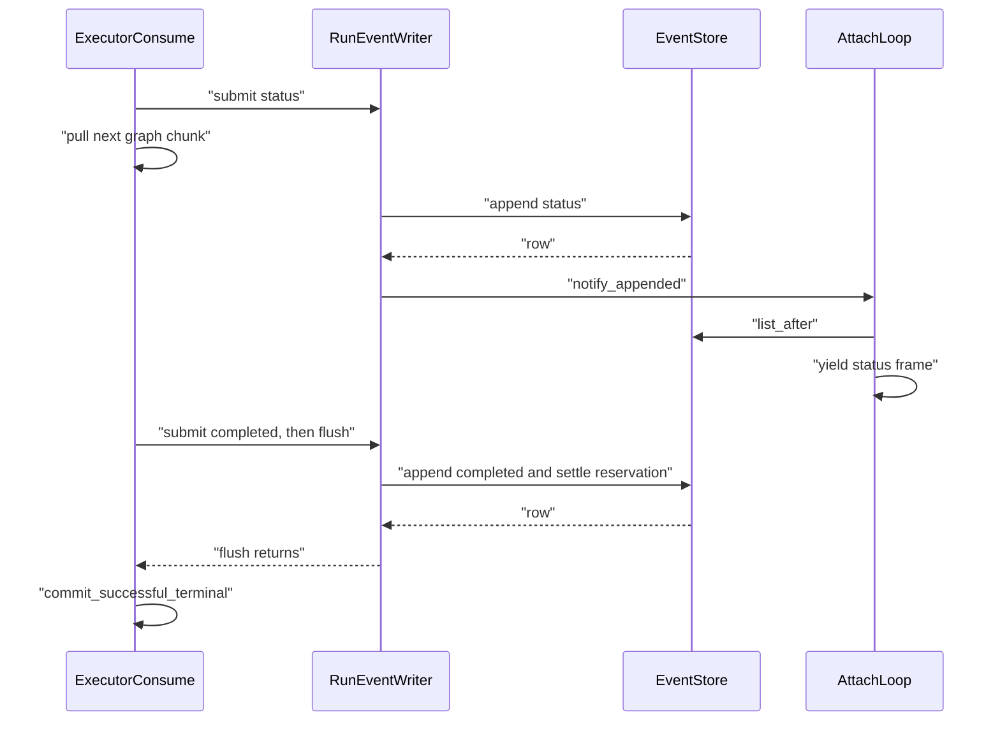

# L3 - Ordered background event writer

Read `00-rules-and-commands.md` first (especially **How to apply an edit**).
Apply the edits below in order. Every `Find (exactly once):` block must
match exactly one place in the named file. If it matches zero or two
places, stop and report; do not guess.

**This is deviation 1 in the plan index. Accepting the plan approves it.
This packet writes its ADR.**

## Goal (why)

LangGraph `astream` only advances when its consumer pulls the next chunk.
After L1 and L2, `_run_executor._consume` still awaits
`self._append_async(...)` for every draft, so every persisted event (about
254 ms, 3 round trips; median 28 events per run) is added to graph time.

This packet adds a per-run FIFO writer:

- The executor **submits** each draft to `RunEventWriter` and keeps
  pulling the stream. One background task persists drafts in submit order
  through the existing `_append_async`, so validation, sanitized-error
  replacement, attach wake-up, and settlement are unchanged.
- After a terminal draft (`completed`, `partial`, `error`, `cancelled`)
  the executor awaits `flush`: it waits until that draft and everything
  before it are persisted. `commit_successful_terminal` therefore still
  runs after the terminal is durable.
- Backpressure: at most `EVENT_WRITER_MAX_PENDING = 32` queued drafts; a
  full queue makes `submit` wait.
- An unexpected exception from an append stops the writer (queued drafts
  after it are skipped, their count is logged) and is re-raised by the
  next `submit` or `flush`. That sends `_run_executor` down its existing
  `except Exception` path (one sanitized `error` terminal).
- After a cancel request, queued non-terminal drafts are skipped, because
  `notify_cancel` has already persisted `cancelled`.
- Heartbeats keep their own `_append_async` path.
- `close` logs one line per run with the numbers L4 needs:
  `sse writer summary run_id=... events=N append_ms_p50=... append_ms_max=...
  lag_ms_max=... flush_ms_max=...`. The numbers are in the message text on
  purpose: the JSON log formatter
  (`smart_rag_core.observability.logging.JsonLogFormatter`) prints only
  `event`, `message`, correlation IDs, and `error_type`, not other
  `extra` fields.

What stays the same: persist-before-flush to the client (frames come only
from the database), sequence order (one consumer per run), exactly one
terminal, reservation settlement after the terminal, cancel and error
terminals.

## Before you start

```powershell
git status --short
git branch --show-current
```

The branch must be `fix/answer-loss-repair` (combined plan) and L2 must be committed
(`git log --oneline -1` shows the L2 commit). None of the files in the
table below may have uncommitted changes, except `docs/README.md` and
`docs/adr/README.md` (see Edit 7 for those two).

## Files this packet edits

| # | File |
| - | ---- |
| 1 | `apps/backend/src/smart_rag_api/services/sse/event_writer.py` (new) |
| 2 | `apps/backend/src/smart_rag_api/services/sse/run_orchestration.py` |
| 3 | `apps/backend/src/smart_rag_api/services/sse/event_append.py` (docstring only) |
| 4 | `tests/contract/test_stream_architecture_budgets.py` (one list entry) |
| 5 | `tests/unit/test_query_sse_event_writer.py` (new) |
| 6 | `tests/unit/test_query_sse_lifecycle.py` (new tests at the end) |
| 7 | `docs/adr/ADR-sse-ordered-background-writer.md` (new), `docs/api/SSE.md`, `docs/adr/README.md`, `docs/README.md` |
| 8 | `docs/evaluation/QUERY_LATENCY_REPAIR_EVIDENCE.md` (L3 row, after the live proof) |

Dates: every `YYYY-MM-DD` in the new text of Edit 7 must be replaced by
today's date. Get it with `Get-Date -Format yyyy-MM-dd`.

## Edit 1 - new file `event_writer.py`

File: `apps/backend/src/smart_rag_api/services/sse/event_writer.py`

Full contents:

```python
"""Per-run ordered background writer for SSE executor drafts.

LangGraph ``astream`` only advances when its consumer asks for the next
chunk, so awaiting one event-store transaction per draft inside that
consumer adds every write to graph time. ``RunEventWriter`` hands drafts to
one background task that persists them in submit order while the graph
keeps running.
"""

from __future__ import annotations

import asyncio
import logging
import statistics
import time
from collections.abc import Awaitable, Callable
from uuid import UUID

from smart_rag_core.security.identity import CallerContext
from smart_rag_core.sse.catalog import TERMINAL_SSE_EVENT_TYPES
from smart_rag_core.sse.store import PersistedRunEvent

LOGGER = logging.getLogger(__name__)

EVENT_WRITER_MAX_PENDING = 32
"""Most drafts queued ahead of persistence for one run. A full queue makes
``submit`` wait, which bounds memory and how far frames can lag the graph."""

AppendFn = Callable[[str, dict[str, object]], Awaitable[PersistedRunEvent | None]]
"""Persist one draft. Returns the row, or None when the append was skipped."""

ExecutorAppendFn = Callable[
    [CallerContext, UUID, str, dict[str, object]],
    Awaitable[PersistedRunEvent | None],
]
"""Shape of ``EventAppendMixin._append_async``."""

_Draft = tuple[str, dict[str, object], float]


def _elapsed_ms(started: float) -> float:
    """Return milliseconds since ``started`` on the monotonic clock.

    Args:
        started: A ``time.monotonic()`` value.

    Returns:
        Non-negative elapsed milliseconds, rounded to 0.1 ms.
    """

    return round(max(0.0, time.monotonic() - started) * 1000.0, 1)


class RunEventWriter:
    """Persist one run's SSE drafts in submit order on a single task.

    One consumer task takes drafts from a bounded FIFO queue and awaits
    ``append`` for each, so persisted order equals submit order. The
    executor awaits ``flush`` after a terminal draft, so work that must
    follow a durable terminal (``commit_successful_terminal``) still does.

    An exception raised by ``append`` stops persistence: drafts queued
    after it are skipped, and every later ``submit`` and ``flush``
    re-raises it. ``close`` never re-raises it, so cleanup paths can always
    call it. Use one writer per run, only from the event-loop thread that
    created it.
    """

    def __init__(
        self,
        append: AppendFn,
        *,
        run_id: UUID,
        max_pending: int = EVENT_WRITER_MAX_PENDING,
    ) -> None:
        """Configure the writer. No task starts until the first ``submit``.

        Args:
            append: Coroutine function that persists one draft.
            run_id: Run whose drafts this writer persists. Used in logs.
            max_pending: Queue bound. Must be at least 1.

        Raises:
            ValueError: ``max_pending`` is below 1.
        """

        if max_pending < 1:
            raise ValueError("max_pending must be at least 1")
        self._append = append
        self._run_id = run_id
        self._queue: asyncio.Queue[_Draft | None] = asyncio.Queue(maxsize=max_pending)
        self._task: asyncio.Task[None] | None = None
        self._failure: Exception | None = None
        self._closed = False
        self._append_ms: list[float] = []
        self._lag_ms_max = 0.0
        self._flush_ms_max = 0.0

    async def submit(self, event_type: str, payload: dict[str, object]) -> None:
        """Queue one draft to persist after every earlier draft.

        Args:
            event_type: Catalog event type.
            payload: Draft payload. Not copied; do not change it afterwards.

        Raises:
            RuntimeError: The writer is closed.
            Exception: The stored ``append`` failure, when one happened.

        Side Effects:
            Starts the consumer task on first use. Waits while the queue
            already holds ``max_pending`` drafts.
        """

        self._raise_failure()
        if self._closed:
            raise RuntimeError("event writer is closed")
        if self._task is None:
            self._task = asyncio.create_task(self._drain())
        await self._queue.put((event_type, payload, time.monotonic()))

    async def flush(self) -> None:
        """Wait until every submitted draft is persisted or skipped.

        Raises:
            Exception: The stored ``append`` failure, when one happened.
        """

        started = time.monotonic()
        await self._queue.join()
        self._flush_ms_max = max(self._flush_ms_max, _elapsed_ms(started))
        self._raise_failure()

    async def close(self) -> None:
        """Wait for queued drafts, stop the consumer, and log a summary once.

        Safe to call more than once and after a failure. Never re-raises the
        stored ``append`` failure.

        Side Effects:
            Logs one ``sse.writer_summary`` info record with counts and
            millisecond timings only.
        """

        if self._closed:
            return
        self._closed = True
        task = self._task
        if task is not None:
            await self._queue.join()
            await self._queue.put(None)
            await task
            self._task = None
        LOGGER.info(
            "sse writer summary run_id=%s events=%d append_ms_p50=%.1f "
            "append_ms_max=%.1f lag_ms_max=%.1f flush_ms_max=%.1f",
            self._run_id,
            len(self._append_ms),
            statistics.median(self._append_ms) if self._append_ms else 0.0,
            max(self._append_ms, default=0.0),
            self._lag_ms_max,
            self._flush_ms_max,
            extra={"event": "sse.writer_summary"},
        )

    def abort(self) -> None:
        """Stop the consumer without waiting; queued drafts are not written.

        For cleanup paths where ``close`` did not finish, for example when
        the executor task is cancelled a second time. No-op after ``close``.

        Side Effects:
            Marks the writer closed and cancels the consumer task.
        """

        self._closed = True
        task = self._task
        self._task = None
        if task is not None and not task.done():
            task.cancel()

    def _raise_failure(self) -> None:
        """Re-raise the stored ``append`` failure, if any.

        Raises:
            Exception: The first exception raised by ``append``.
        """

        if self._failure is not None:
            raise self._failure

    async def _drain(self) -> None:
        """Persist queued drafts in order until the stop marker arrives.

        Side Effects:
            Calls ``append`` once per draft while no failure is stored, and
            marks every item done so ``flush`` and ``close`` can return.
        """

        while True:
            item = await self._queue.get()
            try:
                if item is None:
                    return
                if self._failure is None:
                    await self._persist(*item)
            finally:
                self._queue.task_done()

    async def _persist(
        self, event_type: str, payload: dict[str, object], submitted: float
    ) -> None:
        """Persist one draft and record timings, or store the failure.

        Args:
            event_type: Catalog event type.
            payload: Draft payload.
            submitted: ``time.monotonic()`` when the draft was submitted.

        Side Effects:
            On an ``append`` exception, stores it and logs one
            ``sse.writer_stopped`` record with the number of skipped drafts.
        """

        started = time.monotonic()
        try:
            await self._append(event_type, payload)
        except Exception as exc:
            self._failure = exc
            LOGGER.info(
                "sse writer stopped run_id=%s skipped=%d",
                self._run_id,
                self._queue.qsize(),
                extra={"event": "sse.writer_stopped", "error_type": type(exc).__name__},
            )
            return
        self._append_ms.append(_elapsed_ms(started))
        self._lag_ms_max = max(self._lag_ms_max, _elapsed_ms(submitted))


def executor_draft_writer(
    append: ExecutorAppendFn,
    *,
    caller: CallerContext,
    run_id: UUID,
    cancel_event: asyncio.Event,
) -> RunEventWriter:
    """Build the writer for one executor run.

    After a cancel request, queued non-terminal drafts are skipped:
    ``notify_cancel`` has already persisted ``cancelled``, so a draft
    written now would land after the terminal event. Terminal drafts still
    go to ``append``, which keeps exactly one terminal.

    Args:
        append: ``_append_async`` of the SSE service.
        caller: Run owner.
        run_id: Run id.
        cancel_event: The live handle's cancel event.

    Returns:
        A writer whose consumer task starts on the first ``submit``.
    """

    async def _persist(
        event_type: str, payload: dict[str, object]
    ) -> PersistedRunEvent | None:
        """Persist one draft unless a cancel made it obsolete.

        Args:
            event_type: Catalog event type.
            payload: Draft payload.

        Returns:
            Persisted row, or None when skipped or rejected.
        """

        if cancel_event.is_set() and event_type not in TERMINAL_SSE_EVENT_TYPES:
            return None
        return await append(caller, run_id, event_type, payload)

    return RunEventWriter(_persist, run_id=run_id)
```

## Edit 2 - `run_orchestration.py`

File: `apps/backend/src/smart_rag_api/services/sse/run_orchestration.py`

This file must stay at 300 lines or fewer
(`tests/contract/test_stream_architecture_budgets.py`). After L1 it has
272 lines; these edits add 18.

2a. The catalog import. Find (exactly once):

```python
from smart_rag_core.security.identity import CallerContext
from smart_rag_core.sse.sanitize import sanitize_error_payload
```

Replace with:

```python
from smart_rag_core.security.identity import CallerContext
from smart_rag_core.sse.catalog import TERMINAL_SSE_EVENT_TYPES
from smart_rag_core.sse.sanitize import sanitize_error_payload
```

2b. The writer import. Find (exactly once):

```python
from smart_rag_api.services.sse.chunks import token_counts_from_update
from smart_rag_api.services.sse.executors import QueryRunExecutor
```

Replace with:

```python
from smart_rag_api.services.sse.chunks import token_counts_from_update
from smart_rag_api.services.sse.event_writer import executor_draft_writer
from smart_rag_api.services.sse.executors import QueryRunExecutor
```

2c. The `_run_executor` docstring. Find (exactly once):

```python
        Each catalog append, terminal lookup, and durable-input load is
        awaited on a worker thread so a database wait cannot freeze this
        event loop. Sequence order is the executor yield order. Attach
        loops are woken when the executor ends.
```

Replace with:

```python
        Drafts go through one ``RunEventWriter`` that persists them in
        yield order while the graph keeps running. The executor waits for
        it after each terminal draft, at the end of the stream, and on the
        cancel and error paths, so a terminal is durable before
        post-terminal work. Queued non-terminal drafts are skipped after a
        cancel request. Store calls run on worker threads, and attach loops
        are woken on each append and when the executor ends.
```

2d. Create the writer. Find (exactly once):

```python
            self._cancel_tasks(live)
            return
        try:
            from smart_rag_core.observability.query_run_trace import (
```

Replace with:

```python
            self._cancel_tasks(live)
            return
        writer = executor_draft_writer(
            self._append_async,
            caller=caller,
            run_id=record.run_id,
            cancel_event=live.cancel_event,
        )
        try:
            from smart_rag_core.observability.query_run_trace import (
```

2e. Submit each draft. Find (exactly once):

```python
                    await self._append_async(caller, record.run_id, event_type, payload)
                    if event_type == "token_delta":
```

Replace with:

```python
                    await writer.submit(event_type, payload)
                    if event_type in TERMINAL_SSE_EVENT_TYPES:
                        await writer.flush()
                    if event_type == "token_delta":
```

2f. Wait for the writer at the end of the stream. Find (exactly once):

```python
                            completion_tokens = event_completion
                if not await asyncio.to_thread(
```

Replace with:

```python
                            completion_tokens = event_completion
                await writer.flush()
                await writer.close()
                if not await asyncio.to_thread(
```

2g. The cancel path. Find (exactly once):

```python
        except asyncio.CancelledError:
            if not await asyncio.to_thread(self._has_terminal, caller, record.run_id):
```

Replace with:

```python
        except asyncio.CancelledError:
            await writer.close()
            if not await asyncio.to_thread(self._has_terminal, caller, record.run_id):
```

2h. The error path. Find (exactly once):

```python
                    "error_type": type(exc).__name__,
                },
            )
            if not await asyncio.to_thread(self._has_terminal, caller, record.run_id):
```

Replace with:

```python
                    "error_type": type(exc).__name__,
                },
            )
            await writer.close()
            if not await asyncio.to_thread(self._has_terminal, caller, record.run_id):
```

2i. The `finally` block. Find (exactly once):

```python
        finally:
            live.terminal = True
            live.notify_appended()
```

Replace with:

```python
        finally:
            writer.abort()
            live.terminal = True
            live.notify_appended()
```

After 2a-2i, check: `rg -n "_append_async\(caller, record.run_id, event_type" apps/backend/src/smart_rag_api/services/sse/run_orchestration.py`
must print nothing (exit code 1 when nothing is found is the expected
result).

## Edit 3 - `event_append.py` docstring

File: `apps/backend/src/smart_rag_api/services/sse/event_append.py`

Find (exactly once):

```python
        attach. Callers still await each append before the next event so
        sequence order and exactly-one terminal stay unchanged. After the
```

Replace with:

```python
        attach. Executor drafts reach it through one ``RunEventWriter`` per
        run, so they still persist one at a time in yield order and
        exactly-one terminal stays unchanged. After the
```

## Edit 4 - stream line budget list

File: `tests/contract/test_stream_architecture_budgets.py`

Find (exactly once):

```python
    "apps/backend/src/smart_rag_api/services/sse/run_summary.py",
)
```

Replace with:

```python
    "apps/backend/src/smart_rag_api/services/sse/run_summary.py",
    "apps/backend/src/smart_rag_api/services/sse/event_writer.py",
)
```

## Edit 5 - new file `tests/unit/test_query_sse_event_writer.py`

File: `tests/unit/test_query_sse_event_writer.py`

Full contents:

```python
"""Ordered background writer for one run's SSE executor drafts."""

from __future__ import annotations

import asyncio
import logging
import time
from uuid import UUID, uuid4

import pytest
from smart_rag_api.services.sse.event_writer import (
    RunEventWriter,
    executor_draft_writer,
)
from smart_rag_core.security.identity import CallerContext
from smart_rag_core.sse.store import PersistedRunEvent

from tests.support.query_sse import caller as make_caller

WRITER_LOGGER = "smart_rag_api.services.sse.event_writer"


class _Recorder:
    """Append stand-in that records drafts and can delay, block, or fail."""

    def __init__(
        self,
        *,
        delays: tuple[float, ...] = (),
        fail_at: int | None = None,
        gate: asyncio.Event | None = None,
    ) -> None:
        """Configure the fake append.

        Args:
            delays: Sleep in seconds per call, by call index (missing is 0).
            fail_at: Zero-based call index that raises ``RuntimeError``.
            gate: When set, every call waits for this event first.
        """

        self.delays = delays
        self.fail_at = fail_at
        self.gate = gate
        self.calls = 0
        self.persisted: list[tuple[str, dict[str, object]]] = []

    async def __call__(
        self, event_type: str, payload: dict[str, object]
    ) -> PersistedRunEvent | None:
        """Record one draft after the configured wait.

        Args:
            event_type: Catalog event type.
            payload: Draft payload.

        Returns:
            Always None; the writer ignores the row.

        Raises:
            RuntimeError: On the configured failing call.
        """

        index = self.calls
        self.calls += 1
        if self.gate is not None:
            await self.gate.wait()
        if index < len(self.delays):
            await asyncio.sleep(self.delays[index])
        if index == self.fail_at:
            raise RuntimeError("append failed")
        self.persisted.append((event_type, payload))
        return None


def _draft(index: int) -> tuple[str, dict[str, object]]:
    """Return one numbered status draft.

    Args:
        index: Draft number.

    Returns:
        ``status`` draft whose stage names the number.
    """

    return ("status", {"stage": f"stage_{index}", "status": "running"})


def test_writer_preserves_submit_order() -> None:
    """Fifty drafts with uneven append delays persist in submit order."""

    recorder = _Recorder(delays=tuple(((i * 7) % 5) / 1000.0 for i in range(50)))

    async def _run() -> None:
        """Submit fifty drafts, then close."""

        writer = RunEventWriter(recorder, run_id=uuid4())
        for index in range(50):
            await writer.submit(*_draft(index))
        await writer.close()

    asyncio.run(_run())
    assert recorder.persisted == [_draft(index) for index in range(50)]


def test_submit_does_not_wait_for_append() -> None:
    """Five submits return long before their 100 ms appends finish."""

    recorder = _Recorder(delays=(0.1,) * 5)

    async def _run() -> float:
        """Time five submits, then flush and close.

        Returns:
            Seconds spent in the five ``submit`` calls.
        """

        writer = RunEventWriter(recorder, run_id=uuid4())
        started = time.monotonic()
        for index in range(5):
            await writer.submit(*_draft(index))
        elapsed = time.monotonic() - started
        await writer.flush()
        await writer.close()
        return elapsed

    assert asyncio.run(_run()) < 0.05
    assert len(recorder.persisted) == 5


def test_submit_waits_when_queue_full() -> None:
    """With ``max_pending=2`` a fourth submit waits behind a blocked append."""

    async def _run() -> tuple[bool, list[tuple[str, dict[str, object]]]]:
        """Fill the queue behind a blocked append, then release it.

        Returns:
            Whether the fourth submit timed out, and the persisted drafts.
        """

        gate = asyncio.Event()
        recorder = _Recorder(gate=gate)
        writer = RunEventWriter(recorder, run_id=uuid4(), max_pending=2)
        for index in range(3):
            await writer.submit(*_draft(index))
        try:
            await asyncio.wait_for(writer.submit(*_draft(3)), timeout=0.1)
        except TimeoutError:
            timed_out = True
        else:
            timed_out = False
        gate.set()
        await writer.close()
        return timed_out, recorder.persisted

    timed_out, persisted = asyncio.run(_run())
    assert timed_out is True
    assert persisted == [_draft(index) for index in range(3)]


def test_flush_waits_for_all_submitted() -> None:
    """``flush`` returns only after every submitted draft is persisted."""

    recorder = _Recorder(delays=(0.02,) * 5)

    async def _run() -> int:
        """Submit five slow drafts and flush.

        Returns:
            Persisted count right after ``flush`` returns.
        """

        writer = RunEventWriter(recorder, run_id=uuid4())
        for index in range(5):
            await writer.submit(*_draft(index))
        await writer.flush()
        count = len(recorder.persisted)
        await writer.close()
        return count

    assert asyncio.run(_run()) == 5


def test_append_exception_stops_writer_and_reraises(
    caplog: pytest.LogCaptureFixture,
) -> None:
    """A failing append stops later writes; flush and submit re-raise it."""

    recorder = _Recorder(fail_at=1)

    async def _run() -> None:
        """Submit three drafts where the second fails."""

        writer = RunEventWriter(recorder, run_id=uuid4())
        for index in range(3):
            await writer.submit(*_draft(index))
        with pytest.raises(RuntimeError, match="append failed"):
            await writer.flush()
        with pytest.raises(RuntimeError, match="append failed"):
            await writer.submit(*_draft(3))
        await writer.close()

    with caplog.at_level(logging.INFO, logger=WRITER_LOGGER):
        asyncio.run(_run())
    assert recorder.persisted == [_draft(0)]
    assert recorder.calls == 2
    stopped = [
        record
        for record in caplog.records
        if getattr(record, "event", None) == "sse.writer_stopped"
    ]
    assert len(stopped) == 1
    assert "skipped=1" in stopped[0].getMessage()
    assert getattr(stopped[0], "error_type", None) == "RuntimeError"


def test_close_is_idempotent_and_abort_after_close_is_noop(
    caplog: pytest.LogCaptureFixture,
) -> None:
    """Two closes log one summary; abort after close does nothing."""

    recorder = _Recorder()

    async def _run() -> None:
        """Close twice, abort, and prove submit is refused after close."""

        writer = RunEventWriter(recorder, run_id=uuid4())
        await writer.submit(*_draft(0))
        await writer.close()
        await writer.close()
        writer.abort()
        with pytest.raises(RuntimeError, match="closed"):
            await writer.submit(*_draft(1))

    with caplog.at_level(logging.INFO, logger=WRITER_LOGGER):
        asyncio.run(_run())
    summaries = [
        record
        for record in caplog.records
        if getattr(record, "event", None) == "sse.writer_summary"
    ]
    assert len(summaries) == 1
    assert "events=1" in summaries[0].getMessage()
    assert recorder.persisted == [_draft(0)]


def test_writer_rejects_empty_queue_bound() -> None:
    """``max_pending`` below one is a configuration error."""

    with pytest.raises(ValueError, match="max_pending"):
        RunEventWriter(_Recorder(), run_id=uuid4(), max_pending=0)


def test_executor_writer_skips_non_terminal_drafts_after_cancel() -> None:
    """After cancel, status drafts are skipped and terminals still persist."""

    calls: list[str] = []

    async def _append(
        caller: CallerContext,
        run_id: UUID,
        event_type: str,
        payload: dict[str, object],
    ) -> PersistedRunEvent | None:
        """Record the event type only.

        Args:
            caller: Run owner.
            run_id: Run id.
            event_type: Catalog event type.
            payload: Draft payload.

        Returns:
            Always None.
        """

        del caller, run_id, payload
        calls.append(event_type)
        return None

    async def _run() -> None:
        """Persist one status, cancel, then submit a status and a terminal."""

        cancel = asyncio.Event()
        writer = executor_draft_writer(
            _append, caller=make_caller(), run_id=uuid4(), cancel_event=cancel
        )
        await writer.submit(*_draft(0))
        await writer.flush()
        cancel.set()
        await writer.submit(*_draft(1))
        await writer.submit("cancelled", {})
        await writer.close()

    asyncio.run(_run())
    assert calls == ["status", "cancelled"]
```

## Edit 6 - lifecycle tests

File: `tests/unit/test_query_sse_lifecycle.py`

These tests use `_BlockingAppendStore` (already in this file) and a small
executor class each.

6a. Append to the end of the file:

```python
class _TimedExecutor:
    """Executor that records when each yielded draft is handed back."""

    def __init__(self, count: int) -> None:
        """Configure the stream.

        Args:
            count: Status drafts before ``completed``.
        """

        self.count = count
        self.resumed_at: list[float] = []

    async def execute(
        self,
        *,
        context: Any,
        message: str,
        cancel_event: asyncio.Event,
    ) -> AsyncIterator[tuple[str, dict[str, object]]]:
        """Yield status drafts without delay, then ``completed``.

        Args:
            context: Unused authorized context.
            message: Unused user text.
            cancel_event: Unused cancel flag.

        Yields:
            Catalog drafts.
        """

        del context, message, cancel_event
        for index in range(self.count):
            yield ("status", {"stage": f"stage_{index}", "status": "running"})
            self.resumed_at.append(time.monotonic())
        yield ("completed", {})


def test_executor_does_not_wait_for_non_terminal_appends() -> None:
    """Five status drafts are handed back before their slow appends finish."""

    store = _BlockingAppendStore(0.1, threading.Event())
    executor = _TimedExecutor(count=5)
    service = SseStreamService(
        store=store,
        registry=QueryRunRegistry(),
        executor=executor,
        sse_schema_version="1",
    )
    caller = make_caller()
    runtime = make_runtime()
    service.remember_admitted(caller, runtime, message="hello")

    async def _drain() -> list[str]:
        """Attach once and read every frame through the terminal.

        Returns:
            ``event:`` lines in stream order.
        """

        lines: list[str] = []
        async for frame in service.iter_frames(
            caller, run_id=runtime.run_id, after=0, context=runtime
        ):
            lines.extend(
                line for line in frame.splitlines() if line.startswith("event:")
            )
        return lines

    lines = asyncio.run(_drain())
    assert lines.count("event: status") == 5
    assert lines[-1] == "event: completed"
    assert executor.resumed_at[4] - executor.resumed_at[0] < 0.1
    events = store.list_after(caller, run_id=runtime.run_id, after=0)
    stages = [
        event.payload.get("stage") for event in events if event.event_type == "status"
    ]
    assert stages == [f"stage_{index}" for index in range(5)]
    assert events[-1].event_type == "completed"


class _TerminalProbeExecutor:
    """Executor that checks, after ``completed``, whether it is persisted."""

    def __init__(self, store: MemoryRunEventStore, caller: Any, run_id: Any) -> None:
        """Keep the store handle used for the check.

        Args:
            store: Event store the service writes to.
            caller: Run owner.
            run_id: Run id.
        """

        self.store = store
        self.caller = caller
        self.run_id = run_id
        self.completed_persisted: bool | None = None

    async def execute(
        self,
        *,
        context: Any,
        message: str,
        cancel_event: asyncio.Event,
    ) -> AsyncIterator[tuple[str, dict[str, object]]]:
        """Yield status and ``completed``, then record what is persisted.

        Args:
            context: Unused authorized context.
            message: Unused user text.
            cancel_event: Unused cancel flag.

        Yields:
            Catalog drafts.
        """

        del context, message, cancel_event
        yield ("status", {"stage": "admitted", "status": "running"})
        yield ("completed", {})
        events = self.store.list_after(self.caller, run_id=self.run_id, after=0)
        self.completed_persisted = any(
            event.event_type == "completed" for event in events
        )


def test_terminal_flush_precedes_post_terminal_work() -> None:
    """Code after ``yield completed`` sees the terminal already persisted."""

    store = _BlockingAppendStore(0.05, threading.Event())
    caller = make_caller()
    runtime = make_runtime()
    executor = _TerminalProbeExecutor(store, caller, runtime.run_id)
    service = SseStreamService(
        store=store,
        registry=QueryRunRegistry(),
        executor=executor,
        sse_schema_version="1",
    )
    service.remember_admitted(caller, runtime, message="hello")

    async def _drain() -> None:
        """Attach through the terminal, then wait for the executor check."""

        async for _frame in service.iter_frames(
            caller, run_id=runtime.run_id, after=0, context=runtime
        ):
            pass
        for _ in range(100):
            if executor.completed_persisted is not None:
                return
            await asyncio.sleep(0.01)

    asyncio.run(_drain())
    assert executor.completed_persisted is True


class _CancelWaitExecutor:
    """Executor that yields status drafts at once, then waits for cancel."""

    def __init__(self, count: int) -> None:
        """Configure the stream.

        Args:
            count: Status drafts yielded before waiting.
        """

        self.count = count

    async def execute(
        self,
        *,
        context: Any,
        message: str,
        cancel_event: asyncio.Event,
    ) -> AsyncIterator[tuple[str, dict[str, object]]]:
        """Yield status drafts, then end when cancel is requested.

        Args:
            context: Unused authorized context.
            message: Unused user text.
            cancel_event: Ends the stream when set.

        Yields:
            Catalog drafts.
        """

        del context, message
        for index in range(self.count):
            yield ("status", {"stage": f"stage_{index}", "status": "running"})
        await cancel_event.wait()


def test_cancel_skips_queued_drafts_and_keeps_one_terminal() -> None:
    """Cancel keeps one ``cancelled`` and skips queued status drafts."""

    store = _BlockingAppendStore(0.1, threading.Event())
    registry = QueryRunRegistry()
    service = SseStreamService(
        store=store,
        registry=registry,
        executor=_CancelWaitExecutor(count=5),
        sse_schema_version="1",
    )
    caller = make_caller()
    runtime = make_runtime()
    service.remember_admitted(caller, runtime, message="hello")

    async def _run() -> None:
        """Start the run, cancel after the first status row, then wait."""

        agen = service.iter_frames(
            caller, run_id=runtime.run_id, after=0, context=runtime
        )
        await agen.__anext__()
        for _ in range(200):
            rows = store.list_after(caller, run_id=runtime.run_id, after=0)
            if any(row.event_type == "status" for row in rows):
                break
            await asyncio.sleep(0.01)
        live = registry.get(runtime.run_id)
        assert live is not None
        executor_task = live.executor_task
        assert executor_task is not None
        service.notify_cancel(caller, run_id=runtime.run_id)
        try:
            await asyncio.wait_for(executor_task, timeout=3.0)
        except asyncio.CancelledError:
            pass
        close = getattr(agen, "aclose", None)
        if callable(close):
            closed = close()
            if inspect.isawaitable(closed):
                await closed

    asyncio.run(_run())
    types = [
        row.event_type
        for row in store.list_after(caller, run_id=runtime.run_id, after=0)
    ]
    assert types.count("cancelled") == 1
    assert types.count("completed") + types.count("error") == 0
    assert types.count("status") <= 2
    assert len(types) - types.index("cancelled") - 1 <= 1


class _FailingStatusStore(MemoryRunEventStore):
    """Memory store whose append raises for the status stage ``boom``."""

    def append(
        self,
        caller: Any,
        *,
        run_id: Any,
        event_type: str,
        payload: dict[str, object],
    ) -> Any:
        """Raise for stage ``boom``, otherwise persist.

        Args:
            caller: Owner.
            run_id: Run id.
            event_type: Allow-listed type.
            payload: Candidate payload.

        Returns:
            Persisted event from the memory store.

        Raises:
            RuntimeError: For the ``boom`` status draft.
        """

        if event_type == "status" and payload.get("stage") == "boom":
            raise RuntimeError("store exploded")
        return super().append(
            caller, run_id=run_id, event_type=event_type, payload=payload
        )


def test_writer_failure_becomes_single_error_terminal() -> None:
    """An unexpected append failure ends the run with one sanitized error."""

    store = _FailingStatusStore()
    service = SseStreamService(
        store=store,
        registry=QueryRunRegistry(),
        executor=FixtureQueryRunExecutor(
            extra_events=(
                ("status", {"stage": "boom", "status": "running"}),
                ("status", {"stage": "after", "status": "running"}),
            ),
        ),
        sse_schema_version="1",
    )
    caller = make_caller()
    runtime = make_runtime()
    service.remember_admitted(caller, runtime, message="hello")

    async def _drain() -> list[str]:
        """Attach once and read every frame through the terminal.

        Returns:
            ``event:`` lines in stream order.
        """

        lines: list[str] = []
        async for frame in service.iter_frames(
            caller, run_id=runtime.run_id, after=0, context=runtime
        ):
            lines.extend(
                line for line in frame.splitlines() if line.startswith("event:")
            )
        return lines

    lines = asyncio.run(_drain())
    assert lines[-1] == "event: error"
    events = store.list_after(caller, run_id=runtime.run_id, after=0)
    types = [event.event_type for event in events]
    stages = [
        event.payload.get("stage") for event in events if event.event_type == "status"
    ]
    assert types.count("error") == 1
    assert "completed" not in types
    assert "boom" not in stages
    assert "after" not in stages
```

## Edit 7 - docs

7a. The ADR.

File: `docs/adr/ADR-sse-ordered-background-writer.md`

Full contents:

````markdown
---
title: ADR - SSE ordered background event writer
adr_id: ADR-sse-ordered-background-writer
status: accepted
owner: engineering-lead
last-reviewed: YYYY-MM-DD
approver: "user (Cursor chat; approved with the query latency repair plan)"
approval_date: "YYYY-MM-DD"
audience: eng, reviewers
---

# ADR: SSE ordered background event writer

## Status

`accepted` on YYYY-MM-DD, approved with the query latency repair plan
(deviation 1, latency packet L3).

## Context

LangGraph `astream` only advances when its consumer pulls the next chunk.
Before L3, `RunOrchestrationMixin._run_executor` awaited `_append_async`
for every executor draft. Each append is one event-store transaction:
about 254 ms over three network round trips to Supabase (measured
2026-09-24). A company-documents run has a median of 28 events, so
several seconds of every run were spent waiting for event writes while
the graph could not move.

## Decision

- One `RunEventWriter` per run (`smart_rag_api.services.sse.event_writer`).
  The executor calls `submit`; one background task persists drafts in
  submit order through the existing `_append_async`, so validation,
  sanitized-error replacement, attach wake-up, and reservation settlement
  are unchanged.
- After a terminal draft (`completed`, `partial`, `error`, `cancelled`)
  the executor awaits `flush`, so the terminal and everything before it
  are durable before `commit_successful_terminal` runs.
- The queue holds at most `EVENT_WRITER_MAX_PENDING` = 32 drafts. A full
  queue makes `submit` wait.
- An unexpected append exception stops the writer. Queued drafts after it
  are skipped, the next `submit` or `flush` re-raises it, and the existing
  `except Exception` path persists one sanitized `error` terminal.
- After a cancel request, queued non-terminal drafts are skipped, because
  `notify_cancel` has already persisted `cancelled`.
- Heartbeats keep their own direct `_append_async` path.



## Alternatives considered

- Keep awaiting every append. Simple, but every write stays on the
  graph's critical path.
- Batch several events into one transaction. Rejected:
  `app.append_run_event` has no idempotency key, so a commit with an
  unknown outcome could not be retried without duplicate events.
- One round trip per append (pipeline mode). Complementary, not a
  replacement: latency packet L4, run only if the L3 writer summaries show
  that writes still cost visible time.

## Consequences

- The executor learns about a non-terminal append failure at a later
  `submit` or `flush`, not at that append. Failures that `_append` already
  turns into `None` stay swallowed as before.
- Frames can lag the graph by up to the queue length.
  `app.run_events.created_at` is persist time, so stage durations in the
  latency report include writer lag; `wall_seconds` and `server_total_s`
  stay the primary latency metrics.
- A cancel skips queued non-terminal drafts, so a cancelled run can have
  fewer `status` rows than before. At most one in-flight draft can still
  land after `cancelled`, as before L3.
- `close` logs one `sse.writer_summary` line per run. The numbers are in
  the message text (`events`, `append_ms_p50`, `append_ms_max`,
  `lag_ms_max`, `flush_ms_max`) because the JSON log formatter does not
  print other `extra` fields.

## Security

No ACL or data change. Every append still goes through the owner-checked
`app.append_run_event` RPC as `app_api`. Logs carry the run id, counts,
timings, and exception type names only; never payloads, DSNs, or
exception text.

## Verification

```powershell
uv run python -m pytest tests/unit/test_query_sse_event_writer.py tests/unit/test_query_sse_lifecycle.py
```

## Rollback

Revert the L3 commit. No migration or data change is involved.

[ADR index](./README.md) · [SSE contract](../api/SSE.md)
````

7b. `SSE.md`.

File: `docs/api/SSE.md`

Find (exactly once):

```markdown
Heartbeat and executor appends run in `asyncio.to_thread` so a synchronous
Postgres wait cannot freeze the SSE event loop or LangGraph `astream`.
Sequence order is unchanged: each append is awaited before the next event.
Exactly one terminal remains required.
```

Replace with:

```markdown
Heartbeat and executor appends run in `asyncio.to_thread` so a synchronous
Postgres wait cannot freeze the SSE event loop or LangGraph `astream`.
Exactly one terminal remains required.

Since latency packet L3, the executor does not wait for each append. It
hands drafts to a per-run `RunEventWriter`
(`smart_rag_api.services.sse.event_writer`): one background task persists
them in yield order, so sequence order is still the executor yield order.
The queue holds at most `EVENT_WRITER_MAX_PENDING` = 32 drafts; a full
queue makes the executor wait. After a terminal draft the executor waits
until the writer has persisted it, so `commit_successful_terminal` and
reservation settlement still run after a durable terminal. After a cancel
request, queued non-terminal drafts are skipped because `cancelled` is
already persisted. An unexpected append exception stops the writer; the
executor then persists one sanitized `error` terminal if none exists.
Heartbeats keep their own direct append path. Frames still come only from
persisted rows, so `app.run_events.created_at` is persist time and can lag
the graph by up to the queue length. See
[ADR-sse-ordered-background-writer.md](../adr/ADR-sse-ordered-background-writer.md).
```

7c. ADR index. First run `git status --short docs/adr/README.md`. If it
prints anything, do **not** edit this file; write "ADR index row
deferred: docs/adr/README.md has uncommitted user changes" in your report
and continue with 7d.

File: `docs/adr/README.md`

Find (exactly once):

```markdown
| Verified-answer paced reveal and custom progress | accepted | 6/8 amendment | [ADR-verified-answer-paced-reveal.md](./ADR-verified-answer-paced-reveal.md) |
```

Replace with:

```markdown
| Verified-answer paced reveal and custom progress | accepted | 6/8 amendment | [ADR-verified-answer-paced-reveal.md](./ADR-verified-answer-paced-reveal.md) |
| SSE ordered background event writer | accepted | latency L3 | [ADR-sse-ordered-background-writer.md](./ADR-sse-ordered-background-writer.md) |
```

7d. Docs index. First run `git status --short docs/README.md`. If it
prints anything, do **not** edit this file; write "docs index row
deferred: docs/README.md has uncommitted user changes" in your report.

File: `docs/README.md`

Find (exactly once):

```markdown
| [adr/ADR-ask-evidence-budget-repair.md](./adr/ADR-ask-evidence-budget-repair.md) | engineering-lead | accepted | 2026-09-22 | eng, reviewers |
```

Replace with:

```markdown
| [adr/ADR-ask-evidence-budget-repair.md](./adr/ADR-ask-evidence-budget-repair.md) | engineering-lead | accepted | 2026-09-22 | eng, reviewers |
| [adr/ADR-sse-ordered-background-writer.md](./adr/ADR-sse-ordered-background-writer.md) | engineering-lead | accepted | YYYY-MM-DD | eng, reviewers |
```

After Edit 7: `rg -n "YYYY-MM-DD" docs` must print nothing (exit code 1).
If it prints a line, replace that `YYYY-MM-DD` with today's date.

## Commands (run all; each must exit 0)

```powershell
uv run python -m ruff format apps/backend/src/smart_rag_api/services/sse tests/unit/test_query_sse_event_writer.py tests/unit/test_query_sse_lifecycle.py tests/contract/test_stream_architecture_budgets.py
uv run python -m ruff check --select I --fix apps/backend/src/smart_rag_api/services/sse tests/unit/test_query_sse_event_writer.py tests/unit/test_query_sse_lifecycle.py
uv run python -m pytest tests/unit/test_query_sse_event_writer.py tests/unit/test_query_sse_lifecycle.py tests/unit/test_query_sse_event_store.py
uv run python -m pytest tests/contract/test_stream_architecture_budgets.py
uv run python scripts/check.py --tier unit
uv run python scripts/check.py --tier lint
uv run python scripts/check.py --tier types
uv run python scripts/check.py --tier format
uv run python scripts/check.py --tier docs
```

Expected (measured in a dry run on 2026-09-24 with L0-L2 applied): the
first pytest line prints `35 passed`; the budget line prints `3 passed`;
types prints `0 errors`. A higher passed count is fine if the repo gained
tests; the word `failed` must not appear.

If a lifecycle test that existed before this packet fails, stop and
report its name and the assertion line. Do not change existing tests.

## Live proof

1. Before numbers: the `L2-after` report (single user).
2. Rebuild the image and run the image probe (`00-rules-and-commands.md`,
   **Docker rebuild before any live run**). It must print `L3 present`.
3. Timing run with tag `L3-after` (runner command in
   `00-rules-and-commands.md`), then:

   ```powershell
   uv run python scripts/eval_latency_report.py compare .private-eval/runs/L2-after/latency.json .private-eval/runs/L3-after/latency.json
   ```

4. Expected: `metrics.node_gap_total_s.median` (the targeted metric) and
   `metrics.wall_seconds.median` each lower than `L2-after` by more than
   the noise band (estimate 4-7 s). `counts.deadline_exhausted` must not
   rise. If `metrics.wall_seconds.median` is higher than `L2-after` by more
   than the noise band, stop and report.
5. Collect the writer summaries of the 12 runs:

   ```powershell
   docker compose --env-file .env.compose -f docker-compose.yml -f docker-compose.packet8.yml logs api --since 30m | Select-String "sse.writer_summary"
   ```

   Each line has `append_ms_p50=`, `lag_ms_max=`, and `flush_ms_max=` in
   its `message`. Take the median of each of the three numbers over the
   lines. If fewer than 12 lines appear, run with `--since 60m`; if still
   fewer, use the lines you found and record the count.
6. Apply Edit 8 with the numbers from steps 3-5.

## Edit 8 - evidence doc (after the live proof)

File: `docs/evaluation/QUERY_LATENCY_REPAIR_EVIDENCE.md`

8a. In the `Per-packet timing log` table, find the row whose first cell
is `L3`. Replace its eight `pending` cells with numbers from the step 3
compare output, in column order:
`metrics.wall_seconds.median`, `metrics.server_total_s.median`,
`metrics.server_total_s.p90` (all from `L3-after`), then
`metrics.node_gap_total_s.median` from `L2-after` (Before) and from
`L3-after` (After), the `node_gap_total_s` noise band from the `L0-a` and
`L0-b` row, and `counts.deadline_exhausted` from `L3-after`. Write seconds
with 3 decimals and an `s`, for example `41.250 s`. Do not change any
other row.

8b. Append to the end of the file:

```markdown
## L3 writer summaries

Medians over the `sse.writer_summary` log lines of the `L3-after` runs
(milliseconds). L4 starts only if `append_ms_p50` is above 150 ms or
`flush_ms_max` is above 1000 ms.

| Lines found | `append_ms_p50` median | `lag_ms_max` median | `flush_ms_max` median |
| ----------: | ---------------------: | ------------------: | --------------------: |
| pending | pending | pending | pending |
```

Then replace the four `pending` cells of that new row with the line count
from step 5 and the three medians (one decimal, no unit), for example
`| 12 | 212.4 | 480.0 | 390.2 |`.

## Done when

- [ ] Edits 1-7 applied exactly before the commands; Edit 8 applied after
      the live proof; `git diff --stat` lists only the files in the table
      above.
- [ ] The Edit 2 `rg` check prints nothing.
- [ ] 8 writer tests and 4 new lifecycle tests pass; every existing test
      passes unchanged.
- [ ] `tests/contract/test_stream_architecture_budgets.py` passes.
- [ ] Unit, lint, types, format, docs tiers pass.
- [ ] `L3-after` compare pasted; Edit 8 filled (L3 row and the writer
      summary row have no `pending` cell left).
- [ ] Committed and pushed; `gh pr checks --watch --fail-fast` exit 0.

## Commit

```text
perf(sse): ordered background event writer; executor waits only at terminal (L3)
```

## Do not

- Do not batch several drafts into one database transaction.
- Do not route heartbeats through the writer.
- Do not write queued non-terminal drafts after a cancel request.
- Do not change `EVENT_WRITER_MAX_PENDING` without asking the user.
- Do not put numbers only in `extra={...}`; the JSON log formatter drops them.
