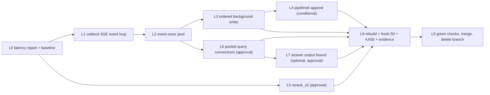

# Query latency repair

> **Superseded as an index (2026-09-24).** This plan is merged into
> [`answer_loss_repair_9c24e1a0.plan.md`](./answer_loss_repair_9c24e1a0.plan.md),
> which sets the only valid order and branch (`fix/answer-loss-repair`).
> From this plan, only L0-L4 run, after answer-loss A2. L0 skips its
> Hybrid timer edits (A2 owns them). L5 is dropped (A3 replaces it). L6
> and L7 were never written and are not part of the combined plan. L8 and
> L9 are replaced by A9 and A10. The measurements and "Findings to carry"
> below are still valid background.

Former canonical index for this repair. The implementing model reads
[`query-latency-repair/00-rules-and-commands.md`](./query-latency-repair/00-rules-and-commands.md)
and **exactly one** packet file per run. Nothing else in `.cursor/plans/`
is needed for this work.

| Packet | File | Fixes | Depends on |
| ------ | ---- | ----- | ---------- |
| L0 | [L0-latency-report-and-baseline.md](./query-latency-repair/L0-latency-report-and-baseline.md) | No repeatable timing numbers | - |
| L1 | [L1-sse-event-loop-unblock.md](./query-latency-repair/L1-sse-event-loop-unblock.md) | 50 ms synchronous poll blocks the loop and the event-store lock; blocking commits and persists on the loop | L0 |
| L2 | [L2-event-store-pool.md](./query-latency-repair/L2-event-store-pool.md) | All runs share one event-store session and lock | L1 |
| L3 | [L3-ordered-event-writer.md](./query-latency-repair/L3-ordered-event-writer.md) | Graph waits about 0.25 s for every one of about 28 event writes | L2 |
| L4 | [L4-pipelined-append.md](./query-latency-repair/L4-pipelined-append.md) | 3 round trips per append (conditional on L3 numbers) | L3 |
| L5 | [L5-rerank-v2-compact-output.md](./query-latency-repair/L5-rerank-v2-compact-output.md) | Rerank sent and timed out on 44 of 49 runs | L0 + approval |
| L6 | [L6-pooled-query-connections.md](./query-latency-repair/L6-pooled-query-connections.md) | About 0.5 s new connection per step, several in sequence | L2 + approval |
| L7 | [L7-answer-output-bound.md](./query-latency-repair/L7-answer-output-bound.md) | Answer call about 9 s (optional) | L1-L6 + approval |
| L8 | [L8-rerun-and-acceptance.md](./query-latency-repair/L8-rerun-and-acceptance.md) | Full proof run and evidence doc | L0-L6 (L7 if done) |
| L9 | [L9-ship-pr-merge.md](./query-latency-repair/L9-ship-pr-merge.md) | Green checks, merge, delete branch | L8 + user "ship" |

## Branch, commits, image

- One branch for the whole plan: `perf/query-latency-repair`, cut from
  `main` **after** [PR #17](https://github.com/Nagdy8888/smart-rag/pull/17)
  (KA50 accuracy repair) merges. If the user says to stack on #17 instead,
  follow the stacking commands in `00-rules-and-commands.md`.
- One commit per packet, pushed immediately; `gh pr checks --watch
  --fail-fast` must exit 0 before the next packet starts.
- The eval calls the laptop Compose API on `http://127.0.0.1:8000`, which
  runs code baked into the `api` image. Every timing run happens only after
  the image is rebuilt from the branch and the probe script prints the
  packet as `present` (`00-rules-and-commands.md`, **Docker rebuild before
  any live run**). A timing run against a stale image is not evidence.

## Why a question takes about 45 s today (measured 2026-09-24, read-only)

Sources: `app.runs`, `app.run_events`, `app.llm_usage` for the 50 fresh-50
runs of 2026-09-23 (`.private-eval/fresh50-answers.json`), LangSmith traces
of the last 20 `query.run.sse` roots, and a round-trip probe run inside the
`api` container. Only IDs, timestamps, and token counts were read.

- Server time per run (first SSE event to terminal event): mean
  **44.9 s**, median **45.9 s**, p90 **51.9 s**, max **53.2 s**. Only 1/50
  finished in 25 s or less, 2/50 in 30 s or less. LangGraph root span mean
  **47.7 s**. **4 of 50** runs (`f14`, `f33`, `f39`, `f41`) ended
  `deadline_exhausted`; all four spent 16-20 s in `generate_answer`.
- Before that, run admission (`app.runs.created_at`) to the first SSE
  event takes median **3.8 s** (p90 4.1 s), and the first event to the first
  node start takes median **1.8 s**. The user waits about 49 s in total.
- Per run: median **28** events (11-30). Median spacing between consecutive
  events **0.53 s**. Sum of gaps between one node's `completed` and the next
  node's `started`: median **6.1 s** (p90 6.8 s). Last node `completed` to
  terminal event: median **3.4 s** (p90 4.1 s).
- Runs are admitted under route family `composite` with a **50 s**
  deadline (`FAMILY_DEADLINE_SECONDS[COMPOSITE] = 50`). The Hybrid envelope
  target (QT-DL-001) is 25 s.
- Database round trip from the container to Supabase (eu-central-1,
  through Supavisor) is **85-95 ms**. A new connection costs about
  **500 ms**.
- **SSE plumbing, about 11-14 s per run** (node gaps 6.1 s + tail 3.4 s +
  startup 1.8 s + event writes inside long nodes). Each write
  (`PostgresRunEventStore._transaction`: `SET ROLE; SET LOCAL
  lock_timeout` -> `app.append_run_event` -> `COMMIT`) costs about
  **254 ms** (3 round trips). All runs and all readers share **one**
  session and **one** `RLock`. The SSE attach loop calls
  `list_after` **synchronously on the event loop every 50 ms**
  (`POLL_SECONDS = 0.05`), so it blocks the loop about 80% of the time and
  holds the lock the writer needs. The executor awaits every append before
  LangGraph gets the next chunk, and `astream` only moves on when the
  consumer pulls, so every write adds to graph time. The per-chunk
  `connection.commit()` and the post-terminal assistant/summary persist
  (two fresh connections) also run synchronously on the loop. Time after
  `verify_answer` completes: 4-7 s. Time before the first node: 1-2 s.
- **`company_scope`, about 14.7 s.** Rerank about **7.3 s**: 44 of 49
  rerank calls were sent and then timed out because they get 3-7 s but
  need 6-8 s to write 530-800 output tokens (a 36-character UUID plus a
  64-character hash echo per request). Timed-out calls are then charged at
  the kind cap (12000 in / 2000 out). Embedding 0.6 s. About 6.8 s is
  database work, including a new connection for scope resolution, the
  context connection, each channel thread, and the temporal lookup.
- **Answer call about 9 s** (about 700 output tokens, verbatim cited
  spans). **Verifier about 2.8 s.**

## Order and dependency

Run L0 first. L1-L3 are the biggest lever and must run in order. L4 runs
only if the L3 report meets its trigger. L5 is independent of L1-L4 and
may run any time after L0 once the user approves it. L6 needs L2's pool
helper pattern. L7 runs only if the user approves it after reading the L6
report. L8 is the proof run; L9 ships only after the user reads the L8
table.

## Expected effect (estimates, to be replaced by measured numbers)

| Packet | Main metric it moves | Estimate per question |
| ------ | -------------------- | --------------------: |
| L1 | event spacing 0.53 s -> about 0.26 s; attach no longer blocks startup | -5 to -8 s |
| L2 | multi-user serialization (single-user almost unchanged) | about 0 s single-user |
| L3 | non-terminal writes leave the graph's critical path | -5 to -7 s |
| L4 | 254 ms -> about 95 ms per write | -0.5 to -1.5 s |
| L5 | rerank 7.3 s timed out -> about 3 s completed | -3 to -5 s |
| L6 | about 5 sequential new connections removed | -2 to -4 s |
| L7 | shorter answer output (optional) | -2 to -4 s |

## Acceptance table (L8 checks these)

Same laptop, same Compose stack, same Supabase project, rebuilt `api` image.
"Latency-12" is the fixed subset defined in L0.

| Metric | Baseline | Target after L0-L6 |
| ------ | -------: | -----------------: |
| fresh-50 server time per run, mean | 44.9 s | <= 30 s |
| fresh-50 server time per run, median | 45.9 s | <= 28 s |
| fresh-50 server time per run, p90 | 51.9 s | <= 36 s |
| fresh-50 client `wall_seconds`, mean | about 49 s (admission 3.8 s + server 44.9 s); measured exactly in L0 | <= 32 s |
| median admission to first SSE event | 3.8 s | <= 1.5 s |
| median first event to first node start | 1.8 s | <= 0.8 s |
| `deadline_exhausted` runs, fresh-50 | 4/50 | 0/50 |
| median spacing between consecutive SSE events | 0.53 s | <= 0.15 s |
| median `node_gap_total_s` | 6.1 s | <= 1.5 s |
| median tail (last node completed to terminal) | 3.4 s | <= 1.5 s |
| median `company_scope` stage | 14.6 s | <= 9 s |
| `rerank_fallback = none` | 2/50 | >= 40/50 |
| rerank rows charged at the kind cap (timed out after send) | 44/49 | <= 5/50 |
| fresh-50 `strict_pass` / `grounded_fact_pass` (runner) | 19 / 19 | >= 19 / >= 19 |
| fresh-50 fact + gold-page citation (evidence-doc bar) | 13 | >= 13 |
| KA50 `strict_pass` | 29 | >= 29 |
| runs finishing in <= 25 s (QT-DL-001), reported only | measured in L8 | report |
| unit tier, lint, types, docs | pass | pass |
| GitHub `PR fast` on the merged head, `Main` on `main` | green | green |

If a latency target is met but an accuracy row drops, the plan is **not**
accepted. Report it; do not tune thresholds to pass.

## Not in this plan

- Raising QT-DL-001 or any family deadline. Rejected in
  [ADR-ask-evidence-budget-repair.md](../../docs/adr/ADR-ask-evidence-budget-repair.md).
- A local cross-encoder reranker. Rejected in the same ADR.
- Changing LangGraph checkpoint durability (`durability="exit"`). Not
  measured as a cause; would need its own ADR.
- Batching several SSE events into one transaction. `app.append_run_event`
  has no idempotency key, so a commit with an unknown outcome could not be
  retried without duplicate events.
- Moving the API next to the database. Hosting the `api` service in
  eu-central-1 would cut each round trip from about 90 ms to about 1-2 ms
  and is the largest remaining lever after this plan. It is a deployment
  decision, recorded as a recommendation in the L8 evidence doc, not a
  packet.

## Findings to carry (not fixed by this plan unless a packet says so)

- The run connection (`open_run_app_api_connection`) and the assistant
  persist use session-level `SET ROLE app_api` on the transaction-pooler
  DSN, then commit. `05-database-connections.md` says transaction pooling
  must not carry session identity. After the first `COMMIT` the next
  transaction may run on another server session. L6 adds a contract test
  that measures this and moves pooled paths to `SET LOCAL ROLE`.
- `docs/architecture/05-database-connections.md` lists the FastAPI
  checkpointer pool as 4; `QUERY_CHECKPOINTER_POOL_MAX_SIZE` is 8 in
  code, and the query memory store opens another pool of 4. L6 reconciles
  the budget math from code.

## Deviations that need the user's approval (record in ADRs)

1. **L3** changes "callers await each append before the next event" to
   "non-terminal appends are queued in order; terminal, cancel, and error
   events flush the queue and are awaited". Persisted order, exactly one
   terminal, persist-before-flush to the client, and reservation settlement
   are unchanged. An append failure is logged when the writer hits it, not
   at the executor's `await`.
2. **L5** replaces the `rerank_v1` output contract: rows name candidates
   by 0-based index instead of chunk UUID, rank is the row position, and
   the model no longer echoes the 64-character input hash (the server
   still computes and records it). Prompt version and SHA change, so the
   exam fingerprint changes and v1 and v2 eval numbers are not directly
   comparable.
3. **L6** replaces fresh query-path connections with a process pool.
   This changes connection-budget math and role handling (transaction-scoped
   roles with a reset on return).
4. **L7** (optional) changes answer prompt/model policy to bound output
   length.

Accepting this plan approves L0-L4 and L8-L9. L5, L6, and L7 each need an
explicit "approved" from the user before that packet starts; the packet
file says where to stop and ask.
