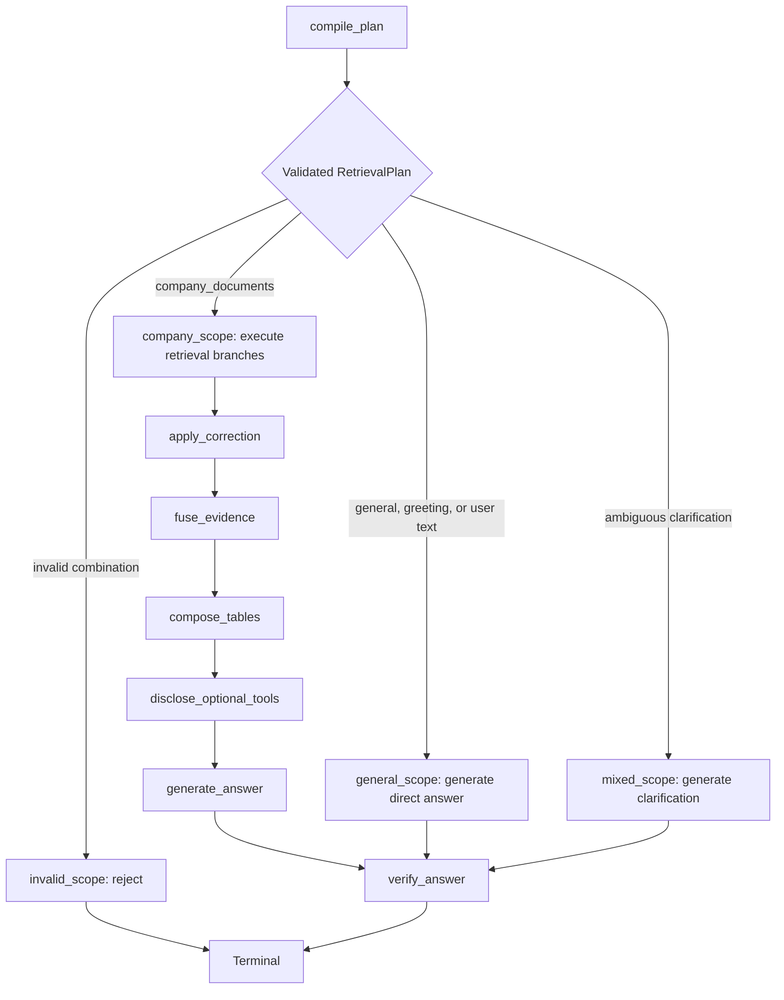

# Query Agent Brain Repair and Architecture Cleanup

## Mandatory execution protocol for a low-cost implementation model

Follow this sequence exactly. Do not skip a step because the intended change
looks mechanical.

1. Work on exactly one `BR-*` brain-repair packet or one numbered cleanup
   packet from this plan per model run. Never combine two packets to save time.
2. Before that packet, read in this order:
   - [.cursor/plans/hybrid-graph-rag_ab5281ef.plan.md](.cursor/plans/hybrid-graph-rag_ab5281ef.plan.md)
   - [.cursor/plans/hybrid-graph-rag/00-global-contracts.md](.cursor/plans/hybrid-graph-rag/00-global-contracts.md)
   - the complete
     [Phase 6 wrapper](.cursor/plans/hybrid-graph-rag/06-phase-agent-intelligence.md)
   - [Phase 6 shared contracts](.cursor/plans/hybrid-graph-rag/06-phase-agent-intelligence/00-shared-contracts.md)
   - exactly one canonical Phase 6 packet authorized by the wrapper and the
     amendment created in packet 1 of this cleanup
   - [.cursor/skills/implement-plan-phase/SKILL.md](.cursor/skills/implement-plan-phase/SKILL.md)
   - [.agents/skills/implement-query-agent/SKILL.md](.agents/skills/implement-query-agent/SKILL.md).
3. Quote the selected packet, the cleanup sub-packet, and every concrete
   acceptance check before editing.
4. Inspect every named file, symbol, test, package export, and pinned dependency
   before referring to it. The names in this plan are targets, not proof that
   repository state has not changed.
5. Run the packet's focused tests before editing. Record pre-existing failures
   instead of claiming the change caused or fixed them.
6. Check `git status` and preserve all user work. Never reset, overwrite, clean,
   delete, stage, commit, or reformat unrelated files. In particular, preserve
   untracked Phase 6 implementation/evidence files already present in the
   working tree.
7. Move one cohesive concern at a time. After each move:
   - repair imports and `__all__`;
   - run import and focused unit tests;
   - only then remove the old implementation.
8. Use explicit package imports. Do not add wildcard imports, dynamic
   `sys.path` changes, import-order side effects, hidden service locators, or
   broad exception handlers to make a split pass.
9. Every authored Python module, class, function, async function, and method
   needs a Google-style docstring. Every LangGraph node docstring must state
   state inputs, state outputs, persistence writes, external/model calls,
   budget/deadline behavior, and failure/fallback routing.
10. Preserve types. Do not replace a typed Pydantic model, enum, protocol,
    `TypedDict`, or dataclass with an untyped mapping merely to avoid import
    work.
11. Do not change SQL, migrations, API/SSE schemas, model prompts, model IDs,
    cost caps, timeouts, retries, route thresholds, or answer semantics unless
    the active packet explicitly authorizes that behavior.
12. Before using a LangGraph, OpenAI, LangSmith, psycopg, or other external API,
    inspect the pinned version and current primary documentation. Add or update
    a contract test for any unstable API used by the refactor.
13. Do not add a dependency for code movement, dead-code scanning, benchmarking,
    or architecture checks when Python's AST, import machinery, standard
    library, Ruff, Pyright, or pytest can perform the check.
14. Never create placeholder implementations, `TODO` core behavior, fake
    success paths, skipped security checks, silent fallbacks, or tests that
    assert only that a function was called.
15. End the run after the selected packet. Report changed files, exact commands
    and exit codes, measured deltas, unverified external checks, deviations,
    rollback, and the next packet's prerequisites. Do not mark a packet complete
    until the user accepts its evidence.

### Cheap-model decision rules

- If a move changes behavior unexpectedly, stop and restore the last coherent
  behavior through a forward edit; do not hide the regression by changing the
  assertion.
- If two modules need each other's implementation, extract the smallest shared
  type/protocol/value into a lower-level module. Do not use local imports as a
  permanent cycle workaround unless the dependency is intentionally optional
  and documented.
- If a symbol has no static references, still inspect `__all__`,
  `langgraph.json`, import strings, CLI entry points, Pydantic discriminators,
  pytest monkeypatch paths, and documentation before deletion.
- If a compatibility module is needed, it may contain a module docstring,
  imports, aliases, and `__all__` only. It may not retain a second
  implementation.
- If a file remains above the target size, split by responsibility, not by
  arbitrary line ranges. Never create `part1.py`, `helpers2.py`, `misc.py`,
  `utils2.py`, or similarly non-semantic files.
- If latency does not improve after a structural split, report that honestly.
  Keep the split only when it materially improves cohesion, testing, or import
  boundaries.
- If a managed database, OpenAI, LangSmith, or authenticated Studio environment
  is unavailable, run deterministic local tests and report the live gate as
  unverified. Never mock a managed integration and call it verified.

### Context-loading map for each run

Do not load all detailed movement sections into a constrained model. Load the
common sections below plus only the active packet's sections.

Common for every run:

- Mandatory execution protocol.
- Stable contracts.
- Scope and safety constraints.
- Definition of no god files.
- Packet evidence template.
- Formatting/lint/type procedure.
- Stop conditions and rollback requirements.

Packet-specific:

- BR-1A/BR-1B/BR-1C: merged brain-repair governance, canonical packet
  amendments, ADR deviations, and their documentation tests.
- BR-2: Profile gateway contracts, live/mock adapters, runtime binding, and
  BR-2 tests.
- BR-3: Scope classification/answer behavior, degradation contract, and BR-3
  tests.
- Packet 1: ordered packet 1, architecture contract test specification,
  latency measurement protocol, and packet 1 tests.
- Packet 2: target graph, exact route selection, exact scope-node contracts,
  Agent node monolith, Graph topology, and packet 2 tests.
- Packet 3: Core branch execution, Route matrix, Routing models, and packet 3
  tests.
- Packet 4: Model gateway, Answer generation, and packet 4 tests.
- Packet 5: Target agent module layout, Live runtime and Studio, Graph compile
  reuse, and packet 5 tests.
- Packet 6: Backend SSE split and packet 6 tests.
- Packet 7: Query admission, Hybrid retrieval, and packet 7 tests.
- Packet 8: Query tracing and evaluation and packet 8 tests.
- Packet 9: Test and fixture restructuring, dead-code protocol, documentation
  requirements, and packet 9 tests.
- Final gate: architecture test specification, latency protocol, every
  packet's recorded evidence, and Final acceptance.

When the plan is supplied through a tool that supports partial file reads,
search these headings and read only their current ranges; do not rely on line
numbers copied from an earlier revision.

## Verified starting inventory to remeasure

The repository has changed while Phase 6 work has been in progress, so line
counts below are approximate. Remeasure before each relevant packet.

- Agent/runtime god files:
  - `apps/agents/src/smart_rag_agents/query/nodes/pipeline.py`: roughly
    1,400–1,700 lines; all query nodes, gateway bridges, state codecs, and token
    helpers.
  - `apps/agents/src/smart_rag_agents/query/studio_live.py`: roughly 670–830
    lines; authentication, admission, settings, runtime hooks, and graph
    construction.
  - `apps/agents/src/smart_rag_agents/query/live_runtime.py`: roughly 550–680
    lines; process bindings, adapters, and run-scoped dependency construction.
- Core god files:
  - `packages/core/src/smart_rag_core/query_routing/branches.py`: roughly
    1,000–1,200 lines.
  - `packages/core/src/smart_rag_core/query_routing/matrix.py`: roughly 600–700
    lines.
  - `packages/core/src/smart_rag_core/gateways/model.py`: roughly 1,300 lines.
  - `packages/core/src/smart_rag_core/retrieval/hybrid_run.py`: roughly 1,400
    lines.
  - `packages/core/src/smart_rag_core/query_admission/service.py`: roughly
    780–900 lines.
  - `packages/core/src/smart_rag_core/observability/query_run_trace.py`: roughly
    800 lines.
  - `packages/core/src/smart_rag_core/evaluation/agent_eval.py`: roughly 1,100
    lines.
- Backend god file:
  - `apps/backend/src/smart_rag_api/services/sse_stream.py`: roughly
    1,500–1,800 lines; chunk parsing, executors, registry, stream service,
    settlement, and HTTP helpers.
- Oversized tests/scripts/docs include:
  - `tests/contract/test_query_run_admission.py`
  - `tests/unit/test_query_sse_executor.py`
  - `tests/unit/test_query_studio_live.py`
  - `tests/contract/test_query_memory_reaper.py`
  - `tests/unit/test_langsmith_online_evaluator.py`
  - `tests/unit/test_langsmith_tracing.py`
  - `tests/unit/test_answer_verifier.py`
  - `tests/unit/test_query_routing_matrix.py`
  - `scripts/eval_query_agent_langsmith.py`
  - `docs/development/phase-06-agent-intelligence-evidence.md`.

Do not interpret a small file as unnecessary. `query_graph_runtime.py`,
`query_sse_mapping.py`, `studio_tracing.py`, registry modules, and package
`__init__.py` files currently provide real boundaries or registrations.

## Stable contracts that every packet must preserve

- `apps/agents/langgraph.json` continues to load:
  - `query` from `smart_rag_agents.query.graph:graph`;
  - local deterministic Studio;
  - authenticated live Studio.
- `smart_rag_agents.query` continues to export `build_query_graph`, `graph`, and
  `pending_query_state`.
- `smart_rag_agents.query.graph` continues to expose its documented graph
  builders/type aliases and a checkpointer-free module-level `graph`.
- `smart_rag_agents.query.nodes` continues to re-export every public node needed
  by graph construction and existing callers.
- Core package-level imports from `smart_rag_core.query_routing`,
  `query_answer`, `query_admission`, `query_profile`, `query_fusion`, and
  `gateways` remain valid.
- The existing `RetrievalPlan` remains the sole deterministic authority for
  post-profile routing. A model never directly selects a graph edge.
- `NoRetrieval` remains a route family; this cleanup changes graph traversal,
  not the durable plan/audit representation.
- Company answers still require authorized canonical evidence. BM25 snippets
  and graph prose never become answer evidence. Insufficient company evidence
  never falls back to world knowledge.
- General, user-text, and clarification answers have no canonical citations.
  `company_claim_forbidden` remains true for every no-retrieval plan.
- All model calls continue through the shared gateway and durable
  reservation/usage path. No extra preparation, answer, or verifier call may
  appear because code moved.
- Requested/effective/corrected routes, limitations, call counts, token counts,
  fallback reasons, and answer origin remain observable.
- SSE holds drafts until deterministic verification and emits exactly one
  terminal event. Reconnect, replay, cancellation, heartbeat, and idempotency
  contracts remain additive and backward-compatible.
- Prompt bodies, SHA pins, model allow-lists, `store=False`, `max_retries=0`,
  timeout derivation, and schema strictness remain unchanged unless the active
  behavior ADR authorizes a modification.
- FastAPI derives identity and authorization from verified JWT/database state.
  Studio live never synthesizes identity or uses a service-role key.
- Query graph imports and Studio introspection open no sockets and spend no
  budget.

## Scope and safety constraints

- Clean the complete query-agent vertical slice:
  - [apps/agents/src/smart_rag_agents/query](apps/agents/src/smart_rag_agents/query)
  - query-owned routing, answer, admission, gateway, Hybrid orchestration, tracing, and evaluation code under [packages/core/src/smart_rag_core](packages/core/src/smart_rag_core)
  - query runtime and SSE services under [apps/backend/src/smart_rag_api/services](apps/backend/src/smart_rag_api/services)
  - directly coupled tests, scripts, and documentation.
- Exclude ingestion workflows, table-domain internals, LightRAG storage/indexing internals, shared security code, and frontend product work except node-stage compatibility updates.
- This master plan fully absorbs
  [agent_brain_repair_8c84c1f7.plan.md](.cursor/plans/agent_brain_repair_8c84c1f7.plan.md):
  Part A is implemented by BR-1 through BR-3, and Part B is expanded by cleanup
  packets 2 through 9. During BR-1, mark the older plan as superseded by this
  master plan without deleting its history.
- Preserve canonical evidence, ACL enforcement, durable reservation accounting, deadlines, bounded work, safe degradation, verified-final SSE, and all existing public import/API contracts.
- Delete a file or symbol only after repository references, dynamic registration, public exports, and tests prove it unnecessary. Keep a compatibility facade only when it protects a documented import contract; facades contain re-exports only.
- Execute the ordered packets below one at a time. Each packet must leave its focused suites green and append evidence before the next structural slice.

## Definition of “no god files”

- One stable responsibility per module; every LangGraph node body gets its own module.
- Authored runtime modules target at most 400 physical lines and have a 600-line hard safety cap. A cohesive declarative schema/registry may exceed the target only through a documented architecture-test exception; no orchestration module may be excepted.
- New runtime modules expose at most 12 top-level classes/functions and use Ruff complexity `C901 <= 15`.
- Query-focused tests target 500 lines; shared doubles and fixtures move to `tests/support` or `tests/fixtures` instead of importing private helpers from another test module.
- Agent documentation stays one topic per file and at most roughly 300 lines. The Phase 6 evidence monolith becomes an index plus packet evidence files.
- Add an AST-based contract test for line, symbol, responsibility/import-boundary, compatibility-facade, and cross-test-private-import rules. Any temporary legacy exception list must shrink to empty by the final packet.

## Target graph



Direct paths still run deterministic verification, but never retrieval, correction, fusion, table composition, optional tools, or a verifier model. Graph inspection and scoped refusal remain company-path plans.

## Target module layout

Use these names unless repository inspection proves an existing canonical name
is clearer. Do not create every directory up front; create files only in the
packet that moves their implementation.

```text
apps/agents/src/smart_rag_agents/query/
├── __init__.py
├── graph.py                         # public registration and thin topology facade
├── topology.py                      # nodes, edges, deterministic routers
├── state.py
├── deps.py
├── nodes/
│   ├── __init__.py
│   ├── shared.py                    # runtime/closed-state guards only
│   ├── state_codec.py               # typed state reconstruction only
│   ├── tokens.py                    # token normalization/accumulation only
│   ├── admission.py
│   ├── memory.py
│   ├── prepare.py
│   ├── plan.py
│   ├── company_scope.py
│   ├── general_scope.py
│   ├── mixed_scope.py
│   ├── invalid_scope.py
│   ├── correction.py
│   ├── fusion.py
│   ├── tables.py
│   ├── optional_tools.py
│   ├── answer.py
│   └── verify.py
├── gateway/
│   ├── __init__.py
│   ├── sync_bridge.py
│   ├── answer.py
│   ├── general_chat.py
│   ├── verifier.py
│   └── tokens.py
├── runtime/
│   ├── __init__.py
│   ├── adapters.py
│   ├── bindings.py
│   └── deps_factory.py
├── persistence/
│   ├── __init__.py
│   ├── checkpointer.py
│   ├── store.py
│   └── postgres.py
└── studio/
    ├── __init__.py
    ├── input.py
    ├── local.py
    ├── live_auth.py
    ├── live_admission.py
    ├── live_factory.py
    └── tracing.py
```

Keep `graph.py`, `studio.py`, `studio_live.py`, `checkpointer.py`, or
`live_runtime.py` as thin compatibility facades only when current entry points
or documented imports require those exact module paths. Remove an internal
facade after every repository caller migrates.

```text
packages/core/src/smart_rag_core/query_routing/
├── __init__.py
├── knowledge_scope.py
├── preparation.py
├── matrix.py                         # thin compile_retrieval_plan facade
├── matrix_rules.py
├── branch_specs.py
├── coverage_policy.py
├── branches.py                       # thin execute_branches facade/orchestrator
├── branch_scheduler.py
├── branch_results.py
├── retrieve_budget.py
├── acl_blindness.py
├── protocols.py
├── branch_channels/
│   ├── __init__.py
│   ├── hybrid.py
│   ├── graph.py
│   ├── table.py
│   └── citation.py
└── models/
    ├── __init__.py
    ├── preparation.py
    ├── plan.py
    └── results.py
```

```text
apps/backend/src/smart_rag_api/services/sse/
├── __init__.py
├── chunks.py
├── executors.py
├── registry.py
├── service.py
└── http.py
```

```text
packages/core/src/smart_rag_core/
├── gateways/
│   ├── model.py                     # compatibility facade if required
│   ├── model_types.py
│   ├── model_protocol.py
│   ├── model_gateway.py
│   └── mock_model.py
├── query_answer/
│   ├── generate.py                  # stable public dispatcher
│   ├── generate_grounded.py
│   ├── generate_no_retrieval.py
│   └── sanitize.py
├── query_admission/
│   ├── service.py                   # stable public facade
│   ├── envelopes.py
│   ├── retrieve_budget.py
│   ├── usage_caps.py
│   └── repository/
│       ├── admit.py
│       ├── reservation.py
│       ├── lifecycle.py
│       ├── records.py
│       └── usage.py
├── retrieval/hybrid/
│   ├── budget.py
│   ├── channels.py
│   ├── profile_fields.py
│   ├── assemble.py
│   └── evidence.py
├── observability/query_trace/
│   ├── redaction.py
│   ├── metadata.py
│   ├── sse.py
│   └── agent_eval.py
└── evaluation/agent_eval/
    ├── schema.py
    ├── mapping.py
    ├── scorers.py
    └── langsmith.py
```

### Exact post-plan route selection

The router must rebuild and validate `RetrievalPlan` from
`state["retrieval_plan"]`; it must not trust the duplicated string fields in
state alone.

1. If the graph is already closed or the plan is missing/malformed, route to
   `invalid_scope`.
2. If `plan.knowledge_scope is COMPANY_DOCUMENTS`, route to `company_scope`.
   This includes Hybrid, Combined, StructuredTable, Composite,
   GraphInspection, and ScopedRefusal plans.
3. If `plan.knowledge_scope is AMBIGUOUS` and
   `plan.no_retrieval_answer_mode is CLARIFICATION`, route to `mixed_scope`.
4. If scope is `GENERAL_KNOWLEDGE`, `DETERMINISTIC`, or
   `USER_SUPPLIED_TEXT`, require a compatible no-retrieval answer mode and
   route to `general_scope`.
5. Any mismatched combination routes to `invalid_scope`. Never guess the
   nearest route and never default malformed state to general knowledge.

Do not branch directly on raw user text, regex signals, model output, client
route, or `state["knowledge_scope"]`.

### Exact scope-node contracts

#### `company_scope_node`

- Inputs: validated preparation, validated retrieval plan, authorized runtime,
  remaining retrieve/model/tool budgets, cancellation/deadline context, and
  bound retrievers.
- Validation: scope must be `COMPANY_DOCUMENTS`; no general/user-text/
  clarification answer mode may be present.
- Work: perform the current bounded branch execution exactly once. Reuse the
  existing branch implementation rather than copying it.
- Outputs: current `branches_executed` state, branch results, updated retrieve
  budget/model-call ledger, zero hidden keyword/catalog calls, and safe detail.
- Persistence: only existing retriever/gateway side effects; no new graph-state
  authority.
- Failure: preserve existing routing rejection, graph-to-Hybrid degradation,
  scoped refusal, timeout, and cancellation behavior.

#### `general_scope_node`

- Inputs: user query, bounded recent memory, authorized runtime, validated
  no-retrieval plan, answer gateway/prompt, and remaining answer budget.
- Accepted scopes: `GENERAL_KNOWLEDGE`, `DETERMINISTIC`, and
  `USER_SUPPLIED_TEXT` with their compatible answer mode.
- Work: invoke the existing direct-answer path. Spend zero or one counted
  `usage_kind="answer"` call according to the compiled mode. Do not call
  Hybrid, LightRAG, StructuredTable, citation lookup, optional tools, or the
  verifier model.
- Outputs: `AnswerPayload`, answer origin, zero citations/atomic links/table
  citations, token totals, answer-call count, and updated model-call budget.
- Security: require `company_claim_forbidden=True`; sanitize model payloads and
  strip invented citation/source identifiers exactly as today.
- Failure: model/budget/deadline failure remains an explicit safe partial or
  refusal; never switch to company retrieval.

#### `mixed_scope_node`

- Inputs: validated plan and user query only; memory may be retained in state
  but must not trigger retrieval.
- Validation: scope must be `AMBIGUOUS`, mode must be `CLARIFICATION`, and
  `company_claim_forbidden=True`.
- Work: construct the existing clarification `AnswerPayload`
  deterministically.
- Calls: zero retrieval, zero optional tools, zero answer model, zero verifier
  model.
- Outputs: `status="answered"`, `answer_origin=AMBIGUOUS`, empty citations and
  links, unchanged call/token budgets.
- Failure: inconsistent state routes to the invalid node instead of emitting a
  misleading clarification.

#### `invalid_scope_node`

- Inputs: malformed or internally inconsistent post-plan state.
- Work: no external calls and no persistence writes.
- Outputs: `status="routing_rejected"`, a stable sanitized reason code, no
  answer, no citations, and unchanged budgets.
- Terminal behavior: route to the existing terminal target/Studio response
  without reaching answer generation.

All successful answer-producing branches converge on `verify_answer`. Direct
answers run deterministic checks with `evidence_required=False`; only a
company answer with material atomic links may invoke the verifier model.

## Merged agent-brain repair

This section replaces the implementation scope of
`agent_brain_repair_8c84c1f7.plan.md`. Do not run the old plan separately after
this master plan is accepted.

### Root cause to preserve in tests

The current failure is the combination of:

1. narrow whole-message greeting detection;
2. an unbound/non-functional preparation profile gateway in production;
3. unresolved scope being represented as `AMBIGUOUS`, even when company and
   general signals do not conflict;
4. a clarification message that falsely says the user mixed company and
   general knowledge.

The following probes must become usable and must not produce false mixed-scope
clarification:

- `hi my friend`
- `hey there`
- `good day`
- `how are you?`
- `thanks a lot`
- `What is the capital of Japan?`
- `What is the refund period?`

A genuine mixed request must still clarify, and a deterministic company signal
must still override malicious model output.

### Approved behavior after the repair

- Every non-company-deterministic natural-language message may use the existing
  single structured preparation call to classify knowledge scope.
- A pure greeting is not settled by a canned deterministic response. It uses
  one counted profile call and one counted general-answer call in live mode.
- A greeting prefix on a substantive company query remains company scope and
  does not spend the profile call when deterministic company signals settle
  routing.
- True conflict (`company_signal=True` and `general_signal=True`) remains
  `AMBIGUOUS` and receives deterministic clarification.
- Profile unavailable, malformed, or below the confidence threshold is not
  treated as mixed. It produces an explicitly degraded, company-claim-forbidden
  general answer stating that company documents were not searched.
- Company/document questions never fall back to world knowledge when a
  deterministic company signal exists or company retrieval is insufficient.
- No new route family or `KnowledgeScope` value is introduced.
- Every turn is classified independently using bounded memory. A degraded turn
  does not permanently pin later follow-ups to NoRetrieval.

### Typed degraded-scope representation

Do not overload `AMBIGUOUS` or a generic route fallback string. Add an explicit
typed reason:

```python
class ScopeDegradationReason(StrEnum):
    """Why scope classification safely degraded without claiming ambiguity."""

    PROFILE_UNAVAILABLE = "profile_unavailable"
    PROFILE_MALFORMED = "profile_malformed"
    PROFILE_LOW_CONFIDENCE = "profile_low_confidence"
```

Add an optional `scope_degradation_reason` to the minimum contracts needed for
the answer path:

- `KnowledgeScopeDecision`;
- `QueryPreparation`;
- `RetrievalPlan`;
- `QueryGraphState`.

Rules:

- a genuine mixed decision has `knowledge_scope=AMBIGUOUS` and
  `scope_degradation_reason=None`;
- a degraded decision has
  `knowledge_scope=GENERAL_KNOWLEDGE`,
  `company_signal=False`,
  `company_claim_forbidden=True` after planning, and one non-null degradation
  reason;
- model-reported confidence is retained when valid; unavailable/malformed may
  use `0.0`;
- a non-null degradation reason is invalid for company, user-text,
  deterministic, or ambiguous scope;
- the reason is server-derived and is not accepted from the profile model's
  JSON payload.

If repository inspection reveals an existing equally typed field with these
semantics, reuse it instead of adding a duplicate. Do not use
`RetrievalPlan.fallback_reason` if that field already represents envelope or
retrieval degradation.

### BR-1A — Canonical amendment and ADR

Active canonical packet for this model run: P06-09 only. Markdown changes only.

Update the accepted strict-split ADR and canonical amendment to record:

1. a real counted `usage_kind="profile"` call may run on the production query
   path under existing profile token/USD caps;
2. P06-10's blanket low-confidence/unavailable/malformed → `AMBIGUOUS`
   requirement is replaced by typed honest general degradation;
3. P06-10/P06-12's zero-cost deterministic greeting is replaced by
   profile-model classification plus general-chat generation, approximately
   two counted calls per pure live greeting;
4. the graph uses explicit company/general/mixed processing nodes after plan
   compilation and bypasses retrieval work for direct paths.

The ADR must include context, decision, security/cost consequences,
alternatives, rollback, approver/date, and the exact packet acceptance clauses
being superseded. It must state that no company evidence or citation rule is
weakened.

Done when:

- P06-09 and the ADR contain all four decisions;
- no Python/TypeScript/SQL behavior changed;
- documentation links and plan integrity pass;
- user explicitly accepts the amended decision before BR-1B.

### BR-1B — Amend P06-10

Active canonical packet for this model run: P06-10 only. Markdown changes only.

Amend P06-10:

- remove deterministic full-greeting settlement and zero-call acceptance;
- require full greetings/small talk to use the one preparation profile call;
- replace blanket failed/low-confidence profile ambiguity with
  `ScopeDegradationReason` behavior;
- retain true mixed scope as `AMBIGUOUS`;
- permit changes to query profile gateway types/schema, OpenAI/mock profile
  adapters, profile observability, runtime bindings, graph state, and their
  tests;
- permit later explicit graph-node wiring while retaining NoRetrieval as the
  durable plan family;
- update fixtures and call-count expectations;
- preserve company-signal override, isolated `policy` behavior, no second
  preparation call, and all existing company route rows.

Done when the packet's ordered actions, allowed outputs, acceptance checks,
negative tests, stop routes, evidence, and rollback agree with the ADR.

### BR-1C — Amend P06-12

Active canonical packet for this model run: P06-12 only. Markdown changes only.

Amend P06-12:

- a greeting uses `GENERAL_MODEL`, not a canned deterministic answer;
- pure live greeting cost is one profile plus one answer call;
- `DETERMINISTIC` model output maps to `GENERAL_MODEL` defensively;
- deterministic clarification is reserved for genuine mixed scope;
- degraded scope uses one general-answer call with explicit no-company-search
  framing;
- general/user-text/greeting/degraded paths run deterministic verification but
  never a verifier model;
- no citations are allowed for all direct paths.

Done when all answer fixtures, usage expectations, rollback, and evidence
requirements agree with the ADR. No code before BR-1A, BR-1B, and BR-1C are
accepted.

### BR-2 — Profile classification gateway and runtime binding

Active canonical packet: amended P06-10.

#### Signals and model-call decision

In `query_routing/signals.py`:

- keep `is_greeting` as a whole-message matcher, but support:
  - `hi`, `hello`, `hey`, `salam`, `good morning`, `good afternoon`,
    `good evening`, `good day`, `greetings`, `yo`, and `howdy`;
  - optional addresses such as `there`, `my friend`, `friend`, `buddy`,
    `team`, or `everyone`;
  - optional leading conversational interjection;
  - trailing whitespace, punctuation, and common emoji;
  - Arabic `مرحبا`, `السلام عليكم`, `اهلا`, and `أهلا`;
- add `is_small_talk` for bounded whole-message phrases including
  `how are you`, `what's up`, `nice to meet you`, and `good to see you`;
- keep a greeting prefix on substantive text from matching the whole message;
- keep greeting/small-talk signals only for mock classification and
  memory-follow-up guards, not deterministic live settlement.

In `knowledge_scope.py` and preparation model-call logic:

- remove the greeting early return from `classify_knowledge_scope`;
- remove the greeting bail-out from the function deciding whether the
  preparation model is needed;
- ensure deterministic company signals still settle before any profile call;
- ensure greetings cannot be hijacked by cited company memory into company
  follow-up retrieval;
- ensure ordinary unresolved natural-language messages use at most the same
  one preparation call, never a second rewrite/classification call.

#### Query profile transport

Inspect current `QueryProfileModelRequest`/`QueryProfileModelResponse`. Add only
missing fields:

- pinned `prompt_text`;
- allow-listed `model_id`;
- bounded `remaining_deadline_seconds`;
- bounded, uniquely delimited recent memory;
- response JSON `payload`;
- provider `request_id`;
- non-negative input/output token counts;
- `model_calls=1`;
- `retrieval_performed=False`.

Keep `inferred` temporarily only when an inspected offline caller requires it;
otherwise remove it and update all callers in the same BR-2 packet.

Add `query_profile_json_schema()` covering exactly the current
`PreparationModelPayload` fields:

- `rewrite`;
- `query_type`;
- `subquestions`;
- `variants`;
- `hl_keywords`;
- `ll_keywords`;
- `retrieval_profile_id`;
- `metadata_filters`;
- `confidence`;
- `relationship_intent`;
- `knowledge_scope`;
- `knowledge_scope_confidence`.

Requirements:

- `additionalProperties: false` at every applicable object level;
- all five existing `KnowledgeScope` enum values only;
- existing max-three bounds encoded in JSON schema;
- no degradation reason in model output;
- schema parity test against Pydantic validation.

The pinned `query_profile_v1.md` prompt already requests knowledge scope. Do not
change its body or SHA unless inspection disproves that statement; if it does,
stop and amend the ADR/prompt changelog before code.

#### Live OpenAI profile adapter

Add or complete `gateways/openai_profile.py` following the existing general
chat adapter:

- verify prompt version and SHA;
- reject a model outside `ALLOWED_PROFILE_MODEL_IDS`;
- use the traced OpenAI client with `max_retries=0` and bounded timeout;
- send `store=False`;
- use strict `json_schema` response formatting;
- expose no tools;
- parse one payload and propagate request/token metadata;
- convert provider/timeout/schema failures to existing typed gateway errors;
- emit a redacted profile span without raw user/memory/source text.

Add `PROFILE_MODEL_ID` and `ALLOWED_PROFILE_MODEL_IDS` beside the query-profile
prompt pins. Reuse the already approved `gpt-4o-mini` identifier unless current
repository pins or ADR specify otherwise.

Replace any unconditional
`query_profile_openai_not_configured` refusal in `OpenAIModelAdapter` with the
real adapter call. Preserve mock/network-denial behavior.

Add `query_profile_responses_traceable` beside the existing traced
general-chat/answer helpers when that is the repository naming pattern. The
span must expose safe model/version/token/status metadata only.

#### Deterministic mock profile

`MockModelAdapter.generate_query_profile` must remain no-network and return a
schema-valid payload:

- greeting/small talk → `general_knowledge`, confidence `0.95`;
- deterministic company signal → `company_documents`;
- deterministic general fixtures such as capital/photosynthesis →
  `general_knowledge`;
- ordinary interrogative with no company signal → `general_knowledge`,
  confidence at least `0.85`;
- real company/general conflict → `ambiguous`;
- supplied text transform → `user_supplied_text`.

Mock mode must not perform DNS, instantiate an OpenAI client, or fabricate a
retrieval result.

#### Runtime binding

In agent process bindings/deps:

- add `query_profile_prompt_text` to both `QueryGraphProcessBindings` and
  `QueryGraphDeps`;
- add a real profile model ID field when required for durable usage;
- bind `QueryGraphDeps.model_caller` in production FastAPI SSE and live Studio;
- invoke the async gateway from the synchronous preparation thunk using the
  existing tested bridge;
- map gateway payload to `PreparationModelPayload`;
- let malformed output raise `ValueError` so preparation records
  `profile_malformed`;
- pass the actual profile model ID to
  `execute_counted_model_call(usage_kind="profile")`;
- preserve one call maximum and existing USD/token/deadline caps.

Do not bind live resources into local deterministic `query_studio`.
The existing `usage_kind="profile"` cap and family model-call ceilings already
own this spend; do not add a migration, usage kind, or larger budget.

#### BR-2 acceptance

- exactly one counted profile call when the model is needed;
- zero profile calls for deterministic company or supplied-text signals that
  already settle scope;
- no separate rewrite call;
- actual provider model ID recorded in usage;
- prompt/model/schema/network controls proven;
- all probe phrases classify to a usable typed result;
- true mixed remains ambiguous;
- unavailable/malformed/low-confidence profile produces the typed degradation
  reason, not ambiguity;
- company signal overrides malicious general model output;
- `policy` alone is not a deterministic company signal;
- mock mode performs no network.

### BR-3 — Direct answer and graceful-degradation behavior

Active canonical packet: amended P06-12.

#### Route and answer mode

- `GENERAL_KNOWLEDGE` → `NoRetrieval` + `GENERAL_MODEL`.
- `USER_SUPPLIED_TEXT` → `NoRetrieval` + `USER_TEXT_MODEL`.
- `AMBIGUOUS` without degradation → `NoRetrieval` + `CLARIFICATION`.
- `DETERMINISTIC` → `NoRetrieval` + `GENERAL_MODEL`.
- degraded `GENERAL_KNOWLEDGE` → `NoRetrieval` + `GENERAL_MODEL` plus the
  non-null degradation reason.
- `COMPANY_DOCUMENTS` keeps existing company route compilation and
  `no_retrieval_answer_mode=None`.

Every no-retrieval plan keeps `company_claim_forbidden=True`. Do not add a
GeneralChat route family.

Update `_extension_for_scope` (or its inspected replacement) so degraded
general scope is NoRetrieval for the current turn without mutating future
memory/follow-up classification. A later turn with deterministic company
signals must still compile a company route.

#### Clarification

`CLARIFICATION_TEXT` may be emitted only when both company and general scope
signals genuinely conflict. It must ask the user to choose company documents
or general knowledge and must not claim that documents were searched.

Mixed clarification:

- is deterministic;
- uses zero answer/verifier calls;
- has `answer_origin=AMBIGUOUS`;
- has no citations/table citations/atomic links.

#### Degraded general answer

Use the existing `GENERAL_DOCUMENT_REFUSAL` framing as the canonical basis, or
introduce one clearly named replacement if needed. The user-visible response
must explicitly say that company documents were not searched because scope
could not be established.

The general model may answer only from world knowledge/user text under
`company_claim_forbidden=True`. The payload sanitizer must reject citations,
source IDs, table citations, atomic links, and claims that company retrieval
occurred.

Do not return a canned refusal without attempting the allowed general model
when answer budget/deadline/gateway are available. If the model is unavailable,
return an honest partial/refusal, not fake success.

#### Greeting behavior

- Pure greeting/small talk reaches profile classification and then the general
  answer model.
- Retire `GREETING_TEXT`/`DETERMINISTIC_CHAT` from the live graph path.
- Keep any deterministic text only as an explicitly tested offline emergency
  fallback if the accepted ADR allows it; it must not masquerade as a model
  answer.
- `hi` immediately after a cited company answer remains greeting/general, not
  a company follow-up.
- `Hi, what is our refund period?` remains company scope/retrieval.

#### BR-3 acceptance

- each live pure greeting costs one profile plus one general-answer call;
- direct deterministic verification runs with `evidence_required=False`;
- verifier model call count remains zero;
- citations and retrieval flags remain empty/false;
- true mixed clarification costs zero answer calls;
- degraded result uses explicit no-company-search framing;
- company insufficient evidence never enters general answer;
- answer origin is correct for general, user text, greeting, degraded, mixed,
  and company cases;
- SSE never emits direct answer text before `verify_answer`.

## Ordered work packets

### 1. Governance, inventory, and baseline

- Confirm BR-1A through BR-3 are accepted and evidenced before structural
  refactoring of the same files.
- Mark the older brain-repair plan as superseded by this master plan, preserving
  its history and linking here.
- Confirm the amended canonical packets authorize explicit scope nodes and
  structural cleanup while retaining existing route families and
  `company_claim_forbidden`.
- Record current module sizes, top-level symbols, import-cycle guards, query graph compilation count, visited nodes, retrieval/model/tool calls, heartbeat writes, and mocked general/company/mixed timings.
- Run and record `pnpm check:fast` plus the focused query routing, graph, SSE, import-boundary, docstring, and LangGraph registration suites before edits.

### 2. Explicit scope nodes and agent node split

- Replace [nodes/pipeline.py](apps/agents/src/smart_rag_agents/query/nodes/pipeline.py) with cohesive node modules for admission, memory, preparation, planning, company scope, general scope, mixed scope, correction, fusion, tables, answer, and verification.
- Move gateway bridges, state codecs, token accounting, budgets, and shared guards into narrowly named support modules; update all internal imports and remove the old pipeline module instead of leaving a duplicate logic shim.
- Add `company_scope_node`, `general_scope_node`, `mixed_scope_node`, and a fail-closed invalid-plan node with complete LangGraph docstrings.
- Rewire [graph.py](apps/agents/src/smart_rag_agents/query/graph.py) with a deterministic router derived only from the validated `RetrievalPlan`. Keep topology construction separate from node implementations.
- Update [query_sse_mapping.py](apps/backend/src/smart_rag_api/services/query_sse_mapping.py) so every answer-producing scope node is held until `verify_answer`.
- Prove general/greeting/user-text paths invoke no retriever or optional tool, mixed scope invokes no retrieval or answer model, and company/inspection/refusal paths retain existing behavior.

### 3. Core routing cleanup

- Split [branches.py](packages/core/src/smart_rag_core/query_routing/branches.py) into protocols, scheduler, retrieve-budget inheritance, Hybrid/graph/table channel modules, normalized branch results, and ACL-blindness helpers.
- Convert [matrix.py](packages/core/src/smart_rag_core/query_routing/matrix.py) into a thin compiler over ordered named rules, branch-spec builders, and coverage policy while preserving exact precedence and outputs.
- Convert [models.py](packages/core/src/smart_rag_core/query_routing/models.py) into preparation, plan, and result model modules with stable package re-exports.
- Remove `hybrid_run` import-order guards only after the new dependency graph and cold-import tests prove they are unnecessary.
- Snapshot every Hybrid/Combined/Table/inspection/refusal plan before and after the split to prove no routing drift.

### 4. Gateway and answer cleanup

- Split [gateways/model.py](packages/core/src/smart_rag_core/gateways/model.py) into request/response types, adapter protocol, mock adapter, gateway facade/factory, and provider adapters while preserving lazy public exports and network-denial tests.
- Split [query_answer/generate.py](packages/core/src/smart_rag_core/query_answer/generate.py) into grounded generation, no-retrieval generation, sanitization, and a thin public dispatcher.
- Consolidate duplicated profile-field readers and prompt loading only when all call sites migrate; prompt SHA/model pins remain unchanged.
- Keep the model call accounting, `store=False`, allow-lists, retries,
  deadlines, answer origins, and citation filtering established by BR-2/BR-3
  byte-for-byte equivalent; cleanup packet 4 is structural only.

### 5. Agent runtime, Studio, and persistence cleanup

- Split [live_runtime.py](apps/agents/src/smart_rag_agents/query/live_runtime.py) into adapter implementations, process bindings, and run-scoped dependency factories.
- Split [studio_live.py](apps/agents/src/smart_rag_agents/query/studio_live.py) into shared input parsing, authentication/admission, runtime hooks, and graph factory modules; deduplicate local/live Studio helpers.
- Move query checkpointer and memory-store code under a query persistence package and remove semantic dependence on ingestion-named helpers where a shared persistence helper is appropriate.
- Verify the pinned LangGraph `1.2.11` runtime-context/config API from primary documentation. If contract tests prove run-scoped dependencies can be supplied without closure capture, compile the static topology once per executor/process and inject per-run connection/cancellation context at invocation. Otherwise retain per-run compilation and report the measured blocker rather than adding an unsafe cache.
- Defer heavy gateway/retrieval imports until the path that needs them, while preserving socket-free module import and LangGraph Studio registration.

### 6. Backend SSE cleanup and latency work

- Split [sse_stream.py](apps/backend/src/smart_rag_api/services/sse_stream.py) into chunk parsing, executors, live-run registry, persistence/settlement service, and HTTP framing modules. Update internal imports and remove the monolith unless a documented compatibility facade is required.
- Remove proven dead helpers/fields, consolidate token normalization, parse each graph chunk once, and load settings once per run.
- Reduce duplicate heartbeat writers to one durable cadence and prove resume/cancel/terminal behavior remains unchanged.
- Keep per-chunk commits and connection boundaries until a counterfactual test proves batching/reuse preserves deadlock avoidance, replay durability, cancellation, and reservation settlement; optimize only with that evidence.
- Add compile-count, heartbeat-count, event-order, exactly-one-terminal, and verified-final tests.

### 7. Admission and Hybrid hot-path cleanup

- Split [query_admission/service.py](packages/core/src/smart_rag_core/query_admission/service.py) into admit, reservation, lifecycle, records, usage, and worker-job repositories behind stable public exports.
- Split admission ceilings into route envelopes, retrieve budget, and usage-cap modules; verify Python values remain synchronized with SQL contracts.
- Split [retrieval/hybrid_run.py](packages/core/src/smart_rag_core/retrieval/hybrid_run.py) into channel execution, budgeted calls, profile fields, assembly/fallback, and evidence loading, leaving `HybridRetriever.retrieve` as bounded orchestration.
- Extract only query-budget callbacks from the shared LightRAG adapter when this removes query dependency cycles; do not refactor LightRAG storage/indexing in this project.
- Prove candidate caps, Supabase authorization recheck, rerank behavior, fallback reasons, model-call ledgers, and result ordering are unchanged.

### 8. Query observability and evaluation cleanup

- Split query-run tracing into redaction, SSE tracing, agent-eval tracing, and metadata modules.
- Split agent evaluation into schemas, case mapping, deterministic scorers, judge integration, and LangSmith registration.
- Split the LangSmith agent-evaluation CLI into argument/configuration and live-run modules; preserve the documented command surface.
- Keep trace redaction, cost fields, prompt versions, online-envelope bounds, and evaluator registry identity unchanged.

### 9. Tests, documentation, and dead-code closure

- Split oversized query admission, SSE executor, Studio live, memory reaper, verifier, routing, tracing, and online-evaluator tests by concern.
- Consolidate repeated Postgres bootstrap, authorized runtime, Hybrid doubles, Studio doubles, and LangSmith recording clients under `tests/support`; move large matrix data under `tests/fixtures`.
- Convert [phase-06-agent-intelligence-evidence.md](docs/development/phase-06-agent-intelligence-evidence.md) into a maintained index and move packet evidence into linked files under `docs/development/phase-06/`. Amend canonical packet links before changing the append target.
- Update [QUERY_ROUTING.md](docs/agent/QUERY_ROUTING.md), tracing/evaluation docs, and [docs/README.md](docs/README.md) with the final topology and module map.
- Remove only dead code proven by static references plus focused tests. Initial candidates include the unused SSE partial-status helper/holder and citation persistence export; the latter stays if any dynamic or planned durable citation contract still requires it.

## Detailed movement instructions

These mappings are intended to prevent a low-cost model from creating vague
modules or duplicating implementations. Confirm the actual symbol exists
before moving it.

### Agent node monolith

Move from `nodes/pipeline.py` as follows:

- `load_memory_node` → `nodes/memory.py`.
- `prepare_query_node` → `nodes/prepare.py`.
- `compile_plan_node` → `nodes/plan.py`.
- existing branch execution used by the graph → shared implementation called
  by `nodes/company_scope.py`.
- `apply_correction_node` → `nodes/correction.py`.
- `fuse_evidence_node` → `nodes/fusion.py`.
- `compose_tables_node` → `nodes/tables.py`.
- `generate_answer_node` company-grounded orchestration →
  `nodes/answer.py`.
- `verify_answer_node` → `nodes/verify.py`.
- `runtime_from_state`, closed-state guards, and retrieve-budget reconstruction
  → `nodes/shared.py`.
- `_fusion_from_state`, `_tables_from_state`, and bounded memory decoding →
  `nodes/state_codec.py`.
- `_nonneg_token_count`, `_tokens_from_gateway_response`, and accumulated-token
  helpers → one token module. Do not leave duplicate token coercion in gateway
  and node packages.
- `_run_coro`, `_gateway_timeout_seconds`, and trace flush behavior →
  `gateway/sync_bridge.py`.
- `_gateway_answer` → `gateway/answer.py`.
- `_gateway_general_chat` → `gateway/general_chat.py`.
- `_gateway_verifier` → `gateway/verifier.py`.

After every move, update:

- `nodes/__init__.py`;
- imports in `graph.py`, tests, Studio, and backend runtime;
- monkeypatch targets that referenced `nodes.pipeline`;
- module-level `__all__`;
- docstrings that still claim all nodes live in one pipeline.

Do not delete `pipeline.py` until `rg "nodes\.pipeline|from .*pipeline import"`
returns no required repository callers. If an external/public compatibility
contract is documented, reduce it to re-exports and add an architecture test
that forbids executable statements in the facade.

### Graph topology

Keep `graph.py` responsible only for public exports, graph construction, and
compilation. Move `enforce_admission` to `nodes/admission.py` and private route
functions to `topology.py` when doing so does not break documented imports.

The production path must become:

```text
START
  -> enforce_admission
  -> load_memory
  -> prepare_query
  -> compile_plan
  -> one of:
       company_scope
         -> apply_correction
         -> fuse_evidence
         -> compose_tables
         -> disclose_optional_tools
         -> generate_answer
         -> verify_answer
       general_scope
         -> verify_answer
       mixed_scope
         -> verify_answer
       invalid_scope
         -> terminal
  -> terminal
```

Studio may prepend a seed node and append `emit_studio_response`, but it must
use the same post-plan routing. Preserve `_route_after_admission`,
`_route_after_prepare`, and `_route_after_correction` behavior or replace them
with typed equivalents plus compatibility imports/tests.

`QuerySseMapper` must recognize all draft-producing graph-node names:

- existing company answer node `generate_answer`;
- direct `general_scope`;
- direct `mixed_scope`.

It stores the draft but emits no answer text until `verify_answer`. The invalid
node emits a normal sanitized routing error and cannot leave an unverified
draft.

### Core branch execution

Move from `query_routing/branches.py`:

- `HybridRetrieveLike`, `GraphRetrieveLike`, and `TableExecuteLike` →
  `protocols.py`.
- `execute_branches`, parallel-group scheduling, cancellation/deadline
  propagation, and concurrency control → `branch_scheduler.py` or a thin
  orchestration section retained in `branches.py`.
- retrieve-budget attachment/inheritance → `retrieve_budget.py`.
- `_run_hybrid`, Hybrid chunk loading/context resolution, and Hybrid result
  conversion → `branch_channels/hybrid.py`.
- `_run_graph`, graph bounds, async bridge use, and graph result conversion →
  `branch_channels/graph.py`.
- table execution/conversion → `branch_channels/table.py`.
- citation lookup execution/conversion → `branch_channels/citation.py`.
- inherited result creation, ranked IDs, coverage bits, limitation codes, and
  fallback reason extraction → `branch_results.py`.
- ACL blindness disclosure/suppression → `acl_blindness.py`.

Preserve:

- branch concurrency maximum 2;
- at most three subquestions;
- ordered branch result determinism;
- every run/principal/company/reservation/deadline/cancellation field;
- graph prose never becoming evidence;
- canonical chunk resolution and ACL recheck;
- zero hidden keyword/catalog model calls;
- existing exact fallback reason strings.

Do not make branch channels import the agent app. Core remains app-independent.

### Route matrix

Keep `compile_retrieval_plan` as the stable public function. Replace the nested
decision tree with an ordered immutable tuple of named rule objects/functions.
Each rule has:

- a descriptive stable name;
- a pure predicate over typed preparation and already computed deterministic
  values;
- a handler returning family, limitations, branch specs, and flags;
- an isolated unit test;
- explicit position in the precedence test.

Preserve the current precedence exactly:

1. NoRetrieval extension.
2. Graph inspection.
3. Unsupported media scoped refusal.
4. Negation/exclusion limitation.
5. Historical/as-of relationship limitation.
6. whole-document summary coverage handling.
7. corpus-wide/global steering.
8. comparison/multipart/composite handling.
9. structured-table handling.
10. current relationship/multi-hop Combined handling.
11. low-confidence relationship Hybrid handling.
12. ordinary Hybrid/default handling.

If inspection shows a different current order, use the repository order and
update this list in the governance packet before code. Never reorder cases for
style.

Move `_hybrid_branch`, `_graph_branch`, `_citation_branch`, and branch
degradation builders to `branch_specs.py`. Move evaluation class/coverage
threshold readers to `coverage_policy.py`. Threshold values remain frozen.

### Routing models

Convert `query_routing/models.py` to a package only after checking every import
form. Preserve `from smart_rag_core.query_routing.models import X`.

- Preparation-facing memory/model payload/query preparation types →
  `models/preparation.py`.
- route enums, branch kinds/specs, routing surface/extensions, and
  `RetrievalPlan` → `models/plan.py`.
- branch/table/correction result types → `models/results.py`.
- `models/__init__.py` explicitly re-exports the same public set.

Do not loosen `extra="forbid"`, frozen models, field bounds, literals, or
validators. Add a test comparing JSON schema and representative
`model_dump(mode="json")` output before and after conversion.

### Model gateway

Inspect `gateways/model.py` and move by dependency direction:

- all request/response Pydantic contracts, including query profile, answer,
  general chat, verifier, rerank, summary, and LightRAG callback payloads →
  `model_types.py`;
- `ModelAdapter` protocol → `model_protocol.py`;
- `MockModelAdapter` and deterministic fixtures → `mock_model.py`;
- `ModelGateway`, `create_model_gateway`, and the network-denial boundary →
  `model_gateway.py`;
- provider-specific implementation remains in or moves to named
  `openai_*.py` modules; do not merge already focused adapters back into a new
  monolith.

Keep `gateways/model.py` only if current imports require it. Its final contents
must be imports, aliases, and `__all__`. Preserve lazy exports in
`gateways/__init__.py` so importing storage/security code does not eagerly load
query answer/fusion/routing.

Contract tests must compare:

- request/response schema;
- strict additional-property rejection;
- mock deterministic outputs;
- OpenAI network blocking in mock mode;
- model allow-list and prompt SHA rejection;
- timeout, retry, `store=False`, and no-tools arguments;
- token/request ID propagation;
- one gateway call per operation.

### Answer generation

Keep `generate_answer(...)` as the stable public dispatcher.

- grounded evidence/table generation and company refusal →
  `generate_grounded.py`;
- deterministic/general/user-text/clarification behavior →
  `generate_no_retrieval.py`;
- provider payload validation, answer-origin/citation sanitization, and invented
  ID filtering → `sanitize.py`;
- mode selection helpers stay with the path that owns them.

Do not let direct-answer modules import retrievers. Do not let grounded modules
fall back to general-model knowledge. Preserve exact answer-origin and
refusal/partial status behavior.

### Live runtime and Studio

Move from `live_runtime.py`:

- process-lifetime immutable bindings and their dataclass →
  `runtime/bindings.py`;
- Hybrid/graph/table adapter classes → `runtime/adapters.py`;
- `build_query_process_bindings`, `build_query_graph_deps`, and run-local
  connection/cancel wiring → `runtime/deps_factory.py`.

Keep a FastAPI-free boundary. Backend-specific `app.state` access remains in
`query_graph_runtime.py`.

Move from Studio modules:

- `StudioQueryInput`, `StudioQueryState`, query text extraction, thread ID, and
  object-list normalization → `studio/input.py`;
- deterministic local seed/emit behavior → `studio/local.py`;
- JWT/profile/revocation/settings validation → `studio/live_auth.py`;
- idempotency, rate limit, budget admission, and caller construction →
  `studio/live_admission.py`;
- `make_graph`/open/close lifecycle → `studio/live_factory.py`;
- trace environment flags → `studio/tracing.py`.

Preserve the exact `langgraph.json` entry points with thin root modules if
needed. Local Studio remains unbound/no-cost. Live Studio requires a real JWT
and normal admission.

### Graph compile reuse

Do not cache a compiled graph that closes over a prior run's psycopg connection,
caller, deadline, cancellation callback, or mutable deps object.

The preferred design is:

1. static topology compiled once with nodes that read immutable process
   bindings and typed run-scoped dependencies from the supported LangGraph
   invocation context/config;
2. every invocation supplies a fresh connection, authorized runtime, and
   cancellation probe;
3. checkpointer/store remain process-safe and correctly scoped by thread/run;
4. two concurrent runs cannot see each other's deps.

Before implementing:

- confirm the exact `langgraph==1.2.11` context/config schema API;
- write a contract test with two concurrent invocations using different fake
  callers/connections/cancel probes;
- prove each invocation observes only its own deps;
- prove graph compilation occurs once;
- prove Studio introspection can compile without live resources.

If the pinned API cannot prove this, do not implement an identity-keyed cache
or global mutable current-run variable. Keep safe per-run compilation and
record the limitation.

### Backend SSE split

Move from `sse_stream.py`:

- `_coerce_stream_token_count`, update-envelope coercion, and token extraction
  → `sse/chunks.py`;
- `QueryRunExecutor`, `FixtureQueryRunExecutor`, and
  `LangGraphQueryRunExecutor` → `sse/executors.py`;
- `LiveQueryRun` and `QueryRunRegistry` → `sse/registry.py`;
- `SseStreamService`, attach/start/settle/cancel/heartbeat orchestration →
  `sse/service.py`;
- `wants_event_stream`, resume-sequence parsing, response framing, and default
  executor factory → `sse/http.py`.

Update dependency injection, routers, scripts, tests, and monkeypatch targets.
Keep `sse_stream.py` as a re-export facade only if a documented import contract
requires it.

Behavioral cleanup rules:

- exactly one component owns periodic durable heartbeat append;
- never emit heartbeat after terminal;
- parse a LangGraph chunk once and pass the normalized mapping to usage
  accounting and `QuerySseMapper`;
- load backend settings once per run and pass the typed settings object;
- do not batch/remove commits until replay-after-crash, concurrent append,
  cancellation, and settlement tests prove safety;
- do not reuse a connection across incompatible transaction/role boundaries;
- preserve 15-second heartbeat, sequence monotonicity, resume semantics, and
  exactly one terminal.

### Query admission

Move repository operations by transaction/lifecycle concern:

- `admit_query_run` and `QueryAdmissionResult` → `repository/admit.py`;
- reservation consume/true-up result types and operations →
  `repository/reservation.py`;
- heartbeat/reconcile/cancel/fail operations → `repository/lifecycle.py`;
- run/citation record loaders → `repository/records.py`;
- immutable model usage and restricted-evidence writes →
  `repository/usage.py`;
- worker true-up enqueue remains separately named and must not create a
  query→worker import cycle.

Split ceilings:

- route envelope constants and `envelope_for_family` → `envelopes.py`;
- `QueryRetrieveBudget` and retrieve debit/assert helpers →
  `retrieve_budget.py`;
- usage-kind caps and model/tool availability assertions → `usage_caps.py`.

Compare every Python envelope and usage cap against the existing SQL RPC/table
contract. Do not adjust values to make tests easier.

### Hybrid retrieval

Keep `HybridRetriever.retrieve` as the stable orchestration entry point.

- counted query embedding/rerank sends and durable budget usage →
  `retrieval/hybrid/budget.py`;
- dense/BM25/term channel job construction and bounded parallel execution →
  `retrieval/hybrid/channels.py`;
- repeated typed profile-field readers →
  `retrieval/hybrid/profile_fields.py`, then consolidate with routing readers
  only if dependency direction stays acyclic;
- assembly kwargs, deterministic fusion call, and fallback composition →
  `retrieval/hybrid/assemble.py`;
- evidence locators/units and authorized context loading →
  `retrieval/hybrid/evidence.py`.

Preserve the candidate ceilings, one batched embedding call, rerank conditions,
authorization/current-version recheck, stable tie order, context/evidence cap,
coverage fields, fallback reason strings, and no-BM25-snippet evidence rule.

### Query tracing and evaluation

Move from `query_run_trace.py`:

- hashed identity and payload redaction → `query_trace/redaction.py`;
- trace metadata/normalized result fields → `query_trace/metadata.py`;
- SSE root trace lifecycle → `query_trace/sse.py`;
- agent-eval root trace lifecycle → `query_trace/agent_eval.py`.

Move from `evaluation/agent_eval.py`:

- Pydantic input/output/reference contracts → `agent_eval/schema.py`;
- fixture/graph-state conversion → `agent_eval/mapping.py`;
- deterministic route/citation/faithfulness/etc. scorers →
  `agent_eval/scorers.py`;
- LangSmith evaluator factories and optional judge wiring →
  `agent_eval/langsmith.py`.

The Phase 6 evaluator registry, dataset names, feedback keys, redaction fields,
online batch limits, and deterministic scorer results must remain identical.

## Architecture contract test specification

Create an AST-based scanner patterned after existing
`tests/contract/boundary_scanner.py` and `docstring_scanner.py`. Do not add a
third-party scanner.

The scanner must:

1. Scan only the explicit query-vertical production roots listed in this plan.
2. Count physical lines and top-level `FunctionDef`, `AsyncFunctionDef`, and
   `ClassDef` nodes.
3. Fail authored runtime modules over 600 lines.
4. Report modules over the 400-line target so the implementation packet can
   split them or record a narrow declarative exception.
5. Fail node modules that define more than one exported `*_node` body, except a
   documented routing module containing only pure route selectors.
6. Fail new runtime modules with more than 12 top-level definitions.
7. Fail query-vertical imports from app code into core code, frontend into
   Python, agent runtime into backend, or lower-level contracts into provider
   implementations.
8. Fail import-cycle guard patterns such as an unused
   `_hybrid_run_cycle_guard` after the core split is complete.
9. Fail test modules importing private helpers from another `test_*.py` module.
10. Validate compatibility facades contain only a docstring, imports,
    assignments/aliases, `__all__`, and type-checking guards.
11. Check the target documentation index/packet line budgets.
12. Print exact path, observed metric, limit, and suggested owning packet.

Temporary exceptions:

- must be an explicit mapping of exact relative path to reason and removal
  packet;
- cannot use globs;
- cannot cover orchestration modules;
- must shrink in every relevant packet;
- must be empty at final acceptance.

Do not turn on Ruff `C901` repository-wide in one change. Enable it for new
query modules or add temporary exact per-file ignores for untouched legacy
files, then remove all query-vertical ignores by final acceptance.

## Test and fixture restructuring map

Use these cohesive targets; preserve test meaning rather than mechanically
splitting by line number.

- `test_query_run_admission.py`:
  - envelope synchronization;
  - idempotency/concurrency;
  - authorization;
  - budget consume/true-up/reconcile;
  - restricted-read audit.
- `test_query_sse_executor.py`:
  - verified-final executor;
  - stream lifecycle/cancellation;
  - service settlement;
  - Postgres event store.
- `test_query_studio_live.py`:
  - authentication/revocation;
  - admission/idempotency;
  - execution/resource lifecycle;
  - socket-free introspection.
- `test_query_memory_reaper.py`:
  - checkpoint/event reaping;
  - summary accounting;
  - conversation deletion;
  - LangSmith deletion/feedback retention.
- `test_answer_verifier.py`:
  - deterministic verifier rules;
  - answer integration;
  - scope/greeting behavior.
- `test_query_routing_matrix.py`:
  - route matrix fixtures;
  - plan invariants;
  - preparation unit behavior.
- `test_langsmith_online_evaluator.py`:
  - envelope validation;
  - scoring;
  - provision/idempotency.
- `test_langsmith_tracing.py`:
  - gateway tracing only; move reusable recording client and query trace cases
    to support/query-specific tests.

Create focused support modules:

- `tests/support/query_postgres.py` for local fixture startup/profile inserts;
- `tests/support/query_runtime.py` for authorized runtime builders;
- `tests/support/query_retrievers.py` for counting/raising Hybrid and graph
  doubles;
- `tests/support/studio_live.py` for Studio hooks/connections;
- `tests/support/langsmith.py` for the recording LangSmith client.

Support modules are not dumping grounds. Each helper must have at least two
callers or remove real duplication. Keep specialized one-test doubles beside
their test.

Move large immutable route-case data to
`tests/fixtures/query_routing_matrix_cases.py` or a validated JSON fixture.
Fixture entries must keep descriptive IDs so a failed case identifies the
route requirement.

## Dead-code and unnecessary-file protocol

For each candidate:

1. Search symbol imports/calls, string references, `__all__`, registries,
   entry-point files, monkeypatch paths, and docs.
2. Run the narrow tests before deletion.
3. Remove the candidate and update imports/docs.
4. Run cold-import, package-export, LangGraph config, and narrow behavior tests.
5. If deletion breaks only a stale test import, determine whether the import is
   a public compatibility contract before changing the test.
6. Record evidence: candidate, searches, callers found, decision, tests.

Known candidates to inspect, not automatically delete:

- `sse_stream.py:raw_status_is_partial`;
- the unused synchronous executor holder field when only the async holder is
  active;
- `query_answer.citations.persist_answer_citations` if no dynamic or durable
  Phase 7 path uses it;
- duplicate profile-field readers after all callers share one acyclic module;
- duplicate prompt file loaders after registry-backed loading is canonical;
- old monolith modules after every caller moves.

Never delete:

- a file merely because it is small;
- a package `__init__.py` used as a stable API;
- an ADR, migration, evidence history, or frozen evaluation fixture;
- a graph/CLI registration target without replacing the registration;
- mock adapters or contract hooks used to prove no-network behavior.

## Latency measurement protocol

File size is not a latency metric. Measure both work and elapsed time.

### Deterministic work counters

Instrument fakes and graph update streams to record:

- graph compilation count;
- visited node names and order;
- Hybrid, graph, table, citation, optional-tool, and verifier calls;
- preparation/answer/verifier model calls;
- Postgres connection opens and per-chunk commits where safely observable;
- heartbeat appends;
- emitted SSE event count and terminal count.

Required path results:

- General/greeting/user-text: zero retrieval/table/citation/optional-tool calls,
  zero correction/fusion/table/tool nodes, zero verifier-model calls, and at
  most one direct answer call according to mode.
- Mixed clarification: zero retrieval/tool/answer/verifier-model calls.
- Company: same branch/correction/fusion/answer/verify behavior as baseline.
- Malicious model output claiming general scope for a deterministic company
  signal: company route still wins.
- Invalid scope/mode pair: zero external calls and routing rejection.

### Local timing

- Use `time.perf_counter_ns()` and deterministic in-memory fakes; no network,
  database, sleeping, or provider calls.
- Warm up five runs, then measure at least 50 runs per general, mixed, and
  company fixture.
- Report median and nearest-rank p95 plus visited-node/call counts.
- Run on the same machine/process/configuration before and after the packet.
- Treat timing as evidence, not a hard cross-machine CI threshold. Exact
  work-count assertions are the regression gate.
- Record cold import using Python's `-X importtime` for
  `smart_rag_agents.query.graph`; do not fail CI on absolute import
  milliseconds.
- A latency claim requires a measured before/after delta. If timing is noisy,
  claim only the deterministic work reduction.

## Packet evidence template

Append one evidence record per packet using this structure:

```markdown
## Query-agent cleanup packet N — title

### Requirement

- Canonical Phase 6 packet:
- Cleanup packet:
- Approved deviation/ADR:

### Baseline

- Git status summary:
- Existing failures:
- Module metrics:
- Path work/timing metrics:

### Changes

- Added:
- Modified:
- Moved:
- Deleted:
- Public compatibility retained:

### Preserved invariants

- Authorization/evidence:
- Budget/deadline:
- Idempotency/persistence:
- SSE/verification:

### Verification

- `exact command`
  - Exit code:
  - Result:

### Measured result

- Module metrics:
- Calls/nodes:
- Timing:

### Unverified

- Managed/external checks:
- Reason:

### Deviations and rollback

- Deviation:
- Rollback:

### Handoff

- Next packet:
- Required inputs:
- Open blockers:
```

Do not write `passed`, `green`, or `complete` without an exact command and exit
code. Do not erase old evidence when a rerun fails; append the corrected run.

## Required tests by packet

Test names may be adjusted to repository conventions, but the behaviors are
mandatory.

### BR-1A/BR-1B/BR-1C tests and proof

These are Markdown-only runs. For each run:

```powershell
uv run python .cursor/plans/hybrid-graph-rag/scripts/verify_plan_integrity.py
uv run pytest tests/contract/test_governance_docs.py -q
pnpm check:docs
```

After BR-1C, search the canonical wrapper, P06-09, P06-10, P06-12, ADR, query
routing docs, and this plan for contradictory requirements:

- zero-cost/canned greeting;
- unavailable profile always ambiguous;
- clarification for unresolved no-signal input;
- graph edits forbidden;
- `graph.py` guaranteed unchanged.

No contradictory active requirement may remain. Historical text may remain
only when clearly labelled superseded.

### BR-2 tests and proof

Add or extend:

- `tests/unit/test_knowledge_scope.py`;
- `tests/unit/test_query_profile_gateway.py`;
- `tests/unit/test_model_gateway.py`;
- `tests/contract/test_query_preparation.py`;
- runtime binding/import tests;
- prompt registry/trace-redaction tests.

Required cases:

- every root-cause probe;
- English and Arabic greeting forms;
- punctuation/address/emoji greeting;
- small talk;
- greeting prefix plus company query;
- greeting after cited company memory;
- deterministic company signal skips profile;
- user-text transform behavior matches the amended P06-10 rule;
- genuine mixed conflict;
- model low confidence;
- model malformed payload;
- model unavailable/timeout;
- malicious general classification of company input;
- isolated `policy`;
- mock no-network;
- strict schema rejects unknown fields and over-bound arrays;
- prompt SHA/model allow-list/retry/store/tools settings;
- exactly one profile call and actual model ID usage.

Run:

```powershell
uv run pytest tests/unit/test_knowledge_scope.py tests/unit/test_query_profile.py tests/unit/test_query_profile_gateway.py -q
uv run pytest tests/unit/test_model_gateway.py tests/unit/test_prompt_registry.py tests/unit/test_langsmith_tracing.py -q
uv run pytest tests/contract/test_query_preparation.py -q
uv run ruff check packages/core/src/smart_rag_core/query_routing packages/core/src/smart_rag_core/query_profile packages/core/src/smart_rag_core/gateways apps/agents/src/smart_rag_agents/query tests/unit/test_knowledge_scope.py tests/unit/test_query_profile_gateway.py
uv run pyright packages/core/src/smart_rag_core/query_routing packages/core/src/smart_rag_core/query_profile packages/core/src/smart_rag_core/gateways apps/agents/src/smart_rag_agents/query tests/unit/test_knowledge_scope.py tests/unit/test_query_profile_gateway.py
```

If `test_query_profile_gateway.py` does not yet exist, create it with full
docstrings; do not omit those cases.

### BR-3 tests and proof

Add/extend direct-answer, verifier, graph runtime, and SSE tests.

Required cases:

- pure greeting uses general model, not canned text;
- pure greeting call ledger is profile=1, answer=1, verifier=0;
- general question call ledger is bounded;
- user-text transform answer origin and no citations;
- genuine mixed clarification uses answer=0;
- degraded unavailable/malformed/low-confidence reason produces honest general
  framing and answer=1 when gateway is available;
- degraded gateway failure produces safe partial/refusal;
- company insufficient evidence cannot call general gateway;
- `DETERMINISTIC` model output maps to general model;
- sanitizer removes/rejects all citation/link/source claims on direct paths;
- deterministic verification runs on direct paths;
- verified-final SSE order.

Run:

```powershell
uv run pytest tests/unit/test_general_chat_gateway.py tests/unit/test_general_chat_generate.py tests/unit/test_answer_verifier.py -q
uv run pytest tests/unit/test_query_graph_runtime.py tests/unit/test_query_sse_mapping.py tests/unit/test_query_sse_executor.py -q
uv run pytest tests/unit/test_knowledge_scope.py tests/unit/test_query_routing_matrix.py tests/contract/test_query_preparation.py -q
uv run ruff check packages/core/src/smart_rag_core/query_answer packages/core/src/smart_rag_core/query_routing apps/agents/src/smart_rag_agents/query apps/backend/src/smart_rag_api/services tests/unit/test_general_chat_generate.py
uv run pyright packages/core/src/smart_rag_core/query_answer packages/core/src/smart_rag_core/query_routing apps/agents/src/smart_rag_agents/query apps/backend/src/smart_rag_api/services
```

### Packet 1 tests and proof

- No production Python behavior changes.
- Plan-integrity and documentation link checks pass after canonical packet/ADR
  amendments.
- Baseline commands and metrics are recorded.
- The architecture scanner may be introduced with exact temporary offenders,
  but packet 1 must not weaken an existing CI gate.

Run:

```powershell
uv run python .cursor/plans/hybrid-graph-rag/scripts/verify_plan_integrity.py
uv run pytest tests/contract/test_governance_docs.py tests/contract/test_import_boundaries.py tests/contract/test_docstrings.py tests/contract/test_langgraph_config.py -q
pnpm check:docs
```

If the integrity lock intentionally requires regeneration, inspect the
repository's documented lock-update procedure. Do not hand-edit hashes or
disable the check.

### Packet 2 tests and proof

Add or extend a focused graph-path test with instrumented fakes:

- company plan selects `company_scope`;
- general plan selects `general_scope`;
- deterministic plan selects `general_scope`;
- user-text plan selects `general_scope`;
- ambiguous clarification selects `mixed_scope`;
- malformed/mismatched plan selects `invalid_scope`;
- graph inspection and scoped refusal remain company;
- general/mixed paths do not instantiate or call retrievers;
- direct paths do not visit correction/fusion/tables/tools;
- mixed node leaves all usage counters unchanged;
- all successful paths reach deterministic verification;
- SSE stores drafts from all answer-producing node names and emits only after
  verification;
- local/live Studio use the same router.

Run:

```powershell
uv run pytest tests/unit/test_knowledge_scope.py tests/unit/test_query_routing_matrix.py tests/unit/test_query_correction.py tests/unit/test_query_retrieve_state_sync.py -q
uv run pytest tests/unit/test_general_chat_generate.py tests/unit/test_answer_verifier.py tests/unit/test_query_graph_runtime.py tests/unit/test_query_sse_mapping.py -q
uv run pytest tests/unit/test_query_studio.py tests/unit/test_query_studio_live.py tests/contract/test_langgraph_config.py -q
uv run pytest tests/contract/test_import_boundaries.py tests/contract/test_docstrings.py -q
```

Also run the newly added graph-path/architecture test by exact path.

### Packet 3 tests and proof

Before splitting, serialize representative `RetrievalPlan` and `BranchResult`
fixtures. After splitting, compare typed equality and JSON dumps.

Required cases:

- direct Hybrid;
- current relationship Combined;
- historical relationship Hybrid limitation;
- global steering Combined;
- StructuredTable;
- Composite;
- graph inspection;
- media scoped refusal;
- whole-document insufficient coverage;
- NoRetrieval general;
- NoRetrieval clarification;
- graph unavailable to Hybrid fallback;
- table/Hybrid fail-closed behavior;
- branch scheduling order and concurrency cap;
- ACL blindness disclosure and suppression.

Run:

```powershell
uv run pytest tests/unit/test_query_routing_matrix.py tests/unit/test_phase6_querytype_map.py tests/unit/test_query_branches_citations.py tests/unit/test_query_correction.py tests/unit/test_query_retrieve_state_sync.py -q
uv run pytest tests/unit/test_lightrag_query_budget.py tests/unit/test_hybrid_run.py -q
uv run pytest tests/contract/test_query_preparation.py tests/contract/test_import_boundaries.py tests/contract/test_docstrings.py -q
```

### Packet 4 tests and proof

Run:

```powershell
uv run pytest tests/unit/test_model_gateway.py tests/unit/test_openai_rerank.py tests/unit/test_general_chat_gateway.py tests/unit/test_general_chat_generate.py -q
uv run pytest tests/unit/test_answer_verifier.py tests/unit/test_answer_filter_invented.py tests/unit/test_langsmith_tracing.py tests/unit/test_prompt_registry.py -q
uv run pytest tests/contract/test_import_boundaries.py tests/contract/test_docstrings.py -q
```

Add schema parity tests for moved request/response models and import tests
showing `import smart_rag_core.gateways` does not open a socket or eagerly
construct a provider client.

### Packet 5 tests and proof

Required concurrency test:

- compile one graph;
- invoke two runs concurrently with different run IDs, callers, connections,
  cancellation probes, and fake retriever outputs;
- assert no object/answer/usage crosses runs;
- cancel one run and prove the other completes;
- prove the graph compiles once;
- prove module-level Studio graph remains unbound.

Run:

```powershell
uv run pytest tests/unit/test_package_imports.py tests/unit/test_query_graph_runtime.py -q
uv run pytest tests/unit/test_query_studio.py tests/unit/test_query_studio_live.py -q
uv run pytest tests/unit/test_postgres_dsn.py tests/unit/test_readiness.py tests/contract/test_langgraph_config.py -q
uv run pytest tests/contract/test_checkpoint_postgres.py -q
```

The Postgres contract test may be reported unavailable only when its documented
fixture cannot run; do not silently skip it.

### Packet 6 tests and proof

Required tests:

- exactly one heartbeat writer/cadence;
- no heartbeat after terminal;
- stream attach/replay from sequence N;
- cancellation and disconnect cleanup;
- duplicate submission/idempotent start;
- one terminal on success, refusal, partial, cancellation, and error;
- no answer text before verification;
- usage and token fields preserved;
- reservation settled exactly once;
- one normalized parse per graph chunk;
- old public imports resolve if a compatibility facade is retained.

Run:

```powershell
uv run pytest tests/unit/test_query_sse_executor.py tests/unit/test_query_sse_mapping.py tests/unit/test_sse_protocol.py -q
uv run pytest tests/contract/test_sse_resume.py tests/contract/test_sse_heartbeat.py -q
uv run pytest tests/unit/test_query_run_sse_trace.py tests/unit/test_query_graph_runtime.py -q
```

### Packet 7 tests and proof

Admission:

```powershell
uv run pytest tests/unit/test_query_admission_ceilings.py tests/unit/test_query_reservation_true_up.py -q
uv run pytest tests/contract/test_query_run_admission.py tests/contract/test_query_admission_api.py -q
```

Hybrid:

```powershell
uv run pytest tests/unit/test_hybrid_run.py tests/unit/test_hybrid_fusion.py tests/unit/test_hybrid_rerank.py tests/unit/test_lightrag_query_budget.py -q
uv run pytest tests/contract/test_hybrid_retrieval.py -q
```

Contract/database tests must prove cross-user denial, optimistic versioning,
double-consume protection, crash reconciliation, candidate authorization
recheck, and fallback behavior.

### Packet 8 tests and proof

Run:

```powershell
uv run pytest tests/unit/test_query_run_sse_trace.py tests/unit/test_query_agent_eval_trace.py tests/unit/test_langsmith_tracing.py -q
uv run pytest tests/unit/test_agent_eval.py tests/unit/test_langsmith_agent_runner.py tests/unit/test_langsmith_online_evaluator.py tests/unit/test_phase6_eval_registry.py -q
uv run python scripts/ci/check_phase6_eval_registry.py
```

Compare evaluator names, feedback keys, scores for frozen fixtures, redacted
trace payloads, and registry commands before and after.

### Packet 9 tests and proof

- Every split test remains discoverable by default pytest collection.
- Shared support modules are not named `test_*.py`.
- No test imports a private helper from another test module.
- Evidence and docs links resolve.
- Dead-code deletions pass public import and config tests.

Run:

```powershell
uv run pytest tests/contract/test_import_boundaries.py tests/contract/test_docstrings.py tests/contract/test_governance_docs.py -q
pnpm check:docs
uv run pytest tests/unit/test_package_imports.py tests/contract/test_langgraph_config.py -q
```

Then run every split source test suite under its new paths.

## Formatting, lint, and type procedure

For each packet:

1. Format only changed Python files with `uv run ruff format <paths>`.
2. Verify formatting with `uv run ruff format --check <paths>`.
3. Lint changed query-vertical paths with `uv run ruff check <paths>`.
4. Run strict types on changed package roots with `uv run pyright <paths>`.
5. Read IDE diagnostics for changed files and fix only newly introduced
   diagnostics.
6. At packet close, run:

```powershell
uv run ruff format --check .
uv run ruff check .
uv run python scripts/ci/check_pyright_baseline.py
uv run pyright
```

Do not use global auto-fix on unrelated files. Do not suppress new type/lint
errors with blanket `# noqa`, `type: ignore`, `Any`, or per-file ignores.

## Stop conditions

Stop the active packet and report the blocker if any of these occurs:

- Canonical packet/ADR authorization is missing for a behavior or acceptance
  change.
- The required pre-packet focused suite fails for reasons not understood after
  a bounded investigation.
- A move requires changing authorization, canonical evidence, RLS, reservation
  accounting, route thresholds, prompt content, cost caps, public API/SSE
  schema, or model-call count outside the active packet.
- A public import cannot be preserved without a real compatibility decision.
- LangGraph `1.2.11` cannot provide run-local dependencies without unsafe
  global mutable state for compile reuse.
- A purported dead symbol is referenced dynamically or owns a planned durable
  contract.
- Contract tests require a real external boundary and only a fake/skipped test
  is available.
- Any direct scope path can reach a retriever/tool/verifier model or emit
  unverified prose.
- Any company path loses canonical grounding, citation verification, or
  fail-closed behavior.
- Any split introduces a cycle, import-order guard, socket/client construction
  at import time, or app-to-core dependency inversion.
- Module budgets can be met only through meaningless fragmentation.
- Full verification reveals a launch-blocking regression that cannot be fixed
  within the current packet without entering another packet's scope.

## Rollback requirements

Every packet must remain independently revertible by ordinary forward edits:

- Structural packets keep behavior snapshots/fixtures so symbols can be moved
  back without data changes.
- No migration or persistent data rewrite belongs in this cleanup.
- Graph routing rollback restores the former `compile_plan ->
execute_branches` edge while retaining typed scope fields; document that this
  restores no-op direct traversal and its latency cost.
- Compile-reuse rollback restores safe per-run compilation; never roll back to
  global mutable run deps.
- SSE rollback restores the prior module boundaries and single verified-final
  behavior, not duplicate heartbeat writers.
- Dead-code deletion rollback restores the exact symbol/export only when a real
  caller is proven.
- Documentation rollback keeps historical evidence and ADR decision history;
  do not delete accepted records.

## Final acceptance

- The older brain-repair plan is linked as superseded, and every one of its
  Part A requirements is implemented/evidenced in BR-1A through BR-3 while its
  Part B requirements are covered by cleanup packets 2, 3, and 9.
- The live preparation profile gateway is fully bound, strict, redacted,
  allow-listed, deadline-bounded, no-retry, `store=False`, and counted exactly
  once when required; mock mode remains deterministic and no-network.
- Pure greetings/small talk use profile classification plus a general answer;
  true mixed scope alone clarifies; unavailable/malformed/low-confidence scope
  carries a typed degradation reason and produces honest no-company-search
  behavior.
- Deterministic company signals always override model output, company
  insufficient evidence never falls back to general knowledge, and no direct
  answer emits canonical citations.
- No query-vertical runtime module violates the architecture budgets; no temporary exception, import-cycle guard, duplicate implementation, cross-test private import, or unexplained compatibility facade remains.
- General/greeting/user-text paths skip retrieval, correction, fusion, tables, optional tools, and verifier-model work; mixed clarification also skips the answer model. Company routes retain grounding and citation requirements.
- Two sequential runs reuse one compiled graph when the verified LangGraph runtime-context design is available; otherwise the evidence records why safe reuse was impossible.
- Heartbeats have one writer, streams emit exactly one verified terminal, cancellation/replay remain durable, and no unverified answer text is exposed.
- Before/after evidence reports visited nodes, model/retrieval/tool calls, compile count, database/heartbeat writes, cold import time, and mocked p50/p95 path timing. Do not claim latency improvement from line-count reduction alone.
- Run focused suites after every packet, then Ruff format/lint, strict Pyright, architecture/doc contracts, all query-agent unit/contract tests, and finally `pnpm check:fast`.
