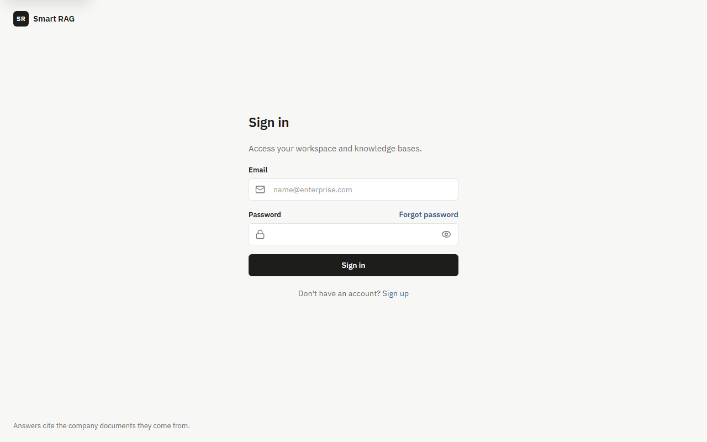
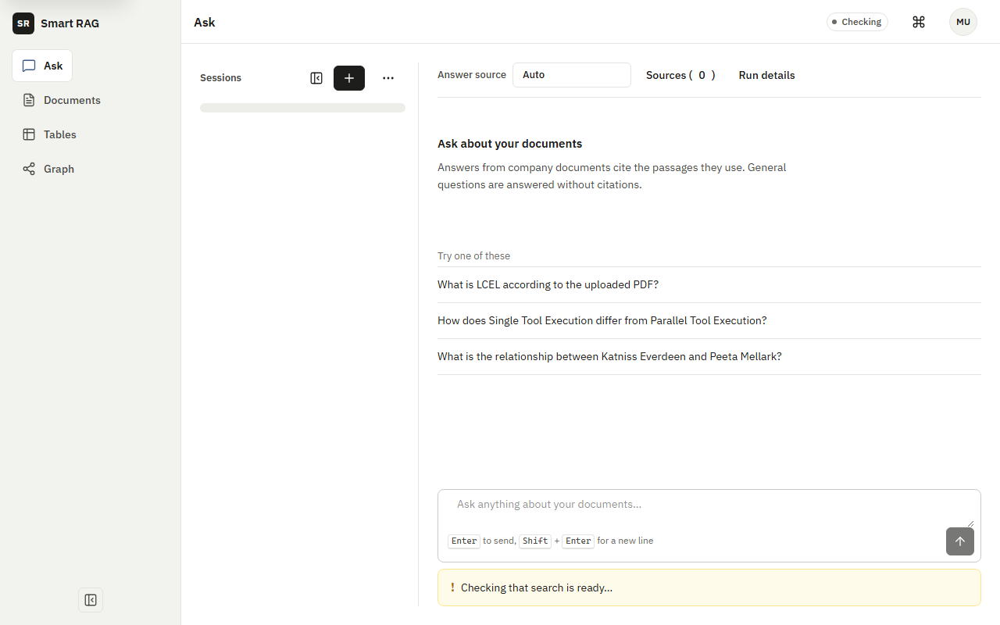
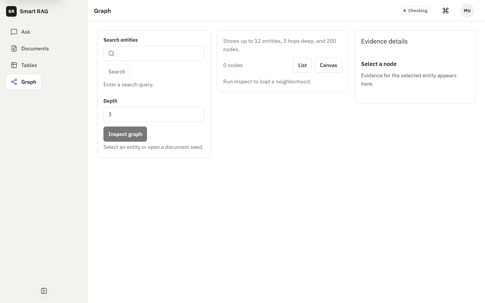

# Smart RAG

A company RAG console that answers from **authorized evidence** — with citations — or it **stops**.

It does not invent from text the caller cannot see. It does not quietly switch company questions onto the open web.



Sign in on hosted Supabase Auth. The rest of the product is the console: neutral surfaces, with citations as the one colored element.



**Ask** is the workspace. Four answer sources, one per turn: Auto, Company documents, General, Web. Company-document questions return passages you can inspect. If Hybrid finds nothing the caller may use, the run is a typed refusal — not a guess.



**Graph** inspects relationships. Answers still cite **canonical Supabase chunks**, not LightRAG prose. Evidence details stay ACL-safe.

## What the stack actually does

| Layer | Behavior |
| --- | --- |
| Retrieve | pgvector dense + private ParadeDB BM25 + term, fused with RRF, rechecked after ACL |
| Ground | Verifier drops unsupported links. PDF paragraph citations and table provenance when those paths run |
| Isolate | ClamAV before Hybrid index. Parser `network_mode: none`. Distroless API and worker |
| Govern | Server-derived roles, RLS, document ACL. Browser JWTs never hit evidence tables |
| Stream | FastAPI SSE with handshake, heartbeats, resume, and one terminal state |

Arabic and English share `arabic_norm_v1` on the BM25 path. Mixed corpora were a design constraint, not an afterthought.

## Quick start

Windows 10/11, Docker Desktop (WSL2 recommended), 16 GB RAM / 4 cores / 40 GB free, [uv](https://docs.astral.sh/uv/) 0.11+, Node.js 20+, pnpm 9.15+. Auth and Postgres are **hosted Supabase** — there is no local Postgres fixture ([ADR](docs/adr/ADR-cloud-only-supabase-no-local-fixture.md)). OpenAI is only for live-model evaluation; mock-model mode needs none.

```powershell
uv sync --all-packages --group dev --python 3.11 --frozen
pnpm install --frozen-lockfile
uv run python scripts/ops/wire_hosted_ingest_env.py
.\scripts\dev.ps1
.\scripts\verify-local.ps1
```

| Surface | URL |
| --- | --- |
| Console | http://localhost:3000 |
| API | http://localhost:8000/docs |
| Live | http://localhost:8000/health/live |

```powershell
uv run python scripts/check.py --tier fast
```

Full laptop wiring: [LOCAL_SETUP.md](docs/development/LOCAL_SETUP.md). Stop Compose (keep volumes): `.\scripts\stop.ps1`.

## Monorepo

uv + pnpm. Core never imports apps. The browser speaks HTTP and SSE only.

```
apps/frontend    Next.js 16 console
apps/backend     FastAPI transport
apps/agents      LangGraph query and ingestion graphs
apps/worker      durable jobs
packages/core    domain, retrieval, ACL, settings
```

## Status

Phases 1–5 have accepted local evidence. Phase 6 is implemented through P06-59; wrapper acceptance is still pending.

The 2026-09-17 company-documents Ask run is a **strict-substring baseline**, not a launch gate: **37 / 100** fully correct. Re-runs use the dual-metric scorer.

[Documentation index](docs/README.md) ·
[Ask baseline](docs/evaluation/COMPANY_DOCUMENTS_RAG_100.md) ·
[Scoring](docs/evaluation/DUAL_METRIC_SCORING.md) ·
[Authorization](docs/security/AUTHORIZATION_MODEL.md) ·
[Quality targets](docs/QUALITY_TARGETS.md)
