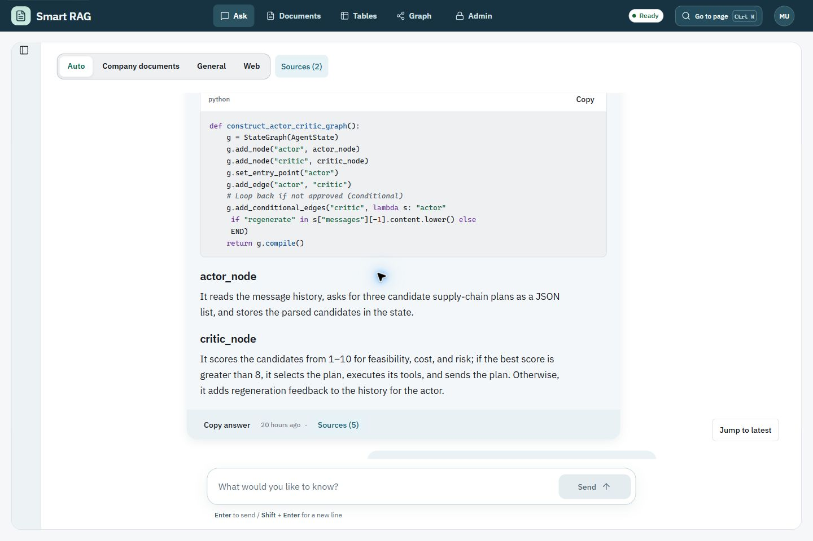
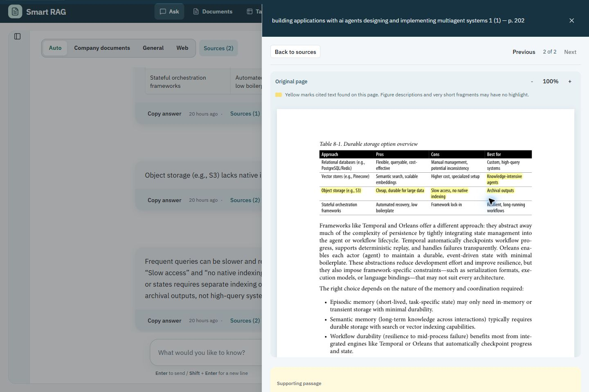
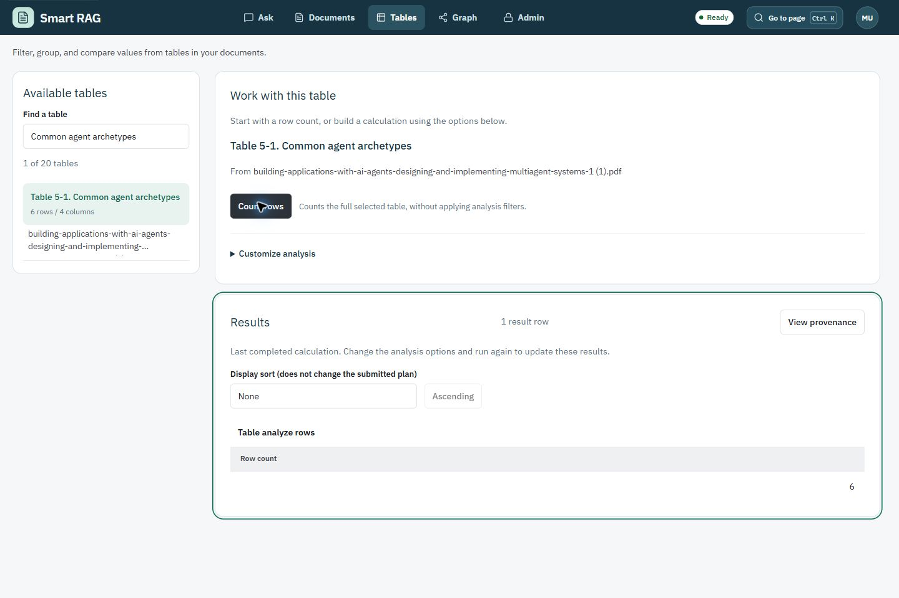
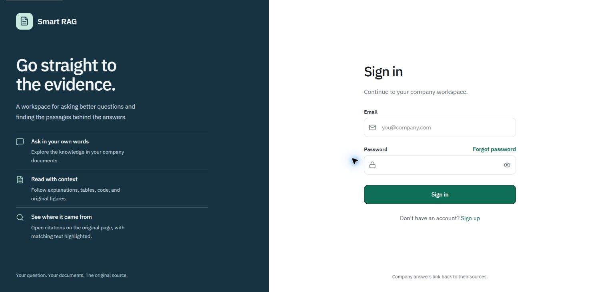
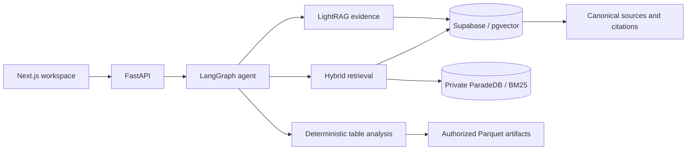

# Smart RAG

<!-- markdownlint-configure-file {"MD033": {"allowed_elements": ["div", "details", "summary", "strong"]}} -->

<div align="center">

**Ask a question. Open the evidence.**

A workspace for turning documents into grounded answers,
exploring their relationships, and checking the original source.

**Next.js 16** &nbsp;&middot;&nbsp; **FastAPI** &nbsp;&middot;&nbsp; **LangGraph** &nbsp;&middot;&nbsp; **Supabase**

[Explore the app](#a-closer-look) &nbsp;&middot;&nbsp; [Run locally](#run-locally) &nbsp;&middot;&nbsp; [Read the docs](docs/README.md)

</div>



## Answers you can inspect

An answer is only useful if you can check it. Smart RAG connects the conversation to the evidence behind it: document passages, original PDF pages, figures, and table cells.

- **Ask naturally.** Choose Auto, Company documents, General, or Web for each turn. Follow-up questions can use conversation context; longer histories can be summarized to stay within context limits.
- **Follow the sources.** Open a citation beside the answer, read the original PDF page, and see highlights where matching cited text is found.
- **Keep the useful structure.** Read formatted explanations, syntax-highlighted code, tables, and cited images in the conversation.
- **Calculate from tables.** Find an extracted table, count rows, or build filters, aggregations, grouping, sorting, and comparisons. Results retain source provenance.
- **Inspect relationships.** Explore graph evidence while keeping answers linked to canonical document chunks.
- **Manage the workspace.** Invite teammates, review access, configure agent tools, and inspect recorded token usage and cost estimates.

Company evidence is checked against the caller's access. When usable evidence is missing, the agent can return an insufficient-evidence response instead of presenting an unsupported answer.

## A closer look

Captured from the local development app.

### The original page, right beside the answer

Move from a citation to its PDF page without leaving the conversation. Navigate between citations, zoom the page, and inspect the supporting passage. Highlights depend on matching text in the original page; figure descriptions may not have a text highlight.



### Tables that do the calculation

Search by table, sheet, or document. Start with **Count rows**, then open **Customize analysis** when you need more. Calculations run on the backend; the interface displays the returned values and their source locations.



<details>
<summary><strong>A focused entrance</strong> &mdash; sign-in screen</summary>



</details>

## Under the hood

The frontend communicates with FastAPI over authenticated HTTP and server-sent events. LangGraph coordinates the query workflow; retrieval combines dense vectors, keyword search, and exact terms. Retrieved evidence is rechecked before it becomes part of an answer.



- **Access:** server-derived roles, document authorization, and database policies.
- **Streaming:** progress updates, reconnection, cancellation, and a terminal run state.
- **Ingestion:** durable jobs for files and websites, with native PDF, image, and table artifacts.
- **Operations:** rate limits, usage budgets, observability, and versioned evaluations.
- **Languages:** Arabic and English retrieval, including a shared Arabic normalization path for keyword search.

<details>
<summary><strong>Repository layout</strong></summary>

```text
apps/
  frontend/      Next.js console
  backend/       FastAPI transport and authenticated endpoints
  agents/        LangGraph query and ingestion workflows
  worker/        Durable background jobs
packages/
  core/          Shared domain, retrieval, authorization, and settings
supabase/        Database migrations and policies
docs/            Architecture, setup, security, evaluations, and runbooks
```

</details>

## Run locally

The development tooling targets Windows with Docker Desktop / WSL2. Install Python 3.11, [uv](https://docs.astral.sh/uv/), Node.js 20+, and pnpm 9.15+.

### Install the workspace

```powershell
git clone https://github.com/Nagdy8888/smart-rag.git
cd smart-rag
uv sync --all-packages --group dev --python 3.11 --frozen
pnpm install --frozen-lockfile
```

### Choose the backend environment

**Hosted Supabase:** follow [Local setup](docs/development/LOCAL_SETUP.md) to configure the hosted database, Auth, Storage, and local application services.

**Self-hosted Supabase development:** the repository also includes a temporary local development profile. For an **already provisioned** stack, resume it without resetting its data:

```powershell
.\scripts\start-local-supabase-dev.ps1
pnpm --filter smart-rag-frontend dev --hostname 127.0.0.1 --port 3000
```

The resume script is not a fresh-install bootstrap. See the [local Supabase runbook](docs/runbooks/temporary-local-supabase.md) for its configuration and lifecycle, and the [configuration reference](docs/development/CONFIGURATION.md) for environment variables. Private environment files and credentials stay outside version control.

Open the [console](http://127.0.0.1:3000), [API documentation](http://127.0.0.1:8000/docs), or [readiness endpoint](http://127.0.0.1:8000/health/ready).

Mock-model mode supports development without live provider calls. Live model use needs provider configuration and remains subject to application budgets.

## Develop and verify

```powershell
# Fast repository checks
uv run python scripts/check.py --tier fast

# Frontend checks
pnpm --dir apps/frontend test
pnpm --dir apps/frontend typecheck
pnpm --dir apps/frontend build
```

Live evaluations and infrastructure-dependent tests have additional setup requirements. Results are tracked with their dataset, configuration, and evidence; screenshots are examples of the interface, not a quality benchmark.

- [Documentation index](docs/README.md)
- [Architecture](docs/architecture/01-system-context.md)
- [Authorization model](docs/security/AUTHORIZATION_MODEL.md)
- [Quality targets](docs/QUALITY_TARGETS.md)
- [Evaluation scoring](docs/evaluation/DUAL_METRIC_SCORING.md)
- [Historical Ask baseline](docs/evaluation/COMPANY_DOCUMENTS_RAG_100.md)

---

<div align="center">

**Your documents. A conversation. The source behind the answer.**

</div>
