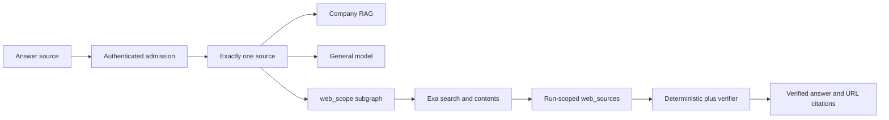

# ADR: Advanced web research mode

## Status

`accepted` on 2026-09-10. Implementation packets are P06-37 through
P06-43 because P06-27 through P06-36 already authorize hosted evaluation.
This ADR does not authorize staging or production Web search, a paid Exa
budget, or managed provider-egress for `api.exa.ai`.

## Context

Ask already has a three-value Answer-source selector (`auto`,
`company_documents`, `general_knowledge`). The user asked for Cursor/Claude
style web research as a fourth dropdown option, using Exa, with Auto as
the default that chooses exactly one source.

Canonical answers today may use only rechecked Supabase passages and
deterministic table values. Optional tools reject remote MCP. API/agent
containers must not fetch arbitrary public URLs. Composite envelopes
cannot silently grow. Packet numbers 27–36 are already used.

## Decision (accepted)

User named/date approvals on 2026-09-10:

1. **Four modes.** Labels are exactly Auto, Company documents, General,
   Web. New chats default to Auto.
2. **Exactly one source.** Auto selects company RAG, general knowledge, or
   Web. Company-plus-web conflict returns clarification. No blended answer.
3. **Exa.** Search uses Exa REST through pinned `httpx`. No `exa-py`.
4. **Local/free-tier only.** `WEB_SEARCH_ENABLED` defaults false. Staging
   and production reject `true`. The existing local `EXA_API_KEY` is
   server-only and never logged or committed. Production Web stays disabled
   until a paid budget and managed egress are separately approved.
5. **Specialist subgraph.** Web is a deterministic `web_scope` branch, not
   an optional catalog tool. Search and page-read are injected ports.
6. **Git.** Implement on `feature/advanced-web-research-mode` branched from
   current `main` (P06-19–36 already landed). One packet commit after
   acceptance.

Narrow evidence exception: Web answers may cite only creator-owned,
run-scoped rows in `app.web_sources` / `app.web_citations` persisted from
bounded Exa or crawl-proxy results. Those rows are never company RAG,
BM25, LightRAG, StructuredTable, or retrieval-cache evidence.

## Bounds

- Two research rounds, three formulations, twelve candidates per round,
  six retained sources, 8,000 characters per source, 40,000 total.
- Five external operations, one critique, one synthesis, one verifier,
  50-second deadline.
- Forced Web reserves `Phase6RouteFamily.WEB_RESEARCH`. Auto keeps a
  Composite reservation that contains the Web envelope. Web never clamps
  to Hybrid.

## Wire values

- Request: `RequestedSearchScope.WEB = "web"`.
- Origin: `KnowledgeScope.WEB = "web"` and `answer_origin="web"`.
- Route: `Phase6RouteFamily.WEB_RESEARCH = "web_research"`.
- Citations: `source_kind="web"` or `"company_document"`.
- Progress: `web_search`, `web_read`, existing `verify_answer`.

## Security and privacy

- Do not send company passages, conversation memory, internal IDs, JWTs,
  emails, or signed URLs to Exa.
- Normalize every URL with crawl policy. Reject private/loopback/metadata
  IPs, credentials, fragments, and unsupported schemes.
- Exa contents are primary. Crawl-proxy fallback may fetch only current-run
  Exa candidate URLs. API/agent code never `httpx` to result URLs.
- Treat retrieved text as untrusted. Cite only persisted `web_source_id`
  values. Never return excerpts or page bodies over API/SSE.
- `WEB_SEARCH_ENABLED=true` is forbidden unless `APP_ENV=local`.

## Alternatives considered

- **Optional-tool `web_search`.** Rejected: optional tools run on the
  company path after tables and cannot implement iterative research.
- **OpenAI hosted web search.** Rejected: user chose Exa.
- **Direct agent HTTP.** Rejected: violates deny-by-default egress.
- **Reuse `app.citations` for live URLs.** Rejected: ACL recheck is
  chunk-centric; Web needs a parallel store.

## Cost and retention

Exa spend is the operator's free-tier quota. No durable Exa budget row is
authorized. Web rows cascade with the run and are purged with conversation
deletion. No separate reaper is added in v1.

## Rollout and rollback

Rollout is local/dev only. Hide or disable Web when the flag is false.
Rollback sets `WEB_SEARCH_ENABLED=false`, leaves historical packets
1–36 unchanged, and does not down-migrate populated Web tables.

## Consequences

Packets P06-38 through P06-43 implement gateway, persistence, routing,
graph, UX, and gates. P06-17/P06-18 remain blocked. Hosted evaluation
packets stay checked.
