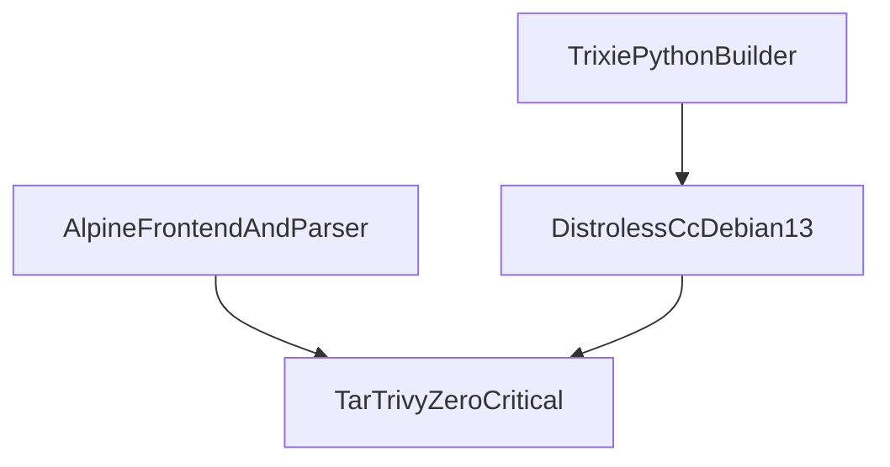

# ADR: Distroless and Alpine application bases to clear Trivy Criticals

## Context

Phase 9 Packet 7 remaining local no-go was unresolved Trivy **Critical**
findings on Debian bookworm application images after `apt-get upgrade`.
Debian 13 (trixie) probes cleared zlib/sqlite, but **perl-base** stayed
Critical: Debian sid 5.42.3-1 is tracker-fixed, yet Trivy/NVD still treat
versions below upstream 5.43.10 as vulnerable. Full Alpine CPython images
scanned 0 Critical, but frozen `pyarrow==19.0.1` has no musllinux wheel
and cannot compile without cmake/Arrow. Waiving Criticals is forbidden.

## Decision

1. **CPython API/worker/agents/crawl-proxy:** build on official
   `python:3.11-slim-trixie` (glibc wheels, including pyarrow 19.0.1),
   `apt-get upgrade` in the builder, then copy `/usr/local`, CA certs, and
   `/app` onto `gcr.io/distroless/cc-debian13:nonroot`. The scanned runtime
   has no perl-base. Probe scan of that distroless image: 0 Critical.
2. **Frontend:** official `node:20-alpine`, `apk upgrade --no-cache`, delete
   bundled npm/corepack from the runner (CVE-2026-59873).
3. **Parser sandbox:** official `python:3.11-alpine` plus Alpine Tesseract
   English/Arabic data, `mesa-gl`, and `glib`. Parser requirements do not
   include pyarrow.
4. Keep `USER 10001:10001`, `ghcr.io/astral-sh/uv:0.11.23`, and frontend
   `pnpm@9.15.0` on the build stage.
5. Do **not** ignore Trivy Critical IDs. Do **not** bump `pyarrow==19.0.1`.

## Alternatives considered

| Option | Outcome |
| --- | --- |
| Wait for a bookworm DSA | Rejected. User ordered repair; zlib is `will_not_fix`. |
| Trixie runtime as the scanned image | Rejected. perl-base remains Trivy Critical. |
| Alpine for API/worker | Rejected. `pyarrow==19.0.1` has no musllinux wheel. |
| Python 3.13 distroless `python3-debian13` | Rejected. Workspace `requires-python` is `<3.13`. |
| Ignore unfixed Criticals | Rejected. Packet 7 forbids waiving Critical findings. |

## Consequences

- Packet 1 identity is invalidated; Packets 1–6 must re-run on the new
  runtime Ids.
- Distroless runtimes have no shell; image CMD and Compose healthchecks for
  api/worker/crawl-proxy stay exec-form JSON (`CMD python`, not `CMD-SHELL`).
- API/worker/agents copy an ``ldd`` closure of libffi and native-wheel
  libraries onto distroless without ``/var/lib/dpkg`` so perl-base stays
  out of the scanned runtime. Crawl-proxy stdlib ``ssl`` is satisfied by
  distroless/cc.
- Parser OS review in [ADR-parser-isolation.md](./ADR-parser-isolation.md)
  tracks Alpine packages.

## Related

- [IMAGE_DIGESTS.md](../../infra/paradedb/IMAGE_DIGESTS.md)
- [02-containers.md](../architecture/02-containers.md)
- [LOCAL_RELEASE_CANDIDATE.md](../deployment/LOCAL_RELEASE_CANDIDATE.md)
- [ADR-cve-pin-patch-2026-08.md](./ADR-cve-pin-patch-2026-08.md)

## Approval

| Role | Name | Date |
| --- | --- | --- |
| Engineering lead | user (Cursor chat; clear Trivy then freeze) | 2026-08-18 |
