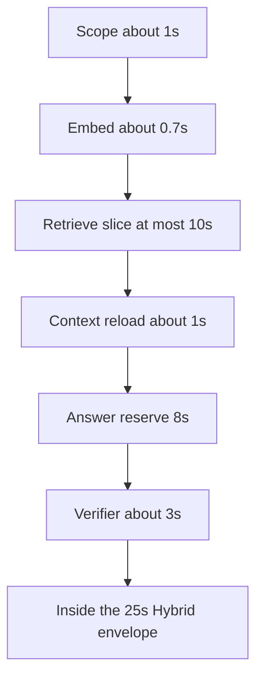

# ADR: Ask evidence budget repair

## Status

`accepted` on 2026-09-22. This records the fusion-quota, retrieve-slice,
and answer-budget changes for the 3/30 post-merge Ask gate.

## Context

The 2026-09-21 post-merge gate was strict 3/30 and grounded 3/30.
Retrieval already placed the gold page in `selected_ids` on 26 of 28
scored questions. Losses were after selection:

- Fusion document and section quotas were a hard cap of 2, so a
  one-document corpus could not fill the 12 evidence slots.
- OpenAI rerank was skipped on 22 of 28 questions. Channels inside the
  8 second retrieve slice left less than the 2 second rerank reserve.
- `final_token_budget` was 3500 and `MODEL_INPUT_MAX_CHARS` was 16384,
  so the answer model saw 1 to 8 passages.

## Decision

1. Keep frozen fusion floors at 2. The effective quota for one call is
   `max(floor, ceil(limit / distinct documents or headings))`.
2. Set `RETRIEVAL_SLICE_SECONDS` to 10. The 8000 ms SQL statement
   timeout stays the per-statement bound. Set `RERANK_RESERVED_SECONDS`
   to 3. The Hybrid branch passes
   `max(2, min(remaining - 8, 10))` so the 8 second answer reserve is
   the slice ceiling. `HYBRID_DEADLINE_SECONDS` and
   `FAMILY_DEADLINE_SECONDS[HYBRID]` stay 25.
3. One retrieve uses one context connection for preload, parent
   expansion, and locator reload. Scope resolution and the citation
   chunk loader keep their own connections.
4. Raise `final_token_budget` to 6000 in both frozen Hybrid profiles
   and `MODEL_INPUT_MAX_CHARS` to 32768. Digests before that byte
   change, kept for rollback:

   - `hybrid_default_v1`:
     `def45b691e64707d07d3c7ea47f45eb1b23b5d2d2546c37a19a514f316c5940c`
   - `hybrid_long_document_v2`:
     `9565a14152c9c530ad5a07ba221f9d944a872c6b6f417e71ef30cab0486c95b1`

   Digests after `final_token_budget` 6000:

   - `hybrid_default_v1`:
     `37343b15449600a4e756e7f72b9282cf709713019e033fe470a9b91fa21f0ec0`
   - `hybrid_long_document_v2`:
     `1b356c0de0972ee42758f1ef9f0a7a47b283ec779f97fbe9af8f04e490dffd7a`

Scope (~1 s) + embed (~0.7 s) + slice (<= 10 s) + context (~1 s) +
answer reserve (<= 8 s) + verifier (~3 s) stays under 25 s.

## Amendment (answer-loss repair A5)

The retrieve slice and `RERANK_RESERVED_SECONDS` (3) stay. Inside the
slice, channels now stop at
`max(CHANNEL_MIN_SECONDS, slice - RERANK_RESERVED_SECONDS - CHANNEL_PHASE_RESERVE_SECONDS)`
(capped at the slice), so assembly, temporal load, and pool preload no
longer consume the rerank reserve. Values: `CHANNEL_MIN_SECONDS` 2.0,
`CHANNEL_PHASE_RESERVE_SECONDS` 1.5. Rollback: set
`CHANNEL_PHASE_RESERVE_SECONDS` to 0 and pass the whole slice to channels.
See [ADR-retrieved-answer-loss-repair.md](./ADR-retrieved-answer-loss-repair.md) Fix 2 step 4.

## Alternatives rejected

- A dedicated rerank API or a local cross-encoder. The repair keeps
  the pinned OpenAI reranker and gives it time to run.
- Raising QT-DL-001 / `HYBRID_DEADLINE_SECONDS` above 25.

## Rollback

Revert `RETRIEVAL_SLICE_SECONDS` to 8, `RERANK_RESERVED_SECONDS` to 2,
the branch clamp to `min(remaining, 8)`, and the fusion effective
quotas to the frozen floors. Restore `final_token_budget` 3500,
`MODEL_INPUT_MAX_CHARS` 16384, and the digests listed above.
