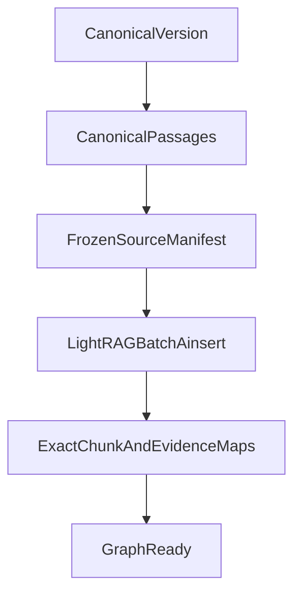

# ADR: Canonical-passage LightRAG sources

## Status

`accepted` — the operator approved a one-time Graph-200 rebuild that indexes
each canonical Hybrid passage as its own LightRAG source instead of concatenating
the version into one vendor document.

## Context

Phase 5 Packet 3 inserted one LightRAG document per canonical version:
`ids=[document_version_id]` plus concatenated `document_chunks.raw_text`.
LightRAG 1.5.6 then applied its own 1200-token overlapping chunker.

On Graph-200 that produced 95 vendor chunks against 164 canonical passages.
Hash/span/overlap plus one bounded Hybrid support call reached 2,832/3,314
(85.46%) mapping coverage, below the 90% Graph Ready gate. `lightrag_chunk_map`
is keyed by canonical `chunk_id`, so overlapping vendor chunks also overwrote
maps (87 persisted of 90 accepted). The extracted vendor snapshot also drifted
from current canonical text (474,506 vs 474,674 characters).

Retrying Hybrid selection or lowering coverage/support gates is forbidden.
The 90% Graph Ready gate, one shared workspace, one writer lease, and one
logical version job remain unchanged.

Pinned `lightrag-hku==1.5.6` `ainsert` accepts `input: str | list[str]` with
matching `ids` and `file_paths` lists. Independent `adelete_by_doc_id` remains
the deletion contract.

## Decision

1. One version index job calls LightRAG with a bounded list of canonical
   passages. Deterministic source IDs are `{version_id}:{chunk_id}` and opaque
   basenames are `g-{version_id}-{chunk_id}.txt`.
2. Each passage is envelope-bound with that source ID so identical passage
   text cannot collapse distinct canonical chunks.
3. Mapping is a strict bijection at **source** identity: each canonical
   passage must yield exactly one processed vendor document whose LightRAG
   chunks reconstruct (overlap-stitch, envelope strip, HTML unescape) to the
   unescaped passage hash. LightRAG 1.5.6 still applies its 1200/100 chunker
   to long enveloped sources, so one processed document may have several
   overlapping vendor chunks. `lightrag_chunk_map` still stores one row per
   canonical `chunk_id`. Source drift is terminal
   `graph_source_snapshot_mismatch` and never a mapping retry.
4. `lightrag_chunk_map.lightrag_doc_id` stores the per-passage vendor ID.
   A vendor chunk cannot overwrite a different canonical mapping.
5. Entity/relation/path evidence persists every accepted referenced passage.
   Malformed, truncated, or foreign source IDs stay unavailable.
6. Hybrid/rerank mapping callbacks stay unused on this exact path. Packet 4's
   one-call Hybrid/rerank budget is not spent to paper over chunker mismatch.
7. Deletion and rebuild remove the legacy whole-version vendor ID and every
   derived passage source ID for that version.

## Consequences

- Graph extract cost scales with canonical passage count, not LightRAG's
  overlapping chunker. Graph-200 is about 164 sources instead of one 200-line
  document (~95 overlapping chunks).
- Mapping no longer depends on Jaccard overlap or Hybrid support to reach
  Graph Ready when the vendor snapshot matches.
- Whole-version `ids=[document_version_id]` remains the documented Phase 5
  historical contract. Production indexing uses this ADR.
- If pinned LightRAG list insert or independent deletion fails qualification,
  GraphRAG stays blocked rather than returning to fuzzy mapping retries.
- One 164-source `ainsert` is forbidden. Indexing uses resumable batches of
  eight with `AsyncOpenAI` below the LightRAG watchdog. See
  [ADR-lightrag-async-embed-batched-sources.md](./ADR-lightrag-async-embed-batched-sources.md).

## Links

- [ADR-lightrag-async-embed-batched-sources.md](./ADR-lightrag-async-embed-batched-sources.md)
- [ADR-graph-source-identity-envelope.md](./ADR-graph-source-identity-envelope.md)
- [GRAPH_MAPPING_CONTRACT.md](../graph/GRAPH_MAPPING_CONTRACT.md)
- [MAPPING.md](../graph/MAPPING.md)
- [WORKSPACE_LIFECYCLE.md](../graph/WORKSPACE_LIFECYCLE.md)
- [LIGHTRAG_CONTRACT.md](../graph/LIGHTRAG_CONTRACT.md)
- [demo-local-ingest-aws-ask.md](../runbooks/demo-local-ingest-aws-ask.md)
- [docs index](../README.md)
