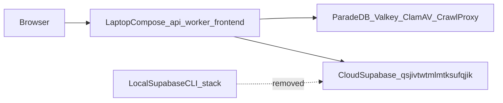

# ADR: Cloud-only Supabase, no local fixture

## Status

`accepted` — 2026-09-07. Supersedes
[ADR-hosted-runtime-local-test-fixture.md](./ADR-hosted-runtime-local-test-fixture.md).

## Context

Laptop Compose already ran against the cloud project
`qsjivtwtmlmtksufqjik`. The local Supabase CLI fixture duplicated
Auth/Postgres/Storage semantics, drifted from hosted JWKS issuers, and
cost roughly 8.6 GB of images plus 21 GB of Docker build cache. Phase 9
local release-candidate scripts started that fixture and are retired.
Phase 10 tooling and its JSON artifacts stay.

## Decision

1. The cloud project is the only Auth/Postgres/Storage target for runtime,
   E2E, and docs.
2. Destructive migration/RLS/schema suites are opt-in against an explicit
   non-hosted `SUPABASE_DB_URL`, guarded by `refuse_hosted_destructive_dsn`.
   There is no loopback DSN default.
3. JWT verification accepts exactly one issuer `{SUPABASE_URL}/auth/v1`.
4. Phase-9 local candidate tooling is retired. Phase-10 modules and
   `docs/deployment/phase-09/*.json` stay.
5. Migrations reach the cloud via Supabase MCP `apply_migration` or the
   SSM `psql` job. Canonical SQL remains `supabase/migrations/`.
6. Admin-alert SMTP is opt-in: both `ADMIN_ALERT_SMTP_HOST` and
   `ADMIN_ALERT_SMTP_PORT` must be set.
7. Live Playwright specs need `E2E_LIVE_EMAIL` / `E2E_LIVE_PASSWORD`.

## Alternatives considered

| Alternative | Why rejected or deferred |
| --- | --- |
| Keep the fixture opt-in | Unused, issuer/schema drift, Docker disk cost |
| Plain Postgres container for RLS suites | Deferred; documented as the way to run opt-in destructive suites |
| Upgrade to Pro and use ephemeral branches | Out of scope for this cleanup |

## Consequences

- No local destructive test loop by default; schema-determinism CI is gone.
- E2E live specs skip unless a provisioned hosted user is configured.
- Operator scripts (`ensure_app_runtime_role.py`, LightRAG restore) require
  an explicit DSN (`OPERATOR_SUPABASE_DB_URL` or `--admin-dsn`).
- `APP_ENV=test` may still inject a synthetic offline Auth origin for unit
  tests; that origin is not a running process.

## Related

- [ADR-hosted-runtime-local-test-fixture.md](./ADR-hosted-runtime-local-test-fixture.md) (superseded)
- [ADR-phase10-hosted-supabase-reuse.md](./ADR-phase10-hosted-supabase-reuse.md)
- [ADR-demo-local-ingest-aws-ask.md](./ADR-demo-local-ingest-aws-ask.md)
- [CONFIGURATION.md](../development/CONFIGURATION.md)
- [LOCAL_SETUP.md](../development/LOCAL_SETUP.md)
- [LOCAL_RUNTIME_ROLES.md](../deployment/LOCAL_RUNTIME_ROLES.md)
