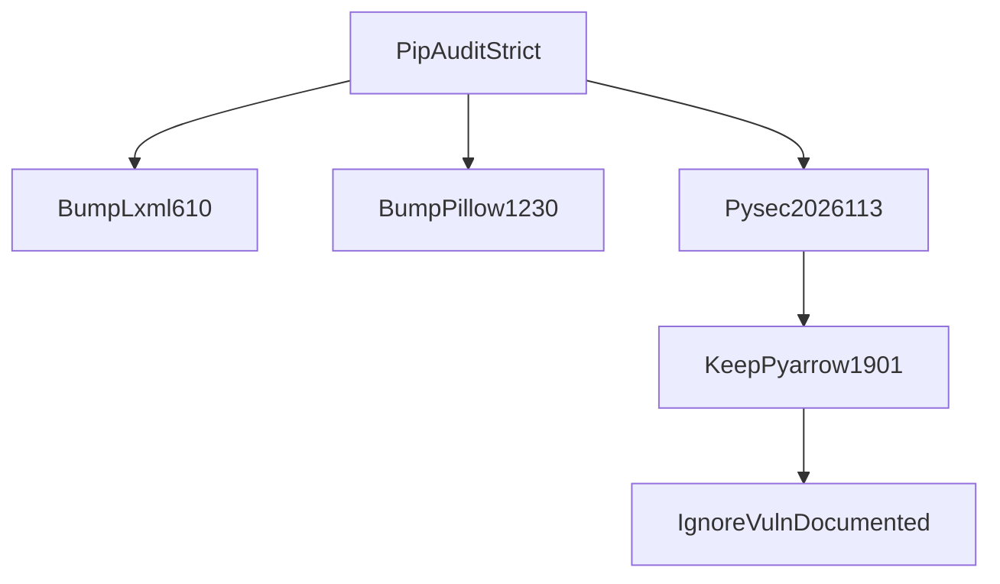

# ADR: CVE pin patch after Packet 8 freeze (accepted)

## Context

PR-fast `pip-audit --strict` failed on `origin/main` after the Phase 4
Packet 9 evidence push (`299b854`). The locked graph reported 27 advisories in
three pins: `lxml==5.3.1`, `Pillow==11.1.0`, and `pyarrow==19.0.1`. Packet 8
froze `pyarrow==19.0.1` and `hybrid_default_v1`. This change must not retune
retrieval or open the sealed holdout.

## Decision

1. **Bump parser-facing pins** in `packages/core/pyproject.toml` and
   `infra/parser-sandbox/requirements.txt`:
   - `lxml` `5.3.1` → `6.1.0` for [PYSEC-2026-87](https://osv.dev/vulnerability/PYSEC-2026-87)
     / CVE-2026-41066 (XXE defaults on `iterparse` / `ETCompatXMLParser`).
   - `Pillow` `11.1.0` → `12.3.0` for the 2026 Pillow advisory set whose last
     remaining fix version is 12.3.0 (including
     [PYSEC-2026-3453](https://osv.dev/vulnerability/PYSEC-2026-3453) /
     CVE-2026-59205).
2. **Keep `pyarrow==19.0.1`.** [PYSEC-2026-113](https://osv.dev/vulnerability/PYSEC-2026-113)
   / CVE-2026-25087 is an Arrow C++ IPC-file pre-buffer use-after-free.
   Apache documents that the trigger API
   (`RecordBatchFileReader::PreBufferMetadata`) is **not exposed in Python
   bindings**, so `pyarrow` is not the vulnerable surface. Structured-table
   code uses `pyarrow.parquet.write_table` / `read_table` and DuckDB Arrow
   register only.
3. **Do not bump pyarrow to 23.0.1** in this change. That would rewrite a
   Packet 8 freeze pin and risk DuckDB `1.2.1` Arrow ABI drift for a
   non-applicable C++ advisory.
4. PR-fast and [QUALITY_COMMANDS.md](../development/QUALITY_COMMANDS.md) pass
   `--ignore-vuln PYSEC-2026-113` with this ADR as the justification. No other
   advisories are ignored.
5. `hybrid_default_v1` is unchanged. Phase 4 Packet 9 remains unchecked
   pending user acceptance.

## Alternatives considered

| Option | Outcome |
| --- | --- |
| Ignore all three advisories | Rejected. lxml and Pillow CVEs are Python-reachable parser/OCR surfaces. |
| Bump pyarrow 19.0.1 → 23.0.1 | Rejected for this patch. Freeze pin plus DuckDB 1.2.1 Arrow register risk; advisory is C++-only. |
| Disable `--strict` | Rejected. Conceals future applicable CVEs. |

## Consequences

- Parser sandbox image must be rebuilt from the updated requirements before
  the next live OCR/HTML parse proof.
- Revisit the pyarrow ignore if Python bindings later expose IPC pre-buffering
  or if Packet 7 table execution is retargeted onto Arrow IPC files.
- Monthly parser advisory review in [ADR-parser-isolation.md](./ADR-parser-isolation.md)
  still applies.

## Related

- [INGESTION_LIMITS.md](../ingestion/INGESTION_LIMITS.md)
- [QUALITY_COMMANDS.md](../development/QUALITY_COMMANDS.md)
- [PHASE4_FREEZE.md](../evaluation/PHASE4_FREEZE.md)
- [ADR-parser-isolation.md](./ADR-parser-isolation.md)

## Approval

| Role | Name | Date |
| --- | --- | --- |
| Engineering lead | user (Cursor chat; keep PR-fast and Main green) | 2026-08-15 |
