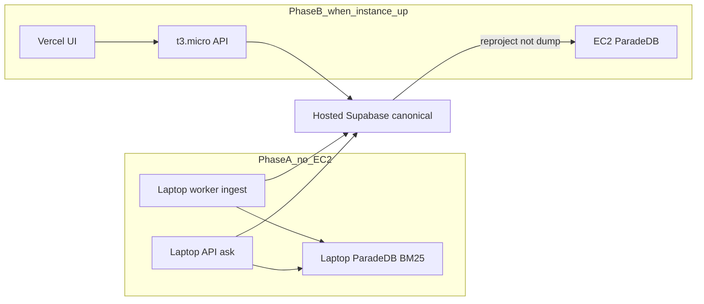

# ADR: Demo local ingest, hosted Supabase, AWS ask later

## Context

Phase 10 freeze constants stay **Pro / us-east-1 / PITR**. Live topology
reuses hosted Supabase `qsjivtwtmlmtksufqjik` (Free, eu-central-1) and a
**t3.micro** EC2 host
([ADR-phase10-hosted-supabase-reuse.md](./ADR-phase10-hosted-supabase-reuse.md),
[ADR-phase10-free-tier-ec2.md](./ADR-phase10-free-tier-ec2.md)). The instance
is **not ready** for SSH/SSM/`compose up` until the operator says so.

Standing ingest (worker, ClamAV, parser) does not fit 1 GiB RAM. ParadeDB is
never canonical. Hosted Postgres has no `pg_search`. Copying a laptop
ParadeDB dump to AWS would move a stale, ACL-sensitive derived index over the
network.

The CMU plot dump
[`docs/datasets/MovieSummaries/plot_summaries.txt`](../datasets/MovieSummaries/plot_summaries.txt)
is ~42k lines. One upload of that file would hit the 2048 embed cap and would
make LightRAG extract the entire dump. Operator choice: **1000 Hybrid** plots
and **200 Graph** plots as **two files** (two uploads), not one file per
line.

## Decision

1. **Phase A (now):** laptop Compose worker + ClamAV + parser + ParadeDB +
   Valkey + API ingest and **ask** against **hosted** Auth/Postgres. Local
   ParadeDB is the live BM25 for Hybrid Ready and laptop ask. Do not start
   local Docker Supabase as the canonical store.
2. **Phase B (when the instance is up):** Vercel/CloudFront → EC2
   `t3micro-edge` API. Fill EC2 ParadeDB only by
   `authorized_current` **reproject from hosted Supabase**. Never copy a
   laptop ParadeDB volume or dump.
3. **Corpus:** `plot_summaries.graph-200.txt` (source lines 1–200,
   company-visible, graph-eligible) and
   `plot_summaries.hybrid-800.txt` (source lines 201–1000, 800 plots,
   `graph_eligible` stays false). Together: 1000 Hybrid plots, 200 Graph
   plots, no duplicate files. LightRAG never sees the 800-line file.
   The draft table that said “801–1000 (800 plots)” was arithmetic error;
   801–1000 is 200 lines. Lines **201–1000** are the 800 Hybrid-only plots.
4. **Do not ingest** the 42k-line dump. 1000 chunks in one version is under
   the 2048 embed cap and **above** QT-CAP-002-P9=16. This is a demo size,
   not a quality-target raise.
5. **LangSmith and TTY:** laptop worker only. Parent runs
   `ingestion.scan` / `ingestion.parse` / `ingestion.index` /
   `ingestion.graph` with `job_id`. Log lines start with `[hybrid]` or
   `[graph]`. Empty terminals or empty LangSmith after an upload fail the
   demo check. Do not enable ingest tracing on the EC2 API.
6. **SSM / Compose on AWS:** in-repo `SmartRagStagingDeploy` uses the t3
   overlay and `--profile t3micro-edge`. Do not `aws ssm send-command` or
   `compose up` on AWS until the operator says the instance is ready.
7. Freeze constants in `phase10_constants.py` / intended topology stay
   Pro/us-east-1. This ADR is an accepted **demo** deviation, not a freeze
   rewrite.

## Consequences

- ClamAV and parser stay on the laptop. They are not needed on AWS for
  ask-only.
- Runtime DSNs on laptop API/worker (and EC2 later) must be **`app_runtime`**,
  not `postgres`. FastAPI still forbids HS256; login failures are a hosted
  key problem, not an HS256 enablement.
- `APP_ENV=local` unsigned LangSmith/OpenAI waiver applies. Do **not** set
  `SMART_RAG_SUBPROCESSOR_MATRIX_VERIFIED=true`. Synthetic/demo files only.
- Graph eligibility is not a UI upload flag. The 200-line document must be
  marked `graph_eligible` after `current_version_id` exists and **before**
  BM25 `finalize_hybrid_ready`. Leaving the 800-line file at the default
  `graph_eligible=false` yields `graph_ineligible`.
- Approximate OpenAI ingest: Hybrid embeddings for 1000 plots plus mini
  extract for 200 Graph plots, about **$0.10–$0.30**, not dollars per plot.

## Alternatives considered

| Option | Outcome |
| --- | --- |
| Ingest the whole `plot_summaries.txt` | Rejected. Embed cap and full-dump Graph extract. |
| One 1000-line company-visible file, Graph “only 200” | Rejected. Graph indexes the whole version. |
| Copy laptop ParadeDB dump to EC2 | Rejected. Non-canonical, stale vs ACL/deletes, network copy. |
| Ingest stack on t3.micro | Rejected. 1 GiB; overlay keeps worker/ClamAV/parser off. |
| Second worker container for Hybrid vs Graph logs | Rejected. Extra RAM. Split the log **view**. |
| Point laptop worker at public AWS ParadeDB | Rejected. Do not publish 5432. |
| Enable HS256 in FastAPI | Rejected. Fix hosted asymmetric keys. |

## Related

- [demo-local-ingest-aws-ask.md](../runbooks/demo-local-ingest-aws-ask.md)
- [07-bm25-projection.md](../architecture/07-bm25-projection.md)
- [bm25-rebuild.md](../runbooks/bm25-rebuild.md)
- [LANGSMITH_TRACING.md](../development/LANGSMITH_TRACING.md)
- [MANAGED_STAGING.md](../deployment/MANAGED_STAGING.md)
- [docs index](../README.md)
