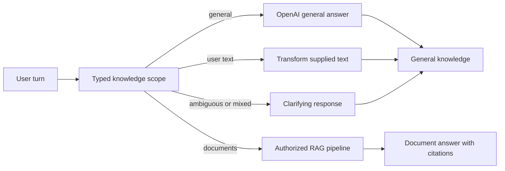

# ADR: General-chat strict split

## Status

`accepted` — 2026-08-25. The user approved a dual-mode assistant for the
production Ask path and a separate live LangSmith Studio graph: general
questions may use OpenAI world knowledge, while company/document questions
remain citation-required RAG with no world-knowledge fallback.

## Context

The completed Phase 6 query graph already answers company questions through
Hybrid/Combined/Table routes. Users asked the assistant to behave like a
traditional ChatGPT for general questions, including standalone greetings,
while still answering from authorized company documents with citations.

Two existing surfaces must stay distinct:

- `query_studio` is the deterministic, unbound, no-cost LangSmith topology and
  chat-debug graph.
- Production FastAPI/SSE already owns admission, ACL, durable budgets, and
  verified-final delivery.

The user selected a strict split over retrieval fallback and over blending
general claims with company claims.

## Decision (accepted)

1. Apply the behavior to the main application and to a separate live LangSmith
   Studio graph named `query_studio_live`.
2. General responses may use OpenAI world knowledge without citations.
3. Company/document responses still require canonical evidence and citations.
4. Mixed or uncertain scope returns clarification. Never blend general and
   company claims in one answer.
5. Never fall back from insufficient company evidence to world knowledge.
6. General and user-text model calls consume durable run reservations and
   immutable usage rows under the existing `usage_kind="answer"` kind. Do not
   add a new usage kind or migration.
7. `query_studio_live` is local-only and authenticates with a real developer
   JWT from a gitignored environment variable. No service-role key or
   synthetic live identity is permitted.
8. `query_studio` stays deterministic and unbound.
9. Implementation is additive Phase 6 packets P06-09 through P06-15. P06-14 is
   a Phase 6/Phase 8 co-owned UI amendment. Do not uncheck historical completed
   packets or renumber active P08-22/P08-23.
10. Rollback disables general scope and removes the live graph registration
    without changing document RAG.

## Alternatives rejected

| Alternative | Why rejected |
| --- | --- |
| Fall back to world knowledge when company evidence is thin | User selected a strict split; this would invent uncited company facts |
| Blend general and company claims in one answer | Source provenance would become untrustworthy |
| Bind live OpenAI/retrieval into `query_studio` | Destroys the no-cost deterministic Studio debug surface |
| Use a service-role key or synthetic Studio identity | Violates ACL, admission, and budget invariants |
| Add a new `GeneralChat` route family | The existing `NoRetrieval` family already owns non-retrieval answers |

## Consequences

- Knowledge-scope classification is typed and deterministic at the route
  matrix. The preparation model may classify remaining natural-language scope
  only; it never selects Hybrid/Combined/Table or authorizes evidence.
- The UI must render an additive `answer_origin` badge and hide citations for
  non-document origins.
- Live Studio success cannot be claimed until a real developer JWT, hosted or
  local Supabase, budget, OpenAI, and retrieval boundary are available.
- Successful SSE streams must drain naturally so LangSmith traces do not
  record `GeneratorExit` as an error on completed runs.

## Rollback

Disable `GENERAL_KNOWLEDGE` / `USER_SUPPLIED_TEXT` execution, remove the
`query_studio_live` registration from `apps/agents/langgraph.json`, and keep
the existing document RAG graph, admission, and citation contracts unchanged.

Related: [QUERY_ROUTING.md](../agent/QUERY_ROUTING.md) ·
[QUERY_BUDGETS.md](../agent/QUERY_BUDGETS.md) ·
[SSE.md](../api/SSE.md) ·
[LANGGRAPH_STUDIO.md](../development/LANGGRAPH_STUDIO.md) ·
[docs index](../README.md)
