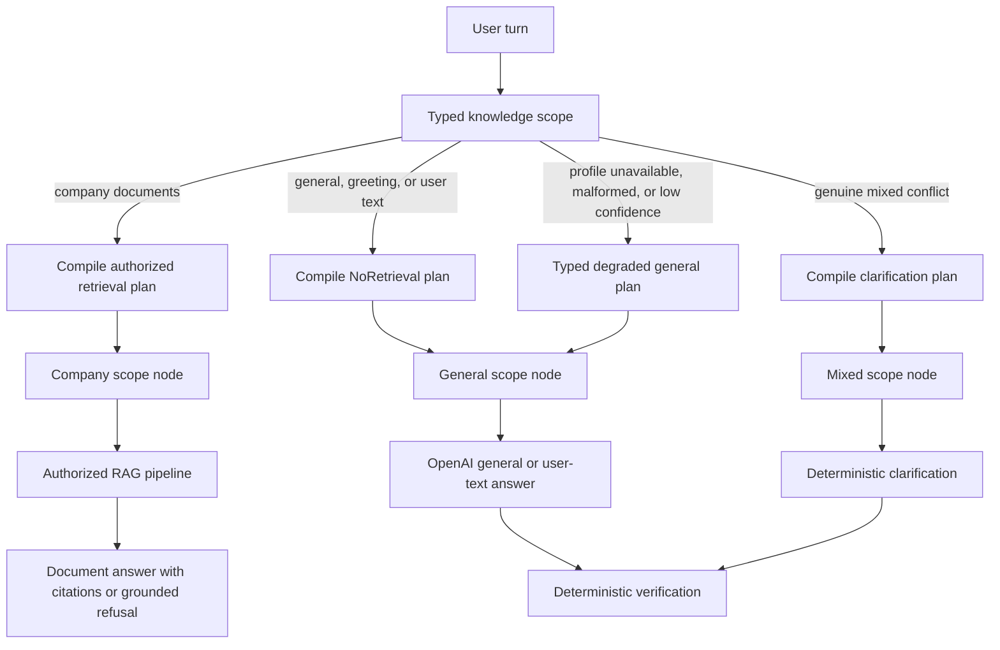

# ADR: General-chat strict split

## Status

`accepted` on 2026-08-25 for the original strict split. The 2026-08-26
remediation amendment is drafted and pending explicit user acceptance: a
counted live profile call, model-classified/model-answered greetings, honest
non-document degradation when scope inference fails, and explicit post-plan
graph paths. The original dual-mode contract remains in force: general
questions may use OpenAI world knowledge, while company/document questions
remain citation-required RAG with no world-knowledge fallback.

## Context

The completed Phase 6 query graph already answers company questions through
Hybrid/Combined/Table routes. Users asked the assistant to behave like a
traditional ChatGPT for general questions, including standalone greetings,
while still answering from authorized company documents with citations.

Two existing surfaces must stay distinct:

- `query_studio` is the deterministic, unbound, no-cost LangSmith topology and
  chat-debug graph.
- Production FastAPI/SSE already owns admission, ACL, durable budgets, and
  verified-final delivery.

The user selected a strict split over retrieval fallback and over blending
general claims with company claims. The first implementation exposed two
incorrect assumptions: a failed or low-confidence profile was labelled
`ambiguous` even without conflicting signals, and greetings were expected to
use a zero-cost canned response even though the intended product should answer
them naturally.

## Decision (accepted)

1. Apply the behavior to the main application and to a separate live LangSmith
   Studio graph named `query_studio_live`.
2. General responses may use OpenAI world knowledge without citations.
3. Company/document responses still require canonical evidence and citations.
4. Only a genuine conflict between company and general signals returns
   clarification. Never blend general and company claims in one answer.
5. Never fall back from insufficient company evidence to world knowledge.
6. General and user-text model calls consume durable run reservations and
   immutable usage rows under the existing `usage_kind="answer"` kind. Do not
   add a new usage kind or migration.
7. `query_studio_live` is local-only and authenticates with a real developer
   JWT from a gitignored environment variable. No service-role key or
   synthetic live identity is permitted.
8. `query_studio` stays deterministic and unbound.
9. Implementation is additive Phase 6 packets P06-09 through P06-15. P06-14 is
   a Phase 6/Phase 8 co-owned UI amendment. Do not uncheck historical completed
   packets or renumber active P08-22/P08-23.
10. Rollback disables general scope and removes the live graph registration
    without changing document RAG.
11. The production preparation path may make one live counted
    `usage_kind="profile"` call under the existing profile USD/token/model-call
    caps. No new usage kind, migration, or enlarged ceiling is authorized.
12. A pure greeting or bounded small-talk message is classified by the existing
    structured preparation call and answered by the general-chat model. A live
    greeting therefore normally consumes one profile call plus one answer call.
    A greeting prefix on a deterministic company question remains company
    scope and does not force a profile call.
13. Profile unavailable, malformed, or below the accepted confidence threshold
    does not mean mixed scope. The server records a typed degradation reason
    and permits a company-claim-forbidden general response that explicitly says
    company documents were not searched. Deterministic company signals still
    override model output and never use this degradation.
14. Keep the five existing `KnowledgeScope` values and existing route families.
    A server-derived degradation reason distinguishes failed scope inference
    from genuine `AMBIGUOUS`; it is never accepted from model JSON.
15. After `compile_plan`, validated `RetrievalPlan` selects explicit company,
    general, mixed, or fail-closed graph nodes. Direct paths skip retrieval,
    correction, fusion, tables, optional tools, and verifier-model work but
    still run deterministic verification.

## Alternatives rejected

| Alternative | Why rejected |
| --- | --- |
| Fall back to world knowledge when company evidence is thin | User selected a strict split; this would invent uncited company facts |
| Blend general and company claims in one answer | Source provenance would become untrustworthy |
| Bind live OpenAI/retrieval into `query_studio` | Destroys the no-cost deterministic Studio debug surface |
| Use a service-role key or synthetic Studio identity | Violates ACL, admission, and budget invariants |
| Add a new `GeneralChat` route family | The existing `NoRetrieval` family already owns non-retrieval answers |
| Treat every profile failure as mixed scope | No conflicting evidence exists; the resulting clarification is false and makes outages unusable |
| Keep zero-cost canned greetings | User approved natural model-classified/model-answered conversation and accepted the bounded cost |
| Let direct queries traverse no-op retrieval nodes | It adds latency and obscures traces without improving safety; validated plans can select explicit paths |

## Consequences

- Knowledge-scope classification is typed and deterministic at the route
  matrix. The preparation model may classify remaining natural-language scope
  only; it never selects Hybrid/Combined/Table or authorizes evidence.
- The normal live cost of a pure greeting increases to approximately two
  counted calls. Existing profile and answer per-call caps and route envelopes
  remain authoritative.
- `ScopeDegradationReason` is server-derived and observable. Degraded answers
  cannot claim company knowledge, retrieval, or citations.
- Direct paths execute fewer graph nodes. This is a work reduction, not by
  itself a claim of wall-clock latency improvement; before/after measurements
  remain required.
- The UI must render an additive `answer_origin` badge and hide citations for
  non-document origins.
- Live Studio success cannot be claimed until a real developer JWT, hosted or
  local Supabase, budget, OpenAI, and retrieval boundary are available.
- Successful SSE streams must drain naturally so LangSmith traces do not
  record `GeneratorExit` as an error on completed runs.

## Rollback

Disable `GENERAL_KNOWLEDGE` / `USER_SUPPLIED_TEXT` execution, remove the
`query_studio_live` registration from `apps/agents/langgraph.json`, restore the
former post-plan linear edge, and keep the existing document RAG graph,
admission, and citation contracts unchanged. Rolling back the greeting/profile
amendment restores the prior canned/clarification behavior and its lower cost;
it must not alter company grounding or durable usage history.

Related: [QUERY_ROUTING.md](../agent/QUERY_ROUTING.md) ·
[QUERY_BUDGETS.md](../agent/QUERY_BUDGETS.md) ·
[SSE.md](../api/SSE.md) ·
[LANGGRAPH_STUDIO.md](../development/LANGGRAPH_STUDIO.md) ·
[docs index](../README.md)
