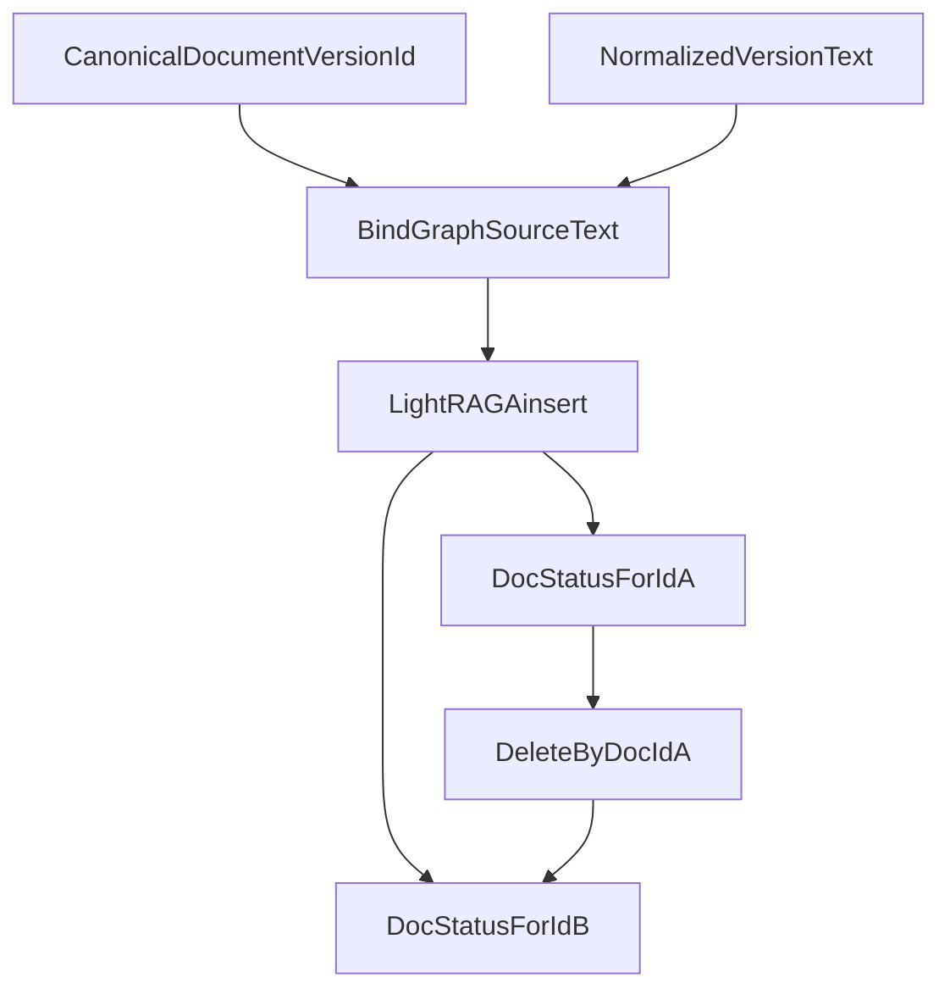

# ADR: Identity-bound LightRAG source envelope

## Status

`accepted` — the project approver directed Phase 5 to continue as an expert
implementation after Packet 1 recorded vendor content-hash collapse. This ADR
supersedes [ADR-lightrag-identical-content-collapse.md](./ADR-lightrag-identical-content-collapse.md)
for production GraphRAG on pin `lightrag-hku==1.5.6`.

## Context

LightRAG 1.5.6 `apipeline_enqueue_documents` deduplicates on **content hash**,
not the caller-supplied document ID. Distinct canonical `document_version_id`
values with identical normalized text therefore collapse: the second ID often
has no `LIGHTRAG_DOC_STATUS` row and cannot be deleted independently.

The plan requires independent attribution/deletion. Random salting was rejected
because it hides the pin. Floating to `main` or switching to AGE is forbidden.

Canonical Hybrid chunks stay unenveloped. Only the LightRAG insert payload is
bound.

## Decision

1. Every application `ainsert` payload is prefixed with a non-secret,
   reversible, versioned header:

   `<<smart-rag-graph-source:graph_source_envelope_v1:{document_version_id}>>`

   followed by a newline and the normalized version text.
2. `document_version_id` remains the vendor `ids` value and the application
   integrity key. The envelope exists only so vendor content hashes cannot
   collapse distinct canonical IDs.
3. Mapping strips the envelope before hash/span/overlap matching to canonical
   chunks (`strip_graph_source_envelope`).
4. Qualification keeps a raw (`bind_identity=false`) negative that documents
   vendor collapse without the envelope.
5. GraphRAG on this pin is **re-enabled** for Packets 2–8.

## Consequences

- Identical company documents remain independently attributable and deletable.
- The first LightRAG chunk of each document contains the envelope; mapping must
  strip it. Middle chunks of identical documents may still share text.
- Shared graph entities after both documents exist are allowed; deletion of one
  ID must not remove the other ID's source support (Packet 7).
- Production envelope tokens are `{version_id}:{chunk_id}` so identical
  canonical passages stay independent. See
  [ADR-canonical-passage-lightrag-sources.md](./ADR-canonical-passage-lightrag-sources.md).

## Links

- [LIGHTRAG_CONTRACT.md](../graph/LIGHTRAG_CONTRACT.md)
- [phase-05-graphrag-evidence.md](../development/phase-05-graphrag-evidence.md)
- [ADR-lightrag-identical-content-collapse.md](./ADR-lightrag-identical-content-collapse.md)
- [ADR-canonical-passage-lightrag-sources.md](./ADR-canonical-passage-lightrag-sources.md)
- [docs index](../README.md)
