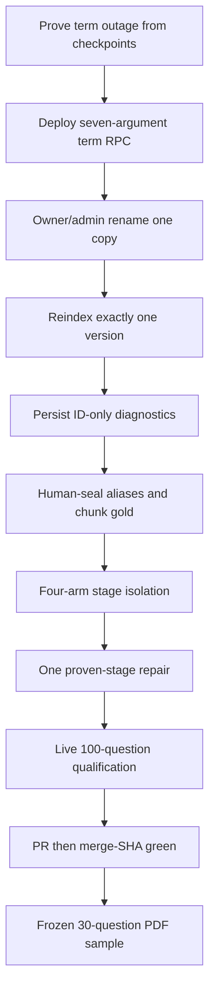

# ADR: Honest RAG accuracy repair

## Status

`accepted` on 2026-09-21. Implementation packets are P06-65 through
P06-72 because P06-58 through P06-64 already authorize general Hybrid
retrieval accuracy. This ADR does not authorize holdout, Phase 6 close,
benchmark-specific production hardcoding, company-to-Web fallback,
raising `MODEL_INPUT_MAX_CHARS`, mutating frozen `hybrid_default_v1`
bytes in place, pinning the failed `hybrid_long_document_v1.json`
digest, automatic document deletion, a sixth sample-PDF upload,
rewriting frozen gold after seeing answers, or `gh pr merge --admin`.

## Context

Merged P06-58 through P06-64 added candidate, ranking, accounting, and
coverage code. Live qualification still reported 35% grounded facts and
four deadline failures. Follow-up inspection on 2026-09-21 showed the
hosted term RPC remained six-argument while application code bound seven
arguments, so the live term channel recorded `term_unavailable` and
masked BM25 degradation. Five current copies of the same bytes share one
non-canonical title, so exact-one source resolution cannot fire. No
document-rename RPC exists. Ask scoring hard-coded favorable promotion
inputs. The 100-question gold has no aliases, so grounded fact equals
strict phrase. Per-channel IDs exist on `HybridRunResult` but are dropped
before checkpoint persistence. `runs.route_family=composite` is the
admission envelope, not the effective retrieve route.

## Decision (accepted)

User named/date approval on 2026-09-21:

1. **Packet numbers.** Overlay packets are P06-65 through P06-72. Do
   not reuse P06-58 through P06-64. Do not uncheck packets 1–64 except
   P06-62/P06-63/P06-64, which stay unchecked until live evidence proves
   their remaining items. Execute after P06-64, then leftover P06-17.
   Do not mark P06-17, P06-18, or Phase 6 complete. Do not open P06-18.
2. **Branch and Git.** Implement on `fix/honest-rag-accuracy` from
   current `main`. One reviewable commit after each packet. Push after
   P06-72 local qualification. Merge with `gh pr merge --merge` only
   after every `PR fast` job is green. After merge, wait until the
   merge SHA `PR fast` and `Main` jobs are green, then delete the
   feature branch. Never `--no-verify`, force-push, or `--admin`.
3. **Document title rename.** Add an additive owner/admin
   `app.update_document_title` RPC and `PATCH /documents/{document_id}`
   modeled on `app.delete_visible_document`. This is a generic product
   capability. Rename exactly one current copy so its title can uniquely
   scope retrieval. Requeue exactly one `hybrid_index` job for that
   version. Do not delete duplicates, reindex every copy, or upload a
   sixth copy.
4. **Measurement first.** Persist optional ID-only
   `HybridBranchDiagnostics` on `BranchResult`. Remove hardcoded
   promotion inputs from the Ask runner. Missing required fields are
   `unknown` and block promotion. Effective route comes from checkpoint
   state, never `runs.route_family`.
5. **Private gold.** Human-approve aliases for the 100-question Ask
   gold. Seal chunk IDs for a 12-question isolation slice through
   hosted `eval_quiz_cases`. Freeze a 30-question post-merge acceptance
   sample under gitignored `.private-eval/`. The coding model may draft
   but cannot approve. Production remains sample-blind.
6. **Stage isolation.** Run Arms A, A-prime, B, and C on the 12-question
   slice. Repair only the first-failing stage that owns a measured
   majority, or the earliest largest count if none does.
7. **Post-merge sample.** After green merge-SHA CI, ask the frozen 30
   questions with known PDF-derived facts. Pass requires at least 29/30
   grounded facts, at least 29/30 blinded semantic support, zero
   deadlines, zero errors, zero ACL leaks, zero Web/general origin,
   zero unknown stage fields, zero `term_unavailable`, no unsupported
   citation, and citation completeness at least 90%. Green CI is not
   accuracy proof.
8. **Cheap-model execution.** One packet per model run after this
   amendment. Exact allowed files, commands, stop routes, and evidence
   templates live in the packet files.

## Bounds

- `MODEL_INPUT_MAX_CHARS` stays 16384.
- Company insufficient evidence never falls back to Web or general
  knowledge.
- Coverage threshold stays 0.65 until a new frozen profile is justified.
- Diagnostics contain UUIDs and bounded numeric/enumerated metadata
  only. No query, title, passage, snippet, answer, or source text.
- Sample 100-question gold, the 12-question slice, and the 30-question
  acceptance file stay private and gitignored.
- Duplicate collapse remains exact content after ACL/current-version
  recheck. Documents are not deleted automatically.

## Security and privacy

- Unauthorized documents never affect ranking or enter results.
- Ambiguous source names stay unscoped; do not leak whether an
  unauthorized title exists.
- Title rename is owner/admin only. Foreign, deleted, and missing
  documents remain indistinguishable not-found.
- Evaluation scripts must not embed credentials. Private labels, gold
  phrases, and unrestricted excerpts stay out of git.
- Evidence docs redact hashes of private gold, passwords, DSNs, and
  unrestricted PDF text.
- ACL, current-version, and deletion rechecks remain mandatory on
  every survivor, including oracle-context evaluation.

## Rejected alternatives

- Embedding this PDF, its prompts, gold phrases, hashes, titles, pages,
  or aliases in production code, prompts, profiles, or tests.
- Creating a sixth upload to fix titles.
- Duplicate-aware resolution by `content_hash` in this overlay; it
  would not uniquely scope questions whose title is absent from every
  copy.
- Broad simultaneous term, dense, rerank, coverage, correction, route,
  and prompt tuning.
- Mutating frozen `hybrid_default_v1` bytes in place.
- Pinning the failed `hybrid_long_document_v1.json` digest.
- Raising `MODEL_INPUT_MAX_CHARS`.
- Company-to-Web or company-to-general fallback.
- Opening P06-18 or weakening citation, faithfulness, ACL, latency, or
  cost gates.
- Merging with failed checks or `gh pr merge --admin`.
- The coding model acting as gold or semantic reviewer.

## Rollback

Disable the new title-rename RPC/route, ID-only diagnostics field,
Ask-runner measurement path, and any later-stage repair in application
code. Restore prior frozen Hybrid pins. Keep populated documents and
rows. Do not down-migrate. Do not delete live documents as a rollback
step.

## Consequences

Packets P06-66 through P06-72 implement this overlay. Leftover P06-17
development/qualification remains after P06-72 without opening
holdout. Phase 6 remains incomplete until the wrapper’s final gate is
proven and accepted. Generalization is claimed only after disjoint
qualification, otherwise marked unverified.
