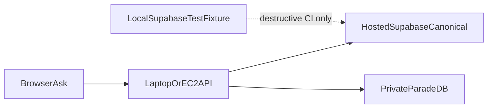

# ADR: Hosted runtime Supabase, local test fixture

## Status

`superseded` — 2026-09-07. Superseded by
[ADR-cloud-only-supabase-no-local-fixture.md](./ADR-cloud-only-supabase-no-local-fixture.md).

## Context

Global contracts and P08-22 still described a local-Supabase daily topology.
Laptop Compose defaults interpolated Docker-host Auth/Postgres loopback
ports. Operator overlays already pointed `.env.compose` at hosted
Auth/Postgres
([ADR-demo-local-ingest-aws-ask.md](./ADR-demo-local-ingest-aws-ask.md),
[ADR-phase10-hosted-supabase-reuse.md](./ADR-phase10-hosted-supabase-reuse.md)),
but a later process-env overlay flipped API/worker back to the local
fixture. Chat rows then landed on the fixture while the operator expected
hosted durability.

Supabase Branching (isolated preview databases) requires Pro. The org
already occupies both Free project slots (`smart-rag` healthy, `Reel`
inactive). Destructive schema-reset and RLS suites cannot share the live
application project.

## Decision (historical)

1. Hosted project `smart-rag` (`qsjivtwtmlmtksufqjik`) is the only runtime
   Auth/Postgres/Storage target for conversations, messages, runs, events,
   citations, budgets, LangGraph checkpoints/store, and LightRAG tables.
2. Local Docker Supabase was a labelled **destructive-test fixture**, not a
   runtime default. `scripts/dev.ps1` must not start or reset it.
3. Private ParadeDB stays a derived BM25 index on laptop/EC2. Never install
   `pg_search` on hosted Postgres.
4. FastAPI short RPC may use the hosted transaction pooler (port 6543).
   Worker, LangGraph checkpoint/store, and LightRAG require session/direct
   (session pooler 5432 or equivalent). Never put checkpoints on 6543.
5. Destructive contract tests refuse `*.supabase.co` / pooler hostnames.
6. P08-22 live proof is hosted Auth/Postgres plus laptop Compose sidecars
   (ParadeDB, Valkey, crawl-proxy, API, worker, frontend).

That fixture was later removed. See the superseding ADR.

## Alternatives rejected (historical)

| Alternative | Why rejected |
| --- | --- |
| Keep local Supabase as the daily runtime | User required hosted chat persistence |
| Remove local Supabase entirely | Then: destructive reset/RLS cannot share the live project; branching needs Pro. Now superseded: opt-in non-hosted DSN instead |
| Upgrade to Pro and use ephemeral branches | User chose to keep local tests after the Free-plan limit |
| Use the same hosted project for destructive suites | Data-loss and test-collision risk |

## Consequences (historical)

- Compose interpolation fails closed without explicit hosted env names.
- Historical P08-22 “local topology” evidence is a test-fixture record, not
  the current operator path.
- Phase 9 local-release scripts that started the CLI fixture are retired.

## Related

- [ADR-cloud-only-supabase-no-local-fixture.md](./ADR-cloud-only-supabase-no-local-fixture.md)
- [ADR-phase10-hosted-supabase-reuse.md](./ADR-phase10-hosted-supabase-reuse.md)
- [ADR-demo-local-ingest-aws-ask.md](./ADR-demo-local-ingest-aws-ask.md)
- [demo-local-ingest-aws-ask.md](../runbooks/demo-local-ingest-aws-ask.md)
- [CONFIGURATION.md](../development/CONFIGURATION.md)
