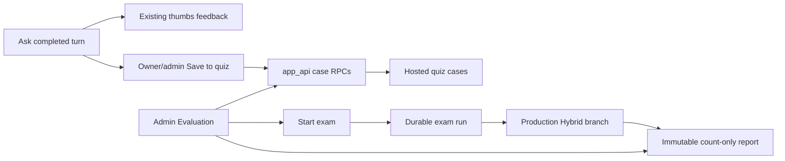

# ADR: Hosted webapp evaluation workspace

## Status

`accepted` on 2026-09-10. This amendment supersedes the local-file-only
custody decision in
[ADR-local-pdf-evaluation-workspace.md](./ADR-local-pdf-evaluation-workspace.md).
It does not authorize staging or production evaluation UI, holdout opening,
or frozen Hybrid retune.

## Context

Packets P06-19 through P06-26 shipped a local owner/admin review page whose
labels lived under gitignored `.private-eval/` and whose official Recall@10
stayed on the CLI. The user then asked for day-to-day evaluation and quiz
work in the running webapp, including gold mapping, exam, and Recall@10,
except holdout.

The application is a single-workspace/single-company product. Do not invent
multi-tenancy or client-supplied company identifiers.

## Decision (accepted)

User named/date approvals on 2026-09-10:

1. **Hosted labels.** Evaluation questions, expected answers, atomic facts,
   and gold metadata may be stored in the existing hosted Supabase project
   behind RLS and `app_api` RPCs. Immediate manual delete and automatic
   365-day retention apply. Mutation audit events are content-free.
2. **Production-corpus Hybrid Recall@10.** The web exam uses current
   production preparation plus the production Hybrid branch over every
   current document readable by the signed-in examiner. It is not the
   CLI's version-restricted PDF metric. A case is a hit only when **every**
   required gold chunk appears in `HybridRunResult.ranked_ids[:10]`.
   User-facing copy is **“All required gold chunks in the production Hybrid
   top 10.”**
3. **Holdout and freeze stay out.** No holdout table, split, endpoint, button,
   loader, path, or report. No freeze, profile allow-list mutation, or
   threshold/RRF/prompt pin rewrite from this UI.
4. **Feedback coexistence.** Ordinary thumbs/tag/comment feedback remains a
   supported product workflow. Quiz capture is a separate owner/admin
   control. Saving a draft never self-approves and never sends expected-answer
   text to a model.

Additional accepted constraints:

- HTTP remains local/test only. Keep `PDF_EVAL_WORKSPACE_ENABLED` as the
  emergency kill switch. Staging and production reject `true`. Packet 29
  may change the local Compose default to `true`; this packet does not.
- FastAPI uses `app_api` and server-derived owner/admin identity. Operator
  and service-role DSNs are forbidden.
- Qualification is one-shot for `(dataset_hash, candidate_fingerprint)`.
  Development may repeat. A case split is immutable after creation.
- Ask-created cases are always `development`. Zero-gold drafts are allowed;
  approval requires one to three current gold chunks on one document version.
- Existing CLI modules remain optional diagnostics and holdout tooling.
  `.private-eval/` is not auto-imported.
- After this markdown packet, existing [P06-10](../../.cursor/plans/hybrid-graph-rag/06-phase-agent-intelligence/packets/10-knowledge-scope-routing.md)
  must be accepted before exam-runner packets. Packets P06-28 through
  P06-36 then execute before P06-11.

## Residual-risk exception (hosted matrix)

[SUBPROCESSOR_GOVERNANCE.md](../security/SUBPROCESSOR_GOVERNANCE.md) still
records managed Supabase region, backup, subprocessors, and DPA rows as
**unverified**. This packet does **not** mark that matrix verified.

The user accepted a **named residual-risk exception** on 2026-09-10: quiz
labels and exam state may live in the same hosted project that already stores
the canonical corpus for laptop runtime. Staging and production evaluation
UI remain forbidden. A later console/DPA/region review may close the
unverified rows without reopening this product decision.

## Alternatives rejected

| Alternative | Why rejected |
| --- | --- |
| Keep CLI as the official Recall@10 path | User required the exam number in the webapp |
| Replace thumbs with quiz fields | Ordinary feedback remains a product workflow |
| Version-restricted PDF metric in the web exam | User required production-corpus measurement |
| Hosted labels without retention/audit/RPC gates | Expands hosted retention without governance |
| Staging/production eval UI | Fail-closed environment gate stays |
| Opening holdout from Admin | Custody stays outside the workspace |
| Implementing P06-28 in the same run as this ADR | Packet protocol: markdown authorization first |

## Consequences

- Canonical store for day-to-day quiz cases is hosted Postgres, not the
  local file workspace.
- The web exam must reuse query admission, production preparation, and
  Hybrid retrieval. It must not clone ranking or bypass durable budgets.
- Hidden evaluation conversations exist only for admission; browser
  conversation APIs never list them.
- Rollback: set `PDF_EVAL_WORKSPACE_ENABLED=false`. Do not down-migrate
  populated hosted tables. Ordinary Ask and feedback continue.
- Packets P06-28 through P06-36 implemented the hosted quiz RPCs, exam
  runner, HTTP, Ask Save to quiz, Admin curation, and the official Recall@10
  scoreboard. Live exam scoring against production Hybrid remains a named
  blocker until a provisioned live run is recorded. The managed
  region/DPA/backup matrix stays unverified.

Related: [ADR-local-pdf-evaluation-workspace.md](./ADR-local-pdf-evaluation-workspace.md) ·
[PDF_EVAL_WORKSPACE.md](../evaluation/PDF_EVAL_WORKSPACE.md) ·
[PDF_HYBRID_EVALUATION.md](../evaluation/PDF_HYBRID_EVALUATION.md) ·
[SUBPROCESSOR_GOVERNANCE.md](../security/SUBPROCESSOR_GOVERNANCE.md) ·
[AUTHORIZATION_MODEL.md](../security/AUTHORIZATION_MODEL.md) ·
[docs index](../README.md)
