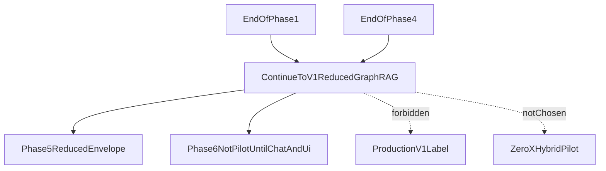

# ADR: Hybrid Pilot release cut

## Status

`accepted` — framework, checkpoint dates, objective criteria, and
production-label prohibition approved on 2026-08-12 via user message
`approved`. Continue-versus-pilot checkpoint votes recorded 2026-08-16
(review close-out). Not a production authorization. Not a `0.x Hybrid Pilot`
cut.

## Context

The production v1 release requires Hybrid plus LightRAG and all v1
acceptance gates. Schedule or budget pressure may force an optional
prerelease labeled `0.x Hybrid Pilot` after Phases 1–4 plus the Phase-6
thin chat/streaming/budget path and a minimal Phase-8 UI.

Global contracts require a dated Hybrid Pilot decision record during Phase 1
sign-off, with checkpoints at end of Phase 1 and end of Phase 4, and
objective continue-versus-pilot criteria. Silence is not approval to relabel
a pilot as production.

## Decision (accepted)

1. Keep **production v1** defined as Hybrid + LightRAG + all v1 acceptance
   gates.
2. Treat **Hybrid Pilot** as an optional non-production cut only if
   objective criteria below are met and the named approver explicitly
   chooses it.
3. Hold two dated decision checkpoints. Calendar dates **2026-08-22** (end
   of Phase 1) and **2026-11-07** (end of Phase 4) were **planning anchors**
   derived from plan effort ranges, not SLAs. Actual engineering dates:
   Phase 4 engineering-close **2026-08-15**; Phase 5 reduced close
   **2026-08-16** (`okay push`).

| Checkpoint | Planned date (anchor) | Actual engineering date | Scope | Approver field | Decision recorded |
| --- | --- | --- | --- | --- | --- |
| End of Phase 1 | 2026-08-22 | 2026-08-12 (Phase 1 accepted) | Confirm targets/sign-off and whether the full Hybrid+Graph path remains funded | user (Cursor chat) | **continue toward production v1 with reduced GraphRAG**. Recorded 2026-08-16 (vote was overdue relative to the 2026-08-22 anchor). Framework accepted 2026-08-12. |
| End of Phase 4 | 2026-11-07 | 2026-08-15 (Phase 4 engineering-close); 2026-08-16 (Phase 5 reduced close) | Re-estimate delivery; choose continue-to-GraphRAG vs Hybrid Pilot cut | user (Cursor chat) | **continue toward production v1 with reduced GraphRAG** (15 labeled `graph_mapping` documents, bulk onboarding blocked). This is **not** a 0.x Hybrid Pilot (pilot still needs Phase 6 thin chat + Phase 8 UI). Packet 8 no-go 2026-08-14; engineering-close ADR 2026-08-15; Phase 5 accepted `okay push` 2026-08-16. SME holdout remains a launch blocker. |

Effort basis (one experienced FTE, excluding client wait): Phase 1 ≈1–1.5
weeks; Phases 2–4 ≈1.5–2.5 + 3–4 + 3.5–5 weeks. Dates assumed work start
2026-08-12 and mid-to-upper planning ranges; they were planning anchors, not
SLAs. Calendar delivery of Phases 1–5 was 2026-08-12 through 2026-08-16.

## Recorded continue-versus-pilot vote (2026-08-16)

Approver: user (Cursor chat). Review close-out requested 2026-08-16.

**Vote (exact text):** continue toward production v1 with reduced GraphRAG
(15 labeled graph_mapping documents, bulk onboarding blocked).

This is **not** a 0.x Hybrid Pilot. A Hybrid Pilot still needs Phase 6 thin
chat plus Phase 8 minimal UI. The production-label prohibition below
remains in force: this vote does **not** authorize calling the repository
production v1, a Hybrid Pilot, or a 2,000-document GraphRAG launch.

## Objective continue-versus-pilot criteria

At each checkpoint the approver must record a binary choice using these
criteria:

| Criterion | Continue toward production v1 (Hybrid + Graph) | Choose Hybrid Pilot cut |
| --- | --- | --- |
| Phase 1 gate status | Packet 1–6 exit evidence accepted; quality/cost/capacity signed | Phase 1 incomplete or unsigned → do not start Phase 2; pilot not available as escape hatch |
| Phase 4 Hybrid gates | Hybrid latency, Recall@, citation, BM25 qualification, and cost ceilings met or formally waived via ADR | Hybrid gates fail and cannot be remediated within remaining budget/schedule |
| Revised Phase 5 estimate | Updated GraphRAG estimate still fits remaining approved calendar and budget | Phase 5 estimate exceeds remaining approved calendar or budget |
| SME availability | SME/glossary/eval labeling available for graph and Combined gates | SME unavailable for graph evaluation window |
| Approved remaining budget | Normal ceilings plus graph maintenance reserve still funded | Reserve or delivery budget insufficient for GraphRAG |
| Label honesty | Continue path remains labeled toward production v1 | Pilot must be labeled **non-production / 0.x Hybrid Pilot**; it does **not** satisfy plan v1 completion criteria |

Phase 5 delivered GraphRAG infrastructure under a **reduced** envelope (15
labeled `graph_mapping` documents; source-chunk capacity unverified; bulk
onboarding blocked). That reduced envelope is the continue-path product
capacity until a measured rebuild and a later signed raise. It does not
satisfy the signed Phase 1 2,000-document / 200,000-chunk aspiration.

## Explicit production-label prohibition

A Hybrid Pilot **must not** be marketed, contracted, or operated as
“production v1.” Relabeling requires a new signed scope that redefines
acceptance gates; it is outside this ADR.

The 2026-08-16 continue-to-v1 vote does **not** lift this prohibition.
Reduced GraphRAG and a recorded continue path are still not production v1.

## Phase 4 Packet 8 checkpoint record (2026-08-14)

Packet 8 published freeze hashes and the ablation catalog, then recorded
**no-go**: holdout was not independently SME-sealed and was not opened;
live Hybrid Recall@10, citation correctness/completeness, and envelope p95
remain unverified at that freeze. Query-profile open-split gates passed on
the mock extract. Winning profile stays `hybrid_default_v1`.

Packet 9 later measured Phase-4-owned open-split Recall@K with **identity
rerank** (`rerank_call_count=0`); holdout stayed sealed. See
[PHASE4_RANKED_IDS.md](../evaluation/PHASE4_RANKED_IDS.md). Those numbers
do not reopen Packet 8 holdout no-go.

The 2026-08-15 engineering-close ADR waived only the SME holdout for Phase 4
**engineering** acceptance and continued toward GraphRAG. Phase 5 reduced
close followed on 2026-08-16 (`okay push`). Evidence:
[PHASE4_HOLDOUT.md](../evaluation/PHASE4_HOLDOUT.md),
[PHASE4_FREEZE.md](../evaluation/PHASE4_FREEZE.md),
[phase-04-hybrid-rag-evidence.md](../development/phase-04-hybrid-rag-evidence.md),
[ADR-phase4-engineering-close.md](./ADR-phase4-engineering-close.md),
[phase-05-graphrag-evidence.md](../development/phase-05-graphrag-evidence.md).

## Consequences

- End of Phase 1 and end of Phase 4 continue-versus-pilot votes are
  recorded as **continue toward production v1 with reduced GraphRAG**.
- Choosing continue commits to Phase 6+ under the signed envelopes in
  [QUALITY_TARGETS.md](../QUALITY_TARGETS.md), except advertised GraphRAG
  capacity is the reduced 15-document envelope until a measured rebuild
  and a later signed raise. See
  [SCALING_OPTIONS.md](../graph/SCALING_OPTIONS.md).
- A `0.x Hybrid Pilot` was **not** chosen. That cut would still require
  Phase 6 thin chat and Phase 8 minimal UI before the pilot label is
  honest.
- Relabeling this path as production v1 remains forbidden.
- Real company content stays prohibited until provider matrix rows are
  `verified`.

## Approver sign-off

| Field | Value |
| --- | --- |
| Approver name | user (Cursor chat; no legal name provided) |
| Role | client / project approver (session) |
| Decision on this ADR | accept defaults (2026-08-12); record overdue checkpoint votes (2026-08-16) |
| Approval date | 2026-08-12 (framework); 2026-08-16 (continue-versus-pilot vote) |
| Notes | Framework message: `approved`. Phase 5 accepted `okay push` 2026-08-16. Review close-out requested 2026-08-16. Vote: continue toward production v1 with reduced GraphRAG (15 labeled graph_mapping documents, bulk onboarding blocked). Calendar dates 2026-08-22 / 2026-11-07 were planning anchors only. |

## Links

- [QUALITY_TARGETS.md](../QUALITY_TARGETS.md)
- [Global contracts](../../.cursor/plans/hybrid-graph-rag/00-global-contracts.md)
- [Phase 1 foundation evidence](../development/phase-01-foundation-evidence.md)
- [Phase 4 Hybrid evidence](../development/phase-04-hybrid-rag-evidence.md)
- [Phase 5 GraphRAG evidence](../development/phase-05-graphrag-evidence.md)
- [PHASE4_HOLDOUT.md](../evaluation/PHASE4_HOLDOUT.md)
- [PHASE4_RANKED_IDS.md](../evaluation/PHASE4_RANKED_IDS.md)
- [PHASE5_GRAPH_EVAL.md](../evaluation/PHASE5_GRAPH_EVAL.md)
- [PHASE6_HANDOFF.md](../graph/PHASE6_HANDOFF.md)
- [RISK_REGISTER.md](../development/RISK_REGISTER.md)
- [Phases 1–5 implementation review](../reviews/2026-08-16-phases-01-05-implementation-review.md)
- [ADR index](./README.md)
