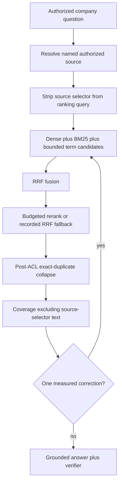

# ADR: General Hybrid retrieval accuracy

## Status

`accepted` on 2026-09-17. Implementation packets are P06-58 through
P06-64 because P06-49 through P06-57 already authorize live RAG failure
remediation. This ADR does not authorize holdout, Phase 6 close,
benchmark-specific production hardcoding, company-to-Web fallback,
raising `MODEL_INPUT_MAX_CHARS`, mutating frozen `hybrid_default_v1`
bytes in place, pinning the unmeasured `hybrid_long_document_v1.json`
digest, automatic document deletion, or `gh pr merge --admin`.

## Context

A 100-question company-document Ask regression scored 37% on a strict
substring metric. Live traces showed fused evidence and a correction on
every run. The 33 “no evidence” outcomes were verifier-stage refusals,
not proven empty retrieval. Current corpus state includes multiple
authorized copies of the same bytes, non-canonical upload titles, and
an unscoped retrieve that keeps the unfrozen long-document profile
disabled. Term retrieval often searched the whole sentence rather than
bounded codes, acronyms, entities, and approved aliases. Retrieve-time
embedding and rerank calls were frequently uncounted because the run
database connection was omitted from the retrieve budget. Correction
often retried an identical cached query. Coverage could treat
source-selector title text as required answer evidence.

The sample remains one development regression. Promotion requires
disjoint query and document qualification, stage-level evidence, and
the existing security, grounding, deadline, and cost gates.

## Decision (accepted)

User named/date approval on 2026-09-17:

1. **Packet numbers.** Overlay packets are P06-58 through P06-64.
   Do not reuse P06-49 through P06-57. Do not uncheck packets 1–57.
   Execute after P06-57, then leftover P06-17. Do not mark P06-17,
   P06-18, or Phase 6 complete. Do not open P06-18.
2. **Generalization.** Production code, prompts, profiles, migrations,
   and tests must contain no sample-PDF hash, book title, question ID,
   gold phrase, expected answer, page number, or benchmark-specific
   alias from the 100-question set. Tune only generic retrieval
   behaviors.
3. **Dual metrics.** Report strict phrase match separately from
   approved-alias/semantic required-fact coverage. Target at least 95%
   grounded required-fact correctness with zero product-deadline
   failures on the development sample, while retaining signed Hybrid
   Recall@10, citation, ACL, latency, and cost gates. Strict score is
   not semantic ground truth.
4. **Authorized source resolution.** Preserve meaningful upload titles.
   Deterministically resolve an explicitly named authorized document.
   Use the title only as a scope selector and remove it from the
   ranking query. Ambiguous or unauthorized matches stay unscoped and
   indistinguishable.
5. **Duplicate collapse.** Collapse exact duplicate content only after
   ACL and current-version recheck. Do not delete documents
   automatically.
6. **Candidate generation.** Feed bounded extracted codes, acronyms,
   entities, and approved aliases—not only the whole sentence—to the
   term channel through an additive, ACL-safe RPC. Balance BM25
   variants and fields so one variant cannot consume the candidate cap.
   Enrich indexed search terms only where a needle-in-index audit
   proves parse or index gaps, then reindex a single canonical test
   version.
7. **Rerank and budgets.** Pass the run database connection into
   retrieve-time accounting. Durably record embedding, rerank, and
   verifier calls. Reserve time for reranking inside the existing
   retrieval and deadline envelope. Qualify a new immutable
   long-document profile from measured development ablations rather
   than pinning the failed `hybrid_long_document_v1.json` digest.
8. **Coverage and correction.** Exclude source-selector text from
   answer-evidence requirements. Use retrieval normalization for term
   matching. Forbid an identical cached retry. Any retry must use a
   measured alternate query or profile, then recompute coverage before
   answer generation. Keep the 0.65 coverage threshold until labeled
   development evidence justifies a new frozen profile.
9. **Qualification.** Run synthetic, unit, contract, and metamorphic
   suites; a live retrieval-only development evaluation; one disjoint
   qualification run when documents exist; then the 100-question Ask
   regression with a fresh conversation per question. If sufficient
   disjoint real documents are unavailable, report generalization as
   unverified rather than claiming it.
10. **Git.** Implement on `fix/general-rag-retrieval-accuracy` from
    current `main`. One reviewable commit after each packet. Merge with
    `gh pr merge --merge` only after every PR check is green. Never
    `--no-verify`, force-push, or `--admin`. After merge, verify `main`
    Actions, then delete the merged remote and local branch.

## Bounds

- `MODEL_INPUT_MAX_CHARS` stays 16384.
- Company insufficient evidence never falls back to Web or general
  knowledge.
- Coverage threshold stays 0.65 until a new frozen profile is
  justified.
- Duplicate collapse is exact content after ACL/current-version
  recheck, not fuzzy dropping and not automatic deletion.
- Long-document runtime remains denied until a measured immutable
  digest is qualified.
- Sample 100-question gold stays private and gitignored.

## Security and privacy

- Unauthorized documents never affect ranking or enter results.
- Ambiguous source names stay unscoped; do not leak whether an
  unauthorized title exists.
- Evaluation scripts must not embed credentials. Private labels, gold
  phrases, and unrestricted excerpts stay out of git.
- Evidence docs redact hashes of private gold, passwords, DSNs, and
  unrestricted PDF text.
- ACL, current-version, and deletion rechecks remain mandatory on
  every survivor.

## Rejected alternatives

- Embedding this PDF, its 100 prompts, gold phrases, hashes, titles,
  pages, or aliases in production code, prompts, profiles, or tests.
- Mutating frozen `hybrid_default_v1` bytes in place.
- Pinning the failed `hybrid_long_document_v1.json` digest without a
  measured qualification.
- Raising `MODEL_INPUT_MAX_CHARS`.
- Company-to-Web or company-to-general fallback.
- Automatic document deletion for duplicates.
- Local rerankers or figure-only vision without a separate ADR.
- Opening P06-18 or weakening citation, faithfulness, ACL, latency, or
  cost gates.
- Merging with failed checks or `gh pr merge --admin`.

## Rollback

Disable the new source-resolution, ranking-query cleanup, additive
term RPC, duplicate collapse, retrieve-budget connection, new
long-document profile pin, coverage source-selector exclusion, and
non-identical correction path in application code. Restore prior
frozen Hybrid pins. Keep populated documents and rows. Do not
down-migrate. Do not delete live documents as a rollback step.

## Consequences

Packets P06-59 through P06-64 implement this overlay. Leftover P06-17
development/qualification remains after P06-64 without opening
holdout. Phase 6 remains incomplete until the wrapper’s final gate is
proven and accepted. Generalization is claimed only after disjoint
qualification, otherwise marked unverified.
