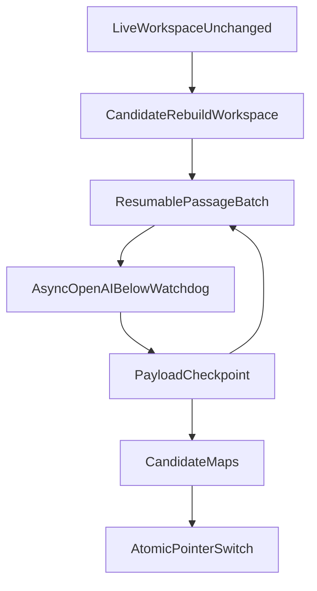

# ADR: Async LightRAG embeddings and batched isolated sources

## Status

`accepted` — the operator rejected a larger LightRAG embedding watchdog as the
fix. Canonical-passage sources and the 90% / 0.80 Graph Ready gates stay.

## Context

The 2026-08-20 Graph-200 rebuild kept one source per canonical passage
(`{version_id}:{chunk_id}`) and solved the original 85.46% mapping mismatch.
It then failed at extract 37/164: LightRAG 1.5.6 force-killed an embedding
flush (`>75s` health-check, `131.3s` actual) because the OpenAI callback ran
**synchronous** `embeddings.create` on the vendor event loop. The Python SDK
defaults to **600 seconds** when `timeout` is omitted. LightRAG's watchdog
stayed at the vendor default (`func=30s`, worker `60s`, health `75s`).

Raising `default_embedding_timeout` would hide a blocked event loop and still
leave one 164-source `ainsert` as a single abort domain. Lowering the 90%
coverage gate or the 0.80 support floor is forbidden.

## Decision

1. Keep per-passage LightRAG sources and the identity envelope from
   [ADR-canonical-passage-lightrag-sources.md](./ADR-canonical-passage-lightrag-sources.md).
2. LightRAG and Hybrid embedding callbacks use `AsyncOpenAI` through
   `traced_async_openai_client` / `traced_embeddings_create_async`. SDK
   `max_retries` stays `0`.
3. LightRAG embedding HTTP timeout is
   `LIGHTRAG_EMBEDDING_PROVIDER_TIMEOUT_SECONDS` (**20s**). It must stay
   **below** `LIGHTRAG_EMBEDDING_VENDOR_TIMEOUT_SECONDS` (**30s**). Do not
   raise the vendor watchdog to paper over provider latency.
4. Insert remaining passages in resumable batches of
   `GRAPH_SOURCE_INSERT_BATCH_SIZE` (**8**), not one 164-source `ainsert`.
5. Checkpoint processed source IDs on the job payload after each successful
   batch. Retry a batch only for timeout / HTTP 429 / vendor `failed`, and
   only after `adelete_by_doc_id` plus a verified empty vendor status.
   Lease loss and worker crash are not retried as timeouts.
6. Jobs with `isolate_candidate=true` write `{live}__rebuild` and leave the
   live workspace/pointer unchanged until sources and maps pass. Then switch
   the singleton pointer atomically. Isolate timeout / 429 / vendor failure /
   lease loss / missing candidate `pipeline_status` fail the job without
   quarantining live. Binding the rebuild workspace must call LightRAG
   `initialize_pipeline_status` (in-memory, no DDL) before `ainsert`.
7. Operator alerts: `graph_embedding_latency` at 15s wall time and
   `graph_source_batch_size` when an insert batch exceeds the signed cap.
8. Load-test the batched async path before raising graph capacity. The
   advisory-lock single writer remains a throughput bottleneck; sharding is
   a later ADR, not an implicit next step.

## Consequences

- Graph-200 extract cost still scales with 164 passage sources. Each
  `ainsert` is at most eight sources, so one embedding kill no longer
  cancels the remaining 127.
- Hybrid ingest keeps a 120s embedding HTTP timeout. Only LightRAG
  callbacks use 20s.
- Isolated rebuilds can leave `{live}__rebuild` in `building` after a
  transient fail. Live Combined/inspection keep using the pointer workspace.
- Documents/hour through Graph Ready stay unverified until a signed
  load-test. Do not raise `MAX_GRAPH_PASSAGE_SOURCES` or the advertised
  15-document envelope from this ADR.

## Links

- [ADR-canonical-passage-lightrag-sources.md](./ADR-canonical-passage-lightrag-sources.md)
- [INGESTION_LIMITS.md](../ingestion/INGESTION_LIMITS.md)
- [LIGHTRAG_CONTRACT.md](../graph/LIGHTRAG_CONTRACT.md)
- [WORKSPACE_LIFECYCLE.md](../graph/WORKSPACE_LIFECYCLE.md)
- [SCALING_OPTIONS.md](../graph/SCALING_OPTIONS.md)
- [demo-local-ingest-aws-ask.md](../runbooks/demo-local-ingest-aws-ask.md)
- [phase-05-graphrag-evidence.md](../development/phase-05-graphrag-evidence.md)
- [docs index](../README.md)
