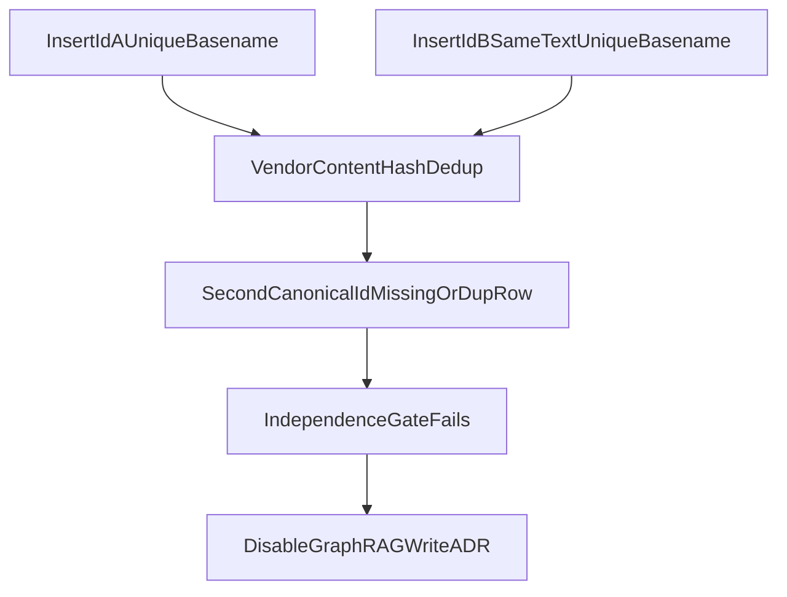

# ADR: Disable GraphRAG — identical-content sources are not independent

## Status

`accepted` for Phase 5 Packet 1. GraphRAG production indexing, mapping, and
Combined routing stay **disabled** on pin `lightrag-hku==1.5.6` until an
approved design restores independent attribution. This is not a license to
weaken the independence gate or to start Packet 2.

## Context

Phase 5 Packet 1 requires that identical-content sources with distinct
canonical document IDs and unique opaque basenames remain independently
attributable and deletable. The live qualification harness
(`tests/contract/test_lightrag_contract.py`, 2026-08-15, local Supabase
PostgreSQL) inserted synthetic text only (`Alpha Probe` / `Beta Probe`).

Observed vendor behavior in `apipeline_enqueue_documents`:

- Duplicate detection keys on **content hash**, not on the caller-supplied ID.
- A second insert with the same text is logged
  `Duplicate document detected (content_hash)` even when IDs and basenames
  differ.
- The second canonical ID often has **no** `LIGHTRAG_DOC_STATUS` row.
  `aget_docs_by_ids` omits it (`identical_content_status_missing`).
- Duplicate bookkeeping, when present, uses a separate `dup-` prefixed FAILED
  row. That token is not the application document ID and is not a citation.

The independence evaluator therefore cannot delete or attribute the second
source as its own document. Pretending independence would falsify Graph Ready
mappings and deletion cleanup.

## Decision

1. **Disable GraphRAG** on this pin. Do not bootstrap production LightRAG
   schemas, do not enqueue production graph jobs, and do not start Phase 5
   Packet 2.
2. **Keep the independence contract.** Do not treat content hashes, `dup-`
   IDs, track IDs, or basenames as application identity.
3. **Keep the pin recorded.** `lightrag-hku==1.5.6` APIs, PGTable (no AGE),
   keyword-bypass query, and disposable-schema bootstrap remain documented in
   [LIGHTRAG_CONTRACT.md](../graph/LIGHTRAG_CONTRACT.md) for a future redesign.
4. Hybrid RAG stays available. Holdout stays sealed.

## Alternatives considered

| Option | Why rejected |
| --- | --- |
| Weaken the gate / accept content-hash collapse | Violates Packet 1 stop route |
| Switch to `PGGraphStorage` / Apache AGE | Forbidden engine |
| Float to LightRAG `main` / a newer release | Requires a new immutable pin and full re-qualification |
| Salt vendor text so hashes differ | Hides the pin behavior; would not be production-safe |

## Consequences

- Packet 1 is an honest reject of production GraphRAG on 1.5.6, not an
  approval of Packet 2.
- A later pin or approved adapter that proves independent identical-content
  deletion may supersede this ADR.
- Hybrid retrieval, ingestion, and Phase 4 engineering-close are unchanged.

## Links

- [LIGHTRAG_CONTRACT.md](../graph/LIGHTRAG_CONTRACT.md)
- [phase-05-graphrag-evidence.md](../development/phase-05-graphrag-evidence.md)
- [ADR index](./README.md)
- [docs index](../README.md)
