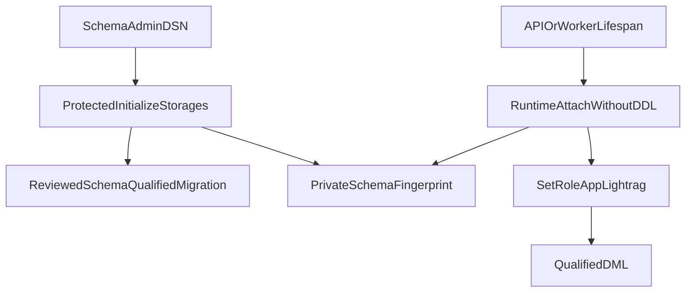

# ADR: LightRAG runtime attach without DDL

## Status

`accepted` — the project approver authorized Packet 2 expert-continue on
2026-08-16. Runtime containers must not hold CREATE/ALTER. Schema-admin
``initialize_storages`` stays on a protected ops path.

## Context

Pinned `lightrag-hku==1.5.6` `PGTableGraphStorage.initialize` always
`execute(_DDL)` (CREATE TABLE). `PGVectorStorage.initialize` calls
`setup_table`. KV and doc-status tables are created in
`PostgreSQLDB.initdb()` / `check_tables`. `CREATE TABLE IF NOT EXISTS` still
requires CREATE on the schema, so role `app_lightrag` (NOLOGIN, USAGE only)
cannot call vendor `initialize_storages()`.

Phase 2 already isolated schema `lightrag` with a capture-status row and
revoked browser access. Default privileges did not grant future vendor tables
to `app_lightrag`. Connection budget: FastAPI LightRAG session cap 4, worker
cap 4, role `app_lightrag`, worst-case sum 30 < 42.

AGE / `PGGraphStorage` remain forbidden. Graph Ready, mapping jobs, and
production `ainsert` are later packets.

## Decision

Use strategy `runtime_attach_without_ddl`:

1. Protected bootstrap loads `LIGHTRAG_SCHEMA_ADMIN_DSN` from
   `LightRagSchemaAdminSettings` only (not Shared/Backend/Worker/Agent). It
   runs `initialize_storages()`, captures warnings and the private-schema
   fingerprint, then `finalize_storages()`. Fatal warnings or postcondition
   failures are not treated as success.
2. Captured vendor DDL is converted into reviewed schema-qualified migrations
   under `supabase/migrations/` from the installed pin `_DDL` / `TABLES` /
   `setup_table` plus a live capture. Search path during vendor init is
   `lightrag,extensions,public`.
3. Runtime factory constructs `LightRAG`, obtains `ClientManager.get_client`,
   attaches existing storages, **skips** DDL / initdb CREATE / `setup_table` /
   `execute(_DDL)`, verifies the reviewed fingerprint, then is usable for DML.
4. Runtime DSN `LIGHTRAG_DB_URL` lives on BackendSettings and WorkerSettings
   only. Unset means the adapter stays unconfigured (honest). API/worker
   lifespan never calls bootstrap initialize.
5. `app_lightrag` is NOLOGIN. The runtime LOGIN user (local postgres analog to
   the checkpointer) opens the pool, then each pooled connection
   `SET ROLE app_lightrag` on init and again after vendor `RESET ALL`. Startup
   GUC `session_authorization` is not used because `RESET ALL` would drop it.
6. Process-wide first vector model/dimension is `text-embedding-3-large` at
   1024. Incompatible workspace/model instances run in isolated processes.
   `POSTGRES_WORKSPACE` is never set; constructor workspace only.
7. Vendor classes stay in `lightrag_adapter.py` and `lightrag_bootstrap.py`.
   The ops CLI calls core and does not import `lightrag`.

## Consequences

- Runtime containers never need CREATE/ALTER on schema `lightrag`.
- Repeat bootstrap is idempotent (`CREATE IF NOT EXISTS`) and must keep the
  reviewed fingerprint.
- Successful initialize is insufficient when warnings or postconditions show
  incomplete migration.
- Application-owned workspace/pointer/lease rows are schema-only in Packet 2.
  They are not Graph Ready and do not authorize citations.
- Pool cap stays 4 per API or worker process. `POSTGRES_CONNECTION_RETRIES=0`.
  Passwords are never logged.

## Links

- [ADAPTER_LIFECYCLE.md](../graph/ADAPTER_LIFECYCLE.md)
- [lightrag-schema-bootstrap.md](../runbooks/lightrag-schema-bootstrap.md)
- [LIGHTRAG_CONTRACT.md](../graph/LIGHTRAG_CONTRACT.md)
- [phase-05-graphrag-evidence.md](../development/phase-05-graphrag-evidence.md)
- [CONFIGURATION.md](../development/CONFIGURATION.md)
- [05-database-connections.md](../architecture/05-database-connections.md)
- [docs index](../README.md)
- [ADR index](./README.md)
