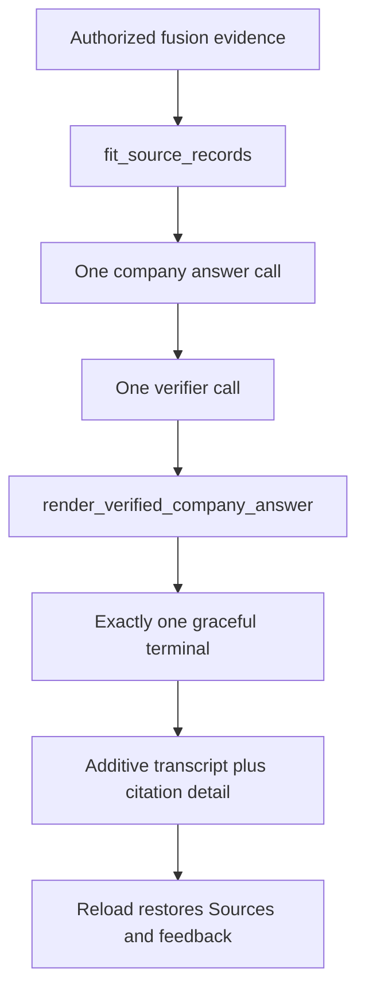

# ADR: Live RAG failure remediation

## Status

`accepted` on 2026-09-16. Implementation packets are P06-49 through
P06-57 because P06-44 through P06-48 already authorize PDF paragraph
citations. This ADR does not authorize holdout, Phase 6 close, a raw
Docker socket, in-process parsing, company-to-Web fallback, SSE source
text, or `gh pr merge --admin`.

## Context

Live company RAG failed in two proven ways. Q15 overflowed
`MODEL_INPUT_MAX_CHARS=16384` with 18,683 raw citation characters, then
mapped a typed size error to `gateway_failed` and SSE `empty_answer`.
Q3 released “Method Call Protocol” as verified even though surviving
atomic links never supported that expansion. Reload dropped per-turn
citations because the public transcript omitted run metadata the UI
needed. Idle Postgres sockets looked open until the next write. The
distroless Compose worker cannot run the parser sandbox, and a shared
Exa `httpx.AsyncClient` closed on the wrong loop.

P06-44 through P06-48 already occupy PDF citation contracts, including
`answer_v2.md` and `app.list_conversation_messages_v2` (`run_id` only).
Integrity requires contiguous packet numbers, so this overlay starts at
P06-49.

## Decision (accepted)

User named/date approval on 2026-09-16:

1. **Packet numbers.** Overlay packets are P06-49 through P06-57. Do
   not reuse P06-44 through P06-48. Do not uncheck packets 1–48. Do not
   mark P06-17, P06-18, or Phase 6 complete. Execute after P06-48, then
   leftover P06-17. Do not open P06-18.
2. **Exact duplicate suppression only.** Drop later passages whose
   normalized citation text matches an already retained higher-ranked
   passage. Do not fuzzy-drop distinct evidence. Do not delete
   duplicate documents.
3. **Whole-block fitting.** Fit `user_query + delimited source records`
   under the existing `model_input_max_chars`. Never truncate a
   passage, split a table row, or fill the budget with a lower-ranked
   fragment. Expected overflow is `answer_context_trimmed`. Defensive
   overflow after fitting is `input_bound_exceeded`, never
   `gateway_failed`.
4. **Answer/deadline reserves.** Reserve two company model calls and
   eight seconds for answer plus verification. Exhaustion returns a
   non-empty partial/refusal and skips the provider. General, user-text,
   and Web ceilings stay unchanged.
5. **Grounded release.** Released company prose is only surviving
   ordered atomic-link claims plus a conclusion whose complete chain
   survived. Do not copy free-form `answer_text`. Do not backfill
   citations from every fusion passage. Pin new immutable
   `answer_v3.md` and `verifier_v2.md`; never edit `answer_v1.md`,
   `answer_v2.md`, or `verifier_v1.md`.
6. **Graceful terminals.** `insufficient_evidence`, refusal, and
   deadline/budget partials emit one truthful partial/limitation
   sequence. `empty_answer` remains an invariant violation only.
   “Something went wrong” is reserved for unknown/server faults.
7. **Additive transcript.** Keep
   `app.list_conversation_messages` and `_v2` callable. Add `_v3` with
   nullable `run_id`, bounded `citation_count`, and nullable
   `source_kind`. Add creator-owned citation-detail GET. Company
   excerpt cap stays 1–1000 characters per
   [ADR-pdf-paragraph-citations](./ADR-pdf-paragraph-citations.md).
   Transcript listings and SSE stay excerpt-free.
8. **Frontend restore.** Keep `activeRunId`, `viewingRunId`, and
   `latestSettledRunId` distinct. Restore Sources and feedback after
   reload. Confirm conversation deletion with the existing dialog.
9. **Postgres reconnect.** At most two attempts and one second total
   for transient connection/DNS/network failures. Never retry auth,
   authorization, SQL, or integrity failures. Retire idle SSE
   connections at 60 seconds. `query_ready` is false when query
   runtime or the event store is unavailable.
10. **Local worker and Exa.** Default Compose excludes the
    incompatible distroless worker. Local ingest uses the documented
    host-worker plus parser sandbox. No raw Docker socket. Each Exa
    `httpx.AsyncClient` is created and closed on the same loop.
11. **Git.** Implement on `fix/rag-reliability-and-citations`. One
    reviewable commit after each packet. Merge with
    `gh pr merge --merge` only after every PR check is green. Never
    `--no-verify`, force-push, or `--admin`.

## Bounds

- `MODEL_INPUT_MAX_CHARS` stays 16384. Fitting never raises the bound.
- Duplicate suppression is byte/normalized-exact only.
- Company answer plus verifier remain one call each. Link cap stays
  six.
- Citation-detail excerpt: 1–1000 characters after live ACL/current
  version/deletion recheck.
- Postgres retry: `max_attempts=2`, `retry_budget_seconds=1.0`, one
  delay of at most 100 ms.
- SSE reusable connection idle lifetime: 60 seconds.

## Security and privacy

- Company insufficient evidence never falls back to Web or general
  knowledge.
- Dropped evidence IDs never appear in the model request, verified
  links, or persisted citations.
- Diagnostic fit fields contain IDs and counts only. Never serialize
  source text into new checkpoint fields.
- Citation excerpts leave Postgres only on creator-owned detail GET
  after live recheck. SSE, transcript listings, logs, and traces stay
  excerpt-free.
- Do not log DSNs, passwords, or exception text that can include host
  or role values.
- Parser remains `--network none`, non-root, read-only, and secret-free.

## Rejected alternatives

- Reusing packet numbers 44–52 while PDF citations occupy 44–48.
- Raising `MODEL_INPUT_MAX_CHARS` instead of fitting evidence.
- Fuzzy duplicate dropping or truncating passages.
- Collapsing typed overflow into `gateway_failed`.
- Trusting mock verifiers that mark any cited ID supported.
- Mounting the raw Docker socket or parsing in-process.
- Opening P06-18 or weakening citation/faithfulness thresholds.
- Merging with failed checks or `gh pr merge --admin`.

## Rollback

Disable the new assembly fit, grounded renderer, v3 transcript RPC,
citation-detail route, reconnect helper, and host-worker overlay in
application code. Restore `answer_v2` / `verifier_v1` pins. Keep
populated citation and message rows. Do not down-migrate. Do not
present printed `page_label` as the PDF viewer page.

## Consequences

Packets P06-50 through P06-57 implement this overlay. Leftover P06-17
development/qualification runs after P06-57 without opening holdout.
Phase 6 remains incomplete until the wrapper’s final gate is proven
and accepted.
