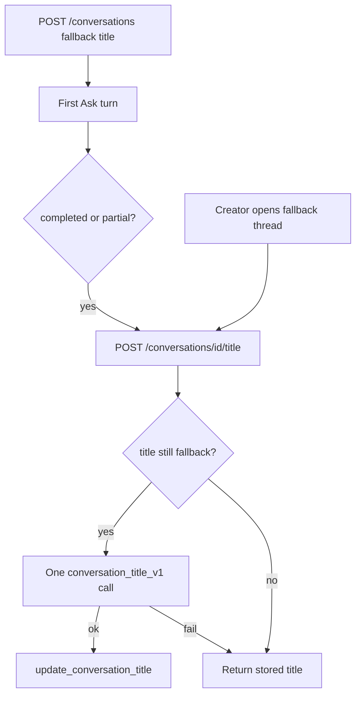

# ADR: LLM conversation titles

## Decision

Session-rail titles are LLM-written summaries of the chat, not the raw first
prompt. `POST /conversations` still stores a compact first-prompt fallback so
the rail can render immediately. `POST /conversations/{conversation_id}/title`
then replaces that fallback with one bounded `gpt-4o-mini` Responses call
(`conversation_title_v1`) after the first completed or partial turn, or when
the creator re-opens a thread that still has a fallback title.

The call is creator-only, rate-limited as `COST_MUTATION`, and fail-closed to
the fallback title. It is not reserved against the query-run envelope. Mock
mode derives the title from the first user excerpt with no network.

## Alternatives

- Keep first-prompt truncation: cheapest, but the rail shows the question
  instead of a description.
- Generate only at create time: no title-update RPC, but the title cannot
  use the first assistant reply.
- Count the call against the query reservation: correct for run budgets,
  but couples title UX to remaining answer budget and can silently skip.

## Consequences

One extra cheap model call per conversation while the stored title still
equals the first-prompt fallback. OpenAPI grows by
`/conversations/{conversation_id}/title`. See
[FASTAPI_SECURITY.md](../api/FASTAPI_SECURITY.md) and
[workspace-screens.md](../frontend/workspace-screens.md).
