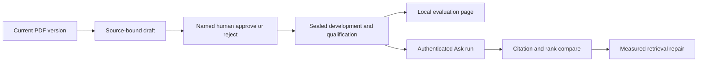

# ADR: Local PDF evaluation workspace

## Status

`accepted` on 2026-09-10. This is a local-only owner/admin overlay after
Phase 6 Packet 9. It does not authorize staging or production evaluation UI,
holdout opening, or frozen Hybrid retune.

## Context

Private PDF Hybrid evaluation is CLI- and filesystem-driven under gitignored
`.private-eval/`. A 2026-09-09 locator-bound seal produced only 2 of 24
grounded non-refusal development cases. Live Recall@10 is not a tuning
baseline until labels are corrected. The PDF parser currently emits no
headings. Integrity cannot insert packets between P06-09 and P06-10.

The user accepted the general-chat strict split, asked for a friendly
review-and-test page, chose a local-only workspace, and approved executing
this overlay immediately after Packet 9, then returning to Packet 10.

## Decision (accepted)

1. Keep private questions, answers, facts, and excerpts in gitignored
   `.private-eval/`. Do not add evaluation-label tables.
2. Enable the workspace only when `APP_ENV=local` or isolated tests and
   `PDF_EVAL_WORKSPACE_ENABLED` is true. Staging and production fail closed.
3. FastAPI uses `app_api` and server-derived owner/admin identity. Operator
   and service-role DSNs are forbidden on this HTTP path.
4. Automatic drafts may propose extractive questions from canonical passages.
   Generated rows stay `generated_only=true` until a named human approves.
5. The answering model receives only the question. Expected answers and gold
   chunk IDs stay evaluator-side until after the run.
6. Holdout custody stays outside the repository. The workspace never lists,
   fetches, or opens holdout. Cases assigned to holdout cannot run against AI.
7. Integrity keeps packet numbers contiguous. Overlay packets are P06-19
   through P06-26 and execute immediately after Packet 9.
8. Do not freeze `hybrid_long_document_v1`, rewrite rejected profile digests,
   retune frozen `hybrid_default_v1`, or open holdout until grounded labels
   and open-split gates pass.
9. Graph remains off for this private PDF. Combined +10pp proof uses a
   separate graph-eligible set.

## Alternatives rejected

| Alternative | Why rejected |
| --- | --- |
| Production/admin hosted workspace | Private questions would leave laptop custody |
| Database label tables | Duplicates gitignored files and expands hosted retention |
| Operator DSN in the API process | Bypasses `app_api` ACL |
| AI-only labels without human approval | Current 2/24 grounding miss |
| Insert packets between 9 and 10 | Would renumber P06-10 through P06-18 |
| Tune RRF from the current 0.0417 Recall@10 | Labels are not gold |

## Consequences

- Compose must bind-mount `.private-eval` for the local API only.
- Passage previews use ACL-rechecked canonical `raw_text`.
- Official Recall@10 remains the CLI ranked-ID path. The page is a manual
  AI test plus citation overlap.
- Operator seal and holdout export stay CLI-only.

## Rollback

Set `PDF_EVAL_WORKSPACE_ENABLED=false`, remove the Compose bind mount, and
leave packets 1–18 and frozen Hybrid bytes unchanged.

Related: [PDF_HYBRID_EVALUATION.md](../evaluation/PDF_HYBRID_EVALUATION.md) ·
[PDF_EVAL_WORKSPACE.md](../evaluation/PDF_EVAL_WORKSPACE.md) ·
[hybrid-pdf-accuracy-remediation.md](../development/hybrid-pdf-accuracy-remediation.md) ·
[AUTHORIZATION_MODEL.md](../security/AUTHORIZATION_MODEL.md) ·
[docs index](../README.md)
