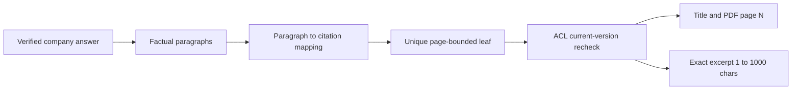

# ADR: PDF paragraph citations

## Status

`accepted` on 2026-09-15. Implementation packets are P06-44 through
P06-48 because P06-37 through P06-43 already authorize advanced web
research. This ADR does not authorize signed Storage URLs, full-chunk
disclosure, printed-page chat labels, or retrofitted mappings for
legacy citation rows.

## Context

Company-PDF answers currently show run-level source chips. The chip
page prefers stored `page_label` (the number printed on the paper
page) over the 1-based PDF viewer file page. Parent/context chunks can
keep the first child's page while later sentences live on a later
page. When the model omits citations, production verification can
attach every retrieved fusion passage. Citation GET and SSE omit the
exact supporting span, and conversation history drops `run_id` plus
citations.

The user asked for the book/source name, the page shown by the PDF
viewer toolbar, and the exact supporting passage next to each answer
paragraph.

## Decision (accepted)

User named/date approvals on 2026-09-15:

1. **PDF viewer page.** Chat “page” is the 1-based file position
   `page_index + 1`. Display `Book title · PDF page N`. Printed
   `page_label` may remain in stored locators and must not drive the
   chip.
2. **Paragraph granularity.** Every factual company paragraph maps to
   one or more authorized canonical passages and a non-empty exact
   source span. Footer-only run sources are not paragraph support.
3. **Book name.** Display live authorized `app.documents.title`. Do not
   extract a cover or PDF-metadata title.
4. **Bounded excerpt.** Creator-owned citation GET may return at most
   1000 characters of exact source text only after live run-ownership
   and chunk ACL/current-version/deletion recheck. SSE stays
   ID/ordinal metadata.
5. **Fail closed.** Missing, ambiguous, unsupported, or uncontained
   mappings remove the paragraph before streaming. Retrieval is not
   citation proof.
6. **Legacy honesty.** Historical rows with no paragraph index or exact
   span stay unmapped. Do not invent mappings.
7. **Git.** Implement on `fix/pdf-paragraph-citations`. One reviewable
   commit after each packet. Push and merge-commit to `main` only after
   P06-48 gates pass.

## Bounds

- At most 6 grounded paragraphs, 6 atomic links, and 12 citations.
- Exact span and returned excerpt: 1–1000 characters.
- Resolve a cited parent to exactly one current authorized
  representative leaf that contains the span.
- PDF locators must yield exactly one distinct `page_index`.
- General, user-text, deterministic, and Web answers stay unchanged.

## Security and privacy

- Title, page, chunk ID, and excerpt leave Postgres only while the
  caller owns the run and the resolved leaf is current, undeleted, and
  ACL-readable.
- On ACL revoke, deletion, current-version flip, locator failure, or
  span-integrity failure: `source_unavailable=true` and title, page,
  chunk ID, and excerpt are omitted.
- Excerpts are escaped text. No raw HTML, signed URL, full chunk,
  prompt, or inaccessible source metadata.
- Do not log excerpt or title content.

## Alternatives considered

- **Printed `page_label` as the chat page.** Rejected: it is not the
  viewer coordinate the user uses to navigate the file.
- **Footer-only citations.** Rejected: they do not prove which
  paragraph a source supports.
- **Cite every fusion passage when the model omits citations.**
  Rejected: retrieval is not proof of support.
- **Return full chunks or signed Storage URLs.** Rejected: that
  broadens disclosure beyond the cited span.
- **Retrofitted mappings for old null spans.** Rejected: those rows
  carry no proof.

## Numbering and branch base

Integrity requires contiguous packet numbers after P06-43, so this
overlay is P06-44 through P06-48. `origin/main` still lacks P06-37
through P06-43. The feature branch is created from committed
`feature/advanced-web-research-mode` HEAD so numbering stays
contiguous and dirty P06-41 frontend files stay in the original
worktree. Dirty snapshot:
`refs/backup/pre-citation-split-20260915132925`.

Execution order: P06-40 and P06-41 remain complete. Execute P06-44
through P06-48 next. Resume P06-42, P06-43, then P06-17 and P06-18.

## Rollout and rollback

Rollout is additive: new prompt version, RPCs, and HTTP fields. Old
clients may ignore new fields. Rollback stops using `answer_v2` and
`list_run_citations_v4` in application code, leaves additive columns
and historical rows in place, and must not present `page_label` as the
PDF viewer page.

## Consequences

Packets P06-45 through P06-48 implement verification, persistence,
inline UI, and gates. Web research packets stay numbered. Company
insufficient evidence still never falls back to Web or general
knowledge.
