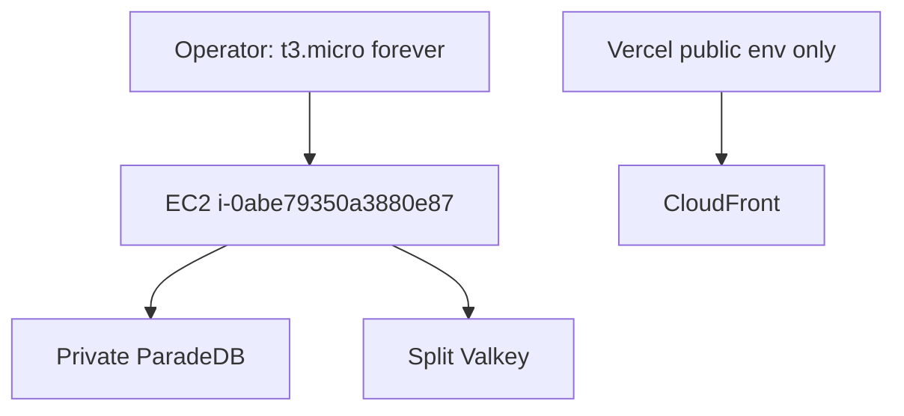

# ADR: Phase 10 live EC2 is t3.micro

## Context

Packet 1 originally froze `m6i.xlarge` for later Packet 5 load. Account
`665602132723` is AWS Free plan. `RunInstances` and
`ModifyInstanceAttribute` rejected `m6i.xlarge`. Live instance
`i-0abe79350a3880e87` is `t3.micro` (916Mi RAM) in `us-east-1`.

On 2026-08-19 the operator said they will **never** use `m6i.xlarge` and
that ParadeDB and Valkey must run on AWS, not the workstation. Frontend
staging stays Vercel.

## Decision

1. Accepted staging instance type is **`t3.micro`**. Terraform default and
   `terraform.tfvars.example` match. Do not plan or apply `m6i.xlarge`.
2. Default Compose on this host is
   `docker-compose.staging.yml` plus `docker-compose.t3micro.yml`.
   `docker compose up -d` starts **ParadeDB and both Valkey services only**.
   API/Caddy/proxies need `--profile t3micro-edge`. Worker, api-green,
   ClamAV, and parser stay `--profile not-on-t3micro`.
3. ParadeDB Docker auto-tunes from the container cgroup. Overlay
   `mem_limit` is 280m so auto-tune cannot assume 8Gi.
4. Packet 5 managed-load / envelope measurements are **not claimed** on
   this host. Blue/green drain is not claimed while api-green is profiled
   off.
5. Phase 9 image digests do not change. Hosted Supabase remains the
   existing Free project in eu-central-1
   ([ADR-phase10-hosted-supabase-reuse.md](./ADR-phase10-hosted-supabase-reuse.md)).

## Consequences

- P10-01-B live type now matches the accepted default.
- P10-01-C can be proven only after ParadeDB/Valkey are **running** on the
  instance with no public host ports.
- Packet 5 load, dual API slots, ClamAV, and parser-sandbox remain
  Blocked on this size.
- Copy `/opt/smart-rag/.env` through Secrets Manager
  `smart-rag/staging/compose-env`, never `ssm:SendCommand` parameters.

## Related

- [ADR-phase10-hosted-supabase-reuse.md](./ADR-phase10-hosted-supabase-reuse.md)
- [MANAGED_STAGING.md](../deployment/MANAGED_STAGING.md)
- [phase10-staging-secrets.md](../runbooks/phase10-staging-secrets.md)
