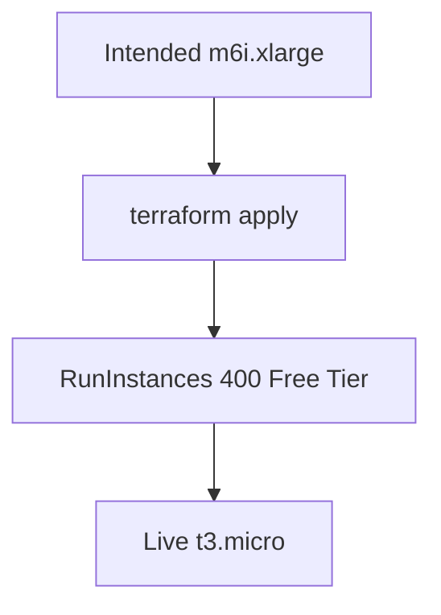

# ADR: Phase 10 live EC2 Free Tier instance type

## Context

Packet 1 intended freeze uses `m6i.xlarge` for later Packet 5 load. Live
`RunInstances` in account `665602132723` rejected that type:

`InvalidParameterCombination: The specified instance type is not eligible
for Free Tier.`

The user asked to finish live apply rather than stop.

## Decision

1. Keep committed Terraform default `instance_type = "m6i.xlarge"`.
2. Live apply used gitignored `terraform.tfvars` `t3.micro` so the remaining
   instance and EIP association could create.
3. Do not claim Packet 5 envelope measurements or m6i capacity from this
   instance.
4. Record live ids in
   [packet1-live-aws.json](../deployment/phase-10/packet1-live-aws.json).

## Consequences

- P10-01-B live IMDS (`required`, hop 1), encrypted gp3 volumes, and
  CloudFront-prefix HTTPS-only security group are asserted on
  `i-0abe79350a3880e87`. Compose files are not yet on the host, so health and
  private-port scans stay unproven.
- Raising to `m6i.xlarge` later needs a paid/non-Free-Tier-restricted
  account path and a new apply. 2026-08-19: `ModifyInstanceAttribute` to
  `m6i.xlarge` returned `FreeTierRestrictionError` (free plan accounts).
  The instance was restarted as `t3.micro`.

## Related

- [ADR-phase10-hosted-supabase-reuse.md](./ADR-phase10-hosted-supabase-reuse.md)
- [MANAGED_STAGING.md](../deployment/MANAGED_STAGING.md)
