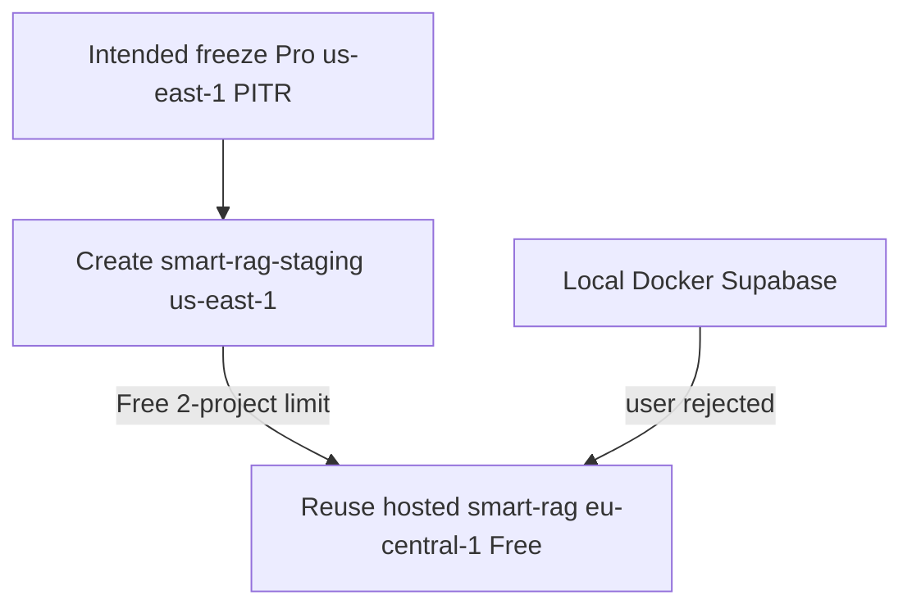

# ADR: Phase 10 hosted Supabase reuse (not local)

## Context

Phase 10 Packet 1 requires an isolated managed Supabase project matching the
intended freeze: **Pro**, **us-east-1**, PITR for RPO ≤24h, asymmetric
JWKS, and no `pg_search` on managed Postgres. Local Docker Supabase is not
that target.

On 2026-08-18 the user directed work to **use Supabase online, not local**.
Creating `smart-rag-staging` in us-east-1 failed: the org is on the **Free**
plan with a **2-project limit**. Existing hosted projects were Reel
(`bkhmqtcxoxtrydumgwfd`, eu-north-1) and **smart-rag**
(`qsjivtwtmlmtksufqjik`, eu-central-1). The user chose to reuse **smart-rag**
rather than pause/delete a project or upgrade to Pro.

## Decision

1. Phase 10 staging Auth/Storage/canonical Postgres is the **hosted** project
   `qsjivtwtmlmtksufqjik` (`https://qsjivtwtmlmtksufqjik.supabase.co`).
2. Do **not** use local Docker Supabase as the Packet 1 managed target.
3. Keep committed intended freeze values in `infra/ec2/intended-topology.json`
   and `phase10_constants.py` as **Pro / us-east-1 / PITR**. Do not rewrite
   those constants so P10-01-A looks Passed against a Free eu-central-1
   project.
4. Record live actuals in
   [packet1-live-supabase.json](../deployment/phase-10/packet1-live-supabase.json).
   Live region/plan/PITR drift is an accepted topology deviation, not a silent
   freeze change.
5. Never install `pg_search` on this hosted project. ParadeDB remains the
   private BM25 engine on EC2.
6. Do not commit `service_role`, database URLs, or Vercel `live_values`.
   `vercel-public-env.json` stays an allow-list only.

## Consequences

- P10-01-A **intended** inventory can still Pass. **Live** plan/region/PITR
  do not match the freeze. Do not claim Pro pooling, PITR RPO ≤24h, or
  us-east-1 data residency from this project.
- Legacy anon JWT on this project is **HS256**. FastAPI must keep HS256 in
  `FORBIDDEN_ALGORITHMS`. Asymmetric JWKS on the hosted project is unproven.
- Advisor reported RLS disabled on `app.revoked_sessions` and
  `app.mfa_recovery_requests`. Do not enable RLS without matching policies.
- QT-AVL-003 RPO ≤24h stays a **target**, not a measurement, until Pro+PITR
  exists.
- Creating a true isolated us-east-1 Pro project later requires an org
  upgrade or freeing a Free-plan slot, then a new Packet 1 inventory.

## Alternatives considered

| Option | Outcome |
| --- | --- |
| Local Docker as staging Supabase | Rejected. User required online. |
| New us-east-1 Pro project | Failed. Free plan 2-project limit. |
| Pause/delete Reel to free a slot | Not chosen. User reused smart-rag. |
| Rewrite intended freeze to Free/eu-central-1 | Rejected. That would hide Packet 1 drift. |

## Related

- [MANAGED_STAGING.md](../deployment/MANAGED_STAGING.md)
- [phase-10 evidence](../development/phase-10-managed-staging-evidence.md)
- [staging topology](../../.cursor/plans/hybrid-graph-rag/shared/release/03-staging-topology.md)

## Approval

| Role | Name | Date |
| --- | --- | --- |
| Client / engineering | user (Cursor chat; reuse existing online smart-rag) | 2026-08-18 |
