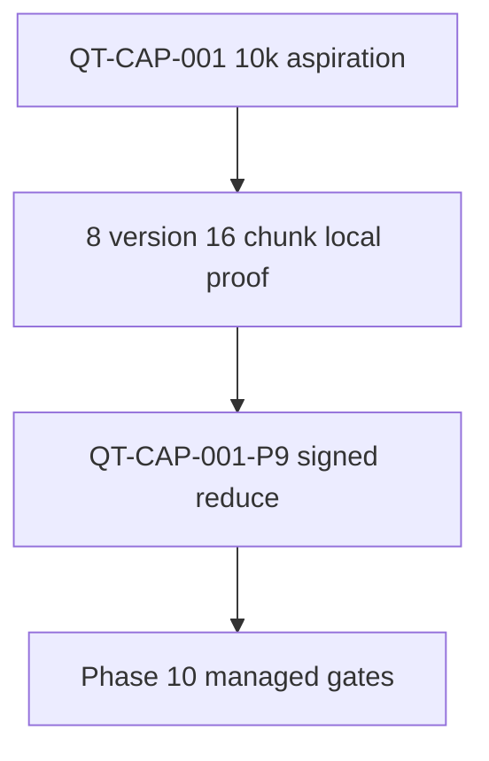

# ADR: Phase 9 local candidate envelope reduce

## Context

Phase 1 signed QT-CAP-001/002 remain 10,000 Hybrid document versions and
1,000,000 canonical chunks as the aspiration to raise toward after measured
load. Phase 9 Packet 4 proved foreground-plus-maintenance behavior only on
the Packet 2 labeled **8-version / 16-chunk** subset. Live 70% CPU/IO pause
did not fire (peak 1.49%). Graph advertisement already stays
[QT-CAP-005-P8](../QUALITY_TARGETS.md) = 15. Claiming QT-CAP-001/002 from
local Docker is forbidden. Packet 7 requires repair, isolate/resize, or
**reduce-and-re-sign** before staging.

On 2026-08-18 the user asked to make Phase 9 100% complete so Phase 10 can
start. That is client sign-off to advertise the proven subset, not a 10k/1M
claim and not managed-topology proof.

## Decision

1. The **local candidate advertised envelope** is
   **QT-CAP-001-P9 = 8** Hybrid document versions and
   **QT-CAP-002-P9 = 16** canonical chunks.
2. Graph stays **QT-CAP-005-P8 = 15**. Do not advertise QT-CAP-005 = 2,000.
3. QT-CAP-004 = 5 simultaneous query runs remains proven on this subset.
   QT-CAP-003 = 25 concurrent users was **not** load-proven locally; do not
   advertise 25 from Docker.
4. Phase 1 QT-CAP-001/002/003/005/006 rows stay as unsigned-for-local
   aspiration. A later raise needs a workload that can reach the 70%
   pause/isolation triggers and a new signed decision.
5. Phase 10 must not infer EC2, managed pooling, CDN, or 10k/1M from this
   freeze.

## Alternatives considered

| Option | Outcome |
| --- | --- |
| Claim QT-CAP-001/002 from 8-doc proof | Rejected. Packet 7 classifies that Failed. |
| Leave the reduce unsigned and start Phase 10 | Rejected. P09-07-B stays Blocked. |
| Resize local Docker until 10k/1M is proven | Rejected. User ordered Phase 9 close, not an unsigned expansion. |
| Treat local NCPU as EC2 | Rejected. Managed sizing stays Phase 10. |

## Consequences

- Packet 7 P09-07-B becomes Passed on the signed reduce.
- Staging (Phase 10) consumes this freeze and the reduced envelope.
- Live OpenAI Recall@K stays Not Run under `MOCK_MODEL_MODE=true` and is
  not a local launch blocker.

## Related

- [QUALITY_TARGETS.md](../QUALITY_TARGETS.md)
- [LOCAL_RELEASE_CANDIDATE.md](../deployment/LOCAL_RELEASE_CANDIDATE.md)
- [phase-09 evidence](../development/phase-09-local-release-candidate-evidence.md)
- [sizing envelope](../../.cursor/plans/hybrid-graph-rag/shared/release/05-sizing-envelope.md)

## Approval

| Role | Name | Date |
| --- | --- | --- |
| Client / engineering | user (Cursor chat; Phase 9 100% so Phase 10 can start) | 2026-08-18 |
