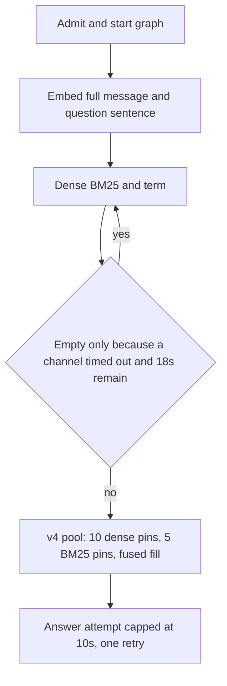

# ADR: Probe15 retrieval timing and pool repair

## Status

`proposed` on 2026-10-08. This changes retrieval cost (one extra answer
attempt at most, one extra channel pass only when the first pass is empty
because a channel timed out) and which passages reach the reranker. It
needs acceptance of the live probe15 rerun before merge to a release branch.

## Context

On the two new 15-question probe sets, with `gpt-4o-mini`, 6 of 30 answers
were strict passes. The other 24 were traced from run records, stage
exports, draft checkpoints, and channel ranks. Five mechanisms accounted
for 20 of them: the run deadline, a rerank pool filled only by the dense
top 20, search over the whole wrapped message, passages ranked too deep to
enter that pool, and passages missing from every channel list. Six more
answers had seen the right passage and then released a shortened claim.
Replacing that claim with the cited sentence was tested offline and
dropped: it saved 2 of 11 answer-side misses and broke 3 current passes.

## Decision

1. Start the graph when the run is admitted. An attach replays events and
   does not start a second executor.
2. Cap each answer and verifier call at 10 seconds or the time left,
   whichever is smaller. Retry the answer once on timeout, connection
   failure, or a 5xx, only with at least 8 seconds and one model call
   left. Do not retry a 429 or an authentication failure. A timeout after
   the request was sent still writes the usage row.
3. If fusion is empty, at least one channel timed out, and at least 18
   seconds of run time remain, run the channel jobs once more with the
   same embeddings.
4. Route long documents to `hybrid_long_document_v4`. The pool stays 20.
   Pins are the dense top 10 and the BM25 top 5. The rest follow fused
   order. `hybrid_long_document_v3` stays pinned as the rollback.
5. Retrieval also embeds the question sentences (authorized titles
   removed) in the same embedding batch and merges the dense lists by
   reciprocal rank. BM25 scans that search text first. The answer prompt
   still receives the full message.
6. Do not release the cited sentence in place of the model's claim. The
   offline check failed its pass bar.
7. Do not move the temporal-record load. On the stored probe exports its
   median was about 1 second of a 9–10 second retrieve. One run spent 4
   seconds there; that is not the common case.

## Rejected alternatives

- A longer run deadline. It hides a stalled call instead of bounding it.
- A larger rerank pool. It raises rerank cost. The size-20 pool already
  has room once it is not filled by dense pins alone.
- More quoting rules in the answer prompt. A previous prompt ban was
  reverted after it increased draft misses.

## Consequences

- One run can pay for two answer attempts. The second happens only after
  a retryable failure and only inside the existing model-call ceiling.
- v3 behavior is unchanged when that profile is loaded explicitly. New
  long-document asks use v4.
- The term channel still contributes only when the question contains an
  identifier-shaped needle. Replay of the 30 question sentences built
  needles and did not show a separate scan defect, so the term query was
  not changed. The book-specific BM25 seed phrases were removed.

## Verification

`uv run pytest tests/unit/test_run_timings.py tests/unit/test_answer_attempts.py tests/unit/test_channel_rerun.py tests/unit/test_long_document_v4_profile.py tests/unit/test_search_text.py`

Live acceptance is a fresh probe15-a and probe15-b run, plus one
sentence-aligned probe15-c run that is not used for tuning.
