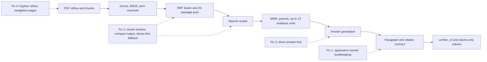

# ADR: Repair answers lost after retrieval

## Status

`accepted` on 2026-09-24. The user accepted all four fixes, chose to
start with Fixes 1 and 3, and chose to reuse `is_search_representative`
for navigation pages. The user also set the acceptance bar at 40 of 50.
[Approvals recorded](#approvals-recorded) lists the frozen contracts and
plan rules this changes. Implementation follows the
[answer-loss repair plan](../../.cursor/plans/answer_loss_repair_9c24e1a0.plan.md),
one packet per run.

## Context

The answer-only run scored **21 of 50**
([ANSWER_ONLY_50_2026-09-24.md](../evaluation/ANSWER_ONLY_50_2026-09-24.md)).
The stage-by-stage diagnosis is in
[ANSWER_ONLY_50_ROOT_CAUSES_2026-09-24.md](../evaluation/ANSWER_ONLY_50_ROOT_CAUSES_2026-09-24.md).

Every fact is in the stored chunk text, and dense search puts a chunk
holding it in its first 12 results on 45 of 50 questions. The 29 misses
happen after that:

| First losing stage | Misses | Fix |
| --- | ---: | --- |
| Right answer generated, then removed by the paragraph/link/citation contract | 7 | 1 |
| Right answer generated, then the released claims dropped the asked term | 2 | 3 |
| Fact chunk in the rerank pool, rerank did not complete, fallback order dropped it | 8 | 2 |
| Fused rank put the fact chunk outside the 20-passage pool | 4 | 2 (2 of 4) |
| Fact chunk in evidence, answer stated a different fact | 4 | 3 |
| Fact chunk in evidence, deadline before generation | 2 | 2 |
| Dense rank below 60 | 2 | none |

The reranker completed on 14 of 50 runs here. On the previous fresh set
it fell back on 44 of 50
([FRESH_KNOWN_ANSWER_50_2026-09-23.md](../evaluation/FRESH_KNOWN_ANSWER_50_2026-09-23.md)).
[ADR-ask-evidence-budget-repair.md](./ADR-ask-evidence-budget-repair.md)
raised the retrieval slice to 10 s and the rerank reserve to 3 s. Channel
and loading work still consume the slice before rerank starts. When rerank
did complete, it placed 12 of 12 pooled fact chunks in the final evidence.

## Decision (proposed)

### Fix 1: The application owns the answer bookkeeping (`answer_v4`)

Today the model writes three cross-referenced lists: paragraphs with
indices and link IDs, atomic links with link IDs and chunk IDs, and
citations that must repeat both the paragraph index and the link ID. A
single index gap refuses the whole answer. A single missing
paragraph-and-link citation drops the whole paragraph. In 5 of the 7
contract failures the model used a chunk UUID as a link ID.

1. Pin a new immutable `answer_v4.md` and a new strict output schema. The
   model returns an ordered list of at most `MAX_VERIFIER_LINKS` (6)
   claims. Each claim has its text, a `kind` (`fact` or
   `inference_link`), and one or two citations of
   `{source_id, span, source_ranges}`. The model no longer writes
   `link_id`, `paragraph_index`, or `atomic_link_id`. The schema is the
   same for every request: OpenAI processes each new strict schema once
   before use, so a per-request ID enum would add that cost to every
   answer call. Application code drops any `source_id` that was not
   sent in the request (amended 2026-09-24, decision D2 in the plan).
2. Application code assigns link IDs (`claim-1` to `claim-6`, scoped to
   one answer payload and stored only in citation provenance), one
   paragraph per claim (the release already renders one paragraph per
   claim), `priority` from claim order, and each citation's link. It
   then builds the existing internal answer payload. `verifier_v2`,
   `render_verified_company_answer`, SSE events, and the transcript
   contract keep their current shape.
3. The deterministic check runs per claim. A claim whose citation fails
   is dropped on its own and recorded in `refused_links`. Failures
   include an unknown chunk, a span that is not an exact substring of
   the citation text, or a failed ACL/current recheck. The answer refuses
   only when no claim survives. `answer_bounds_exceeded` stays blocking.
4. Unchanged: the claims-only release from
   [ADR-live-rag-failure-remediation.md](./ADR-live-rag-failure-remediation.md)
   item 5, the acronym and ungrounded-literal guards, exact-span
   alignment, one answer call and one verifier call per run, and
   `MODEL_INPUT_MAX_CHARS`. The bytes of `answer_v1` to `answer_v3` are
   not edited.

The pinned SDK request shape is covered by
tests/contract/test_answer_v4_schema.py, and a gated live call
(ANSWER_SCHEMA_LIVE=1) proves the provider accepts the schema.

### Fix 2: Make the reranker run and fix the fallback order

1. **Measure first.** Persist ID-only durations in the Hybrid diagnostics
   for scope resolution, embedding, each channel, fusion, temporal load,
   pool preload, the rerank call, selection, and locator reload. Also
   persist the rerank validation sub-code: `json`, `hash`, `length`,
   `duplicate`, or `unknown_id`. Then rerun 10 questions from the
   answer-only set to find what consumes the slice.
2. **Compact rerank output (`rerank_v2`).** Pin a new immutable prompt
   and schema. The request labels candidates `c01` to `c20`. The response
   is an ordered list of those labels, constrained by a schema enum, and
   no longer echoes `input_hash`. The server maps labels back to the
   chunk IDs it already holds, and still computes and logs the request
   hash. Today's responses are about 700 output tokens of UUIDs and hash.
   The label form should be several times smaller; step 1 measures the
   actual size and latency.
3. **Accept partial rankings.** Keep the first occurrence of each valid
   label in order, ignore unknown and duplicate labels, and append the
   unranked candidates in fallback order. Record `rerank_partial` with
   counts. Output that is not valid JSON stays `rerank_schema_invalid`.
4. **Protect the rerank window.** Channels and pool preload get the slice
   minus `RERANK_RESERVED_SECONDS`. A channel still running at that point
   is handled like today's channel timeout. The final numbers depend on
   step 1 and come back for approval before merge, because cutting a
   channel early can cost recall.
5. **New frozen profile `hybrid_long_document_v3`.** It gets its own file
   and digest pin. The `hybrid_default_v1` and `hybrid_long_document_v2`
   bytes stay unchanged. It adds two fields whose defaults keep current
   behavior:
   - `dense_head_pin` (default 5, v3 value 12). The first 12 dense IDs
     are pinned into the pool, and pins still cannot add an ID outside
     `fused_ids`.
   - `fallback_order` (`rrf` or `dense_first`, v3 value `dense_first`).
     When rerank does not complete, pool members that dense search found
     are ordered by dense rank, followed by the rest in fused order.

   MMR, the document and section quotas, parent expansion, the 12-unit
   cap, and the 6000-token budget are unchanged. Both routes that select
   v2 today (unscoped small-corpus questions and questions scoped to one
   long document) select v3 instead; v2 stays pinned and loadable for
   rollback. The acceptance runs are unscoped, so the scoped route is
   covered by unit tests only.
6. **Deadline.** The 50 s run deadline and the 25 s Hybrid deadline stay.
   If the step 1 measurements show the protected rerank window pushes the
   p90 run total above 45 s, reduce per-node persistence overhead before
   v3 goes live. The overhead is currently about 11 s per run of node
   time and gaps between nodes.

The Phase 6 shared contract says a failed rerank "falls back to
deterministic RRF". Dense-first order is also deterministic, but the rule
text changes. This is a plan deviation and needs approval.

### Fix 3: Answer the question first (part of `answer_v4`)

`answer_v4.md` adds these rules:

- The first claim answers the question directly, in one sentence.
- For the asked item (a name, term, list entry, or number), use the
  passage's own words rather than a related concept.
- When one passage states the answer, do not answer with a related topic
  from another passage.
- When no passage states the answer, return `insufficient_evidence`.

The prompt holds no question-specific, book-specific, or domain-specific
text. It ships in the same prompt version as Fix 1, but the rerun
attributes each change per question. The effect of prompt changes is
uncertain; this ADR does not promise one.

### Fix 4: Re-ingest with hyphen repair and navigation pages excluded

1. In `join_pdf_lines`, treat U+2010 HYPHEN and U+00AD SOFT HYPHEN at a
   line end like ASCII `-`. When the left fragment ends in a letter and
   a hyphen and the right fragment starts lowercase, join them without
   the hyphen. Bump `PDF_PARSER_VERSION` to `parser_v1_pdf_reflow_v4`.
   Trade-off: a real compound word broken at its own hyphen at a line end
   loses the hyphen. The current ASCII rule already does this. Hyphens
   inside a line are untouched.
2. Add a generic detector for table-of-contents and back-of-book-index
   chunks. A chunk qualifies when its entries end in page references
   (numbers, ranges, roman numerals, dot leaders): at least 3 runs of
   page references, at most 5 words per run, and almost no sentence
   breaks. Entries are counted instead of lines because PDF reflow joins
   the lines of one block. Thresholds come from fixtures and structural
   counts, never from the book's title, hash, page numbers, or headings.
   Glossaries and prose must not match. Each representative passage or
   parent is judged on its own text.
3. Keep detected chunks stored in the version. Set
   `is_search_representative = false`, leave `duplicate_of_chunk_id`
   NULL, and add the provenance reason `navigation_page`. Existing filters
   then keep these chunks out of embedding, BM25 projection, and all three
   channels, with no migration. This changes what the flag means: today
   it only marks duplicates. Readers that assume a duplicate target must
   handle NULL. The user chose this over a new column, which would need a
   migration.
4. Re-ingest the book through the normal pipeline. The upload API always
   creates a new document and refuses bytes that match a visible one,
   and no RPC restores a deleted document, so the book is soft-deleted
   with `app.delete_visible_document` and uploaded again as a new
   document. The old rows stay soft-deleted but cannot be made current
   through the application.

### Not changed

Chunk sizes and strategy, the embedding model, `rrf_k`, channel weights,
the evidence cap, the token budget, and the model choices stay as they
are. So do no local reranker and no Web fallback. The known dense-recall
misses (a04, a07) are not targeted.

## Order

1. Fixes 1 and 3 (`answer_v4`). This is the largest measured loss, needs
   no re-ingest, and has the smallest blast radius.
2. Fix 2, measurement first, then steps 2 to 6.
3. Fix 4 last. Re-ingest changes chunk IDs, so it would break the
   per-question comparison for the first two fixes.

Each fix is a plan packet with its own evidence handoff.

## Expected effect and acceptance

These are upper bounds on this question set, not predictions. They
overlap, and fixing one stage can expose the next loss.

| Fix | Misses it can recover on this set |
| --- | ---: |
| 1 | 7 |
| 2 | 12 (8 fallback order, 2 pool, 2 deadline) |
| 3 | 6 |
| 4 | small; the a38 case overlaps Fix 1 |

Acceptance targets, approved 2026-09-24:

- **Unseen set.** A new answer-only set of 50 questions on pages none of
  the three earlier sets used, written before the fixes run and scored
  with the same rules: at least 40 of 50 right.
- **Rerun of this set.** At least 40 of 50 right. No generated right
  answer is removed by bookkeeping. Rerank completes, fully or partially,
  on at least 45 of 50. The fact chunk reaches final evidence on at least
  43 of 50. No deadlines. The p90 run total is at most 45 s.
- **Safety.** The invented-expansion regression from the live-RAG ADR
  still refuses. Verifier and release tests still pass. A manual review
  of every released claim on the unseen set finds none unsupported by its
  cited span. Out-of-scope negative questions still refuse.
- **Freeze.** The v1 and v2 profile digests and the `answer_v1`–`answer_v3`,
  `verifier_v2`, and `rerank_v1` bytes are unchanged. No single test
  covers this: `tests/unit/test_phase4_freeze.py` pins only the holdout
  freeze and the `hybrid_default_v1` digest, and the other pins are spread
  over seven test files. The final proof therefore runs all of those tests
  and a byte diff of the frozen files against `origin/main`.

## Approvals recorded

Approved by the user on 2026-09-24:

- **Fix 1:** a new answer prompt and model-output schema, which changes
  [ANSWER_VERIFICATION.md](../agent/ANSWER_VERIFICATION.md).
- **Fix 2:** the rerank response schema (no model-echoed hash), a new
  frozen profile, and the plan rule "falls back to deterministic RRF".
  The channel-window numbers from step 4 come back for a separate
  approval after the step 1 measurements.
- **Fix 4:** the meaning of `is_search_representative`, the parser
  version bump, and a re-ingest of the book.
- **Fix 4 re-ingest path (2026-09-25):** soft-delete the book document
  and upload the same PDF as a new document, with a new chunk and
  document ID.
- The acceptance targets above.

## Alternatives considered

- **Release paragraph text instead of atomic claims.** Rejected. It
  reintroduces the invented expansions that live-RAG item 5 removed.
- **Keep `answer_v3` and repair its bookkeeping** (renumber indices,
  dedupe IDs). This is the weaker option. It repairs a09, a10, and a45
  after the fact, but the model still has to juggle two UUID namespaces.
  It remains the fallback if the Fix 1 schema fails its contract test.
- **A stronger answer model.** Deferred, because it changes cost. Measure
  after Fixes 1 and 3.
- **Retune `rrf_k` or channel weights.** Rejected. That changes ranking
  even when rerank succeeds. Dense-first applies only when rerank did not
  complete.
- **Skip rerank for long documents and use dense order.** Rejected. When
  rerank completed, it placed 12 of 12 pooled fact chunks and lifted two
  from fused rank 21 to 1.
- **A local cross-encoder or a dedicated rerank API.** Rejected. The plan
  allows no local reranker in v1, and a provider change needs its own
  ADR.
- **Raise the slice or the run deadline.** Rejected as a first step. The
  last raise did not change what consumes the slice.
- **Re-chunk, use semantic chunking, or change the embedding model.**
  Rejected. The facts are in the chunks, and dense top 12 holds them on
  45 of 50.

## Consequences

The answer contract changes only at the model boundary; internal payloads
and downstream consumers keep their shape. `answer_v4`, `rerank_v2`, and
the v3 profile digest appear in eval fingerprints, the prompt changelog,
and the freeze tests. Diagnostics gain ID-only timings and sub-codes. The
re-ingest creates new chunk IDs, so this run's ID traces stop applying.

## Security and privacy

ACL/RLS rechecks, current-version checks, and the claims-only release are
unchanged. Schema enums limit citation IDs and rerank labels to the
request's authorized evidence or pool, and the server still validates
them, so the model cannot name a chunk outside the pool. New diagnostics
hold IDs, counts, durations, and reason codes, never query text, passage
text, or model output. Excluding navigation pages is a ranking choice, not
an access control. Private questions, gold phrases, and raw PDF text stay
out of git.

## Rollback

- **Fixes 1 and 3:** pin `answer_v3` again; `answer_v4` stays unused.
- **Fix 2:** route to `hybrid_long_document_v2`, pin `rerank_v1`, and
  revert the channel window.
- **Fix 4:** revert the A6 and A7 commits, rebuild the parser image,
  restart the worker, soft-delete the re-ingested document, and upload
  the PDF again. Restoring the old soft-deleted rows by SQL is not
  approved. Both reverts affect only new ingests.

## Verification

After implementation, each packet adds unit tests for its behavior:
application-assigned IDs, per-claim drops, and refusal at zero claims
(Fix 1); label mapping, partial rankings, sub-codes, dense-first order,
and the dense pin (Fix 2); U+2010 and U+00AD joins, plus a navigation
detector tested on a table of contents, an index, a glossary, and prose
(Fix 4). Contract tests cover the strict `answer_v4` and `rerank_v2`
schemas against the pinned OpenAI SDK. Each packet runs
`uv run python scripts/check.py --tier fast` and reruns the private
diagnostics from the root-cause document.

## Links

- [ANSWER_ONLY_50_ROOT_CAUSES_2026-09-24.md](../evaluation/ANSWER_ONLY_50_ROOT_CAUSES_2026-09-24.md)
- [ANSWER_ONLY_50_2026-09-24.md](../evaluation/ANSWER_ONLY_50_2026-09-24.md)
- [ADR-live-rag-failure-remediation.md](./ADR-live-rag-failure-remediation.md)
- [ADR-ask-evidence-budget-repair.md](./ADR-ask-evidence-budget-repair.md)
- [ADR-small-corpus-long-document-and-channel-pins.md](./ADR-small-corpus-long-document-and-channel-pins.md)
- [HYBRID_RETRIEVAL_CONTRACT.md](../retrieval/HYBRID_RETRIEVAL_CONTRACT.md)
- [ANSWER_VERIFICATION.md](../agent/ANSWER_VERIFICATION.md)
- [INGESTION_LIMITS.md](../ingestion/INGESTION_LIMITS.md)
