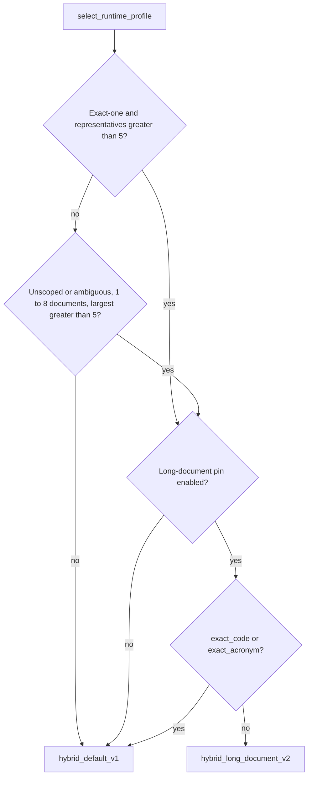

# ADR: Small-corpus long-document profile and channel-head pins

## Status

`accepted` on 2026-09-22. This extends eligibility for the already-frozen
`hybrid_long_document_v2` profile and adds channel-head pins to the rerank
pool. It does not change any frozen JSON or digest.

## Context

The 2026-09-22 known-answer-50 run (read-only join of stage IDs to
`app.document_chunks`) measured:

- Authorized corpus: 4 documents with 1015, 632, 164, and 3 search
  representatives. The gold document is the 1015-chunk one.
- Gold page fused rank: at most 5 on 31 questions, 6–12 on 11, 13–20 on 2,
  21–40 on 5, 41–100 on 1. The 19 questions at fused rank 6 or worse are
  the cap drops under `hybrid_default_v1` (`rerank_pool_size` 20,
  `rerank_max_per_document` 5, `document_quota` 2).
- Gold page dense rank: at most 3 on 41/50, at most 5 on 44/50, worst 23.
  BM25 held the gold page on 29/50.
- RRF (`rrf_k=60`, equal weights) ranks a chunk at dense 60 and BM25 60
  (`2/120 = 0.0167`) above a dense-only rank 1 (`1/61 = 0.0164`). `k11`,
  `k28`, and `k32` were dense rank 1 and fused rank 22–26.
- `hybrid_long_document_v2` (`rerank_max_per_document` 20, `document_quota`
  12) ran on 0/50 questions because eligibility required an exact-one title
  match, and none of the questions named the book.

## Decision

1. `SMALL_CORPUS_MAX_DOCUMENTS = 8`. When resolution is not exact-one, the
   caller can read between 1 and 8 current documents, and the largest
   authorized document has more than `RERANK_PER_DOCUMENT_LEGACY_CAP` (5)
   representatives, select `hybrid_long_document_v2` with reason
   `small_corpus_long_document`. Resolution stays `unscoped` or
   `ambiguous`. No version filter is applied.
2. Exact-one eligibility is unchanged (`long_document_eligible`). Trivial
   exact classes and an unfrozen pin still stay on `hybrid_default_v1`.
   `authorized_document_count` of 0 means unknown and never triggers the
   small-corpus rule.
3. `CHANNEL_HEAD_PIN = 5`. The first 5 dense IDs and the first 5 BM25 IDs
   that are also in the authorized fused list are pinned into the rerank
   pool. Pins bypass the per-document cap, count toward `pool_size`, keep
   fused order, and cannot add an ID outside `fused_ids`.

## Alternatives rejected

- Retune `rrf_k` or channel weights. Those values are frozen and a change
  needs a new ranked-ID qualification, not a known-answer patch.
- An adaptive per-document cap. It is fragile when the fused tail contains
  other documents and would retune the default profile's contract.
- A new frozen default profile. That needs a digest freeze. `v2` is
  already pinned.

## Consequences

- Cache keys already include `retrieval_profile_id`, so unscoped questions
  on a small corpus miss the default-profile cache and use
  `document_quota` 12 and `query_aware` excerpts.
- Pins may displace up to 10 fused-order IDs from a 20-slot pool.
- Large tenants (more than 8 authorized documents) keep today's default
  profile.

## Rollback

Set `SMALL_CORPUS_MAX_DOCUMENTS = 0` and `CHANNEL_HEAD_PIN = 0`. Both
revert to the previous behavior with no data change.

## Verification

Unit tests in `test_long_document_profile.py`, `test_source_scope.py`, and
`test_hybrid_rerank.py`. The known-answer-50 re-run is packet P7 of the
[KA50 accuracy repair plan](../../.cursor/plans/ka50_accuracy_repair_7e21c4d9.plan.md).

## Links

- [ADR-hybrid-long-document-profile.md](./ADR-hybrid-long-document-profile.md)
- [HYBRID_RETRIEVAL_CONTRACT.md](../retrieval/HYBRID_RETRIEVAL_CONTRACT.md)
