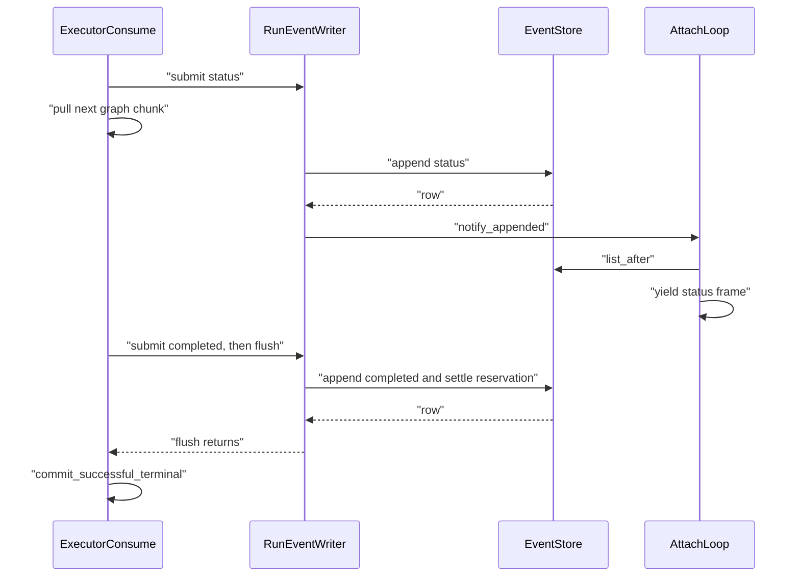

# ADR: SSE ordered background event writer

## Status

`accepted` on 2026-09-24, approved with the query latency repair plan
(deviation 1, latency packet L3).

## Context

LangGraph `astream` only advances when its consumer pulls the next chunk.
Before L3, `RunOrchestrationMixin._run_executor` awaited `_append_async`
for every executor draft. Each append is one event-store transaction:
about 254 ms over three network round trips to Supabase (measured
2026-09-24). A company-documents run has a median of 28 events, so
several seconds of every run were spent waiting for event writes while
the graph could not move.

## Decision

- One `RunEventWriter` per run (`smart_rag_api.services.sse.event_writer`).
  The executor calls `submit`; one background task persists drafts in
  submit order through the existing `_append_async`, so validation,
  sanitized-error replacement, attach wake-up, and reservation settlement
  are unchanged.
- After a terminal draft (`completed`, `partial`, `error`, `cancelled`)
  the executor awaits `flush`, so the terminal and everything before it
  are durable before `commit_successful_terminal` runs.
- The queue holds at most `EVENT_WRITER_MAX_PENDING` = 32 drafts. A full
  queue makes `submit` wait.
- An unexpected append exception stops the writer. Queued drafts after it
  are skipped, the next `submit` or `flush` re-raises it, and the existing
  `except Exception` path persists one sanitized `error` terminal.
- After a cancel request, queued non-terminal drafts are skipped, because
  `notify_cancel` has already persisted `cancelled`.
- Heartbeats keep their own direct `_append_async` path.



## Alternatives considered

- Keep awaiting every append. Simple, but every write stays on the
  graph's critical path.
- Batch several events into one transaction. Rejected:
  `app.append_run_event` has no idempotency key, so a commit with an
  unknown outcome could not be retried without duplicate events.
- One round trip per append (pipeline mode). Complementary, not a
  replacement: latency packet L4, run only if the L3 writer summaries show
  that writes still cost visible time.

## Consequences

- The executor learns about a non-terminal append failure at a later
  `submit` or `flush`, not at that append. Failures that `_append` already
  turns into `None` stay swallowed as before.
- Frames can lag the graph by up to the queue length.
  `app.run_events.created_at` is persist time, so stage durations in the
  latency report include writer lag; `wall_seconds` and `server_total_s`
  stay the primary latency metrics.
- A cancel skips queued non-terminal drafts, so a cancelled run can have
  fewer `status` rows than before. At most one in-flight draft can still
  land after `cancelled`, as before L3.
- `close` logs one `sse.writer_summary` line per run. The numbers are in
  the message text (`events`, `append_ms_p50`, `append_ms_max`,
  `lag_ms_max`, `flush_ms_max`) because the JSON log formatter does not
  print other `extra` fields.

## Security

No ACL or data change. Every append still goes through the owner-checked
`app.append_run_event` RPC as `app_api`. Logs carry the run id, counts,
timings, and exception type names only; never payloads, DSNs, or
exception text.

## Verification

```powershell
uv run python -m pytest tests/unit/test_query_sse_event_writer.py tests/unit/test_query_sse_lifecycle.py
```

## Rollback

Revert the L3 commit. No migration or data change is involved.

[ADR index](./README.md) · [SSE contract](../api/SSE.md)
