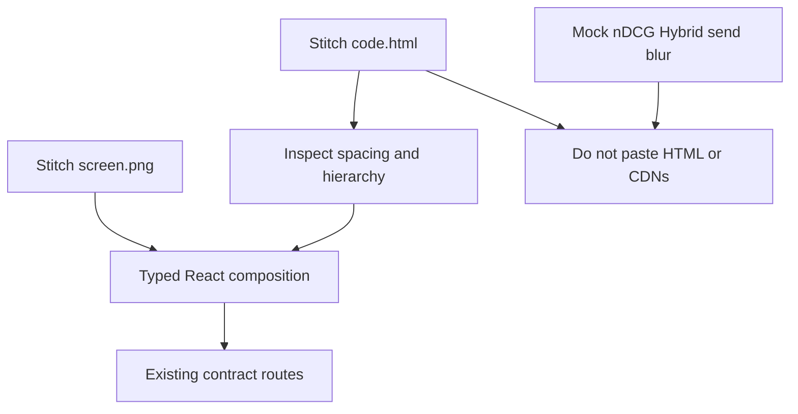

# ADR: Stitch-first production UX

## Status

`accepted` — 2026-08-20. The user asked to restore Google Stitch visual
fidelity and clarified that “template, not a layout” meant **do not add
unnecessary numbered-frame routes**, not **ignore the frames’ design**.
Polished contract-safe improvements are allowed.

## Context

Phase 7 Round 2 recorded the gitignored Stitch export as a template, not
product IA. Phase 8 implemented a component-system fallback that reused the
Phase 6 developer console. That produced a contract-correct but visually
unrelated UI. Reviewers and the user rejected that outcome.

Stitch `code.html` still cannot ship: Tailwind CDN, Google Fonts CDN,
Material Symbols, inline scripts, `innerHTML`, mock diagnostics, and
unsupported Hybrid/Combined send controls remain forbidden.

## Decision (accepted)

1. Each mapped `screen.png` is the **visual composition target** for its
   product route. Compare implementation to the image during development.
2. `code.html` may be inspected for spacing, hierarchy, and component
   intent. Reconstruct as typed React. Do not import the gitignored
   export, paste generated HTML, or add one route per frame number.
3. Preserve Auth, FastAPI, SSE, authorization, safe-text, and CSP
   contracts. Unsupported Stitch controls are omitted, read-only, or an
   honest unavailable state.
4. Normal user journeys must not show review fixtures, raw `GAP-*`
   identifiers, or backend implementation prose. Gap ids remain on
   dedicated `/unavailable/` pages and in tests/docs.
5. “Make it cooler” means better hierarchy, drawers, skeletons, empty
   states, and reduced-motion-safe motion. It does not mean fake data or
   new APIs.

Frame-to-route map: [VISUAL_MAP.md](../frontend/VISUAL_MAP.md).

## Alternatives considered

| Alternative | Why rejected |
| --- | --- |
| Keep Phase 8 fallback console | User rejected the UX |
| Port `code.html` | CSP, a11y, mocks, and security defects |
| One App Router folder per Stitch frame | User forbade unnecessary frames as IA |

## Consequences

- [STITCH_REVIEW.md](../frontend/STITCH_REVIEW.md) Round 3 supersedes the
  “ignore layout” reading of Round 2.
- Frontend tokens stay `#F8FAFC` / `#2563EB` / 8px / no blur.
- Visual regression is required at 1280×800 and 390×844.

## Rollback

Revert this ADR, Round 3 review language, and the Stitch-first frontend
commit set. Do not restore CDN HTML.

Related: [STITCH_BRIEF.md](../frontend/STITCH_BRIEF.md) ·
[DESIGN_SYSTEM.md](../frontend/DESIGN_SYSTEM.md) ·
[VISUAL_MAP.md](../frontend/VISUAL_MAP.md) ·
[docs index](../README.md)
