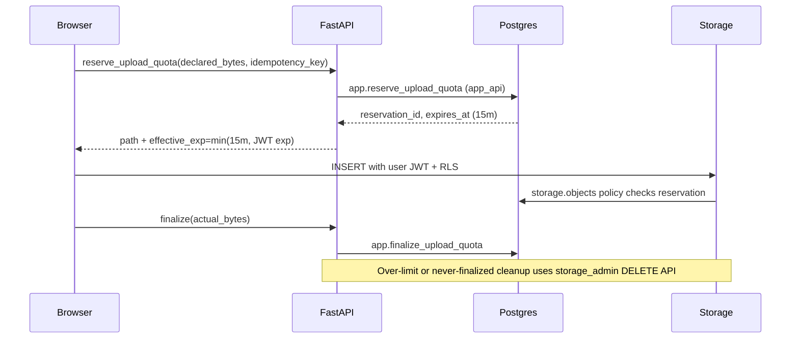

# ADR: Upload capability lifetime and Storage privilege boundary

## Context

Browser uploads need short-lived admission against durable per-user and company
quarantine byte caps. Supabase signed-upload tokens are often provider-fixed,
non-revocable, and longer than the desired 15-minute application lease. Worker
and admin Storage operations (list quarantine, delete, future move/copy) require
a broad credential; inventing a narrow Storage token the platform does not
provide is forbidden, and general runtime must never load `service_role`.

## Decision

1. **Browser quarantine upload mechanism:** user JWT + Storage RLS `INSERT` into
   private bucket `documents-quarantine` at path
   `{auth.uid()}/{reservation_id}/{safe_filename}`. Do **not** use
   `createSignedUploadUrl` for v1 admission.
2. **Application admission/quota reservation TTL:** provisional **15 minutes**.
3. **Effective capability lifetime label:**
   `min(reservation_expires_at, access_token_exp)`.
   Do **not** claim the 15-minute lease revokes a longer-lived JWT.
4. **Privileged Storage boundary:** isolate worker/admin Storage HTTP calls under
   `apps/backend/src/smart_rag_api/storage_admin/` with
   `PrivilegedStorageSettings` reading `SUPABASE_STORAGE_ADMIN_SECRET` only.
   Mirror the Auth Admin isolation pattern. Never load this secret through
   `SharedSettings`, frontend, general worker settings, or health handlers.
5. **Object deletion:** always via Storage HTTP API; never SQL delete of
   `storage.objects` metadata as a substitute for provider byte removal.

### Operation matrix

| Operation | Browser user JWT | API / worker database role | Isolated Storage Admin |
| --- | --- | --- | --- |
| List quarantine | Denied | Denied | Bounded API operation only |
| Read quarantine | Denied | Denied | Bounded API operation only |
| Insert quarantine | Own active reserved path only | Denied | Operational recovery only |
| Update / overwrite | Denied | Denied | Not implemented in Phase 2 |
| Delete | Denied | SQL metadata DML denied | Storage HTTP API only |
| Move / copy | Denied | Denied | Deferred until promotion implementation |
| Other private buckets | Denied | Denied | Exact bucket/path operation only |

## Consequences

- Quarantine remains non-browseable (no authenticated `SELECT` policy).
- Live local proof uploads and reads real bytes, deletes them through the
  Storage API, retries the missing-object response safely, and confirms the
  `storage.objects` row is gone. Arbitrary HTTP 400 responses remain failures;
  only the provider's explicit `not_found` / `NoSuchKey` envelope is idempotent.
- Contract tests prove SharedSettings/BackendSettings omit
  `SUPABASE_STORAGE_ADMIN_SECRET`.
- Phase 3 owns ClamAV/MIME/promotion; Phase 2 only provides scan schema and
  blocks fake `clean` inserts from non-worker roles.

## Related documents

- [ADR-privileged-auth-administration-boundary.md](./ADR-privileged-auth-administration-boundary.md)
- [08-data-dictionary.md](../architecture/08-data-dictionary.md)
- [phase-02-identity-data-evidence.md](../development/phase-02-identity-data-evidence.md)
