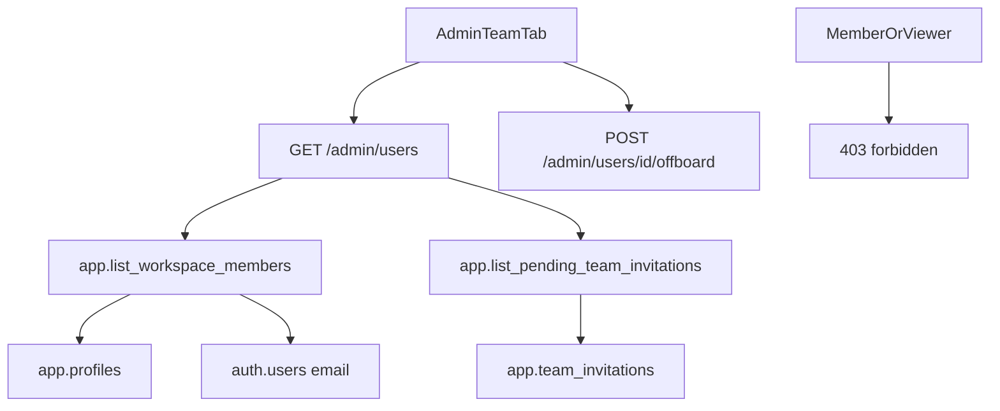

# ADR: Owner/admin workspace member list

## Status

`accepted` — 2026-08-27. The operator asked Team & access to show people in
the workspace so offboarding is not a bare UUID form.

## Context

P08-19 omitted a member directory because FastAPI had no list contract.
Offboard still required a known `user_id`. That made the Team tab unusable
for a real operator.

Membership already lives in `app.profiles`. Auth emails live in
`auth.users`. Invitations already live in `app.team_invitations`. This
change exposes those rows through a bounded owner/admin RPC rather than
inventing a second identity store.

## Decision

- Add `GET /admin/users` for owner/admin only.
- Authorize with live `CallerContext` plus SECURITY DEFINER RPCs
  `app.list_workspace_members` and `app.list_pending_team_invitations`.
- Return at most 200 members and 200 unaccepted invitations.
- Include email, role, upload flag, disabled timestamp, and user id.
  Never return invitation `token_hash` or Auth Admin secrets.
- Members and viewers receive 403. UI hiding remains convenience only.
- Offboard remains `POST /admin/users/{user_id}/offboard`. The table can
  fill that id; it does not add a new mutation.

## Consequences

- P08-19 “no member directory” is superseded for owner/admin product UI.
- Emails are untrusted text; the UI renders them with `UserText`.
- Last-owner offboard protection stays in the existing offboard path.
- Hosted Auth Admin list-users is not used; FastAPI never holds a browser
  service-role key for this read.

## Alternatives rejected

- Keep UUID-only offboard: rejected by the operator.
- Call GoTrue `GET /auth/v1/admin/users` from the browser: leaks the
  privileged Auth boundary.
- PostgREST `authenticated` select of `auth.users`: not granted and would
  bypass FastAPI rate limits.
