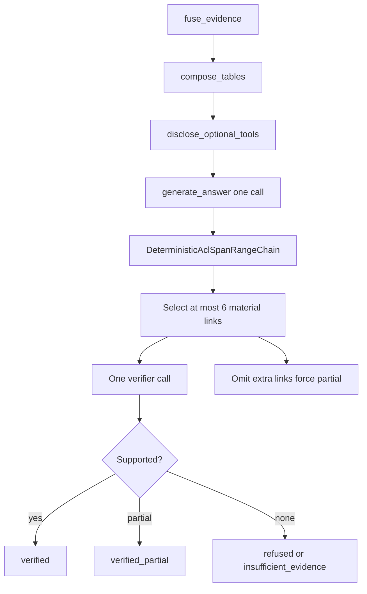
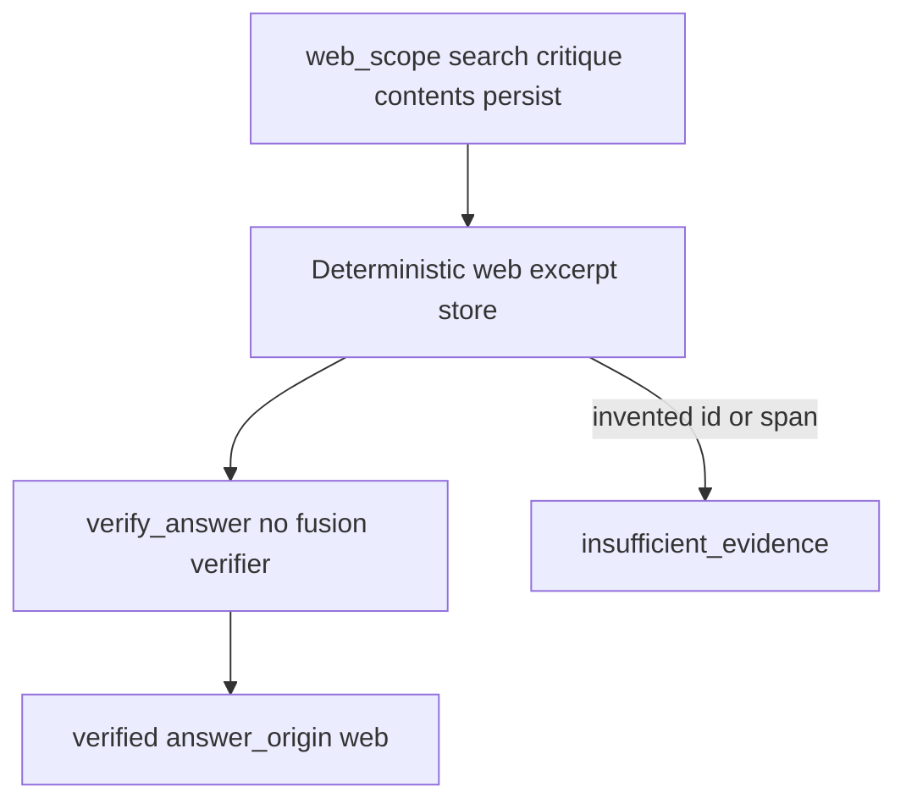

# Answer verification

Packet 3 generates **one** answer from canonical Supabase passages and
deterministic table values, then verifies citations in two layers.
Unsupported links are omitted or refused. They are never softened into
uncited claims. SSE and the public chat UI remain later packets.

Related: [COMBINED_FUSION.md](./COMBINED_FUSION.md) ·
[QUERY_ROUTING.md](./QUERY_ROUTING.md) ·
[QUERY_BUDGETS.md](./QUERY_BUDGETS.md) ·
[OPTIONAL_TOOLS.md](./OPTIONAL_TOOLS.md) ·
[phase-06 evidence](../development/phase-06-agent-intelligence-evidence.md) ·
[docs index](../README.md)

## Evidence the answer may use

- Canonical Hybrid/Combined `EvidenceUnit` / `ScoredPassage` citation text
  and locators.
- StructuredTable sandbox results with exact cell or range provenance.
- Run-scoped `app.web_sources` excerpts on the Web path only. Spans must
  be exact substrings of the persisted excerpt. Invented `web_source_id`
  values are dropped. Company `citations` stay empty on Web answers.
- Not native graph prose, BM25 snippets, unresolved paths, or numbers the
  model calculates from prose.

Source records are delimited as `<<untrusted-source>>`. Embedded
instructions stay inside the record.

## Multi-hop citations

Each atomic link cites at least one canonical passage or table range.
The composed conclusion is labeled `inference`. Wording is no stronger
than the supported path. The conclusion need not appear verbatim in one
passage. A chain whose every link is supported remains an inference.

## Layered verify

1. Deterministic checks: current source/version/ACL, citation-span or
   table-range alignment, inference-chain completeness.
2. One separately budgeted small-model call covering at most **six**
   material atomic links. Lower-priority claims are omitted. A seventh
   link does not trigger another call. When omitted IDs exist, answer
   status is forced `partial` and SSE surfaces `verifier_omitted_links`.
   Status must not remain `complete`.
3. Deadline or step exhaustion emits terminal `verified_partial` or
   `insufficient_evidence`. It is not fake success.
4. `verified` requires a non-null model gateway. Unbound gateway or
   unbound Hybrid on a retrieval route is `verified_partial` or
   `insufficient_evidence`, never `verified`. Citations with
   `chunk_id is None` are dropped unless `table_id` is in allowed table
   IDs.

Counted usage kinds are `answer` and `verifier` via
`execute_counted_model_call`, plus retrieve-time `embedding`, `rerank`,
and LightRAG consume against the same reservation. Keyword extract,
catalog LLM, and LightRAG `answer_generate` stay 0.

Empty `citation_text` cannot pass deterministic `complete`. Graph locators
load canonical `raw_text` through `fetch_authorized_chunk_context`; empty
text is dropped. Company `answer_v2` passage citations require an exact
1–1000 character span contained in canonical text. Empty spans are
legacy whole-passage only when paragraph mappings are not required.

Prompt versions: `answer_v2`, `answer_v1` (historical), `verifier_v1`,
`web_critique_v1`, and `web_answer_v1` under
`apps/agents/src/smart_rag_agents/prompts/`. Company hashes are
LF-normalized SHA-256 in `smart_rag_core.query_answer.versions`. Live
company answers derive `answer_text` from ordered paragraphs. Fusion
passages are never backfilled as citations.

## Graph nodes

After `apply_correction`:

Web: `web_scope` (search → critique → optional follow-ups → contents →
persist sources → draft) → `verify_answer` → END. Hold-until-verify:
`token_delta` is emitted only after verification.

Compile still constructs no sockets or OpenAI clients. Mock mode works
without network.

